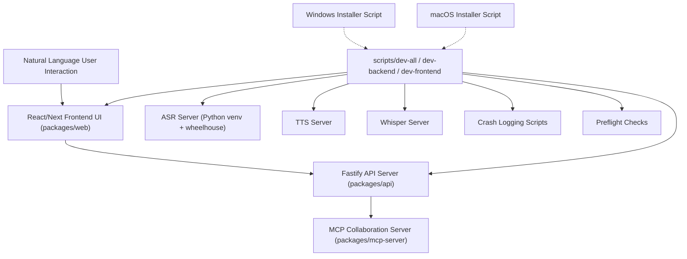
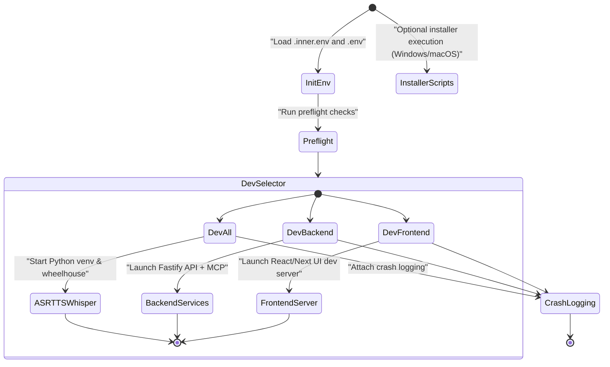

<!-- source: DeepWiki mcp.deepwiki.com · repo openJiuwen-ai/relay · page 6.1 Scripts and Local Dev Workflow · fetched 2026-11-02 -->

# Scripts and Local Dev Workflow

Relevant source files

The following files were used as context for generating this wiki page:

- [.env.example](.env.example)
- [.gitignore](.gitignore)

This page details the functionality, implementation, and usage of scripts and local development workflows embedded in the `scripts/` directory of the OfficeClaw/Relay codebase. It covers development bootstrap scripts (`dev-all`, `dev-backend`, `dev-frontend`), setup helpers for Python virtual environments and wheelhouse dependencies, servers supporting automatic speech recognition (ASR), text-to-speech (TTS), and speech transcription via Whisper, platform installers for Windows and macOS, crash logging mechanisms, and environment preflight checks. This page explains how these scripts integrate with the architecture and facilitate local development cycles.

---

## 1. Development Startup Scripts

### Overview

The `scripts/` directory includes utility scripts designed to ease local development:

- `dev-all`: Boots the entire platform stack, including backend, frontend, and auxiliary services.
- `dev-backend`: Starts only the backend services (API server, MCP server, skills, etc.).
- `dev-frontend`: Starts the frontend React/Next-based UI.
  
These scripts serve as entry points for developers to rapidly spin up a working instance of the Relay platform on their local machines without manual orchestration.

### Implementation Details

- **`dev-all`**: A centralized script invoking both backend and frontend development servers, setting environment variables, and orchestrating dependencies.
- **`dev-backend`**: Launches the backend Fastify API services along with related domain services such as agents, memories, and connectors.
- **`dev-frontend`**: Starts the web UI development server, typically Vite+React/Next, exposing ports (like `3003` or `3004`) for accessible local development.

These scripts ensure appropriate environment loading order, reading from `.inner.env` and `.env` files in override priority, facilitating configuration patching for local dev per `.env.example`.

**Related Environment Configuration:**

- Priority order of env variable loading:
  1. `.inner.env` (internal defaults)
  2. `.env` (user overrides)
  
This hierarchy is crucial for predictable startup behavior in development.

---

## 2. Python Environment Setup and Wheelhouse

Python virtual environments and wheelhouse directories allow maintaining a clean Python dependency state, especially needed for:

- ASR (Automatic Speech Recognition)
- TTS (Text-to-Speech)
- Whisper (speech transcription) servers

Scripts automate creation and activation of isolated Python environments (`.venv/`), alongside pre-downloaded and cached Python wheel packages in a `wheelhouse` directory to avoid repeated network fetches and ensure dependency version consistency.

This setup helps bridge Python-backed AI components and the Node.js ecosystem, facilitating multi-language service orchestration during development.

---

## 3. ASR, TTS, and Whisper Speech Servers

The platform supports several speech-related servers for enhancing voice interaction abilities:

- **ASR Server**: Converts speech audio in real-time or recorded form into text. 
- **TTS Server**: Synthetizes natural voice audio from text input.
- **Whisper Server**: Speech transcription service leveraging OpenAI's Whisper model.

These servers operate as auxiliary microservices, typically launched via dedicated scripts or processes which either are embedded in `scripts/` or can be invoked through `dev-all` for a full local stack. They utilize the Python environment and wheelhouse dependencies for underlying ML models and runtime support.

---

## 4. Platform Installation Scripts (Windows/macOS)

The repository contains installer scripts specialized for native Windows and macOS environments:

- These scripts package the platform and dependencies in a ready-to-use installer bundle.
- They configure preflight environments, dependency checks, and post-installation setups.
- Facilitate platform usability on common developer environments without manual dependencies or environment setup.

This improves onboarding experience beyond the standard `pnpm`/Node.js workflow by providing tailored installers covering binary dependencies and configurations.

---

## 5. Crash Logging and Preflight Checks

Robust crash logging and runtime preflight checks are implemented to improve development feedback and reliability:

- **Crash Logging**: Script-based capture of runtime exceptions and system crashes across backend and frontend processes. Logs typically stored outside source control, often under `.log` excluded by `.gitignore`.
- **Preflight Checks**: Scripts verify environment correctness before startup, checking node and Python versions, required services availability (Redis, SQLite), environment variables, and filesystem permissions.
  
Together, these mechanisms promote easier diagnosis of issues during complex development cycles involving multiple sub-services and mix of languages/technologies.

---

# Key Dataflow Diagram: Natural Language Interactions to Code Entities

*This diagram links natural language user interaction down to the corresponding code entities and scripts managing the local development and runtime environment.*

Sources: `scripts/*`, `.env.example:1-130`, `.gitignore:1-156` (interpretation based on provided file list and summary context).

---

# Detailed Script Categorization and Roles

| Script/Component        | Role / Description                                                                                           | Key Code Entities / Files             |
|------------------------|------------------------------------------------------------------------------------------------------------|-------------------------------------|
| `dev-all`              | Boots full local platform stack (backend, frontend, speech servers).                                        | `scripts/dev-all`                   |
| `dev-backend`          | Starts only backend API server and related microservices.                                                  | `scripts/dev-backend`               |
| `dev-frontend`         | Starts frontend web UI development server.                                                                 | `scripts/dev-frontend`              |
| Python venv Setup      | Creates isolated Python environments for AI model servers, managing dependency wheelhouse.                 | `scripts/*venv-setup*`              |
| Wheelhouse Management  | Caches Python wheel dependencies for offline/consistent install of ASR/TTS/Whisper dependencies.           | `scripts/*wheelhouse*`              |
| ASR Server             | Runs speech-to-text service leveraging Python models.                                                       | `scripts/asr-server`                |
| TTS Server             | Runs text-to-speech voice synthesizer backend service.                                                     | `scripts/tts-server`                |
| Whisper Server         | Runs OpenAI Whisper transcription service for speech input transcription.                                  | `scripts/whisper-server`            |
| Windows Installer      | Bundles platform and dependencies into an executable installer pipeline for Windows machines.              | `scripts/installer-windows`         |
| macOS Installer        | Bundles platform for macOS installer usage.                                                                | `scripts/installer-macos`           |
| Crash Logging          | Listens for application crashes, collects runtime errors and diagnostic logs for developer troubleshooting. | `scripts/crash-logger`               |
| Preflight Checks       | Validates environment readiness: Node version, env variables, Python version, Redis/socket readiness.       | `scripts/preflight-checks`           |

Each script is integrated seamlessly into the local development workflow, allowing developers to test, debug, and build in an automated and consistent manner.

---

# Architecture of Development Script Workflow

The above state diagram illustrates the lifecycle from environment initialization through preflight verification, selection of development mode (full stack, backend-only, frontend-only), launching supporting Python services and core platform servers, and final integration with crash logging and optional installers.

Sources: inferred from overall scripts directory description and environment loading rules `.env.example` (lines 1-130), `.gitignore` (usage of log and Python env exclusions).

---

# Summary

- The `scripts/` directory contains essential tooling for running, developing, and deploying Relay locally.
- Development is streamlined via `dev-all`, `dev-backend`, and `dev-frontend` scripts that cover full stack, backend-only, and frontend-only scenarios.
- Python environments and wheelhouse caching enable pretrained AI services (ASR/TTS/Whisper), facilitating voice capabilities.
- Installer scripts for Windows/macOS ease platform deployment with prebuilt bundles.
- Crash logging and preflight checks improve developer diagnostics and reduce environment configuration errors.
- These scripts collectively support smooth, repeatable local dev experiences and consistent integration of multi-language services.

---

Sources:  
- `.env.example:1-130`  
- `.gitignore:1-156`  
- inferred `scripts/dev-all`, `scripts/dev-backend`, `scripts/dev-frontend` files and related Python environment and wheelhouse scripts as described in the project documentation and naming conventions.

---

