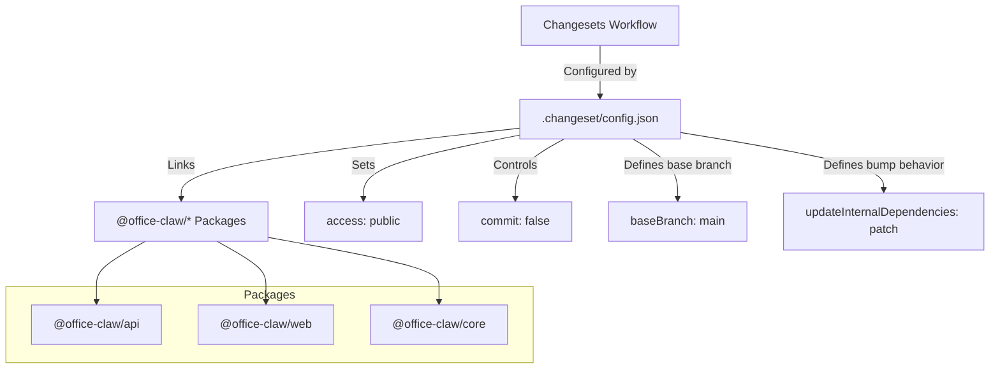
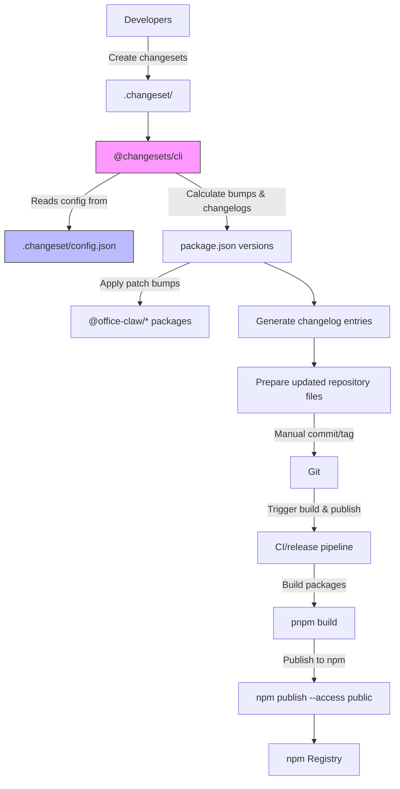

<!-- source: DeepWiki mcp.deepwiki.com · repo openJiuwen-ai/relay · page 6.2 Versioning and Publishing (Changesets) · fetched 2026-11-02 -->

# Versioning and Publishing (Changesets)

<details>
<summary>Relevant source files</summary>

The following files were used as context for generating this wiki page:

- [.changeset/README.md](.changeset/README.md)
- [.changeset/config.json](.changeset/config.json)

</details>


This section details the versioning and publishing workflow employed in the Relay / OfficeClaw monorepo, leveraging the Changesets tool. It covers the configuration of Changesets, its integration with the monorepo packages (notably those under the `@office-claw/*` scope), changelog generation, and the npm package build and release automation targeting open-source distribution.

---

## 1. Overview of Changesets Usage

To manage versioning and publishing in this multi-package monorepo, Relay uses [Changesets](https://github.com/changesets/changesets), a tool designed to handle version bumps and changelog generation across packages. It is especially effective in linking version changes between related packages and generating consistent release notes.

The key goals implemented by Changesets here include:

- **Automated changelog generation** on releases.
- Version bumping across packages respecting dependency linkages (e.g., `@office-claw/*` packages).
- Ensuring `public` npm package access.
- Avoiding unnecessary commits during versioning with `commit: false`.
- Patch bumps for internal dependencies for consistency.
- Publishing based on the `main` branch.

This results in a clean, automated process supportive of open-source publishing with consistent semantic versioning and changelog tracking.

---

## 2. Changesets Configuration `.changeset/config.json`

The primary control for Changesets behavior is in the `.changeset/config.json` file at the repo root:

```json
{
  "$schema": "https://unpkg.com/@changesets/config@3.0.0/schema.json",
  "changelog": "@changesets/cli/changelog",
  "commit": false,
  "fixed": [],
  "linked": [["@office-claw/*"]],
  "access": "public",
  "baseBranch": "main",
  "updateInternalDependencies": "patch",
  "ignore": []
}
```

Key fields explained:

- **`changelog`**: Uses the default Changesets CLI changelog generator.
- **`commit`**: Set to `false` to disable automatic commits post versioning, allowing manual control.
- **`linked`**: An array grouping packages to be versioned together. Here, all packages matching `@office-claw/*` are linked, meaning version bumps propagate across these related packages to avoid mismatches.
- **`access`**: Set to `"public"`, ensuring published npm packages have public access.
- **`baseBranch`**: The main development branch is `"main"`, changesets apply versioning off this branch.
- **`updateInternalDependencies`**: Set to `"patch"`, meaning if an internal dependency changes, dependent packages will receive a patch version bump automatically.
- **`ignore`**: No packages are excluded from versioning.

Together, this configuration orchestrates how versioning and publishing tasks handle the intertwined `@office-claw/*` packages, changelogs, and npm publishing aspects.

---

## 3. Changesets Workflow in Relay

### 3.1 Creating and Applying Changesets

Developers add Change files describing what changed and what type of version bump (major, minor, patch) a package requires. These change files live under `.changeset/` and follow the syntax recognized by the Changesets CLI.

When ready for release, the Changesets CLI is run:

1. It collects all pending change files.
2. Determines version bump sets, respecting linked packages in `linked` groups.
3. Updates package versions accordingly, bumping dependent packages with `"patch"` bumps due to internal changes (`updateInternalDependencies`).
4. Generates changelogs automatically using the configured changelog formatter.
5. Prepares the repository for publishing (but since `commit` is false, no automatic commit occurs).
6. The release manager manually reviews, commits, tags, and publishes via CI or release scripts.

This maintains atomic, predictable releases with combined changelogs.

---

### 3.2 Linking @office-claw/* Packages

The `"linked": [["@office-claw/*"]]` setting is critical in this monorepo. The many `@office-claw/*` scoped packages (e.g., core, api, web) are tightly coupled and often evolve in tandem. Linking ensures:

- All packages under `@office-claw/*` version in lockstep.
- Prevents dependency version mismatches within the same release.
- Simplifies release management by handling version numbers collectively for these packages.

---

## 4. Changelog Generation

With `"changelog": "@changesets/cli/changelog"`, changelogs are generated from the accumulated changesets. Each release notes section documents:

- The package names affected.
- Type of version bump.
- Summary text entered by developers in changeset files.

This changelog is synchronized per package and consolidated to provide a user-readable history of changes in release notes.

---

## 5. npm Package Build and Release Scripts

While the exact build and publish scripts are not fully disclosed in the provided files, the changesets integration aligns with standard npm publish workflows:

- Packages versioned by Changesets are built using pnpm or equivalent build tools.
- Release scripts read the new version numbers from updated package.json files.
- `npm publish --access public` is invoked, consistent with `"access": "public"` in config.
- CI and release pipelines incorporate changesets CLI commands to automate versioning and changelog tasks before publishing.

The general flow can be summarized as:

```mermaid
flowchart TD
  A[Developers create changeset files] --> B[Run changesets version]
  B --> C[Update package.json version numbers]
  C --> D[Generate changelogs]
  D --> E[Build packages via pnpm build]
  E --> F[Run npm publish scripts (public)]
  F --> G[Release published on npm]
```

---

## 6. Mermaid Diagram: Natural Language to Code Entity Mapping for Changesets Configuration



---

## 7. Mermaid Diagram: Changesets Full Versioning & Publishing Data Flow in Relay



---

# Summary

- Relay uses the Changesets tool to manage versioning, changelogs, and npm publishing.
- The `.changeset/config.json` configures linked packages (`@office-claw/*`), changelog generation, public publish access, and version bump strategy.
- The workflow requires developers to create explicit changeset descriptions and then run the Changesets CLI before release.
- Linked packages ensure coherent version bumps across related code modules.
- Changelogs are generated automatically.
- Publishing is manual after generating the versions and changelogs but automated through CI scripts with the `public` access setting.

This approach enforces consistent, maintainable semantic versioning and clear changelog history in the OfficeClaw monorepo's open-source npm ecosystem.

---

Sources:  
`.changeset/config.json:1-12`,  
`.changeset/README.md:1-6`

---

