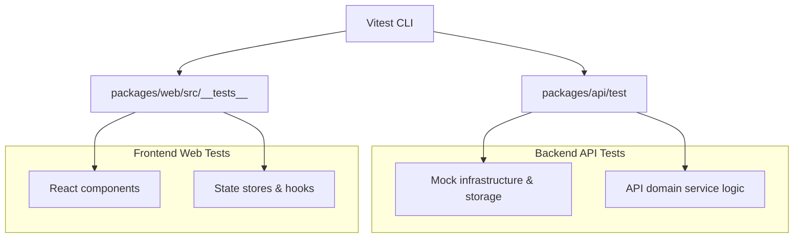
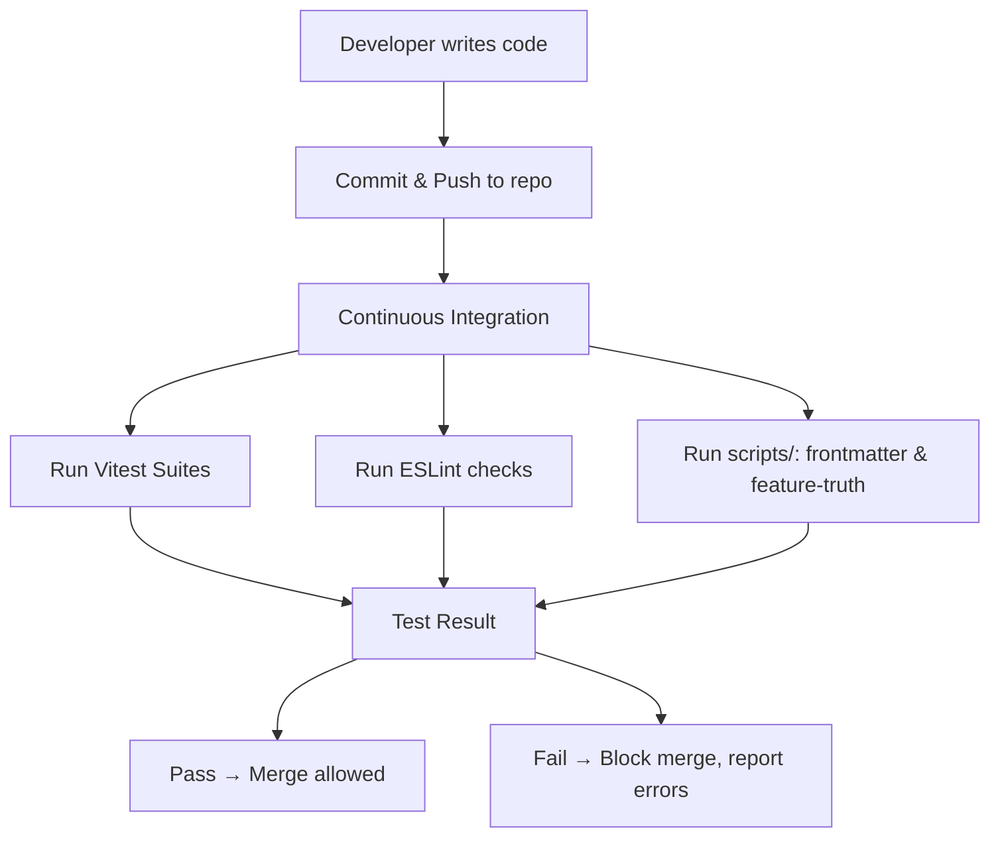

<!-- source: DeepWiki mcp.deepwiki.com · repo openJiuwen-ai/relay · page 6.3 Testing and Quality Gates · fetched 2026-11-02 -->

# 6.3 Testing and Quality Gates

Relevant source files

The following files were used as context for generating this wiki page:

- [OPEN SOURCE SOFTWARE NOTICE.md](OPEN SOURCE SOFTWARE NOTICE.md)
- [karpathy-guidelines.md](karpathy-guidelines.md)

This section details the testing strategy and quality gate mechanisms implemented in the Relay codebase. It covers the usage of Vitest testing suites for both backend and frontend packages, strategies for mock data and audit-log testing, document and frontmatter verification scripts, and the ESLint configuration that enforces code style and quality.

---

## Overview and Purpose

Testing and quality gates in Relay ensure software correctness, maintainability, and adherence to standards before code integration and release. The approach spans multiple layers:
- Automated unit and integration tests using Vitest for API and Web packages
- Mocks and audit-log specific test suites for domain validation
- Scripts for doc consistency, frontmatter and feature-truth checking
- ESLint for static code quality and style enforcement

This comprehensive strategy supports the rapid development of a large monorepo with multiple packages and a shared infrastructure, guaranteeing reliability and reducing regressions.

---

## 1. Vitest Testing Suites

Relay employs [Vitest](https://vitest.dev/), a Vite-native, fast testing framework for JavaScript/TypeScript, running tests primarily in two areas:

### 1.1 Backend API Testing (packages/api/test)

- Location: `packages/api/test`
- Purpose: Verify Fastify backend domains, routes, services and business logic.
- Scope: Includes domains such as agents, memory, projects, skills, scheduler, connector layers, and the core persistence logic.
- Test types: Unit and integration tests covering route handlers, domain service methods, and storage providers.
- Uses extensive mocking to isolate domain logic from infrastructure (e.g. mocking DB or external service calls).

### 1.2 Frontend Web Testing (packages/web/src/__tests__)

- Location: `packages/web/src/__tests__`
- Focus: Testing React components, hooks, stores, and frontend service abstractions.
- Targets UI units like chat message rendering, thread sidebar, agent panels, and common frontend utilities.
- Tests ensure stable UI logic and state transition correctness with fast in-memory rendering.

### Test Execution Flow Diagram

---

## 2. Mocks and Audit-Log Testing

Mocks simulate complex external dependencies, enabling controlled tests for core domain logic without external side effects.

- Audit-log tests evaluate the correctness and completeness of event logging mechanisms in agent orchestration.
- These tests confirm important user and system activities are logged appropriately for traceability and degradation policies.
- Audit log service classes and methods are tested to verify event classification and persistence behavior.

---

## 3. Document Frontmatter and Feature-Truth Consistency Checks

Located in the `scripts/` directory, specialized scripts statically analyze skill packs, documentation, and feature metadata:

- **Frontmatter Checks**: Validate YAML frontmatter in markdown docs contains required keys, consistent formatting, and correct references.
- **Feature-Truth Checks**: Verify that declared features in config files match implementations and documentation.
- These scripts help maintain integrity across multi-skill knowledge encapsulations and prevent doc drift.

---

## 4. ESLint Configuration

- ESLint is configured project-wide to enforce coding conventions, prevent common errors, and maintain stylistic consistency.
- Rules are strict to prevent type errors, enforce imports, and avoid unused variables or unreachable code.
- This acts as a quality gate during CI checks, ensuring no lint errors are merged.

---

## Data Flow of Testing and Quality Gates

---

## Key Classes and Functions

- **Vitest Setup**: Testing harness configurations per package contain setup files registering mocks and test utilities.
- **AuditLogService** (in API domain): Manages event logging, tested for event triggering and persistence behaviors.
- **DocChecker scripts** (in `scripts/`): Command-line utilities to parse markdown frontmatter and verify feature documentation.
- ESLint config files: Centralize lint rule sets used by both API and Web packages.

---

## Summary

Relay uses an integrated testing and quality gate system comprising backend and frontend Vitest tests, audit log verification, documentation consistency scripts, and ESLint static analysis. These mechanisms collectively ensure code correctness, traceability, and maintain high code quality standards suitable for the complex multi-package monorepo structure.

---
### Sources:
- packages/api/test/
- packages/web/src/__tests__/
- scripts/
- ESLint configs (implied)
- AuditLogService and domain test files referenced generally for domain audit tests

---

