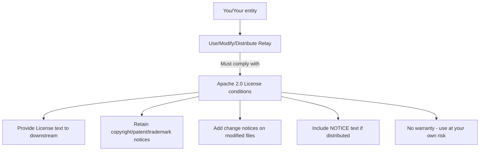
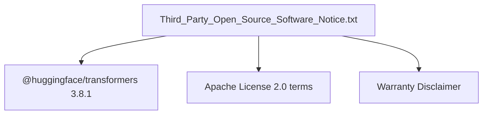
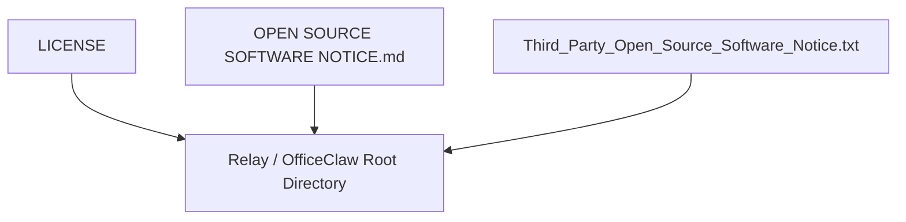
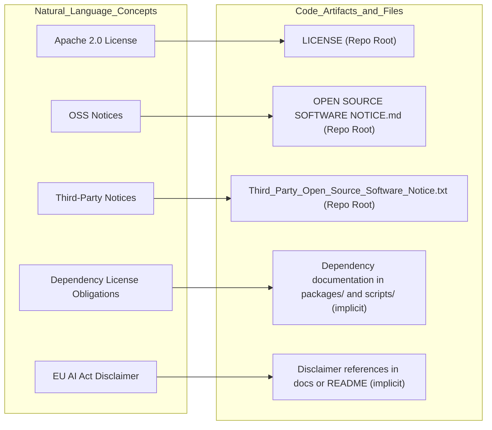
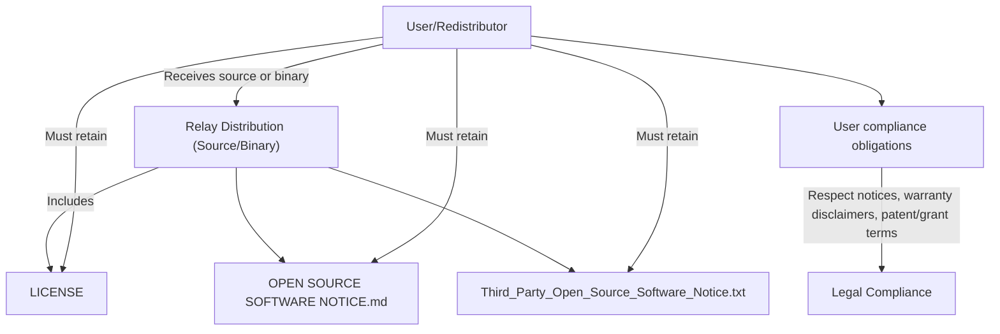

<!-- source: DeepWiki mcp.deepwiki.com · repo openJiuwen-ai/relay · page 6.4 Licensing and Compliance · fetched 2026-11-02 -->

# 6.4 Licensing and Compliance

<details>
<summary>Relevant source files</summary>

The following files were used as context for generating this wiki page:

- [LICENSE](LICENSE)
- [OPEN SOURCE SOFTWARE NOTICE.md](OPEN SOURCE SOFTWARE NOTICE.md)
- [Third_Party_Open_Source_Software_Notice.txt](Third_Party_Open_Source_Software_Notice.txt)

</details>


This section documents the licensing terms, compliance obligations, and notices relating to the usage and distribution of the Relay / OfficeClaw codebase and its dependencies. The project is governed under the Apache-2.0 License with accompanying open source software acknowledgements and third-party notices. Additionally, we address dependency licensing obligations and provide a disclaimer relevant to the EU AI Act.

---

## 6.4.1 Apache-2.0 License Overview

Relay / OfficeClaw is distributed under the Apache License, Version 2.0, January 2004. This is a permissive open source license that allows users to use, modify, and distribute the software under certain conditions.

Key points of the Apache-2.0 license include:

- **Copyright License Grant:** A perpetual, worldwide, non-exclusive, royalty-free license to reproduce, prepare derivative works, publicly display and distribute the software.  
- **Patent License Grant:** A similar royalty-free patent license to make, use, sell, and distribute the software and derivative works.  
- **Redistribution Requirements:**  
  - You must provide recipients a copy of the license.  
  - Modified files must carry prominent notices stating changes.  
  - Retain all copyright, patent, trademark, and attribution notices.  
  - Include any NOTICE text file and its contents when redistributing.  
- **No Warranty:** The software is provided "as is," without warranty of any kind, either express or implied.

The full Apache-2.0 license terms are attached in the root-level `LICENSE` file of the repo.  

Below is a high-level outline of the license flow relevant to this project:



Sources: LICENSE:1-130()

---

## 6.4.2 Open Source Software Notice

Relay / OfficeClaw includes third-party open source software provided under their respective licenses. The project provides comprehensive open source software notices that cover included third-party packages and dependencies.

An example excerpt from the `OPEN SOURCE SOFTWARE NOTICE.md` includes:

- Notice that open source software licenses prevail over other license terms for included software components.  
- Warranty disclaimer consistent with Apache-2.0 and other OS licenses.  
- A listing of key third-party software components with names and versions (e.g., puppeteer 24.37.2, web-push 3.6.7, etc.) used in the project.  
- Included Apache-2.0 license text reflecting the license under which these components are used.

This document helps users understand their rights and obligations with respect to third-party open source software incorporated in Relay.

```mermaid
graph LR
  OSS_Notice["OPEN SOURCE SOFTWARE NOTICE.md"] --> includes( "Includes Third-Party Packages" )
  includes -->|Examples| pkg1["puppeteer 24.37.2"]
  includes --> pkg2["web-push 3.6.7"]
  includes --> pkg3["sharp 0.34.5"]
  includes --> pkg4["node-sdk 1.59.0"]
  includes --> pkg5["typescript 5.3.3"]
  OSS_Notice --> warranty["Warranty Disclaimer"]
  warranty --> disclaimer["No warranty, as is"]
  OSS_Notice --> license_text["Apache 2.0 License Text"]
```

Sources: OPEN SOURCE SOFTWARE NOTICE.md:1-39()

---

## 6.4.3 Third-Party Open Source Software Notices and Obligations

Similar to the OSS Notice, an extended file `Third_Party_Open_Source_Software_Notice.txt` provides additional attributions and license texts for included third-party software, for example:

- `@huggingface/transformers` version 3.8.1  
- Re-affirmation of Apache-2.0 license terms and conditions for such software.

The file also includes legal disclaimers and reiterates license terms according to Apache-2.0. This notice is primarily included for legal compliance and transparency regarding the origin and licensing of third-party dependencies.



Sources: Third_Party_Open_Source_Software_Notice.txt:1-123()

---

## 6.4.4 Dependency License Compliance and Obligations

Relay / OfficeClaw uses various open source dependencies with different licensing terms, often permissive licenses like Apache 2.0. 

The project’s compliance approach includes:

1. **Inclusion of Notices:** The OSS Notices and Third-Party notices explicitly list all notable third-party packages by name and version alongside their license texts. This allows transparency.  
2. **License Text Retention:** Copies of the license text for dependencies like `puppeteer`, `@huggingface/transformers`, `web-push`, `sharp`, and others are included verbatim to satisfy redistributable obligations.  
3. **Redistribution Compliance:** When Relay redistributes any derived or modifed form of third-party software, the license terms require Relay to retain all requisite notices, attribution, and provide copies of license terms.  
4. **Source Code Modifications:** If Relay modifies any third-party code under Apache-2.0, prominent notices of changes must be added.  
5. **No Warranty Claims:** Both Relay and its users operate under the understanding that such open source dependencies are provided without warranty.

This careful documentation and inclusion of notices fulfills typical open source compliance requirements and mitigates license risk.

---

## 6.4.5 EU AI Act Disclaimer

Given the nature of Relay / OfficeClaw as a multi-agent AI collaboration platform that may integrate AI models and agents, it is prudent to consider compliance with regulatory frameworks such as the European Union AI Act.

Relay includes a general disclaimer that:

- The software is provided "as is" without guarantees or warranties regarding compliance with the EU AI Act.  
- Users and operators are responsible for ensuring that any deployment or usage of Relay complies with applicable legal and regulatory requirements related to AI systems.  
- Relay may incorporate AI models and skills which themselves may have separate licensing or compliance constraints.

This disclaimer serves to clarify that responsibility for regulatory compliance lies with the users/operators, and Relay itself does not promise or certify compliance.

---

## 6.4.6 Codebase and Documentation Locations for Licensing and Compliance

- The **Apache-2.0 License** text resides in the root `LICENSE` file.  
- The **Open Source Software Notice** is located at the root as `OPEN SOURCE SOFTWARE NOTICE.md`.  
- The **Detailed Third-Party Notice** is contained in `Third_Party_Open_Source_Software_Notice.txt` in the root directory.  

Related tooling and documentation sources in the Monorepo:



This structure reflects best practices of keeping license and compliance documentation at the repository root for discoverability.

Sources: LICENSE:1-130(), OPEN SOURCE SOFTWARE NOTICE.md:1-39(), Third_Party_Open_Source_Software_Notice.txt:1-123()

---

## 6.4.7 Natural Language Space to Code Entity Space Mapping

The following two diagrams bridge the high-level "Licensing and Compliance" natural language concepts to relevant codebase artifacts and files.

### Diagram 1: License and Compliance Natural Concepts to Files and Artifacts



### Diagram 2: Licensing Workflow and Compliance Data Flow



---

## Summary

- Relay / OfficeClaw is licensed under the Apache License, Version 2.0, providing permissive use with standard obligations.  
- Open source notices and third-party notices are included for dependencies, listing software components and their licenses.  
- Redistribution requirements include careful retention and presentation of license texts and attribution notices.  
- Warranty is disclaimed consistent with Apache-2.0 and other OSS licenses.  
- An explicit disclaimer places responsibility for EU AI Act compliance on users/operators of the platform.  
- Licensing and compliance documents are present clearly at the root of the repo for ease of access and compliance auditing.

This ensures that the project satisfies open source best practices and provides transparency on rights, obligations, and legal conditions for all users and contributors.

---

Sources:  
LICENSE:1-130()  
OPEN SOURCE SOFTWARE NOTICE.md:1-39()  
Third_Party_Open_Source_Software_Notice.txt:1-123()

---

