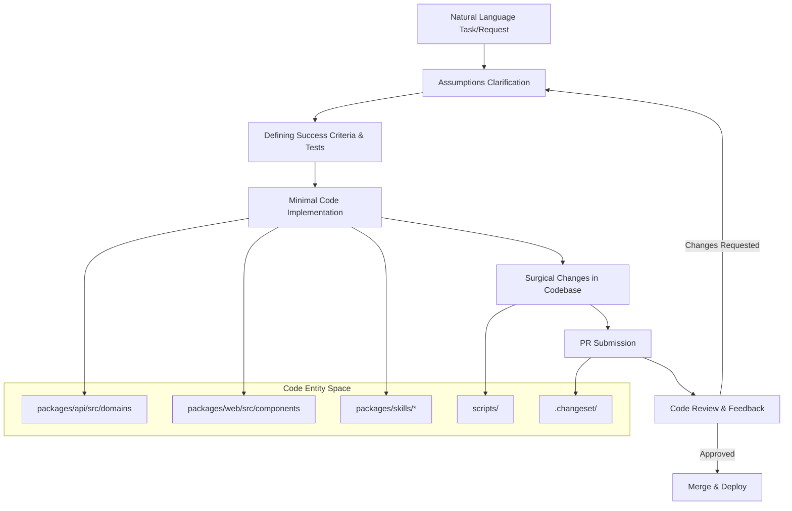

<!-- source: DeepWiki mcp.deepwiki.com · repo openJiuwen-ai/relay · page 6.5 Engineering Guidelines · fetched 2026-11-02 -->

# Engineering Guidelines

<details>
<summary>Relevant source files</summary>

The following files were used as context for generating this wiki page:

- [karpathy-guidelines.md](karpathy-guidelines.md)

</details>


This page details the engineering guidelines prescribed for contributing to the Relay / OfficeClaw codebase. These guidelines are primarily sourced from the karpathy-guidelines.md document and define coding and collaboration conventions aimed at improving code quality, minimizing mistakes, and streamlining development workflow. The practices emphasize careful thinking, simplicity, surgical edits, and goal-driven programming, shaping how contributors approach design, implementation, and reviews.

---

## 1. Purpose and Scope

The Engineering Guidelines define behavioral rules and conventions that reduce common mistakes especially around contributions involving Large Language Model (LLM) coding and general software engineering. They establish a disciplined process favoring thoughtful, minimal, and verifiable changes. All contributors are expected to read and adhere to these conventions to ensure code quality, maintainability, and ease of collaboration.

The guidelines are advisory but are strongly encouraged to be merged with any project-specific instructions during contribution discussions and code reviews.

Sources: karpathy-guidelines.md:1-65()

---

## 2. Core Principles

### 2.1 Think Before Coding

- **Explicit assumptions:** Never assume details — always state your assumptions explicitly before proceeding with implementation.
- **Clarify ambiguity:** When multiple valid interpretations exist, list all alternatives rather than silently choosing one.
- **Avoid speculation:** Propose simpler alternatives if available and push back against unnecessary complexity.
- **Surface confusion early:** If something is unclear, do not proceed blindly. Name the confusing part and ask for clarity.

This principle ensures issues and design tradeoffs are recognized early, preventing costly rewrites or bug fixes later in the development cycle.

### 2.2 Simplicity First

- **Minimal code:** Write the minimum amount of code necessary to solve the problem.
- **No speculative features:** Avoid adding features, abstractions, or configurations that were not explicitly requested.
- **No error handling for impossible scenarios:** Handle only expected and probable errors.
- **Refactor to reduce length:** If the implementation is longer than needed (e.g., 200 lines instead of 50), simplify it.

The guiding question is: *“Would a senior engineer consider this code overcomplicated?”* If yes, simplify it immediately.

### 2.3 Surgical Changes

- **Modify only what is necessary:** Do not attempt to improve unrelated adjacent code or comments.
- **Respect existing style:** Match the coding style and conventions of the code around the changes, even if suboptimal.
- **Avoid refactoring "just because":** Only refactor what is broken or directly affected by your change.
- **Dead code management:** Remove dead code only if your edits make it newly unused; do not remove pre-existing dead code without explicit instruction.
- **Traceability:** Every changed line must be directly linked to the user request or task.

This approach reduces diff noise, avoids introducing unrelated changes, and enables clean code history.

### 2.4 Goal-Driven Execution

- **Define verifiable success criteria:** Before writing code, clearly specify the goal in terms that are testable.
- **Transform vague tasks into measurable objectives:** For example:
  - Instead of "Add validation," say "Write tests for invalid inputs, then make them pass."
  - Instead of "Fix the bug," say "Write a failing test reproducing the bug, then fix it and verify."
- **Plan multi-step tasks explicitly:**
  ```
  1. [Step] → verify: [check]
  2. [Step] → verify: [check]
  3. [Step] → verify: [check]
  ```
  
This iterative and feedback-driven approach ensures robustness and facilitates independent developer progress without frequent clarifications.

---

## 3. How These Guidelines Shape Contributions

Contributions undergo code review to ensure compliance with these guidelines. The typical flow looks like:

```mermaid
flowchart LR
  "Feature_Request_or_Bug" --> "Review_Assumptions_&_Success_Criteria"
  "Review_Assumptions_&_Success_Criteria" -->|Clarifications| "Discussion"
  "Review_Assumptions_&_Success_Criteria" -->|Clear| "Implementation"
  "Implementation" --> "Write_Minimal_Code"
  "Write_Minimal_Code" --> "Make_Surgical_Changes"
  "Make_Surgical_Changes" --> "Define_Tests_and_Verification"
  "Define_Tests_and_Verification" --> "Submit_PR"
  "Submit_PR" --> "Code_Review"
  "Code_Review" -->|Request_Changes| "Discussion"
  "Code_Review" -->|Approve| "Merge"
```

Notes:
- Before writing code, assumptions and success criteria are discussed and clarified.
- The implementation is minimal and surgical, touching only necessary lines.
- Tests are defined and verify all success criteria.
- Feedback loops via review ensure compliance and code quality.

---

## 4. Relation to the Codebase

While the guidelines are general, they have direct implications on development practices across multiple packages and modules:

- **API Server (packages/api):** Route handlers and domain services maintain minimal, clear logic, avoiding speculative flexibility.
- **Web Frontend (packages/web):** React components and state stores adhere to surgical changes preserving UI performance and code clarity.
- **Skills System:** Skill packs are authored with minimal abstractions and clear success criteria for vetting.
- **Shared Libraries (packages/shared, core, mcp-server):** Definitions and extension points follow explicit interfaces without speculative features.
- **Build and Tooling (scripts/, changeset configs):** Release scripts and dev tools evolve through clearly defined steps and tests.
  
Engineering decisions in each code area reflect these grain rules, which must always be kept in mind when contributing.

---

## 5. Visualizing the Guidelines in the Contribution Lifecycle

This diagram maps natural language concepts of the guidelines to concrete code entities and steps, bridging intention to implementation.



- Tasks start in natural language with assumptions and success criteria defined.
- Minimal implementation occurs in domain services, React components, or skills modules.
- Surgical code edits and scripts adjust build, test, and release artifacts.
- Changeset files capture versioning tied to reviewed PRs.

---

## 6. Summary Table of Engineering Guideline Principles

| Principle          | Key Behavior                             | Impact on Code/Process                |
|--------------------|----------------------------------------|-------------------------------------|
| Think Before Coding | Explicit assumptions and questions     | Clear design decisions before coding|
| Simplicity First    | Minimum code, no speculation            | Lean, maintainable code              |
| Surgical Changes    | Small, focused edits                    | Cleaner history, less side effects  |
| Goal-Driven Execution| Define testable success criteria       | Verifiable, reproducible progress   |

---

# Appendix: Extract of Karpathy Guidelines (Most Relevant Points)

```markdown
1. Think Before Coding
- State assumptions explicitly.
- Surface tradeoffs and ask if unclear.

2. Simplicity First
- Minimum code solving the problem.
- No feature creep, abstractions, or impossible error handling.

3. Surgical Changes
- Touch only what you must.
- Match existing style.
- Remove dead code only if newly dead.

4. Goal-Driven Execution
- Define verifiable success criteria.
- Write tests that verify bugs/features before fixing/implementing.
```

Sources: karpathy-guidelines.md:1-65()

---

This page codifies the engineering guidelines that ensure Relay / OfficeClaw evolves with precision, clarity, and minimal technical debt. Contributors who internalize and apply these practices contribute to the project’s long-term health and developer experience.

---

