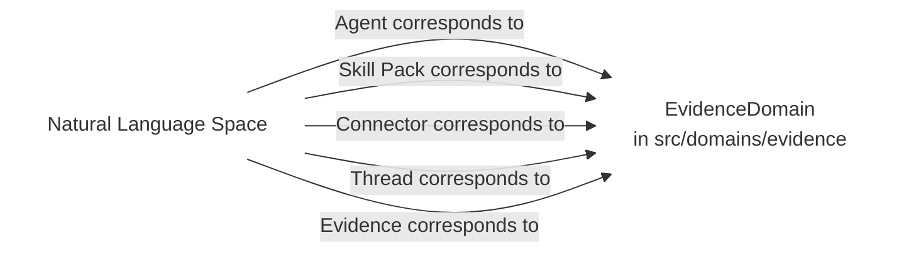
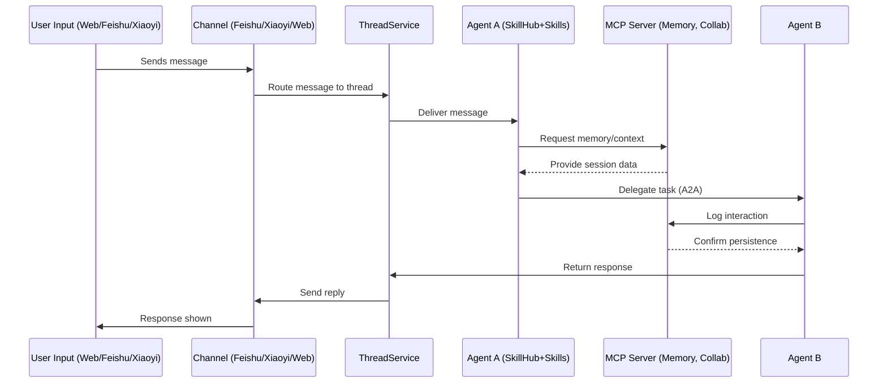

<!-- source: DeepWiki mcp.deepwiki.com · repo openJiuwen-ai/relay · page 7 Glossary · fetched 2026-11-02 -->

# 7. Glossary

Relevant source files

The following files were used as context for generating this wiki page:

- [.env.example](.env.example)
- [.inner.env](.inner.env)
- [README.md](README.md)
- [README_zh.md](README_zh.md)
- [office-claw-skills/manifest.yaml](office-claw-skills/manifest.yaml)

This glossary defines the key terms, concepts, and components specific to the Relay / OfficeClaw codebase. Each entry includes explanations of the term’s role in the platform, relevant implementation details, important classes or functions, and pointers to source files where these concepts are realized or managed. This page serves as a technical reference for developers and maintainers to understand and navigate the core abstractions of the system.

---

## Agent

**Definition:**  
An Agent is an autonomous AI entity configured with one or more specific skills and tasked with completing particular types of work or roles within Relay. Agents can collaborate with others by communicating, delegating, and executing tasks.

**Implementation Details:**  
- Agents are domain entities primarily handled in the `packages/api/src/domains/agents` directory.  
- Core agent services (`agents/services/agents.ts`) manage creation, updates, and orchestration of agents.  
- An agent exposes skills it supports and collaborates via message threads.  
- Agents maintain state and context within session chains to persist their memory across interactions.

**Key classes/functions:**  
- `AgentService` - Manages agents lifecycle (creation, update, delete).  
- `SkillHub` - Handles skill loading and assignment to agents.  
- Agents participate in sessions maintained by the orchestration domain.  

**Code pointers:**  
- `packages/api/src/domains/agents/services/agents.ts`  
- `packages/api/src/domains/agents/services/orchestration.ts`  

---

## Hub

**Definition:**  
The Hub is the central administrative and coordination interface of the Relay platform. It manages overall system configuration such as agents, skills, channels, quota pools, and profiles.

**Implementation Details:**  
- The Hub consists of backend API routes (Fastify routes under `src/routes/hub`) and frontend panels (`packages/web/src/pages/officeclawhub`).  
- It coordinates environment patches through a whitelist to safely override environment configurations.  
- The Hub has authority over integration setups, including provider profiles and model profiles.

**Code pointers:**  
- API routes: `packages/api/src/routes/officeclawhub.ts`  
- Frontend: `packages/web/src/pages/officeclawhub`  
- Env patch whitelist: `.env.example` and underlying config loaders.  

---

## Thread

**Definition:**  
Threads are isolated conversational contexts or sessions in which multiple agents and channels exchange messages. They encapsulate the ongoing dialogue and maintain message history and state.

**Implementation Details:**  
- Threads are represented as persistent objects tracked in the database.  
- Message streams associated with a thread are used for chat UI and orchestration.  
- Managed through domain services in `packages/api/src/domains/threads`.  
- Each thread can be linked to certain agents, limiting the conversation scope.

**Key classes/functions:**  
- `ThreadService` - Creation, retrieval, and state management of threads.  
- Thread entities include metadata such as participants and status flags.  

**Code pointers:**  
- `packages/api/src/domains/threads/services/thread-service.ts`  
- `packages/api/src/routes/threads.ts`  

---

## Limb

**Definition:**  
A Limb is a specialized sub-agent or a capability extension of a primary Agent, often designed to perform narrower or helper tasks that contribute to the Agent’s overall function.

**Implementation Details:**  
- Limbs run scripts or skill commands called by their parent Agent.  
- Handled inside the limb domain (`packages/api/src/domains/limb`).  
- Limbs share session context but have isolated execution environments.  

**Code pointers:**  
- `packages/api/src/domains/limb`  

---

## Evidence

**Definition:**  
Evidence refers to all traces, logs, and object records that document conversations, events, or interactions within Relay. It persists user-agent dialogues, audit trails, and input/output artifacts.

**Implementation Details:**  
- Evidence is stored by pluggable providers — SQLite is the primary storage backend.  
- The API evidence domain (`packages/api/src/domains/evidence`) exposes interfaces for adding and querying evidence records.  
- Supports traceability and audit compliance.

**Code pointers:**  
- `packages/api/src/domains/evidence`  
- `packages/sqlite-adapter` provides SQLite storage adapter implementation.  

---

## Soul Template

**Definition:**  
A Soul Template is a persistent configuration or personality profile that shapes an agent's behavior and response style. It describes base traits, roles, and strategic parameters used during task execution.

**Implementation Details:**  
- Souls are templates set per Agent or profile, loaded during session initialization.  
- It may include prompt templates or skill triggers influencing reasoning.

**Code pointers:**  
- Managed in agent domain or skill configuration resources (code references sparse, related to skill and agent initialization).  

---

## Skill Pack

**Definition:**  
A Skill Pack is a bundled collection of skills, commands, and handlers packaged to extend the platform’s capabilities. Skill Packs can be dynamically loaded and assigned to agents.

**Implementation Details:**  
- Skill Packs are organized inside `office-claw-skills/` directory.  
- They follow manifest definitions in `manifest.yaml` describing triggers, capabilities, and dependencies.  
- Skills are coded in Python or JavaScript and loaded on demand by the SkillHub.

**Code pointers:**  
- `office-claw-skills/manifest.yaml` (skill definitions and metadata)  
- `packages/api/src/domains/agents/services/skillhub.ts` (skill pack loading and management)  

---

## Connector

**Definition:**  
A Connector is an integration adapter enabling Relay Agents to communicate through various external platforms or services like Feishu, DingTalk, Telegram, or email systems.

**Implementation Details:**  
- Connector implementations are in `packages/api/src/infrastructure/connectors`.  
- ConnectorRouter manages routing incoming messages to appropriate handlers and outgoing messages to platforms.  
- Supports WebSocket, REST hooks, and polling mechanisms.  
- Includes platform-specific adapters for Feishu, Xiaoyi, etc.

**Code pointers:**  
- `packages/api/src/infrastructure/connectors/connector-router.ts`  
- Specific connectors e.g. `feishu.ts`, `xiaoyi.ts`  

---

## Channel

**Definition:**  
Channels represent logical communication pathways or platforms through which users and agents interact with Relay. Examples include Web UI, Feishu, Xiaoyi, email.

**Implementation Details:**  
- Channels manage user authentication, message normalization, and routing to Agents in threads.  
- Channels are configurable entities persisted in storage and managed by the Hub.  

**Code pointers:**  
- `packages/api/src/domains/channels`  
- Channel management UI in `packages/web/src/pages/channels`  

---

## MaaS

**Definition:**  
MaaS (Model as a Service) denotes the cloud model hosting platforms supported by Relay, especially Huawei Cloud’s MaaS offerings.

**Implementation Details:**  
- Model profiles are defined and managed to connect to Huawei MaaS APIs.  
- Supports multi-model switching and usage tracking.  
- Coordinated through provider profiles and ACP model profiles.

**Code pointers:**  
- `packages/api/src/domains/agents/services/acp-model-profile.ts`  
- Configuration in `.env` environment variables for MaaS API keys.  

---

## Xiaoyi

**Definition:**  
Xiaoyi is an AI open platform for multi-modal interactions supported by Relay as a channel. It allows real-time communication and message routing between Relay Agents and users.

**Implementation Details:**  
- Implemented as a connector in `packages/api/src/infrastructure/connectors/xiaoyi.ts`.  
- Manages inbound events, message parsing, and outbound message delivery.

**Code pointers:**  
- `packages/api/src/infrastructure/connectors/xiaoyi.ts`  

---

## Feishu / Lark

**Definition:**  
Feishu (Lark outside China) is a collaboration platform integrated as a channel/connector to Relay, letting Agents communicate over chat groups or private messages.

**Implementation Details:**  
- Feishu connector manages OAuth authentication, webhook events, and API interactions.  
- Supports message deduplication and @mention parsing.  

**Code pointers:**  
- `packages/api/src/infrastructure/connectors/feishu.ts`  

---

## ACP Model Profile

**Definition:**  
ACP Model Profiles define configuration parameters for cloud AI service providers (such as Huawei MaaS models) including credentials, model identifiers, and usage policies.

**Implementation Details:**  
- Profiles are persisted in storage and configurable via the Hub.  
- Used for orchestrating model calls and managing quotas.

**Code pointers:**  
- `packages/api/src/domains/agents/services/acp-model-profile.ts`  
- Hub API routes for ACP model profiles (`packages/api/src/routes/acp-model-profiles.ts`)  

---

## Provider Profile

**Definition:**  
Provider Profiles configure upstream AI service endpoints and credentials, abstracting the connection details for Relay model or service requests.

**Implementation Details:**  
- Similar to ACP profiles but at a more generic or multi-provider level.  
- Managed through domain and Hub interfaces.

**Code pointers:**  
- `packages/api/src/domains/agents/services/provider-profile.ts`  
- API routes under `provider-profiles.ts`  

---

## Quota Pool

**Definition:**  
Quota Pools manage usage limits and resource allocation for model calls or API interactions, preventing overuse or abuse.

**Implementation Details:**  
- Quotas are tracked per user/agent or provider and enforced in orchestration flows.  
- Configured and monitored via the Hub’s governance panels.

**Code pointers:**  
- `packages/api/src/domains/agents/services/quota.ts`  
- Hub quota management UI in `packages/web/src/pages/quota`  

---

## Reflux

**Definition:**  
Reflux is a data synchronization or state propagation mechanism within the platform, enabling consistent updates across components or services.

**Implementation Details:**  
- Likely realized as an event or message bus (possibly in core or mcp-server packages).  
- Used internally for session or runtime state updates.

**Code pointers:**  
- Minimal direct references found in provided content; possibly part of `packages/mcp-server`.  

---

## Slice

**Definition:**  
A Slice generally refers to a partitioned piece of data or session state, used to isolate or scope information within a thread or agent interaction.

**Implementation Details:**  
- Slicing applies to memory or context storage to keep session states manageable and privacy-respecting.

**Code pointers:**  
- Likely handled in `packages/mcp-server/src/memory` or session domains.  

---

## A2A (Agent-to-Agent)

**Definition:**  
A2A stands for Agent-to-Agent communication, referring to direct interaction and messaging between agents to collaborate on tasks.

**Implementation Details:**  
- Implemented via thread constructs and session chains that route messages and task execution instructions between agents.  
- Supports delegation and multi-agent orchestration.

**Code pointers:**  
- `packages/api/src/domains/agents/services/collaboration.ts`  
- Session and orchestration services implement cross-agent communication.  

---

## MCP (Multi-Channel Platform) Server

**Definition:**  
MCP Server is the core backend server component that hosts the multi-agent orchestration, memory system, and memory-sharing toolsets consumed by agents.

**Implementation Details:**  
- Located in `packages/mcp-server`.  
- Provides APIs and utilities used by agents for memory access, collaboration, and state management.  
- Includes tools for managing context, state slices, and ephemeral data stores.

**Code pointers:**  
- `packages/mcp-server` root directory  
- Memory and collab services under `packages/mcp-server/src`  

---

## Degradation Policy

**Definition:**  
Degradation Policy governs fallback or graceful degradation strategies when models, connectors, or services fail or degrade in performance.

**Implementation Details:**  
- Defined within the orchestration domain to intercept errors and apply retry or switch rules.  
- Ensures continuity of service and user experience.

**Code pointers:**  
- `packages/api/src/domains/agents/services/degradation-policy.ts`  
- Used in orchestration flows (`orchestration.ts`)  

---

## Session Chain

**Definition:**  
A Session Chain is the sequential context of an agent’s conversation or task flow, preserving state and memory throughout interactions.

**Implementation Details:**  
- Chains are linked through session identifiers and track progress including inputs, outputs, and decisions.  
- Stored in memory and evidence layers.

**Code pointers:**  
- `packages/api/src/domains/agents/services/session.ts`  
- Related to evidence storage for preserving session data.  

---

## Intent Card

**Definition:**  
An Intent Card is a structured data object representing a parsed user intent or command, often used to trigger skills or workflows.

**Implementation Details:**  
- Generated by the task extractor or skill hub to dispatch actions.  
- Cards may carry metadata for routing and user interaction.

**Code pointers:**  
- `packages/api/src/domains/agents/services/task-extractor.ts`  

---

## Backlog Doc

**Definition:**  
Backlog Doc represents documentation or task backlog items maintained for tracking pending or deferred work within the platform.

**Implementation Details:**  
- Referenced in the project and inspiration domains to capture outstanding work.  

**Code pointers:**  
- `packages/api/src/domains/projects` and supplemental documentation services.  

---

## Changeset

**Definition:**  
A Changeset is a versioned record of source code or configuration changes, used to automate release, versioning, and changelog generation.

**Implementation Details:**  
- Integrated with the monorepo using `.changeset` directory and config files.  
- Workflow triggers changelog and package version bumps upon approvals/merges.

**Code pointers:**  
- Scripts and config files under `scripts/` and `.changeset/config.json`  
- CI/CD release workflow references in `6.2 Versioning and Publishing (Changesets)` page.  

---

## node-linker=hoisted

**Definition:**  
This is a pnpm configuration setting which controls how node_modules folders are structured. The `hoisted` value makes pnpm flatten dependencies to a single shared `node_modules` folder for compatibility.

**Implementation Details:**  
- Set in pnpm workspace or `.npmrc`.  
- Improves module lookup performance and compatibility with existing Node.js tooling.

**Code pointers:**  
- Referenced in environment configuration and build tooling docs (`6.1 Scripts and Local Dev Workflow`).  

---

## Env Patch Whitelist

**Definition:**  
A whitelist restricting which environment variables may be patched or overridden at runtime in the Hub environment.

**Implementation Details:**  
- Implemented to prevent insecure or unintended config changes via the API.  
- The whitelist is read from config files and enforced in Hub API routes, controlling `.env` modifications.  

**Code pointers:**  
- Environment config: `.env.example` and `.inner.env` (for default variables)  
- Hub env patch logic in `packages/api/src/domains/hub/env-patch-whitelist.ts` (implied)  

---

# Diagrams

### Diagram 1: Natural Language Concepts → Core Code Entities

### Diagram 2: Multi-Agent Communication Flow (A2A) Bridging Thread, Agent, MCP

---

# Summary Table of Key Terms

| Term               | Description                                             | Core Location / File                             |
|--------------------|---------------------------------------------------------|-------------------------------------------------|
| Agent              | Autonomous AI entity with roles and skills              | `src/domains/agents/services/agents.ts`         |
| Hub                | Central management and UI platform                       | `src/routes/officeclawhub.ts`, `web/src/pages/officeclawhub` |
| Thread             | Conversation/session context                             | `src/domains/threads/services/thread-service.ts`|
| Limb               | Specialized helper sub-agent                             | `src/domains/limb`                               |
| Evidence           | Persistent logs, message records                         | `src/domains/evidence`, `sqlite-adapter`        |
| Soul Template      | Agent personality/behavior profile                       | Agent and skill initialization components        |
| Skill Pack         | Collection of skills extending Agent functions          | `office-claw-skills/manifest.yaml`               |
| Connector          | External platform adapter (Feishu, Xiaoyi, etc.)        | `src/infrastructure/connectors`                  |
| Channel            | Logical user-agent communication pathway                 | `src/domains/channels`, frontend `channels` UI  |
| MaaS               | Huawei Cloud Model service integration                   | `acp-model-profile.ts`, `.env` env vars          |
| Xiaoyi             | External AI platform channel integration                 | `connectors/xiaoyi.ts`                            |
| Feishu / Lark      | Corporate collaboration platform connector              | `connectors/feishu.ts`                            |
| ACP Model Profile  | AI cloud model configuration profile                     | `acp-model-profile.ts`                            |
| Provider Profile   | Upstream provider API and credential profile             | `provider-profile.ts`                             |
| Quota Pool         | Usage limit management                                   | `quota.ts` service                                |
| Reflux             | Internal event/state propagation                         | `mcp-server` or state management services        |
| Slice              | Partitioned session/context data                         | `mcp-server/src/memory` or session domains       |
| A2A (Agent-to-Agent)| Cross-agent direct communication                         | `agents/services/collaboration.ts`                |
| MCP Server         | Memory, collaboration, tools backend                     | `packages/mcp-server`                             |
| Degradation Policy | Fallback and error handling policy                       | `degradation-policy.ts`                           |
| Session Chain      | Persistent conversation flow sequence                    | `session.ts`, evidence domain                     |
| Intent Card        | Parsed user intent object                                 | `task-extractor.ts`                               |
| Backlog Doc        | Documented pending work or task backlog                  | project/inspiration domains                        |
| Changeset          | Versioned source code change record                       | `.changeset/`, `scripts/`                         |
| node-linker=hoisted| pnpm dependency flattening config                        | pnpm workspace configuration                      |
| Env Patch Whitelist| Env var override whitelist                               | `.env.example`, Hub domain patch enforcement      |

---

# Additional Notes

- The platform's architecture blends domain-driven design with modular service layers managing Agents, Threads, and Skill Packs to enable robust multi-agent collaboration in a multi-channel environment.
- Connectors abstract away protocol/platform specifics for seamless user-agent conversations over multiple external systems.
- Evidence and session chains guarantee persistence and traceability, critical for complex task orchestration and auditing.
- The MCP server acts as an internal toolset provider ensuring agents have consistent memory and collaboration tools.

---

Sources:  
- `README.md` (1-125)  
- `office-claw-skills/manifest.yaml:1-269`  
- `packages/api/src/domains/agents/services/agents.ts` and related files in `domains/agents/services`  
- `packages/api/src/domains/threads/services/thread-service.ts`  
- `packages/api/src/domains/evidence/*`  
- `packages/api/src/infrastructure/connectors/*`  
- `.env.example` and `.inner.env` (as references for Env Patch Whitelist)  
- `packages/mcp-server/*`  
- `scripts/`, `.changeset/config.json` (Changeset workflow)