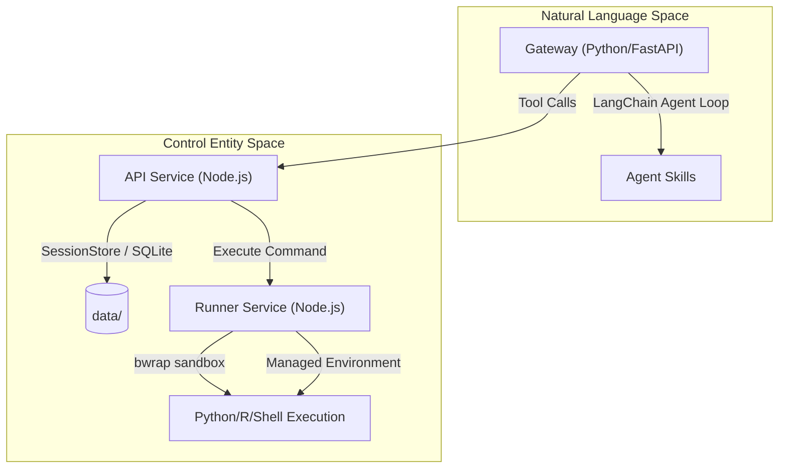
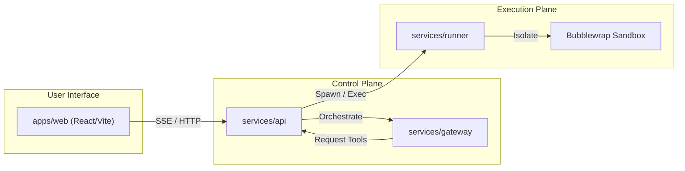

<!-- source: DeepWiki mcp.deepwiki.com · repo openJiuwen-ai/sciencediscovery · page 1 ScienceDiscovery Overview · fetched 2026-11-02 -->

# ScienceDiscovery Overview

Relevant source files

The following files were used as context for generating this wiki page:

- [CONTRIBUTING.md](CONTRIBUTING.md)
- [LICENSE](LICENSE)
- [README.md](README.md)
- [README_zh.md](README_zh.md)
- [Third_Party_Open_Source_Software_Notice.txt](Third_Party_Open_Source_Software_Notice.txt)

ScienceDiscovery is a one-stop AI research workspace purpose-built for scientific exploration. It provides a unified environment where researchers can perform literature reviews, formulate hypotheses, develop code, and execute experimental trials [README.md:3-4](). The platform is designed for trusted local or workstation use, leveraging a secure sandbox for code execution and a multi-agent orchestration layer to handle complex research assignments [README.md:10-19]().

## Product Positioning

ScienceDiscovery is positioned as a research-centric orchestration tool rather than a multi-tenant service. Key architectural constraints include:
*   **Security Model**: The API, gateway, and runner services listen on loopback by default. The API uses a single bearer token and does not terminate TLS [README.md:7-8]().
*   **Isolation**: Code execution (Python, R, Shell) is confined within a fail-closed `bubblewrap` sandbox, while the control plane (API, Gateway, PDF worker) runs outside this sandbox [README.md:8-9]().
*   **Target Audience**: Intended for individual researchers or teams in a secured network environment, distributed as a prepackaged binary for Linux (x86_64/aarch64) [README.md:12-32]().

## Key Features

| Feature | Description |
| :--- | :--- |
| **Scientific Connectors** | One-click access to research databases (PubMed, arXiv, UniProt, etc.) [README.md:16-16](). |
| **Autonomous Sandbox** | Agents write and debug code in isolated environments with managed scientific dependencies [README.md:17-17](). |
| **Multi-Agent Orchestration** | Automatic task decomposition using over 300 cross-domain Skills [README.md:18-18](). |
| **Full Traceability** | Visualized workflows with provenance for code, logs, and environments [README.md:19-19](). |

Sources: [README.md:3-19](), [README.md:28-32]()

## System Architecture and Subsystems

The system is divided into a Node.js control plane and specialized sidecars for agent logic and code execution.

### High-Level Service Interaction
The following diagram illustrates how the "Natural Language Space" (Agent Gateway) interacts with the "Code Entity Space" (Runner and API).

#### Diagram: Logical Service Mapping

Sources: [README.md:10-12](), [README.md:8-9]()

### Component Relationship
This diagram maps system components to their specific roles in the research lifecycle.

#### Diagram: Research Workflow and Code Entities

Sources: [README.md:10-12](), [README.md:7-8]()

## Detailed Subsystems

ScienceDiscovery's functionality is distributed across several key subsystems:

1.  **Control Plane (API Service)**: Manages the run lifecycle state machine, session storage in SQLite, and permission enforcement.
2.  **Agent Gateway**: A Python-based sidecar that runs the LangChain agent loop and translates high-level tasks into tool calls.
3.  **Isolated Runner**: Handles the creation of `bubblewrap` sandboxes and manages `micromamba` environments for scientific computing.
4.  **Scientific Connectors (MCP)**: Provides structured access to external databases like PubMed and PDB via the Model Context Protocol.
5.  **Provenance and CAS**: Ensures all research outputs are traceable using Content-Addressed Storage (SHA-256).

## Navigation

For technical details on specific areas, refer to the following child pages:

*   **[Getting Started and Deployment](#1.1)**: Guide for binary installation, dependency bootstrapping (uv, deer-flow), and host requirements like Bubblewrap.
*   **[Configuration Reference](#1.2)**: Reference for `SCIENCE_AGENT_*` environment variables, default ports (4310/4311/4312), and storage layouts.

For the underlying architecture, see the **Runtime Architecture** (Section 2) and **Shared Packages** (Section 3) documentation.

Sources: [README.md:21-23](), [CONTRIBUTING.md:5-5]()

---

