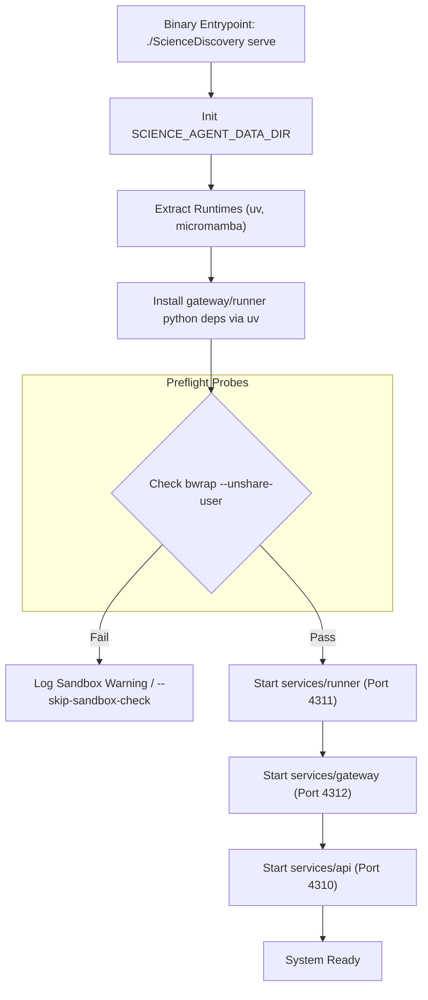

<!-- source: DeepWiki mcp.deepwiki.com · repo openJiuwen-ai/sciencediscovery · page 1.2 Configuration Reference · fetched 2026-11-02 -->

# Configuration Reference

<details>
<summary>Relevant source files</summary>

The following files were used as context for generating this wiki page:

- [.agents/skills/deploy/SKILL.md](.agents/skills/deploy/SKILL.md)
- [.env.docker.example](.env.docker.example)
- [.env.example](.env.example)

</details>


This page provides a technical reference for the ScienceDiscovery configuration system. It details the environment variables, networking defaults, storage architecture, and the mechanisms used to bootstrap the multi-process runtime.

## Environment Variables and the `--env-file` Mechanism

ScienceDiscovery uses a centralized environment variable configuration model. When running the preprovided binary via `ScienceDiscovery serve`, the system looks for an environment file (defaulting to `.env`) or a path specified via the `--env-file` flag [docs/zh/reference/configuration.md:15-16]().

### Variable Priority
1.  **Command-line Flags**: Flags like `--port` or `--data-dir` override environment variables [.agents/skills/deploy/SKILL.md:92-94]().
2.  **Explicit Environment Variables**: Variables set in the shell (e.g., `export SCIENCE_AGENT_PORT=5000`).
3.  **Env File**: Key-value pairs defined in the file passed to `--env-file`.
4.  **Stored Secrets**: For sensitive values like `SCIENCE_AGENT_AUTH_TOKEN`, if the variable is unset, the system reads from `<data-dir>/secrets/` [.env.example:47-50]().

### Key Environment Variables

| Variable | Default | Description |
| :--- | :--- | :--- |
| `SCIENCE_AGENT_DATA_DIR` | `data` | Root directory for all state, logs, and environments [.env.example:32-32](). |
| `SCIENCE_AGENT_HOST` | `127.0.0.1` | Binding address for the API Service [.env.example:51-51](). |
| `SCIENCE_AGENT_PORT` | `4310` | Public port for the Web UI and API [.env.example:52-52](). |
| `SCIENCE_AGENT_AUTH_TOKEN` | *Generated* | Bearer token for UI/API authentication [.env.example:53-53](). |
| `SCIENCE_AGENT_LOG_LEVEL` | `INFO` | Logging verbosity (DEBUG, INFO, WARN, ERROR) [.env.example:38-38](). |
| `SCIENTIFIC_ENVS` | `1` | Enables/disables managed scientific environment provisioning [.env.docker.example:51-51](). |

**Sources:** [.env.example:1-146](), [.env.docker.example:1-78](), [.agents/skills/deploy/SKILL.md:42-44]()

---

## Network Topology and Default Ports

The ScienceDiscovery runtime consists of four primary services communicating over loopback (`127.0.0.1`). Only the **API Service** is intended to be exposed to users, typically via an SSH tunnel or a trusted network interface.

### Service Port Mapping

| Service | Default Port | Communication Type | Role |
| :--- | :--- | :--- | :--- |
| **API Service** | `4310` | HTTP / SSE | Control plane and Web UI host [.env.example:52-52](). |
| **Runner Service** | `4311` | HTTP | Sandboxed code execution (Python/R/Shell) [.env.example:87-87](). |
| **Gateway Service** | `4312` | HTTP | LangChain agent loop and tool orchestration [.env.example:61-61](). |
| **Memory Graph** | `17674` | HTTP | Experimental Neo4j-backed execution mirror [.env.example:114-114](). |

### Communication Flow Diagram
This diagram maps the network interactions between code entities across the service boundaries.

**Diagram: Service Inter-Process Communication (IPC)**
```mermaid
graph TD
    subgraph "User Space"
        "Browser/Client" -- "HTTP/SSE (Port 4310)" --> "API_Service[services/api]"
    end

    subgraph "Control Plane (127.0.0.1)"
        "API_Service" -- "HTTP (Port 4312)" --> "Gateway_Service[services/gateway]"
        "API_Service" -- "HTTP (Port 4311)" --> "Runner_Service[services/runner]"
        "API_Service" -- "HTTP (Port 17674)" --> "Memory_Graph[services/memory-graph]"
    end

    subgraph "Callback Path"
        "Gateway_Service" -- "Tool Call Proxy" --> "API_Service"
        "API_Service" -- "Internal Exec" --> "Runner_Service"
    end

    style "API_Service" stroke-width:2px
    style "Gateway_Service" stroke-width:2px
    style "Runner_Service" stroke-width:2px
```
**Sources:** [.env.example:51-115](), [.agents/skills/deploy/SKILL.md:111-113]()

---

## Storage Layout (`data/`)

The `SCIENCE_AGENT_DATA_DIR` (defaulting to `./data` or `./science-agent-data`) is the authoritative root for all persistent and ephemeral state. The launcher ensures this directory exists and has correct permissions before starting sub-services [.agents/skills/deploy/SKILL.md:118-118]().

### Directory Structure

| Path | Purpose |
| :--- | :--- |
| `data/secrets/` | Stores generated `auth-token` and `gateway-internal-token` [.env.example:47-50](). |
| `data/logs/` | Rotated operational logs (`api.log`, `runner.log`, etc.) [.env.example:34-36](). |
| `data/envs/` | Managed scientific environments (e.g., `envs/paper`, `envs/gateway`) [.env.example:28-31](). |
| `data/cas/` | Content-Addressed Storage for artifacts and provenance records [.env.example:35-37](). |
| `data/sessions/` | SQLite databases and local workspace files for individual agent sessions [.env.example:32-33](). |

**Sources:** [.env.example:28-50](), [.agents/skills/deploy/SKILL.md:42-46]()

---

## Resource Quotas and Timeouts

To ensure system stability during automated scientific discovery, ScienceDiscovery enforces several quota levels via environment variables.

### Execution and Idle Timeouts
*   **Sandboxed Execution (`SCIENCE_AGENT_EXEC_TIMEOUT_MS`)**: Hard wall-clock limit for a single `run_python` or `run_shell` call. Default is 2 hours (7,200,000ms) in Docker [.env.docker.example:57-58]().
*   **Kernel Idle (`SCIENCE_AGENT_KERNEL_IDLE_MS`)**: Time before a persistent Python/R kernel is culled. Default is 30 minutes [.env.docker.example:60-61]().
*   **Gateway Idle (`SCIENCE_AGENT_GATEWAY_IDLE_TIMEOUT_MS`)**: Time before the agent-loop sidecar is shut down if no turns are active. Default 4 minutes [.env.example:72-72]().

### Storage and Output Quotas
*   **Workspace Limit (`SCIENCE_AGENT_WORKSPACE_MAX_BYTES`)**: Total size allowed for a session workspace (uploads + generated files). Default 10 GiB [.env.example:142-143]().
*   **Output Truncation (`SCIENCE_AGENT_MAX_OUTPUT_BYTES`)**: Maximum retained stdout/stderr per tool execution. Default 1 GiB [.env.example:145-146]().

**Sources:** [.env.example:71-80](), [.env.example:138-146](), [.env.docker.example:57-61]()

---

## Runtime Bootstrap and Provisioning

When `ScienceDiscovery serve` is executed, the `launcher` service performs a sequence of preflight checks and dependency installations.

### Bootstrap Sequence
1.  **Environment Extraction**: Extracts embedded runtime payloads (micromamba, uv) to the data directory [.agents/skills/deploy/SKILL.md:114-116]().
2.  **Dependency Bootstrap**: Installs `uv`, `deer-flow`, and Python dependencies for the `gateway` service [.agents/skills/deploy/SKILL.md:114-116]().
3.  **Sandbox Validation**: Probes `bwrap` (Bubblewrap) capabilities, checking for unprivileged user namespace support [.agents/skills/deploy/SKILL.md:72-78]().
4.  **Service Launch**: Starts `gateway` and `runner` as background child processes, then starts the `API` service in the foreground [.agents/skills/deploy/SKILL.md:111-113]().

### Sandbox Requirements
The system requires `bubblewrap` (0.6+) to be installed on the host [.agents/skills/deploy/SKILL.md:68-68](). On modern Linux distributions (e.g., Ubuntu 24.04+), specific kernel knobs must be configured:
*   `kernel.unprivileged_userns_clone=1` [.agents/skills/deploy/SKILL.md:66-66]()
*   `kernel.apparmor_restrict_unprivileged_userns=0` [.agents/skills/deploy/SKILL.md:67-67]()

**Diagram: Launcher Bootstrap Logic**

**Sources:** [.agents/skills/deploy/SKILL.md:57-78](), [.agents/skills/deploy/SKILL.md:104-124]()

---

