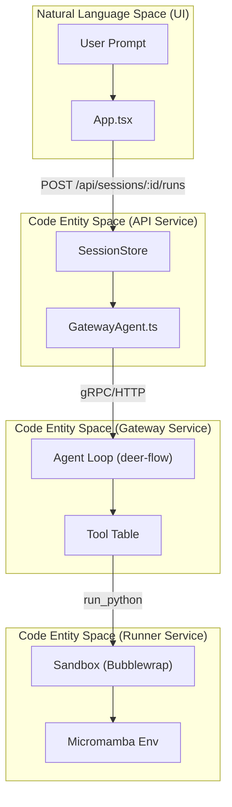
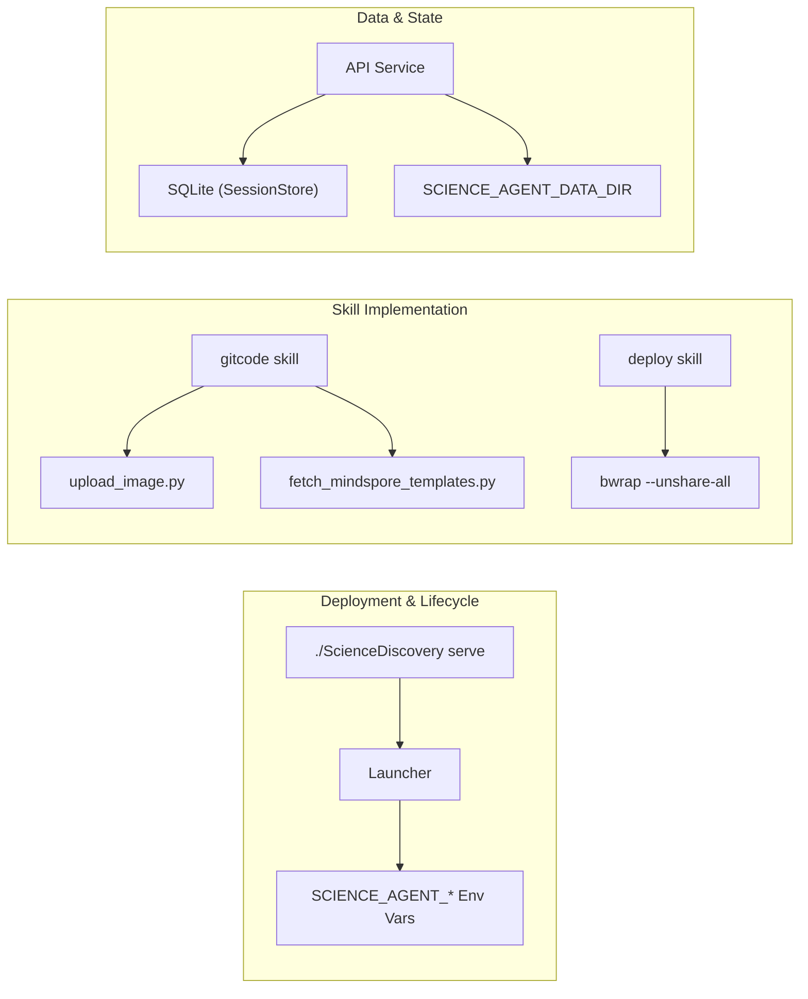

<!-- source: DeepWiki mcp.deepwiki.com · repo openJiuwen-ai/sciencediscovery · page 10 Glossary · fetched 2026-11-02 -->

# Glossary

Relevant source files

The following files were used as context for generating this wiki page:

- [.agents/skills/deploy/SKILL.md](.agents/skills/deploy/SKILL.md)
- [.agents/skills/gitcode/SKILL.md](.agents/skills/gitcode/SKILL.md)
- [.agents/skills/gitcode/scripts/download_image.py](.agents/skills/gitcode/scripts/download_image.py)
- [.agents/skills/gitcode/scripts/fetch_mindspore_templates.py](.agents/skills/gitcode/scripts/fetch_mindspore_templates.py)
- [.agents/skills/gitcode/scripts/upload_image.py](.agents/skills/gitcode/scripts/upload_image.py)
- [.dockerignore](.dockerignore)
- [.env.example](.env.example)
- [README.md](README.md)
- [apps/web/src/App.tsx](apps/web/src/App.tsx)
- [apps/web/src/MemoryGraphView.tsx](apps/web/src/MemoryGraphView.tsx)

This page defines codebase-specific terms, abbreviations, and domain concepts used throughout ScienceDiscovery. It serves as a technical reference for onboarding engineers to bridge the gap between scientific research requirements and the underlying implementation.

## System Components

ScienceDiscovery operates as a three-process runtime managed by a central launcher.

| Term | Definition | Code Pointer |
|:---|:---|:---|
| **API Service** | The Node.js control plane. Manages state, sessions, and permissions. | `services/api` |
| **Gateway** | A Python sidecar running the LangChain-based agent loop. | `services/gateway` |
| **Runner** | The isolation layer that executes sandboxed Python/R/Shell code. | `services/runner` |
| **Launcher** | The bootstrap process that manages the lifecycle of the other three services. | `services/launcher` |

### Process Communication Flow
The following diagram illustrates how Natural Language requests from the UI translate into specific code entities across the service boundaries.

**Diagram: Request to Execution Flow**

Sources: [README.md:10-13](), [.env.example:57-61](), [apps/web/src/App.tsx:206-215]()

---

## Domain Concepts

### Artifacts & Provenance
*   **Artifact**: A persistent output of a research task (e.g., a CSV file, a molecular structure, or a report). Classified by `ScientificArtifactKind` [apps/web/src/App.tsx:82-82]().
*   **ArtifactDerivation**: A record of how an artifact was produced, including the tool used and the input parameters [apps/web/src/App.tsx:18-18]().
*   **Provenance**: The full chain of evidence (execution records, prompt manifests, and CAS references) that ensures research traceability [README.md:18-19]().

### Security & Isolation
*   **Bubblewrap (bwrap)**: A low-level unprivileged sandboxing tool used by the Runner to isolate agent code from the host system [README.md:28-32]().
*   **Fail-closed Sandbox**: A security model where code execution is denied network access and restricted to specific workspace directories by default [README.md:7-9]().
*   **NPU Broker**: An opt-in component that allows the sandboxed Runner to execute allowlisted workloads on Huawei Ascend NPU hardware [(.env.example:93-97)]().

### Agent Orchestration
*   **Deer-flow**: The underlying engine used in the Gateway to manage the LangChain agent loop and state transitions [(.env.example:57-61)]().
*   **Skill**: A project-local or built-in capability defined in a `SKILL.md` file that the agent can invoke [(.agents/skills/deploy/SKILL.md:1-7)]().
*   **Permission Epoch**: A lifecycle state for tool approvals. The agent must request permissions for sensitive operations, which users grant or deny via the UI [apps/web/src/App.tsx:42-45]().

---

## Technical Abbreviations

| Abbreviation | Full Name | Description |
|:---|:---|:---|
| **CAS** | Content-Addressed Storage | Storage system where files are addressed by their SHA-256 hash. |
| **MCP** | Model Context Protocol | A protocol for connecting AI models to external data sources (PubMed, arXiv). |
| **SSE** | Server-Sent Events | Used by the API to stream agent "thinking" and tool events to the UI. |
| **ELF** | Executable and Linkable Format | The standard binary format for the ScienceDiscovery release. |

---

## Implementation Mapping

This diagram maps system-level operations to specific script and configuration implementations.

**Diagram: Infrastructure Implementation Map**

Sources: [.env.example:32-33](), [.agents/skills/deploy/SKILL.md:106-113](), [.agents/skills/gitcode/scripts/upload_image.py:16-29](), [.agents/skills/gitcode/scripts/fetch_mindspore_templates.py:16-20]()

---

## Memory Graph Terms
The **Science Memory Graph** is an experimental feature for visualizing task and citation chains.

*   **MemorySubgraph**: A filtered view of the graph relevant to a specific session [apps/web/src/MemoryGraphView.tsx:17-17]().
*   **Neo4j**: The graph database backend used to store memory nodes and edges [apps/web/src/MemoryGraphView.tsx:80-82]().
*   **Node Status**: Nodes in the graph track execution state (e.g., `succeeded`, `failed`) [apps/web/src/MemoryGraphView.tsx:34-39]().

Sources: [apps/web/src/MemoryGraphView.tsx:47-53](), [.env.example:107-112]()