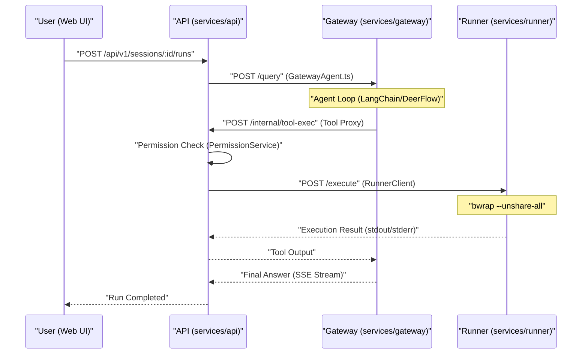
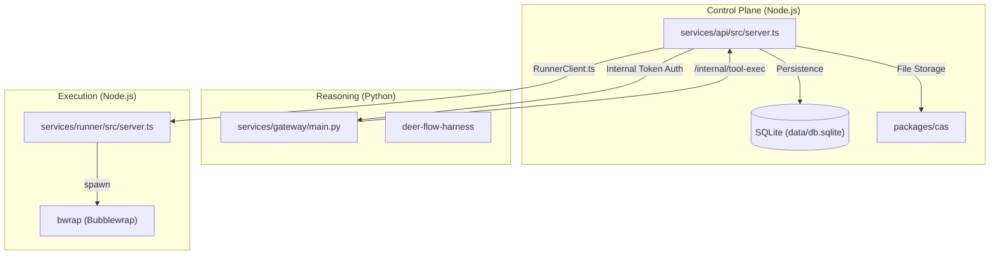

<!-- source: DeepWiki mcp.deepwiki.com · repo openJiuwen-ai/sciencediscovery · page 2 Runtime Architecture · fetched 2026-11-02 -->

# 2. Runtime Architecture

Relevant source files

The following files were used as context for generating this wiki page:

- [.env.example](.env.example)
- [CODEOWNERS](CODEOWNERS)

ScienceDiscovery operates as a distributed system of three primary processes, typically bound to `127.0.0.1` to maintain a loopback-only security model. This architecture separates the **Control Plane** (API), the **Agentic Reasoning** (Gateway), and the **Untrusted Execution** (Runner).

### System Overview

The runtime is designed to isolate long-running agent loops and high-risk scientific code execution from the main API service. All inter-process communication is authenticated via internal tokens generated at first boot [`.env.example:47-53,65,89`]().

#### Process Responsibilities

| Process | Role | Implementation | Primary Responsibility |
| :--- | :--- | :--- | :--- |
| **API** | Control Plane | Node.js / TypeScript | Lifecycle management, SQLite storage, SSE streaming, and permission governance. |
| **Gateway** | Agent Loop | Python / FastAPI | LangChain/DeerFlow orchestration, LLM provider abstraction, and tool proxying. |
| **Runner** | Sandbox | Node.js / TypeScript | Bubblewrap-based execution of Python, R, and Shell scripts with resource quotas. |

### Communication Flow

The system uses a "callback" pattern for tool execution. While the Gateway drives the agent loop, it does not have direct access to the sandbox or the file system. Instead, it calls back into the API to request tool execution, which then delegates to the Runner.

#### Execution Sequence Diagram
This diagram illustrates how a user prompt flows through the system entities to trigger a sandboxed execution.

"Natural Language Space to Code Entity Space: Execution Flow"

**Sources:** [`.env.example:57-68,85-92`](), [`services/api`](), [`services/gateway`](), [`services/runner`]().

### Security Model

The architecture enforces a strict security boundary centered on the API process:
1.  **Loopback Binding**: By default, all services bind to `127.0.0.1` [`.env.example:51,60,86`]().
2.  **Token Authentication**: Each process requires a specific bearer token (`SCIENCE_AGENT_AUTH_TOKEN`, `SCIENCE_AGENT_GATEWAY_INTERNAL_TOKEN`, `SCIENCE_AGENT_RUNNER_TOKEN`) [`.env.example:53,65,89`]().
3.  **Sandbox Isolation**: The Runner utilizes `bubblewrap` (bwrap) to ensure scientific code (Python/R) has no network access and limited filesystem visibility [`.env.example:91,121-124`]().
4.  **Governance**: The API acts as the "Policy Enforcement Point," requiring manual or rule-based approval for sensitive tools before they reach the Runner.

### Component Services

#### [Control Plane: API Service](#2.1)
The central orchestrator. It manages the `SessionStore` (SQLite), tracks the run lifecycle state machine (queued → running → blocked → completed), and handles Server-Sent Events (SSE) for real-time UI updates. It also hosts the `GatewayAgent` translation layer that speaks to the Gateway sidecar.

#### [Agent-Loop Gateway](#2.2)
A Python sidecar that executes the agentic reasoning loop. It integrates `deer-flow` and LangChain to manage conversation history, tool selection, and LLM provider interactions. It uses a `ToolProxy` to send execution requests back to the API.

#### [Isolated Runner and Sandbox Execution](#2.3)
The execution engine. It manages ephemeral and persistent kernels (Python, R, Shell) inside `bwrap` containers. It enforces wall-clock limits (`SCIENCE_AGENT_EXEC_TIMEOUT_MS`) and output size quotas (`SCIENCE_AGENT_MAX_OUTPUT_BYTES`) [`.env.example:75,146`]().

#### [Launcher and Binary Packaging](#2.4)
The bootstrap system. It manages the lifecycle of the three processes, environment variable injection via `.env` files, and the initialization of scientific environments using `micromamba` [`.env.example:32,125-132`]().

### Shared Infrastructure
The services communicate using a shared schema defined in `packages/schema` and leverage a Content-Addressed Storage (CAS) system in `packages/cas` for artifact and provenance tracking.

"Process and Data Entity Mapping"

**Sources:** [`.env.example:32,51-68,85-92`](), [`CODEOWNERS:10-10`]()

---

