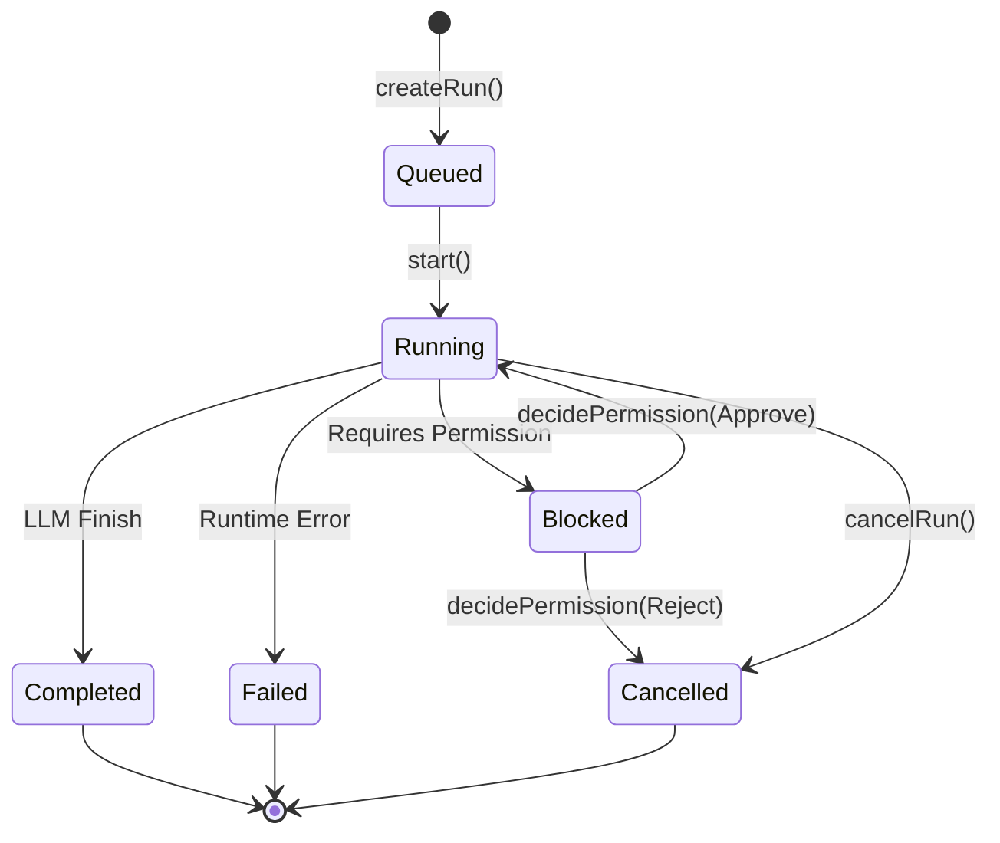

<!-- source: DeepWiki mcp.deepwiki.com · repo openJiuwen-ai/sciencediscovery · page 2.1 Control Plane: API Service · fetched 2026-11-02 -->

# Control Plane: API Service

<details>
<summary>Relevant source files</summary>

The following files were used as context for generating this wiki page:

- [apps/web/src/api.ts](apps/web/src/api.ts)
- [apps/web/src/api/artifacts.ts](apps/web/src/api/artifacts.ts)
- [apps/web/src/api/auth.ts](apps/web/src/api/auth.ts)
- [apps/web/src/api/client.ts](apps/web/src/api/client.ts)
- [apps/web/src/api/projects.ts](apps/web/src/api/projects.ts)
- [apps/web/src/api/runs.ts](apps/web/src/api/runs.ts)
- [apps/web/src/api/sessions.ts](apps/web/src/api/sessions.ts)
- [apps/web/src/api/settings.ts](apps/web/src/api/settings.ts)

</details>


The **API Service** acts as the central control plane for ScienceDiscovery. It is responsible for orchestrating the lifecycle of agent runs, managing persistent storage via SQLite, enforcing permission boundaries, and providing a unified HTTP/SSE interface for the frontend. It coordinates between the **Agent-Loop Gateway** (which executes LLM logic) and the **Isolated Runner** (which executes code).

## System Architecture and Data Flow

The API service manages the transition between high-level user intent and low-level execution events. It maintains the authoritative state of all projects, sessions, and runs.

### Bridge: Natural Language to Code Entity Space

The following diagram maps conceptual frontend actions to the internal API implementation and their corresponding data storage entities.

**API Mapping: Frontend Actions to Code Entities**
```mermaid
graph TD
    subgraph "Frontend Space (apps/web)"
        [UI_Chat_Input] --> |"streamMessage()"| [RunsApiClient]
        [UI_Permission_Dialog] --> |"decidePermissionRequest()"| [SessionsApiClient]
    end

    subgraph "API Control Plane (services/api)"
        [RunsApiClient] --> |"POST /api/sessions/:id/messages"| [HTTP_Router]
        [SessionsApiClient] --> |"POST /api/permission-requests/:id/decision"| [HTTP_Router]
        
        [HTTP_Router] --> [RunStateMachine]
        [HTTP_Router] --> [PermissionStateMachine]
        
        [RunStateMachine] --> [SessionStore_SQLite]
        [PermissionStateMachine] --> [SessionStore_SQLite]
        
        [RunStateMachine] --> |"GatewayAgent.chat()"| [Gateway_Service]
    end

    subgraph "Persistence (data/)"
        [SessionStore_SQLite] -.-> |"schema: session_run"| [sqlite_db]
        [SessionStore_SQLite] -.-> |"schema: permission_request"| [sqlite_db]
    end
```
**Sources:** [apps/web/src/api/runs.ts:144-149](), [apps/web/src/api/sessions.ts:148-153](), [apps/web/src/api/auth.ts:52-73]()

---

## Run Lifecycle State Machine

The core of the API service is the management of a `SessionRun`. A run progresses through a set of states defined in the shared schema, ensuring that only one active run exists per session and that all events are captured for provenance.

### State Transitions
1.  **Queued**: The run is created and waiting for resources.
2.  **Running**: The `GatewayAgent` is actively communicating with the LLM.
3.  **Blocked**: The run is suspended awaiting human intervention (e.g., a permission request or tool call approval).
4.  **Completed/Failed/Cancelled**: Terminal states where the execution context is cleaned up.

**Run Lifecycle Flow**

**Sources:** [apps/web/src/api/runs.ts:67-78](), [apps/web/src/api/sessions.ts:148-153]()

---

## Storage and Persistence

The API service utilizes a **SessionStore** backed by **SQLite** to persist the entire workspace state. This includes not just messages, but the full scientific context.

| Entity | Description | Key Code Reference |
| :--- | :--- | :--- |
| **Session** | The top-level container for a research task. | `Session` in `@science-agent/schema` |
| **Run** | A single execution attempt within a session. | `SessionRun` in `@science-agent/schema` |
| **Permission** | Records of granted or denied tool capabilities. | `PermissionRequest` / `PermissionGrant` |
| **Provenance** | CAS-linked records of how artifacts were derived. | `ArtifactDerivation` |
| **CAS** | Content-Addressed Storage for large blobs (logs, files). | `readCas(hash)` in `RunsApiClient` |

**Sources:** [apps/web/src/api/runs.ts:47-49](), [apps/web/src/api/artifacts.ts:62-64](), [apps/web/src/api/sessions.ts:133-135]()

---

## SSE Streaming and Event Handling

To provide a responsive "live" experience, the API uses **Server-Sent Events (SSE)** to stream run events from the Gateway to the Frontend.

### Event Propagation
When a run is active, the `streamMessage` or `subscribeRunEvents` methods establish a persistent connection. The API service multiplexes events from the underlying GatewayAgent (such as `thinking`, `call_tool`, and `output`) and pushes them to the client.

*   **Sequence Tracking**: Every event is assigned a sequence number to allow clients to resume streams without losing data after a reconnection.
*   **Multiplexing**: The API translates internal Gateway signals into `RunStreamEvent` objects defined in the schema.

**Sources:** [apps/web/src/api/runs.ts:88-136](), [apps/web/src/api/runs.ts:144-185]()

---

## Permission and Governance State Machine

ScienceDiscovery operates on a "Human-in-the-loop" security model. The API service manages a `PermissionEpoch` for each session.

1.  **Request**: When the agent attempts a sensitive tool call (e.g., network access or NPU usage), the Gateway issues a `PermissionRequest`.
2.  **Epochs**: Permissions are valid only for a specific "Epoch". Rotating the epoch (`rotatePermissionEpoch`) invalidates previous grants, forcing re-authorization for new tasks.
3.  **Decisions**: The API provides endpoints for the user to `Approve` or `Reject` requests, which triggers the state machine to resume the blocked run.

**Sources:** [apps/web/src/api/sessions.ts:118-127](), [apps/web/src/api/sessions.ts:148-153]()

---

## GatewayAgent Translation Layer

The `GatewayAgent` (accessed via the API) acts as a translation layer between the HTTP Control Plane and the Python-based Gateway Service.

**Entity Association: API to Gateway**
```mermaid
graph LR
    subgraph "Control Plane (Node.js)"
        [HTTP_Handler] --> [GatewayAgent_Class]
        [GatewayAgent_Class] --> [SSE_Manager]
    end

    subgraph "Communication"
        [GatewayAgent_Class] --> |"gRPC/HTTP POST"| [Python_Gateway_Process]
        [Python_Gateway_Process] --> |"Event Stream"| [GatewayAgent_Class]
    end

    subgraph "Gateway Service (Python)"
        [Python_Gateway_Process] --> [LangChain_Agent_Loop]
        [LangChain_Agent_Loop] --> [Tool_Executor]
    end
```
**Sources:** [apps/web/src/api/runs.ts:150-158](), [apps/web/src/api/runs.ts:166-182]()

### Key Functions in the Control Plane
*   `listProjects()` / `createProject()`: Manage high-level workspace grouping. [apps/web/src/api/projects.ts:28-34]()
*   `streamMessage()`: The primary entry point for starting an interactive agent session. [apps/web/src/api/runs.ts:144-149]()
*   `readCas(hash)`: Retrieves raw data for artifacts, stdout, or code from the Content-Addressed Storage. [apps/web/src/api/runs.ts:47-49]()
*   `getArtifactDashboard()`: Aggregates the state of all scientific artifacts produced during a session. [apps/web/src/api/artifacts.ts:133-135]()

---
**Sources:**
- `apps/web/src/api/auth.ts`
- `apps/web/src/api/projects.ts`
- `apps/web/src/api/sessions.ts`
- `apps/web/src/api/runs.ts`
- `apps/web/src/api/artifacts.ts`
- `apps/web/src/api/settings.ts`

---

