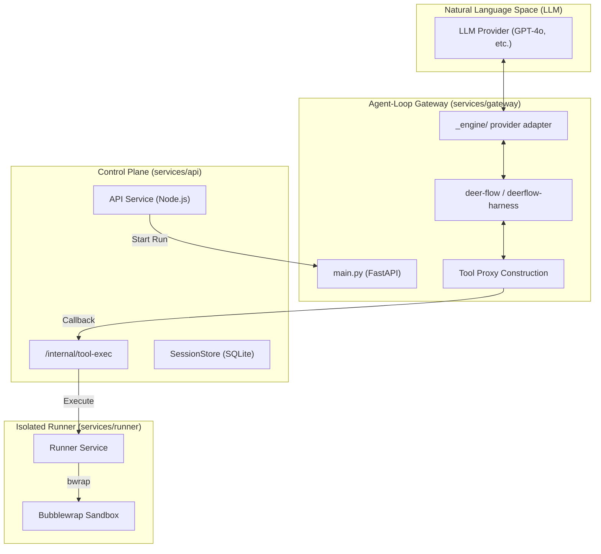
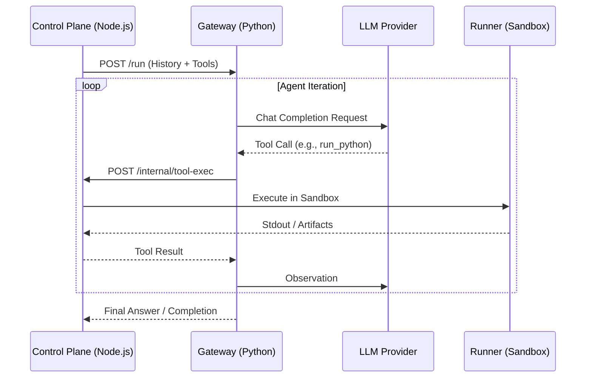

<!-- source: DeepWiki mcp.deepwiki.com · repo openJiuwen-ai/sciencediscovery · page 2.2 Agent-Loop Gateway · fetched 2026-11-02 -->

# Agent-Loop Gateway

Relevant source files

The following files were used as context for generating this wiki page:

- [.agents/skills/deploy/SKILL.md](.agents/skills/deploy/SKILL.md)
- [.env.example](.env.example)

The Agent-Loop Gateway is a Python-based sidecar service built with FastAPI that orchestrates the core LangChain agent loop. It serves as the bridge between the TypeScript-based Control Plane (API) and the Large Language Model (LLM), managing tool execution proxies, history summarization, and the integration of the `deer-flow` reasoning framework.

## Overview and Purpose

The Gateway is responsible for the "thinking" phase of the ScienceDiscovery runtime. While the API service manages session state and persistence, the Gateway executes the actual iterative agent loop, translating between natural language intents and structured tool calls. It operates as a loopback-only service, typically listening on `127.0.0.1:4312` [services/gateway/main.py:60-61]().

### Key Responsibilities
*   **Agent Loop Management**: Running the LangChain-based reasoning cycle.
*   **Tool Proxy Construction**: Wrapping workspace tools (Python, Shell, R) into a format the agent can invoke, while routing the actual execution back to the API for governance and provenance.
*   **Deferred Tool Promotion**: Handling specialized scientific tools (e.g., PubMed, arXiv) that require specific environment or permission contexts.
*   **History Summarization**: Managing context window limits by summarizing long interaction histories.
*   **Provider Adapter Boundary**: Interfacing with various LLM providers through a unified `_engine/` adapter layer.

## Architecture and Data Flow

The Gateway sits between the API and the LLM. It does not directly execute code in the sandbox; instead, it calls back into the API's `/internal/tool-exec` endpoint to perform actions.

### System Context Diagram
This diagram illustrates how the Gateway (Code Entity: `services/gateway`) bridges the Natural Language Space of the LLM with the Code Execution Space of the API and Runner.

**Sources:** [.env.example:57-68](), [services/gateway/main.py:60-61](), [.agents/skills/deploy/SKILL.md:111-113]()

## Implementation Details

### The Agent Loop and Deer-Flow
The Gateway utilizes `deer-flow` (and the `deerflow-harness`) to manage complex reasoning tasks. When the API triggers a run, it sends a request to the Gateway's execution endpoint. The Gateway then initializes a LangChain agent configured with a specific set of tools and a system prompt derived from the agent's "Skill" definition.

### Tool Proxy Construction
Tools are not implemented within the Gateway itself. Instead, the Gateway receives a tool manifest from the API and constructs "Proxy Tools." When the agent calls a tool like `run_python`, the Gateway sends an HTTP request back to the `SCIENCE_AGENT_TOOL_CALLBACK_URL` [.env.example:66-68](). This ensures that all side effects (file changes, network access) are governed by the API's permission system and recorded in the provenance log.

### Provider Adapter Boundary (`_engine/`)
The Gateway abstracts LLM specificities through an internal adapter layer. This allows ScienceDiscovery to support multiple backends (OpenAI, Anthropic, or local models) while maintaining a consistent interface for the `deer-flow` logic.

### History Summarization
To prevent context window overflow during long scientific research sessions, the Gateway implements a history summarization mechanism. It monitors the token count and, upon reaching a threshold, triggers a sub-loop to condense previous turns into a concise summary that is injected back into the system prompt.

## Configuration and Security

The Gateway is designed to be internal-only. It relies on a shared secret for authentication with the API.

| Variable | Description | Default |
| :--- | :--- | :--- |
| `SCIENCE_AGENT_GATEWAY_HOST` | Listening host for the sidecar. | `127.0.0.1` |
| `SCIENCE_AGENT_GATEWAY_PORT` | Listening port for the sidecar. | `4312` |
| `SCIENCE_AGENT_GATEWAY_INTERNAL_TOKEN` | Secret shared between API and Gateway. | Generated on first start |
| `SCIENCE_AGENT_TOOL_CALLBACK_URL` | The API endpoint for tool execution. | `http://<host>:<port>/internal/tool-exec` |

**Sources:** [.env.example:60-68](), [.agents/skills/deploy/SKILL.md:127-132]()

## Lifecycle of a Request

1.  **Initiation**: The user sends a message to the API.
2.  **Dispatch**: The API calls the Gateway's `/run` endpoint with the session history and tool definitions.
3.  **Reasoning**: The Gateway invokes the LLM via the `_engine/` adapter.
4.  **Tool Call**: If the LLM requests a tool, the Gateway calls the API's `tool-exec` endpoint.
5.  **Execution**: The API validates permissions and instructs the Runner to execute the tool in a `bwrap` sandbox.
6.  **Result**: The result flows back: Runner → API → Gateway.
7.  **Observation**: The Gateway provides the tool output back to the LLM to continue the loop.

**Sources:** [.env.example:57-68](), [.agents/skills/deploy/SKILL.md:111-113](), [services/gateway/main.py:60-61]()

---

