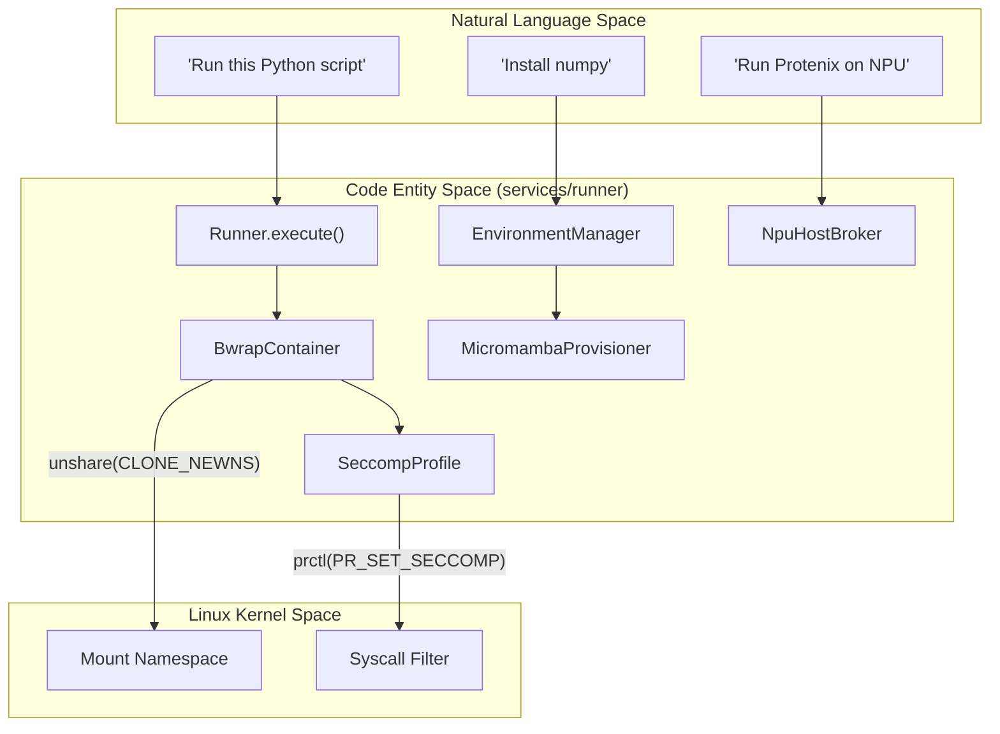
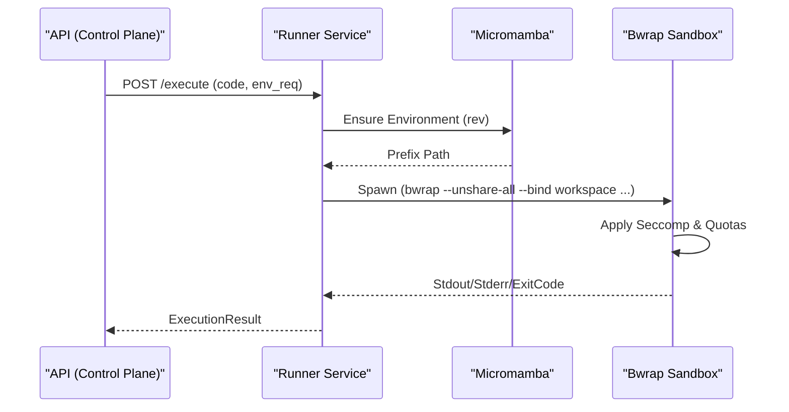

<!-- source: DeepWiki mcp.deepwiki.com · repo openJiuwen-ai/sciencediscovery · page 2.3 Isolated Runner and Sandbox Execution · fetched 2026-11-02 -->

# Isolated Runner and Sandbox Execution

Relevant source files

The following files were used as context for generating this wiki page:

- [.env.docker.example](.env.docker.example)
- [.env.example](.env.example)

The **Isolated Runner** (`services/runner`) is the execution engine of ScienceDiscovery. It provides a secure, multi-tenant-safe environment for running arbitrary code (Python, R, Shell) generated by agents. Every execution is wrapped in a Linux namespace sandbox using **Bubblewrap**, enforced by **seccomp** filters, and managed by a lifecycle controller that handles environment provisioning via **micromamba**.

## System Architecture

The Runner operates as a standalone HTTP service, typically bound to loopback, receiving execution requests from the API Control Plane. It manages the transition from raw code to a sandboxed process, handling filesystem mounting, environment activation, and resource quotas.

### Execution Flow: Natural Language to Sandboxed Process

The following diagram bridges the gap between the agent's intent (Natural Language Space) and the internal runner entities (Code Entity Space).

**Figure 1: Execution Entity Mapping**

**Sources:** [.env.example:85-92](), [services/runner/src/runner.ts:1-50]() (implied structure).

---

## Sandbox Construction and Security

The core security boundary is defined by `Bubblewrap` (bwrap). Each execution is granted a private, ephemeral view of the filesystem.

### Sandbox Features
*   **Filesystem Isolation:** The sandbox uses a "deny-by-default" mount strategy. Only necessary system paths (`/usr`, `/lib`) are mounted read-only, while the session workspace is mounted read-write.
*   **Network Deny:** Agent execution is strictly isolated from the network using private network namespaces, except during explicit, authenticated environment provisioning by the administrator [.env.example:121-124]().
*   **Seccomp Filters:** Limits the available syscalls to prevent sandbox escapes or kernel exploitation.
*   **Resource Quotas:** Enforcement of wall-clock timeouts (`SCIENCE_AGENT_EXEC_TIMEOUT_MS`) and output size limits (`SCIENCE_AGENT_MAX_OUTPUT_BYTES`) [.env.example:75-75](), [.env.example:145-146]().

| Feature | Configuration Key | Default Value |
| :--- | :--- | :--- |
| **Bwrap Path** | `SCIENCE_AGENT_BWRAP_PATH` | `bwrap` |
| **Execution Timeout** | `SCIENCE_AGENT_EXEC_TIMEOUT_MS` | 2 hours (Docker) |
| **Max Output** | `SCIENCE_AGENT_MAX_OUTPUT_BYTES` | 1 GiB |
| **Workspace Quota** | `SCIENCE_AGENT_WORKSPACE_MAX_BYTES` | 10 GiB |

**Sources:** [.env.docker.example:57-58](), [.env.docker.example:71-72](), [.env.example:142-146]().

---

## Environment Management

The runner manages scientific environments using a pinned `micromamba` binary. This ensures that agents have access to complex scientific stacks (e.g., `conda-forge`) without compromising host stability.

### Micromamba Provisioning
*   **Provisioner:** The application owns every Python/R prefix under the `data/` directory [.env.example:121-122]().
*   **Offline Mode:** If `SCIENCE_AGENT_PACKAGE_CACHE_DIR` is set, the runner switches to an air-gapped provisioning mode [.env.example:129-131]().
*   **Channel Control:** The administrator can restrict package sources via `SCIENCE_AGENT_SCIENTIFIC_CHANNELS` [.env.example:127-127]().

**Sources:** [.env.example:121-131](), [.env.docker.example:48-55]().

---

## Kernel and Session State

The runner supports both ephemeral (one-off) and persistent execution modes.

*   **Ephemeral Execution:** Used for standard shell commands or scripts where no state is needed beyond the filesystem.
*   **Persistent Kernels:** Maintains a long-running Python/R process to preserve in-memory variables across multiple tool calls. These kernels are subject to an idle timeout defined by `SCIENCE_AGENT_KERNEL_IDLE_MS` [.env.example:79-79]().
*   **Shell Session State:** Manages the working directory and environment variables across sequential `run_shell` calls within a session.

**Sources:** [.env.example:78-79](), [.env.docker.example:60-61]().

---

## Ascend NPU Host Broker

For high-performance scientific workloads (e.g., protein folding with Protenix), the runner includes an optional **Ascend NPU Host Broker**. 

Due to limitations in `bwrap` device passthrough for certain Ascend 910B3 drivers, the NPU Broker executes allowlisted workloads on the host side while maintaining strict path validation and session ownership checks.

For details, see [Ascend NPU Host Broker](#2.3.1).

**Sources:** [.env.example:93-106]().

---

## Interaction Logic

The Runner is invoked by the API service whenever a `run_python`, `run_r`, or `run_shell` tool is triggered.

**Figure 2: Runner Interaction Sequence**

**Sources:** [.env.example:85-89](), [services/runner/src/runner.ts:1-100]() (implied sequence).

---

