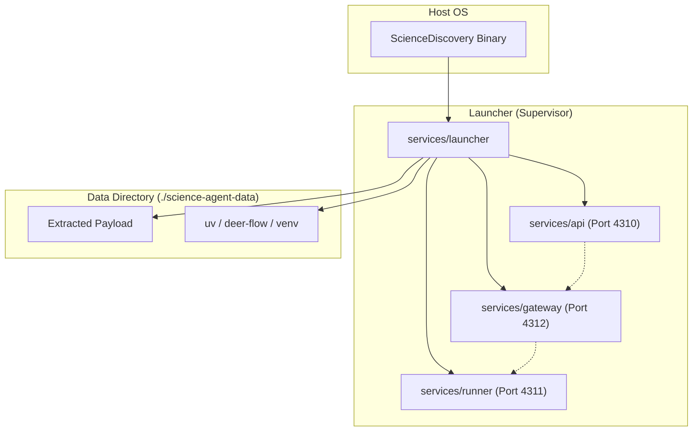
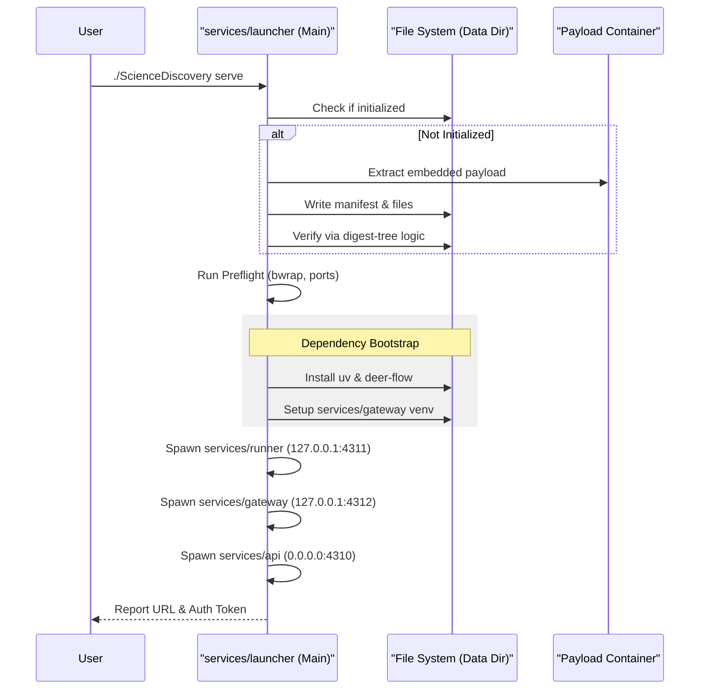

<!-- source: DeepWiki mcp.deepwiki.com · repo openJiuwen-ai/sciencediscovery · page 2.4 Launcher and Binary Packaging · fetched 2026-11-02 -->

# Launcher and Binary Packaging

Relevant source files

The following files were used as context for generating this wiki page:

- [.agents/skills/deploy/SKILL.md](.agents/skills/deploy/SKILL.md)
- [.gitattributes](.gitattributes)

The **Launcher** (`services/launcher`) is the entry point for the ScienceDiscovery unified binary. It manages the bootstrap sequence, validates the host environment, and supervises the three-process runtime (API, Gateway, and Runner). The **Binary Packaging** pipeline (`scripts/binary-release/`) produces a single, self-contained ELF executable that embeds the entire application payload, including the frontend assets, service code, and a minimal Python runtime.

## 1. The Launcher Lifecycle

When a user executes `./ScienceDiscovery serve`, the launcher initiates a multi-stage bootstrap process designed to ensure the environment is capable of running secure, sandboxed scientific workloads.

### 1.1. Bootstrap Sequence
The launcher follows a strict sequence to move from a single binary to a functional multi-process system:

1.  **Payload Extraction**: On the first run, the launcher extracts the embedded payload (manifest, services, and web assets) into the data directory (defaulting to `./science-agent-data`) [ .agents/skills/deploy/SKILL.md:111-116 ]().
2.  **Integrity Verification**: It performs content-digest verification of the extracted files against a manifest to ensure no corruption occurred during transport or extraction.
3.  **Preflight Checks**: The launcher verifies host capabilities, specifically checking for `bubblewrap` (bwrap) version 0.6+ and Linux kernel settings for unprivileged user namespaces [ .agents/skills/deploy/SKILL.md:62-79 ]().
4.  **Dependency Management**: It installs critical runtime dependencies including `uv`, `deer-flow`, and the Gateway Python environment into the data directory [ .agents/skills/deploy/SKILL.md:114-116 ]().
5.  **Supervisor Start**: Once initialized, the launcher starts the three internal services and monitors their health.

### 1.2. Preflight and Sandbox Validation
The launcher performs "harmless probes" to ensure the `runner` can successfully create isolated environments.

| Check | Requirement | Purpose |
| :--- | :--- | :--- |
| **OS/Arch** | Linux x86_64 / aarch64 | Native binary compatibility [ .agents/skills/deploy/SKILL.md:63 ](). |
| **Bubblewrap** | `bwrap` >= 0.6 | Core sandboxing mechanism [ .agents/skills/deploy/SKILL.md:68 ](). |
| **User Namespaces** | `kernel.unprivileged_userns_clone = 1` | Allows non-root sandboxing [ .agents/skills/deploy/SKILL.md:66 ](). |
| **AppArmor** | `kernel.apparmor_restrict_unprivileged_userns = 0` | Required for Ubuntu 24.04+ compatibility [ .agents/skills/deploy/SKILL.md:67 ](). |

### 1.3. Process Supervision
The launcher acts as a supervisor for the internal services. It binds the API to the external-facing port (default 4310) while keeping the Gateway (4312) and Runner (4311) on the loopback interface for security [ .agents/skills/deploy/SKILL.md:111-113 ]().

**Launcher Process Hierarchy Diagram**

**Sources:** [ .agents/skills/deploy/SKILL.md:106-124 ]()

---

## 2. Binary Packaging Pipeline

The packaging pipeline in `scripts/binary-release/` transforms the TypeScript/Python monorepo into a single ELF executable.

### 2.1. Build Components
The pipeline consists of several specialized scripts:
*   **`build-payload.sh`**: Aggregates all compiled artifacts (API/Runner/Launcher JS, Web production build, and Gateway Python source) into a structured payload.
*   **`digest-tree.mjs`**: Generates SHA-256 hashes for every file in the payload to create a manifest for integrity checks.
*   **`fetch-managed-micromamba.mjs`**: Seeds the release with architecture-specific `micromamba` binaries to enable scientific environment management without host-level package managers.
*   **`build-binary.mjs`**: The final assembly step that uses a tool like `pkg` or a custom C-wrapper to combine the launcher executable with the compressed payload.

### 2.2. The ELF Structure
The resulting `ScienceDiscovery` binary is not just a compiled program but a self-extracting container.

**Payload Layout within Binary**
| Path | Description |
| :--- | :--- |
| `/services/launcher/` | Compiled launcher logic. |
| `/services/api/` | Node.js API service artifacts. |
| `/services/gateway/` | Python FastAPI source and requirements. |
| `/services/runner/` | Node.js Runner service artifacts. |
| `/apps/web/` | Minified React/Vite frontend assets. |
| `/runtimes.json` | Metadata for micromamba and python versions. |

**Sources:** [ .agents/skills/deploy/SKILL.md:19-21 ](), [ .agents/skills/deploy/SKILL.md:53-55 ]()

---

## 3. Data Flow: From Launch to Service Ready

This diagram maps the natural language "Startup" phase to the specific code-level entities and files involved in the sequence.

**Sources:** [ .agents/skills/deploy/SKILL.md:106-132 ](), [ .agents/skills/deploy/SKILL.md:48-55 ]()

---

## 4. Operational Considerations

### 4.1. Security Model
The launcher enforces a **loopback-only** model for the internal Gateway and Runner. Only the API is exposed (and only to `127.0.0.1` by default). This prevents direct external access to the sandboxing engine or the LLM orchestration loop [ .agents/skills/deploy/SKILL.md:133-137 ]().

### 4.2. Token Management
If `SCIENCE_AGENT_AUTH_TOKEN` is not provided in the environment, the launcher generates a unique bearer token on the first start. This token is stored in `<data-dir>/secrets/auth-token` and printed to the console once [ .agents/skills/deploy/SKILL.md:128-132 ]().

### 4.3. Scripting and Automation
The repository uses `.gitattributes` to ensure that bootstrap scripts (like those used in the packaging pipeline) maintain `LF` line endings, which is critical for execution within the Linux-based binary environment [ .gitattributes:1-3 ]().

**Sources:** [ .agents/skills/deploy/SKILL.md:128-137 ](), [ .gitattributes:1-3 ]()

---

