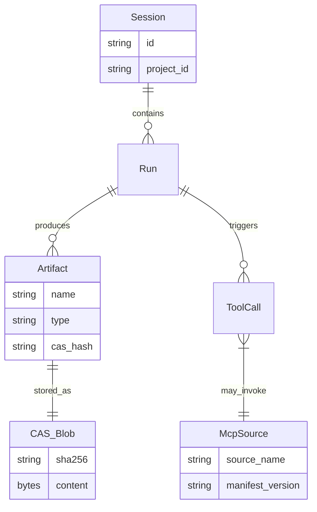

<!-- source: DeepWiki mcp.deepwiki.com · repo openJiuwen-ai/sciencediscovery · page 3 Shared Packages and Data Model · fetched 2026-11-02 -->

# Shared Packages and Data Model

<details>
<summary>Relevant source files</summary>

The following files were used as context for generating this wiki page:

- [.npmrc](.npmrc)

</details>


This page provides a high-level overview of the shared packages within the `packages/` directory of the monorepo. These packages define the foundational data structures, tool definitions, scientific data connectors, and storage mechanisms used by the API, Gateway, and Runner services.

By centralizing these concerns, the system ensures type safety across the TypeScript/Node.js boundary and maintains a consistent execution model for agentic workflows.

## 1. Schema Package: Shared TypeScript Types
The `packages/schema` package is the "source of truth" for the entire system's data model. It exports the TypeScript interfaces and types that define how entities are stored in the database and transmitted via the API.

Key entities defined here include:
*   **Session & Project**: The top-level containers for agent activity and resource scoping.
*   **Artifacts**: Structured outputs (files, datasets, molecular structures) produced by tools.
*   **Permissions**: The state machine for human-in-the-loop approvals (e.g., `Requested`, `Granted`, `Denied`).
*   **Provenance**: Metadata linking artifacts to the specific tool executions and prompts that generated them.

For details on the type definitions and data flow, see [Schema Package: Shared TypeScript Types](#3.1).

**Sources:**
* `packages/schema/src/index.ts` (Exports all shared types)

---

## 2. Agent Runtime Package: Tools and Prompts
The `packages/agent-runtime` package defines the interface between the Agent Loop and the physical execution environment. It contains the definitions for "Workspace Tools"—the primary actions an agent can take.

### Workspace Tooling
The core function `createWorkspaceTools` aggregates standard execution tools that the Gateway injects into the LLM context:
*   **Computation**: `run_python`, `run_r`, and `run_shell`.
*   **State Management**: `declare_artifact` for persisting results and `task`/`propose_plan` for orchestration.
*   **Subagents**: Definitions for spawning specialized child agents to handle sub-tasks.

For details on tool implementation and prompt construction, see [Agent Runtime Package: Tools and Prompts](#3.2).

**Sources:**
* `packages/agent-runtime/src/workspace/tools.ts` (Implementation of `createWorkspaceTools`)
* `packages/agent-runtime/src/types/index.ts` (Runtime-specific type definitions)

---

## 3. MCP Sources and Scientific Connectors
The `packages/mcp-sources` package implements the **Model Context Protocol (MCP)** to provide agents with secure, governed access to external scientific databases.

### Scientific Data Access
This package contains built-in connectors for:
*   **Literature**: PubMed, arXiv.
*   **Bioinformatics**: UniProt, Ensembl, PDB (Protein Data Bank).
*   **Governance**: The `McpGovernanceBroker` ensures that every external request is audited, rate-limited, and checked against user-defined trust boundaries before execution.

For details on the connector manifests and the deferred tool promotion mechanism, see [MCP Sources Package and Scientific Connectors](#3.3).

**Sources:**
* `packages/mcp-sources/src/index.ts` (MCP entry point and source registry)
* `packages/mcp-sources/src/governance/broker.ts` (Governance and audit logic)

---

## 4. Content-Addressed Storage (CAS) and Provenance
The `packages/cas` package provides a content-addressable storage layer, ensuring that every file and execution record in the system is immutable and traceable.

### Data Integrity and Traceability
*   **SHA-256 Addressing**: Files are stored based on their content hash, enabling automatic deduplication and integrity verification.
*   **Artifact Derivation**: Every artifact points to a `CAS` address, allowing the system to reconstruct the exact state of the workspace at the time of creation.
*   **Auditability**: The `cas` package works with the provenance system to link `Prompt Manifests` and `Execution Records` into a verifiable chain of evidence.

For details on the storage layout and verification API, see [Content-Addressed Storage (CAS) and Provenance](#3.4).

**Sources:**
* `packages/cas/src/index.ts` (CAS client and storage logic)

---

## System Integration Diagram

The following diagram illustrates how these shared packages bridge the gap between high-level agent logic (Natural Language Space) and the underlying system execution (Code Entity Space).

### Data and Tooling Flow
```mermaid
graph TD
    subgraph "Natural Language Space (LLM/Gateway)"
        "AgentPrompt" -- "Uses" --> "ToolDefinition"
    end

    subgraph "Shared Packages (The Bridge)"
        "ToolDefinition" -- "Defined in" --> "agent-runtime"
        "DataTypes" -- "Defined in" --> "schema"
        "ExternalData" -- "Fetched via" --> "mcp-sources"
    end

    subgraph "Code Entity Space (API/Runner/CAS)"
        "agent-runtime" -- "Executes via" --> "services/runner"
        "schema" -- "Persisted in" --> "services/api/SessionStore"
        "mcp-sources" -- "Audited in" --> "packages/cas"
        "services/runner" -- "Writes to" --> "packages/cas"
    end

    style "agent-runtime" stroke-width:2px
    style "schema" stroke-width:2px
    style "mcp-sources" stroke-width:2px
    style "packages/cas" stroke-width:2px
```

### Entity Relationship Diagram
This diagram shows how specific code entities across the packages relate to the core `Session` lifecycle.



**Sources:**
* `packages/schema/src/index.ts` (Session, Run, Artifact definitions)
* `packages/cas/src/index.ts` (CAS hashing logic)
* `packages/mcp-sources/src/index.ts` (Source definitions)

---

