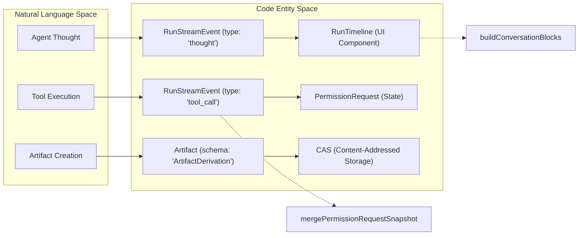

<!-- source: DeepWiki mcp.deepwiki.com · repo openJiuwen-ai/sciencediscovery · page 3.1 Schema Package: Shared TypeScript Types · fetched 2026-11-02 -->

# Schema Package: Shared TypeScript Types

<details>
<summary>Relevant source files</summary>

The following files were used as context for generating this wiki page:

- [apps/web/src/permission-state.ts](apps/web/src/permission-state.ts)
- [apps/web/src/run-stream/model.ts](apps/web/src/run-stream/model.ts)
- [apps/web/src/session/model.ts](apps/web/src/session/model.ts)

</details>


The `@science-agent/schema` package serves as the single source of truth for all data structures within the ScienceDiscovery ecosystem. It provides the TypeScript interfaces and type definitions that facilitate seamless communication between the **API Service** (Control Plane), the **Gateway** (Agent Loop), the **Runner** (Sandbox), and the **Web Frontend**.

By centralizing these definitions, the system ensures type safety across the network boundary, specifically for Server-Sent Events (SSE), REST API payloads, and internal state management.

## Core Data Models

The schema is organized around the lifecycle of a scientific research session, from project organization to granular execution provenance.

### 1. Project and Session
Projects act as the top-level organizational unit, while Sessions contain the actual conversation history and stateful agent interactions.

| Entity | Role | Key Properties |
| :--- | :--- | :--- |
| `Project` | Multi-session container | `id`, `name`, `createdAt`, `archivedAt` |
| `Session` | Conversation context | `id`, `projectId`, `title`, `systemPrompt`, `memoryGraphId` |
| `ChatMessage` | Message history | `id`, `role` (user/assistant/system), `content`, `createdAt` |

**Sources:** [apps/web/src/session/model.ts:15-20](), [apps/web/src/session/model.ts:29-38]()

### 2. Execution and Runs
A `SessionRun` represents a single execution cycle where the agent processes a user request. This state machine is critical for the frontend to determine if the UI should be interactive or in a "thinking" state.

```mermaid
graph TD
    subgraph "Run State Machine"
        ["queued"] --> ["running"]
        ["running"] --> ["blocked"]
        ["blocked"] --> ["running"]
        ["running"] --> ["completed"]
        ["running"] --> ["failed"]
        ["running"] --> ["cancelled"]
        ["running"] --> ["interrupted"]
    end

    style ["blocked"] stroke-dasharray: 5 5
```
**Sources:** [apps/web/src/run-stream/model.ts:116-122](), [apps/web/src/run-stream/model.ts:137-141]()

## Data Flow: From Agent to UI

The `RunStreamEvent` is the primary vehicle for data flow. When the Agent Gateway performs an action, it emits an event that the API broadcasts via SSE. The frontend uses `routeRunStreamEvent` to determine how to update the UI.

### Natural Language to Code Entity Space

This diagram bridges the gap between the agent's "thinking" (Natural Language) and the underlying code entities that represent those thoughts in the system.


**Sources:** [apps/web/src/run-stream/model.ts:44-65](), [apps/web/src/session/model.ts:82-105](), [apps/web/src/permission-state.ts:18-28]()

## Permission and Governance

Governance is handled via `PermissionRequest` objects. These are generated when an agent attempts a sensitive operation (e.g., file deletion, external API access).

*   **States:** `pending`, `granted`, `denied`.
*   **Resolution:** Once a permission is resolved, it is terminal. The function `mergePermissionRequestSnapshot` ensures that delayed SSE messages do not overwrite a user's decision with a stale "pending" state.

**Sources:** [apps/web/src/permission-state.ts:17-28]()

## Artifacts and Provenance

The schema defines how scientific results are tracked. Every `Artifact` is linked to a `Provenance` record, which references the specific `SessionRun` and tool call that generated it.

### System Entity Relationship

This diagram illustrates how the shared types connect the different subsystems of the ScienceDiscovery architecture.

```mermaid
erDiagram
    "Session" ||--o{ "SessionRun" : "triggers"
    "SessionRun" ||--o{ "RunStreamEvent" : "emits"
    "SessionRun" ||--o{ "PermissionRequest" : "requires"
    "RunStreamEvent" ||--o| "Artifact" : "declares"
    "Artifact" ||--|| "ArtifactDerivation" : "tracked_by"
    
    "API_Service" {
        string SessionStore
        string SQLite_DB
    }
    "Gateway_Agent" {
        string LangChain_Loop
        string Tool_Proxy
    }
    "Web_Frontend" {
        string RunTimeline
        string PermissionState
    }

    "API_Service" -- "Session" : "manages"
    "Gateway_Agent" -- "RunStreamEvent" : "produces"
    "Web_Frontend" -- "RunStreamEvent" : "consumes"
```
**Sources:** [apps/web/src/run-stream/model.ts:22-36](), [apps/web/src/session/model.ts:71-73](), [apps/web/src/permission-state.ts:15-21]()

## Utility Functions for Schema Types

The `@science-agent/schema` package is often used in conjunction with frontend utility models to manage complex state transitions:

1.  **Stream Routing:** `routeRunStreamEvent` decides if an event should trigger a toast notification or update the session view based on whether the session is currently active in the user's browser.
2.  **Timeline Interleaving:** `buildConversationBlocks` merges `ChatMessage` arrays with `SessionRun` timelines to create a unified research log where agent "thinking" steps appear between messages.
3.  **Run Sorting:** `sortSessionRuns` and `runsRequiringEventReplay` use `queueOrder` and `createdAt` timestamps to ensure execution history is rendered in the correct chronological order.

**Sources:** [apps/web/src/run-stream/model.ts:44-65](), [apps/web/src/session/model.ts:82-105](), [apps/web/src/session/model.ts:114-116]()

---

