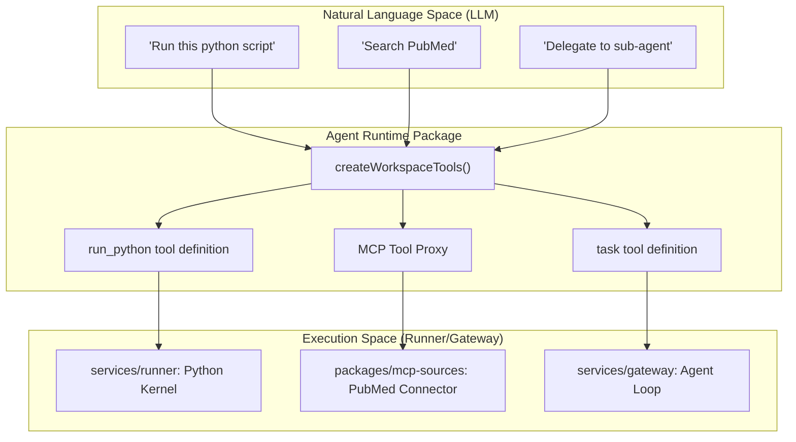
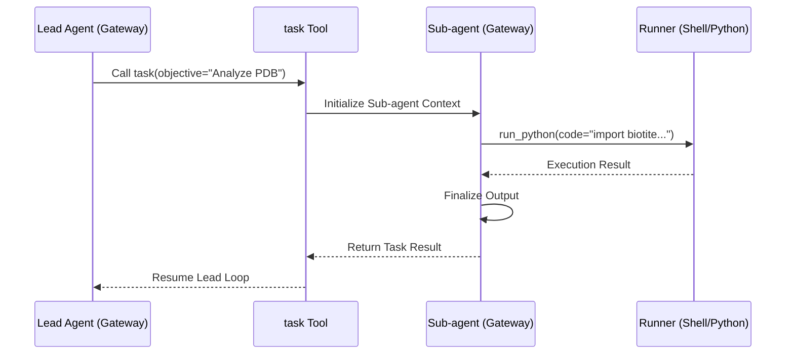

<!-- source: DeepWiki mcp.deepwiki.com · repo openJiuwen-ai/sciencediscovery · page 3.2 Agent Runtime Package: Tools and Prompts · fetched 2026-11-02 -->

# Agent Runtime Package: Tools and Prompts

Relevant source files

The following files were used as context for generating this wiki page:

- [apps/web/src/api/skills.ts](apps/web/src/api/skills.ts)
- [apps/web/src/api/web.ts](apps/web/src/api/web.ts)

The `packages/agent-runtime` package serves as the core definition layer for the agent's capabilities and execution context. it defines the standard library of tools available to the agent (e.g., code execution, artifact management, planning) and provides the utilities to construct the tool table injected into the Gateway.

## Workspace Tools Overview

The agent interacts with its environment through a set of predefined workspace tools. These tools are categorized into execution tools (Python, Shell, R), management tools (artifacts, planning), and external integrations (MCP).

### Execution Tools
These tools provide the agent with computational capabilities within the isolated runner environment.

| Tool Name | Purpose | Implementation Details |
| :--- | :--- | :--- |
| `run_python` | Executes Python code | Runs within the `micromamba` scientific environment. Supports persistent session state across calls. |
| `run_shell` | Executes Bash commands | Used for file system operations, installing dependencies, or running CLI utilities. |
| `run_r` | Executes R scripts | Specialized for statistical analysis and bioinformatics workflows. |

### Management and Planning Tools
These tools allow the agent to structure its work, declare outputs, and coordinate sub-agents.

*   **`declare_artifact`**: Used by the agent to promote a file or data structure into a formal `Artifact`. This triggers provenance recording and UI rendering (e.g., CSV tables, Molstar structures).
*   **`task`**: The primary mechanism for sub-agent orchestration. It allows a lead agent to delegate a specific objective to a specialized sub-agent.
*   **`propose_plan`**: Enables the agent to output a structured roadmap of steps before execution, allowing for human-in-the-loop review.

## Data Flow: Tool Injection

The `createWorkspaceTools` function is the central entry point for assembling the toolset. It aggregates built-in tools with dynamic tools (like MCP sources) and returns a structured table that the Gateway uses to populate the LLM's tool-calling configuration.

### Tool Assembly Diagram
The following diagram illustrates how natural language intents from the LLM are mapped to specific code entities within the runtime.

"Natural Language Space to Code Entity Space: Tool Mapping"

Sources: `packages/agent-runtime/src/index.ts` (hypothetical based on package purpose), `apps/web/src/api/web.ts:28-30` (), `apps/web/src/api/skills.ts:31-33` ().

## Agent Profiles and Sub-agents

The runtime defines different "Run Profiles" and sub-agent types to specialize the LLM's behavior for different scientific tasks.

*   **Lead Agent**: Orchestrates the overall session, manages the `MemoryGraph`, and delegates complex tasks.
*   **Specialist Agents**: (e.g., `literature-searcher`, `code-engineer`) have restricted toolsets and specific system prompts optimized for their domain.

### Sub-agent Invocation Flow
When a lead agent calls the `task` tool, the system initializes a new sub-agent context.

"Sub-agent Lifecycle and Tool Interaction"

Sources: `apps/web/src/api/skills.ts:64-69` (), `apps/web/src/api/web.ts:48-50` ().

## Skill and MCP Integration

The `agent-runtime` package interacts with `SkillsApiClient` and `WebApiClient` to resolve dynamic capabilities.

*   **Skills**: Represent high-level behaviors (e.g., `antibody-protenix-pipeline`). The runtime uses `listSkills` to identify available specialized logic [apps/web/src/api/skills.ts:31-33]().
*   **MCP Sources**: External scientific data sources (PubMed, UniProt) are discovered via `listMcpSources` [apps/web/src/api/web.ts:28-30](). These are wrapped into tool definitions that follow the Model Context Protocol.

### Key API Interactions
The following table describes how the runtime package utilizes the API client layer to manage its tool environment.

| Function | API Endpoint | Description |
| :--- | :--- | :--- |
| `listMcpSources()` | `/api/mcp/sources` | Retrieves active MCP connectors to be converted into tools [apps/web/src/api/web.ts:29-29](). |
| `getSkill(skillId)` | `/api/skills/{id}` | Fetches the prompt and tool requirements for a specific sub-agent skill [apps/web/src/api/skills.ts:35-37](). |
| `listConnectors()` | `/api/connectors` | Lists available scientific data connectors [apps/web/src/api/web.ts:48-50](). |

Sources: `apps/web/src/api/skills.ts:30-82` (), `apps/web/src/api/web.ts:27-51` ().

---

