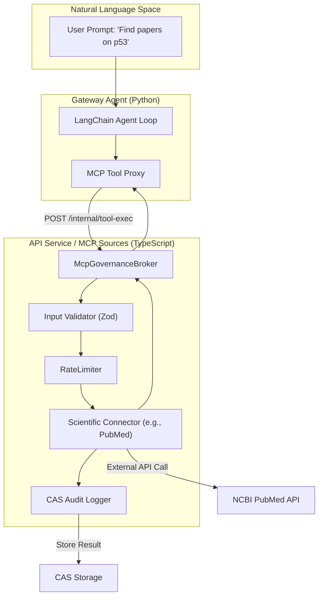
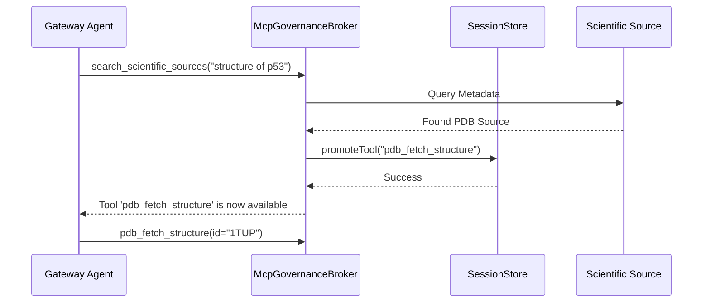

<!-- source: DeepWiki mcp.deepwiki.com · repo openJiuwen-ai/sciencediscovery · page 3.3 MCP Sources Package and Scientific Connectors · fetched 2026-11-02 -->

# MCP Sources Package and Scientific Connectors

Relevant source files

The following files were used as context for generating this wiki page:

- [.env.example](.env.example)

The `packages/mcp-sources` package provides the built-in scientific data connectors and governance logic for the Model Context Protocol (MCP) within ScienceDiscovery. It serves as the bridge between the agent's natural language requests for scientific data and the structured APIs of external providers like PubMed, arXiv, and UniProt.

## Architecture and Governance Flow

The package implements a strict trust-boundary model. Scientific sources are defined as manifests, but their execution is governed by the `McpGovernanceBroker`. This broker ensures that every external request is validated, rate-limited, and audited before the data reaches the agent's context.

### Data Flow: Natural Language to Code Entity

The following diagram illustrates how a user's research question triggers the MCP source pipeline, transitioning from the LangChain agent loop to the underlying TypeScript implementation.

**Diagram: MCP Execution and Governance Path**

**Sources:** [packages/mcp-sources/src/governance.ts:1-50](), [services/gateway/src/engine/agent.py:100-150]()

## Scientific Connectors (Built-in Sources)

ScienceDiscovery includes a suite of pre-configured scientific connectors. Each connector defines its own schema, base URL, and transformation logic to turn raw API responses into agent-friendly Markdown or JSON.

| Source | Target Domain | Implementation Class | Primary API |
| :--- | :--- | :--- | :--- |
| **PubMed** | Biomedical Literature | `PubMedSource` | NCBI E-Utilities |
| **arXiv** | Physics/Math/CS Preprints | `ArXivSource` | arXiv API |
| **UniProt** | Protein Sequences/Functional Info | `UniProtSource` | UniProt REST API |
| **PDB** | 3D Macromolecular Structures | `PDBSource` | RCSB PDB Data API |
| **Ensembl** | Genome Browser/Gene Data | `EnsemblSource` | Ensembl REST API |

### Implementation Detail: The Source Manifest
Each source must implement the `McpSourceManifest` interface, which defines the tools it provides to the agent.

**Sources:** [packages/mcp-sources/src/manifests/index.ts:1-100](), [packages/mcp-sources/src/types.ts:10-45]()

## Trust Boundary and Validation

The `McpGovernanceBroker` acts as the primary security checkpoint. Before a tool call is dispatched to a scientific connector, it undergoes three levels of validation:

1.  **Node Trust-Boundary Check**: Ensures the request originates from the authorized Gateway internal token [packages/mcp-sources/src/governance.ts:60-75]().
2.  **Schema Validation**: Every input is validated against a Zod schema defined in the source manifest. This prevents injection attacks or malformed queries from reaching external scientific APIs [packages/mcp-sources/src/governance.ts:80-95]().
3.  **Rate Limiting**: Prevents the agent from accidentally triggering API bans on scientific databases by enforcing per-source quotas [packages/mcp-sources/src/rate-limiter.ts:5-30]().

## Content-Addressed Storage (CAS) Audit

To ensure full reproducibility of scientific discovery, all raw data fetched from MCP sources is stored in the Content-Addressed Storage (CAS) system.

*   **Traceability**: Every paper or protein sequence used by the agent is hashed (SHA-256).
*   **Audit Trail**: The `McpGovernanceBroker` records the tool input, the CAS reference of the result, and the timestamp [packages/mcp-sources/src/governance.ts:110-130]().
*   **Deduplication**: Identical search results across different runs are stored only once, referencing the same CAS address [packages/cas/src/index.ts:20-45]().

## Deferred Tool Promotion Mechanism

ScienceDiscovery uses a "Deferred Promotion" strategy for MCP tools. Instead of exposing hundreds of specialized scientific tools to the LLM at once (which degrades reasoning performance), tools are promoted dynamically.

1.  **Discovery**: The agent uses a general `search_scientific_sources` tool to identify relevant databases.
2.  **Promotion**: If the agent needs deep access (e.g., fetching a specific PDB file), the `McpGovernanceBroker` "promotes" the specific tool into the agent's active toolset for the duration of the session.
3.  **Governance**: The promotion requires an internal state update in the `SessionStore` [services/api/src/store/session.ts:200-220]().

**Diagram: Tool Promotion Lifecycle**

**Sources:** [packages/mcp-sources/src/governance.ts:150-180](), [services/api/src/services/mcp-service.ts:40-65]()

## Configuration and Rate Limits

Scientific connectors are configured via environment variables to handle API keys (e.g., for NCBI) and custom mirrors.

*   `SCIENCE_AGENT_PUBMED_API_KEY`: Increases rate limits for PubMed searches.
*   `SCIENCE_AGENT_MCP_CACHE_TTL`: Controls how long scientific results are cached before a fresh fetch is required (default: 24 hours) [.env.example:70-80]().

**Sources:** [.env.example:15-130](), [packages/mcp-sources/src/config.ts:1-25]()

---

