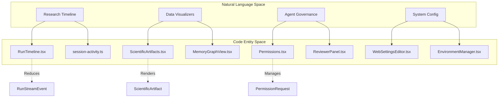
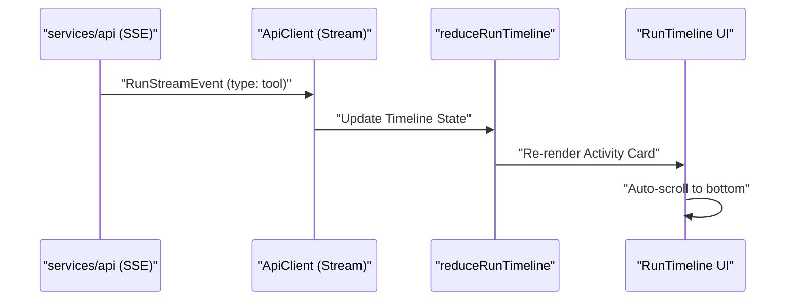

<!-- source: DeepWiki mcp.deepwiki.com · repo openJiuwen-ai/sciencediscovery · page 4 Web Frontend · fetched 2026-11-02 -->

# Web Frontend

Relevant source files

The following files were used as context for generating this wiki page:

- [apps/web/index.html](apps/web/index.html)
- [apps/web/package.json](apps/web/package.json)
- [apps/web/src/App.tsx](apps/web/src/App.tsx)
- [apps/web/src/main.tsx](apps/web/src/main.tsx)

The ScienceDiscovery Web Frontend is a React-based single-page application (SPA) built with Vite. It serves as the primary user interface for interacting with the scientific agent, managing research sessions, visualizing complex data artifacts (such as molecular structures and large CSVs), and governing agent permissions.

The frontend is designed to handle high-frequency Server-Sent Events (SSE) from the `services/api`, transforming raw agent logs into a structured, interactive timeline of research activities.

### Top-Level Architecture

The application entry point is `apps/web/index.html` [apps/web/index.html:1-29](), which loads `main.tsx` [apps/web/src/main.tsx:1-30](). The UI is wrapped in a `LocaleProvider` to support internationalization and a `StrictMode` container for development safety.

The core logic resides in `App.tsx`, which manages the global state including:
*   **Session & Project Management**: Handling the lifecycle of research projects and individual agent sessions.
*   **Run Stream Processing**: Consuming `RunStreamEvent` objects and updating the local UI state via `reduceRunTimeline` [apps/web/src/App.tsx:139-143]().
*   **View State**: Managing navigation between the Workbench, Settings, and specialized viewers using a serialized URL state mechanism [apps/web/src/App.tsx:185-185]().

#### System Component Map
The following diagram bridges the high-level UI concepts to their implementation entities in the codebase.

**UI to Code Entity Mapping**

Sources: [apps/web/src/App.tsx:17-81](), [apps/web/src/App.tsx:138-186]()

### Core Subsystems

#### 1. Run Timeline and Session Management
The Workbench is centered around the `RunTimeline`, which displays the agent's progress. It maps internal agent events—such as `thinking`, `tool_use`, `plan`, and `subagent` calls—into interactive UI cards. It also handles the orchestration of complex tasks and the display of permission prompts.

For details, see [Run Timeline and Session Management](#4.1).

#### 2. Settings and System Panels
The frontend provides comprehensive management interfaces for the underlying runtime. This includes the `EnvironmentManager` for handling micromamba environments, `SkillManager` for agent capabilities, and `ScopedSettingsEditor` for configuring model profiles and proxy settings.

For details, see [Settings, Environment, and System Panels](#4.2).

#### 3. Artifact Viewers
ScienceDiscovery includes specialized renderers for scientific data types. The `ScientificArtifacts.tsx` [apps/web/src/App.tsx:153-153]() component acts as a dispatcher for:
*   **Molecular Data**: Using Molstar for 3D visualization.
*   **Tabular Data**: High-performance CSV viewing with Plotly integration.
*   **Knowledge Graphs**: A dedicated `MemoryGraphView` for exploring task and citation chains.

For details, see [Artifact Viewers: CSV, Molecular, and Memory Graph](#4.3).

#### 4. API Client and i18n
Communication with the backend is centralized in the `ApiClient` [apps/web/src/api.js](). This layer handles authentication token prompts, error routing, and the transformation of backend schemas into frontend-friendly models. The UI is fully localized via the `i18n` module.

For details, see [API Client Layer and Internationalization](#4.4).

### Data Flow and SSE Handling

The frontend maintains a real-time connection to the API service to stream agent progress. The `routeRunStreamEvent` [apps/web/src/App.tsx:212-212]() function directs incoming SSE data to the appropriate state reducers.

**Event Processing Flow**

Sources: [apps/web/src/App.tsx:139-143](), [apps/web/src/App.tsx:206-215]()

### Development Workflow

The project uses `pnpm` for package management and `vite` for the build pipeline.

*   **Development Server**: Run `npm run dev` in `apps/web` to start the Vite HMR server [apps/web/package.json:8-8]().
*   **Type Checking**: Use `npm run typecheck` to validate TypeScript against the shared `@science-agent/schema` [apps/web/package.json:10-10]().
*   **Testing**: Unit tests for reducers and stream isolation are executed via `tsx` [apps/web/package.json:9-9]().

Sources: [apps/web/package.json:1-41]()

---

