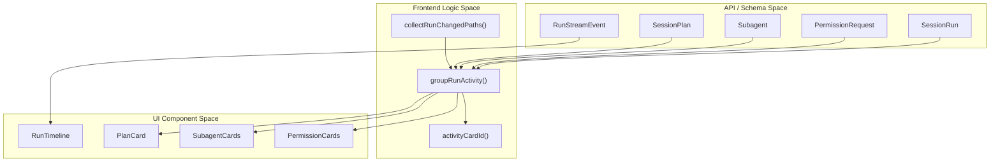
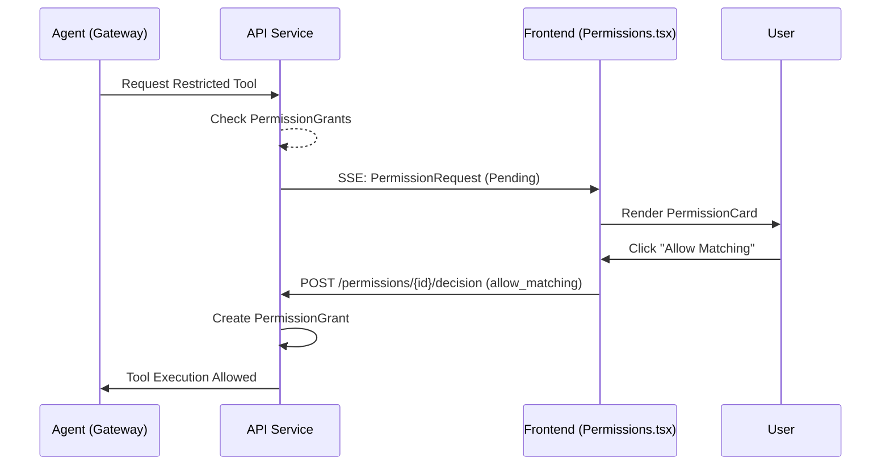

<!-- source: DeepWiki mcp.deepwiki.com · repo openJiuwen-ai/sciencediscovery · page 4.1 Run Timeline and Session Management · fetched 2026-11-02 -->

# Run Timeline and Session Management

Relevant source files

The following files were used as context for generating this wiki page:

- [apps/web/src/ManagementControls.tsx](apps/web/src/ManagementControls.tsx)
- [apps/web/src/Orchestration.tsx](apps/web/src/Orchestration.tsx)
- [apps/web/src/PermissionDecisionActions.tsx](apps/web/src/PermissionDecisionActions.tsx)
- [apps/web/src/Permissions.tsx](apps/web/src/Permissions.tsx)
- [apps/web/src/RunTimeline.tsx](apps/web/src/RunTimeline.tsx)
- [apps/web/src/WorkbenchNavigation.tsx](apps/web/src/WorkbenchNavigation.tsx)
- [apps/web/src/session-activity.ts](apps/web/src/session-activity.ts)
- [apps/web/src/session/run-activity.ts](apps/web/src/session/run-activity.ts)

This page documents the frontend architecture for visualizing agent execution history and managing interactive sessions. It covers the `RunTimeline`, the grouping of run-time activities (plans, subagents, permissions), and the management controls that facilitate user-in-the-loop scientific discovery.

## Overview

The ScienceDiscovery frontend represents agent execution as a series of **Runs** within a **Session**. A Session contains the full history of a research task, while a Run represents a single turn of agent execution (from user prompt to agent completion or pause). The UI maps backend events and state entities into a chronological flow of cards and timeline entries.

### Key Components
- **RunTimeline**: The primary chronological display for a single run's internal steps (thinking, tool calls, logs).
- **RunActivityGroup**: A logical grouping of high-level entities produced during a run (plans, subagents, artifacts) that sit alongside the timeline.
- **Permission Management**: The interface for granting or denying agent requests for sensitive operations (e.g., code execution, network access).
- **Orchestration Panel**: Visualizes the agent's internal planning and subagent spawning.

---

## Session and Run Activity Grouping

Activities produced during a session (such as plans, subagents, and permission requests) are attributed to specific runs based on their creation timestamps. This ensures that even after a page refresh, the UI can reconstruct which agent action led to which result.

### Attribution Logic
The `groupRunActivity` function [apps/web/src/session/run-activity.ts:148-223]() performs the following:
1.  **Sorting**: It identifies all runs that have a `startedAt` timestamp and sorts them chronologically.
2.  **Bucketing**: For each item (e.g., a `Subagent`), it finds the latest run that had already started when the item was created (`createdAt`).
3.  **Path Union**: For workspace files, it uses `collectRunChangedPaths` [apps/web/src/session/run-activity.ts:109-117]() to check `workspace.changed` events, allowing a file to appear in multiple run groups if it was modified across different turns.

### Run Activity Data Model
| Entity | Interface | Source Event/State |
| :--- | :--- | :--- |
| **Plans** | `SessionPlan` | `propose_plan` tool or backend state |
| **Subagents** | `Subagent` | `spawn_subagent` tool or backend state |
| **Permissions** | `PermissionRequest` | Backend-initiated pause for approval |
| **Downloads** | `ArtifactCandidate` | MCP-governed download offers |

Sources: [apps/web/src/session/run-activity.ts:39-59](), [apps/web/src/session/run-activity.ts:148-223]()

---

## Run Timeline Mapping

The `RunTimeline` [apps/web/src/RunTimeline.tsx:15-15]() renders the granular execution steps of an agent. These steps are derived from the `RunStreamEvent` sequence.

### Event-to-UI Mapping

| Event Type | UI Card / Entry | Components Involved |
| :--- | :--- | :--- |
| `thinking` | Thinking block | `RunTimeline` |
| `call` | Tool Input card | `ToolIoSections` |
| `response` | Tool Output card | `ToolIoSections` |
| `plan` | Plan Card | `PlanCard` in `Orchestration.tsx` |
| `subagent` | Subagent Card | `SubagentCards` in `Orchestration.tsx` |
| `permission` | Permission Request | `PermissionCards` in `Permissions.tsx` |

### Code Entity Space: Activity Mapping
The following diagram illustrates how raw activity data from the API is transformed into UI components.

Sources: [apps/web/src/session/run-activity.ts:71-76](), [apps/web/src/Orchestration.tsx:43-68](), [apps/web/src/Permissions.tsx:34-79]()

---

## Orchestration and Subagents

The agent uses specialized tools to manage complex tasks. These are visualized in the `OrchestrationPanel` [apps/web/src/Orchestration.tsx:70-89]().

### Plans
Plans are rendered as `PlanCard` components. They track:
- **Feasibility Confidence**: Stated by the agent during planning [apps/web/src/Orchestration.tsx:37-37]().
- **Step Status**: Steps can be `pending`, `running`, or `completed` [apps/web/src/Orchestration.tsx:39-40]().
- **Caveats**: Methodological limitations identified by the agent [apps/web/src/Orchestration.tsx:64-64]().

### Subagents
Subagents are autonomous loops spawned by the lead agent. The `SubagentCards` [apps/web/src/Orchestration.tsx:102-148]() component displays:
- **Turn Counts**: Current turns vs. `maxTurns` limit [apps/web/src/Orchestration.tsx:92-92]().
- **Token Usage**: Granular breakdown of input/output tokens [apps/web/src/Orchestration.tsx:126-126]().
- **Step Trace**: An internal timeline for the subagent, showing its own tool calls via `ToolIoSections` [apps/web/src/Orchestration.tsx:131-140]().

Sources: [apps/web/src/Orchestration.tsx:36-68](), [apps/web/src/Orchestration.tsx:91-147]()

---

## Permission and Governance Flow

When an agent attempts a restricted action, the backend issues a `PermissionRequest`. The frontend intercepts this to pause execution and await user input.

### Permission Decision Actions
Users can respond to requests via the `PermissionDecisionActions` component [apps/web/src/PermissionDecisionActions.tsx:29-42]():
1.  **Allow Once**: Grants permission for the specific request ID.
2.  **Allow Matching**: Generates a matcher (e.g., for a specific connector or directory) to grant future requests automatically [apps/web/src/PermissionDecisionActions.tsx:39-39]().
3.  **Deny**: Blocks the action, usually resulting in a tool error returned to the agent.

### Matching Logic
The `permissionMatchingKey` [apps/web/src/PermissionDecisionActions.tsx:19-27]() function creates a unique string for resource-based matching:
- **Connectors**: Matches based on the connector ID (`parts.slice(0, 2)`).
- **Remote Jobs**: Matches based on the compute provider and job type.

### UI Interaction Flow

Sources: [apps/web/src/PermissionDecisionActions.tsx:19-27](), [apps/web/src/Permissions.tsx:48-61]()

---

## Management and Navigation

### Management Controls
The `ManagementControls` [apps/web/src/ManagementControls.tsx:15-15]() provide session-level actions:
- **Revoking Grants**: The `PermissionGrantManager` [apps/web/src/Permissions.tsx:81-93]() allows users to view and remove active permissions for the current session.
- **Specialist Management**: The `SpecialistManager` [apps/web/src/Orchestration.tsx:150-166]() allows users to configure the "Specialist" personas available for the agent to spawn as subagents.

### Workbench Navigation
The `WorkbenchNavigation` [apps/web/src/WorkbenchNavigation.tsx:15-15]() handles the layout transitions between the conversation timeline and the scientific workbench (Artifacts, Memory Graph, etc.).

Sources: [apps/web/src/Permissions.tsx:81-93](), [apps/web/src/Orchestration.tsx:150-166]()

---

