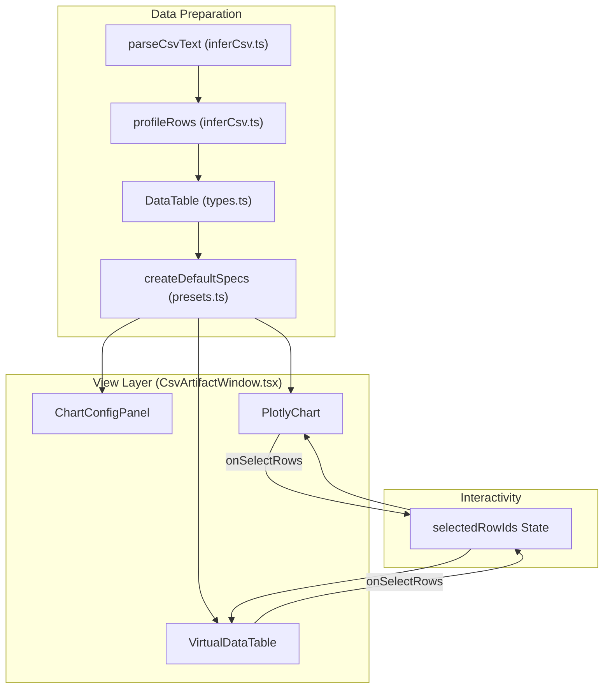
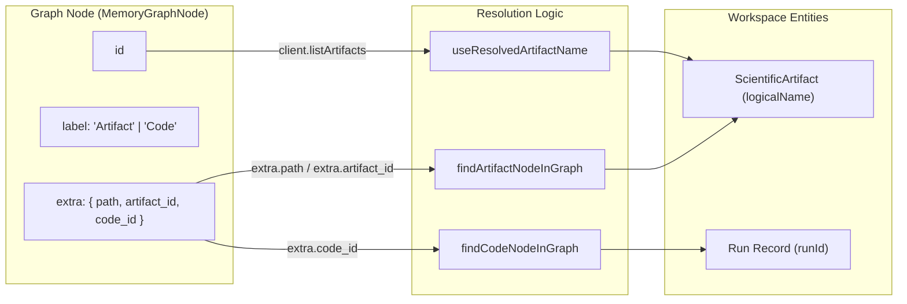

<!-- source: DeepWiki mcp.deepwiki.com · repo openJiuwen-ai/sciencediscovery · page 4.3 Artifact Viewers: CSV, Molecular, and Memory Graph · fetched 2026-11-02 -->

# Artifact Viewers: CSV, Molecular, and Memory Graph

Relevant source files

The following files were used as context for generating this wiki page:

- [apps/web/src/MemoryGraphCanvas.tsx](apps/web/src/MemoryGraphCanvas.tsx)
- [apps/web/src/MemoryGraphExplorer.tsx](apps/web/src/MemoryGraphExplorer.tsx)
- [apps/web/src/MemoryGraphProduct.tsx](apps/web/src/MemoryGraphProduct.tsx)
- [apps/web/src/MemoryGraphView.tsx](apps/web/src/MemoryGraphView.tsx)
- [apps/web/src/MolstarWindow.tsx](apps/web/src/MolstarWindow.tsx)
- [apps/web/src/csv-artifact/CsvArtifactWindow.tsx](apps/web/src/csv-artifact/CsvArtifactWindow.tsx)
- [apps/web/src/csv-artifact/charts/PlotlyChart.tsx](apps/web/src/csv-artifact/charts/PlotlyChart.tsx)
- [apps/web/src/csv-artifact/charts/buildFigure.ts](apps/web/src/csv-artifact/charts/buildFigure.ts)
- [apps/web/src/csv-artifact/components/ChartConfigPanel.tsx](apps/web/src/csv-artifact/components/ChartConfigPanel.tsx)
- [apps/web/src/csv-artifact/components/VirtualDataTable.tsx](apps/web/src/csv-artifact/components/VirtualDataTable.tsx)
- [apps/web/src/csv-artifact/csv/inferCsv.ts](apps/web/src/csv-artifact/csv/inferCsv.ts)
- [apps/web/src/molecular.ts](apps/web/src/molecular.ts)

This page documents the specialized frontend subsystems used to render and explore scientific artifacts. These viewers provide interactive visualizations for tabular data, 3D molecular structures, and the relational history of research objects.

## 1. CSV Artifact Viewer

The `CsvArtifactWindow` provides a multi-pane environment for exploring tabular data. It combines automated statistical profiling with interactive charting and high-performance data grids.

### Implementation and Data Flow

The viewer follows a pipeline from raw text to interactive visualization:

1.  **Parsing and Inference**: Raw CSV text is parsed using `papaparse` [apps/web/src/csv-artifact/csv/inferCsv.ts:197-201](). The system infers `ColumnKind` (quantitative, categorical, date, etc.) for each field based on content patterns and naming conventions like `gene_id` or `p-value` [apps/web/src/csv-artifact/csv/inferCsv.ts:72-95]().
2.  **Chart Presets**: Based on the inferred `DataTableKind` (e.g., differential expression, enrichment, or generic), the system generates default `ChartSpec` objects such as Volcano plots or Heatmaps [apps/web/src/csv-artifact/csv/inferCsv.ts:170-194]().
3.  **Visualization**: The `PlotlyChart` component renders the selected spec using `plotly.js` [apps/web/src/csv-artifact/charts/PlotlyChart.tsx:116-123]().
4.  **State Management**: User-defined chart configurations and active views are persisted to `localStorage` via `workspaceCache` [apps/web/src/csv-artifact/CsvArtifactWindow.tsx:181-187]().

### Key Components

| Component | Role | Source |
| :--- | :--- | :--- |
| `CsvArtifactWindow` | Orchestrates the viewer lifecycle, panels, and toolbar actions. | [apps/web/src/csv-artifact/CsvArtifactWindow.tsx:111-117]() |
| `PlotlyChart` | Manages the Plotly.js instance, selection gestures, and image exports. | [apps/web/src/csv-artifact/charts/PlotlyChart.tsx:116-123]() |
| `VirtualDataTable` | A high-performance grid rendering only visible rows for large datasets. | [apps/web/src/csv-artifact/components/VirtualDataTable.tsx:39-45]() |
| `ChartConfigPanel` | Allows users to remap visual encodings (X, Y, Color, Size) and filter data. | [apps/web/src/csv-artifact/components/ChartConfigPanel.tsx:65-72]() |

### CSV Processing and Rendering Flow

Title: CSV Artifact Rendering Pipeline

Sources: [apps/web/src/csv-artifact/csv/inferCsv.ts:97-168](), [apps/web/src/csv-artifact/CsvArtifactWindow.tsx:111-150](), [apps/web/src/csv-artifact/charts/PlotlyChart.tsx:49-56]()

---

## 2. Molecular Structure Viewer

The `MolstarWindow` integrates the Mol* (MolStar) plugin to visualize 3D molecular and crystal structures.

### Format Detection
The system identifies molecular formats (PDB, CIF, SDF, XYZ, MOL2) using a tiered strategy:
1.  **File Extension**: Checked via `EXTENSION_FORMATS` [apps/web/src/molecular.ts:21-32]().
2.  **Media Type**: Checked via `MEDIA_TYPE_FORMATS` [apps/web/src/molecular.ts:34-42]().
3.  **Sniffing**: Analyzing content headers (e.g., checking for `@<TRIPOS>` for MOL2 or `data_` for CIF) [apps/web/src/molecular.ts:62-86]().

### Multi-Structure Superposition
When multiple structures are loaded, `MolstarWindow` performs a Kabsch superposition using `alignAndSuperpose` [apps/web/src/MolstarWindow.tsx:135-157](). This aligns mobile structures onto the first "reference" structure and calculates the Root-Mean-Square Deviation (RMSD).

Sources: [apps/web/src/molecular.ts:93-108](), [apps/web/src/MolstarWindow.tsx:46-49]()

---

## 3. Science Memory Graph Explorer

The Memory Graph provides a relational view of the research process, connecting goals, tasks, code executions, and artifacts.

### Visual Architecture
The graph uses `cytoscape.js` with the `dagre` layout engine for a layered, hierarchical visualization [apps/web/src/MemoryGraphCanvas.tsx:115-126]().

*   **Nodes**: Represent entities like `ResearchGoal`, `SubTask`, `Code`, and `Artifact`. Colors are assigned by label (e.g., Artifacts are green) [apps/web/src/MemoryGraphCanvas.tsx:25-33]().
*   **Edges**: Represent relationships like `produces`, `next` (task sequence), and `cites` [apps/web/src/MemoryGraphCanvas.tsx:35-43]().

### Component Hierarchy

| Component | Description | Source |
| :--- | :--- | :--- |
| `MemoryGraphView` | A thumbnail card shown in the workspace panel; polls for graph health and stats. | [apps/web/src/MemoryGraphView.tsx:47-114]() |
| `MemoryGraphExplorer` | Full-screen modal for interactive graph navigation and filtering. | [apps/web/src/MemoryGraphExplorer.tsx:100-128]() |
| `MemoryGraphCanvas` | The Cytoscape-based rendering surface. | [apps/web/src/MemoryGraphCanvas.tsx:142-150]() |
| `MemoryGraphProduct` | Left-hand panel in the explorer showing details of the selected node. | [apps/web/src/MemoryGraphProduct.tsx:88-104]() |

### Data Association: Graph to Workspace

The explorer bridges the abstract graph space to actual session data using resolution logic.

Title: Memory Graph Entity Mapping

Sources: [apps/web/src/MemoryGraphExplorer.tsx:51-90](), [apps/web/src/MemoryGraphProduct.tsx:38-82]()

### Chain Navigation
Users can enter "Chain View" to isolate the lineage of a specific artifact. The `initialChainKind` prop determines whether to show the full graph, the `task` chain (how it was made), or the `artifact` chain (what it was derived from) [apps/web/src/MemoryGraphExplorer.tsx:121-122]().

Sources: [apps/web/src/MemoryGraphCanvas.tsx:15-19](), [apps/web/src/MemoryGraphExplorer.tsx:15-24](), [apps/web/src/MemoryGraphProduct.tsx:15-28](), [apps/web/src/MemoryGraphView.tsx:47-70]()

---

