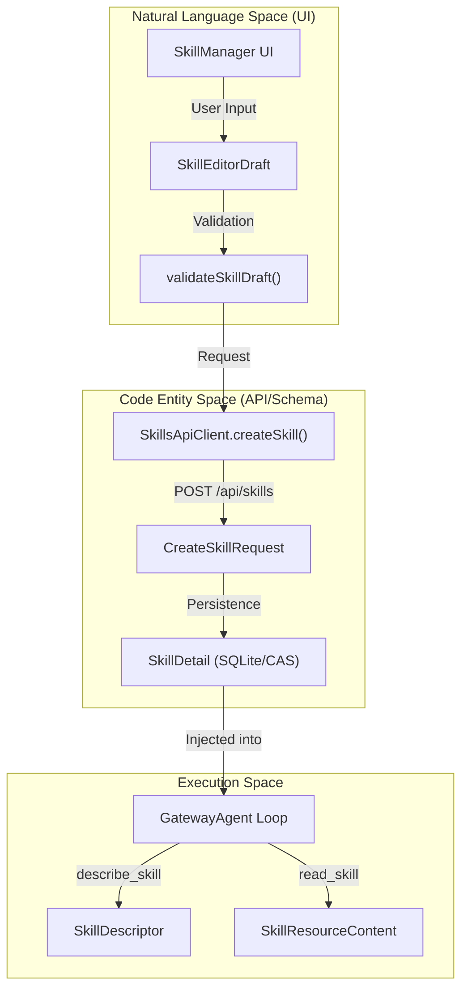
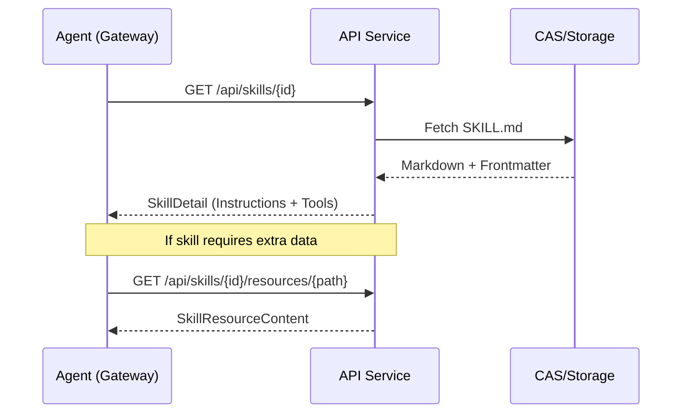

<!-- source: DeepWiki mcp.deepwiki.com · repo openJiuwen-ai/sciencediscovery · page 5 Agent Skills System · fetched 2026-11-02 -->

# Agent Skills System

Relevant source files

The following files were used as context for generating this wiki page:

- [apps/web/src/SkillManager.tsx](apps/web/src/SkillManager.tsx)
- [apps/web/src/api/skills.ts](apps/web/src/api/skills.ts)

The Agent Skills System provides a structured mechanism for extending the capabilities of the ScienceDiscovery agent. Skills are encapsulated bundles of instructions, tool permissions, and metadata that allow the agent to specialize in specific scientific domains or operational tasks. This system uses a "progressive disclosure" model to manage the context window, where the agent first identifies relevant skills before reading their full implementation details.

## Skill Architecture and Format

Skills are defined using a standardized `SKILL.md` format, which combines YAML frontmatter for configuration with Markdown for natural language instructions.

### The SKILL.md Specification
Each skill consists of a primary entry point and optional supporting resources. The frontmatter defines the operational constraints:
*   **Allowed Tools**: A whitelist of tools (e.g., `run_python`, `literature_searcher`) the agent is permitted to use when this skill is active.
*   **Compatibility**: Versioning and environment requirements.
*   **Metadata**: Version strings, authors, and licensing information.

The UI manages these drafts via the `SkillEditorDraft` interface [apps/web/src/SkillManager.tsx:28-37](), which ensures that skill names follow a strict naming convention: `^[a-z0-9]+(?:-[a-z0-9]+)*$` [apps/web/src/SkillManager.tsx:51-53]().

### Progressive Disclosure
To prevent context window saturation, the system implements a two-stage discovery process:
1.  **`describe_skill`**: The agent lists available skills to see high-level descriptions.
2.  **`read_skill`**: The agent fetches the full `instructions` and `allowedTools` only when it determines a skill is necessary for the current task.

## Skill Lifecycle and Management

The `SkillManager` component in the frontend provides the primary interface for creating, importing, and auditing skills [apps/web/src/SkillManager.tsx:105-117]().

### Authoring Modes
*   **Dialogue Draft**: Users can describe a desired capability in natural language, and the system generates a `SkillDraft` using an LLM [apps/web/src/api/skills.ts:60-62]().
*   **Session Distillation**: Successful research workflows can be "distilled" into reusable skills, capturing the effective prompts and tool sequences used during a session [apps/web/src/api/skills.ts:64-69]().
*   **Git Import**: Skills can be synchronized from remote repositories, allowing for team-wide sharing of scientific pipelines [apps/web/src/api/skills.ts:56-58]().

### Scoping and Revisions
Skills can be scoped to a specific **Project** or **Session**, or shared globally across the system. When a skill is used in a research run, its state is captured in a **Prompt Manifest**. This ensures that even if a skill is updated later, the specific revision used for a discovery remains frozen for reproducibility.

## System Integration

The following diagram illustrates how the `SkillsApiClient` bridges the frontend management UI with the backend skill storage and execution environment.

### Skill Data Flow
"Natural Language Space" to "Code Entity Space" mapping.

Sources: [apps/web/src/SkillManager.tsx:28-103](), [apps/web/src/api/skills.ts:30-82]().

## Built-in Skill Library

ScienceDiscovery ships with a library of built-in skills located in the `skills/` directory. These serve as the foundation for the autonomous research team.

| Skill Category | Primary Responsibility | Key Tools |
| :--- | :--- | :--- |
| **Orchestration** | Managing subagents and task delegation | `task`, `propose_plan` |
| **Literature** | Searching and extracting evidence | `literature-searcher`, `evidence-extractor` |
| **Review** | Validating citations and computations | `citation-reviewer`, `computation-reviewer` |
| **Bio-Pipelines** | Executing specialized NPU workloads | `antibody-protenix-pipeline` |

### Detailed Skill Documentation
For specific implementation details on these skills, refer to the following child pages:

*   **[Built-in Research Skills](#5.1)**: Overview of the core research team (Orchestrator, Searcher, Writer, etc.).
*   **[Antibody Protenix Pipeline Skill](#5.2)**: Deep dive into NPU-accelerated protein design workflows using RFdiffusion and Protenix.
*   **[GitCode Agent Skills](#5.3)**: Integration with GitCode CLI for issue tracking and repository management.

### Skill Resource Access
Skills may include supplementary files (e.g., Python templates, JSON schemas). These are accessed via the `readSkillResource` endpoint [apps/web/src/api/skills.ts:79-81](), which retrieves content based on a relative path within the skill's package.

Sources: [apps/web/src/api/skills.ts:35-37](), [apps/web/src/api/skills.ts:79-81]().

---

