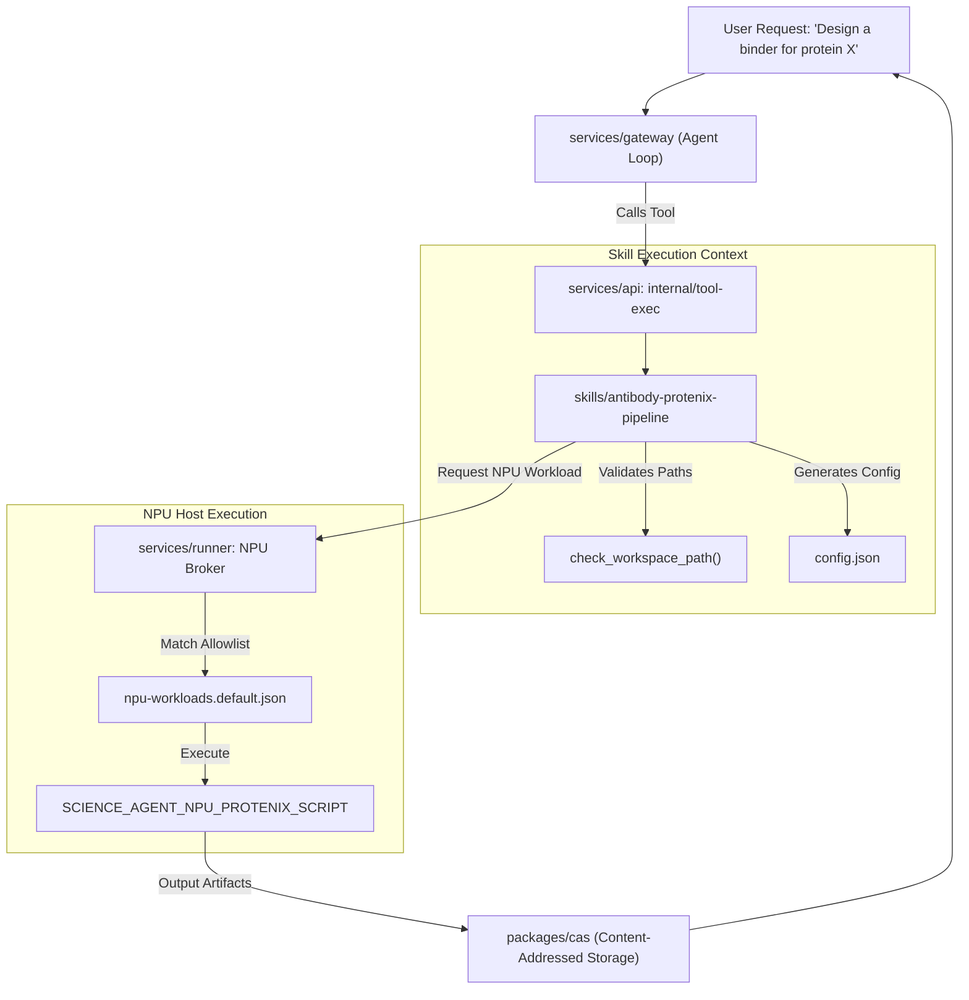
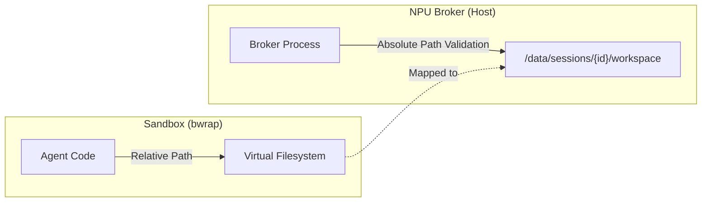

<!-- source: DeepWiki mcp.deepwiki.com · repo openJiuwen-ai/sciencediscovery · page 5.2 Antibody Protenix Pipeline Skill · fetched 2026-11-02 -->

# Antibody Protenix Pipeline Skill

Relevant source files

The following files were used as context for generating this wiki page:

- [.env.example](.env.example)

The **Antibody Protenix Pipeline Skill** is a specialized agentic workflow designed for therapeutic antibody discovery. It leverages the **NPU Host Broker** to execute computationally intensive deep learning models—specifically **RFdiffusion**, **ProteinMPNN**, and **Protenix**—on Ascend 910B hardware while maintaining the security and provenance guarantees of the ScienceDiscovery runtime.

## Pipeline Architecture

The skill implements a multi-stage structural biology pipeline. Because these models require specialized hardware (NPU) and large weight files that cannot typically run inside a standard restricted Bubblewrap sandbox, the skill communicates with the `services/runner` via the NPU Broker mechanism.

### Data Flow and Component Interaction

The following diagram illustrates how a natural language request from a user triggers the underlying code entities and NPU hardware:

**Natural Language to Code Entity Mapping**

**Sources:** [.env.example:93-105](), [services/runner/README.md (implied architecture)]()

---

## Technical Implementation

### NPU Broker Integration
The pipeline relies on the `SCIENCE_AGENT_NPU_BROKER` being enabled (`1`). This allows the `services/runner` to bypass the standard `bwrap` (Bubblewrap) isolation for specific, allowlisted workloads that require direct NPU device access.

*   **Workload Validation:** The runner checks every request against an allowlist defined in `SCIENCE_AGENT_NPU_WORKLOAD_CONFIG`. By default, this points to `services/runner/workloads/npu-workloads.default.json`.
*   **Path Safety:** To prevent directory traversal attacks during host-side execution, the skill must ensure all input and output paths reside within the session's authorized workspace.
*   **Execution Entrypoint:** The core logic is triggered via the script defined in `SCIENCE_AGENT_NPU_PROTENIX_SCRIPT`.

**Sources:** [.env.example:93-105]()

### Job Lifecycle Monitoring
The pipeline is designed for long-running jobs. The lifecycle follows a standard state machine within the API:

1.  **Queued:** The NPU Broker receives the request and places it in the host-side queue.
2.  **Running:** The NPU kernels are active (RFdiffusion for backbone generation, ProteinMPNN for sequence design, or Protenix for structure prediction).
3.  **Completed/Failed:** The results are written back to the workspace, and the runner returns the exit code and logs to the API.

### Configuration Schema
The skill uses a `config.json` to parameterize the pipeline. Key parameters include:
*   **Target Protein:** PDB ID or sequence.
*   **Hotspots:** Specific residues for binding.
*   **Iteration Counts:** Number of diffusion steps and MPNN sequences to generate.
*   **Workspace Mapping:** Mapping of internal sandbox paths to host-side NPU paths.

---

## Environment Configuration

To enable the Antibody Protenix Pipeline, the following environment variables must be configured in the `.env` file or the system environment:

| Variable | Description | Default/Example |
| :--- | :--- | :--- |
| `SCIENCE_AGENT_NPU_BROKER` | Enables the host-side NPU workload broker. | `1` |
| `SCIENCE_AGENT_NPU_WORKLOAD_CONFIG` | Path to the JSON allowlist for NPU tasks. | `services/runner/workloads/npu-workloads.default.json` |
| `SCIENCE_AGENT_NPU_PROTENIX_SCRIPT` | The entrypoint script that manages the Protenix/RFdiffusion/MPNN flow. | `/path/to/protenix_manager.py` |
| `SCIENCE_AGENT_EXEC_TIMEOUT_MS` | Wall-clock limit for the execution. Should be high for NPU jobs. | `0` (Unlimited) |

**Sources:** [.env.example:74-75](), [.env.example:93-105]()

---

## Workspace Path Validation

Safety is maintained by strictly validating all paths passed to the NPU Broker. The skill implementation ensures that:
1.  **Input Data:** All input structures (PDB/FASTA) are registered as `Artifacts` or reside in the `SCIENCE_AGENT_DATA_DIR`.
2.  **Output Data:** The NPU script is restricted to writing only within the specific `Session` workspace directory.
3.  **Path Resolution:** The `services/runner` resolves `${python}` and scientific environment paths dynamically to ensure the NPU workload uses the correct versioned dependencies.

**System Path Interaction Diagram**

**Sources:** [.env.example:32-33](), [.env.example:93-102]()

## Operator Setup (AGENT_BOOTSTRAP.md)

Operators must follow the `AGENT_BOOTSTRAP.md` guide to prepare the host environment for this skill:
1.  **Driver Installation:** Ensure Ascend 910B drivers and firmware are installed on the host.
2.  **Model Weights:** Download and place RFdiffusion and Protenix weights in a directory accessible by the NPU Broker.
3.  **Environment Seeding:** Use `fetch-managed-micromamba.mjs` to ensure the runner has the necessary scientific libraries to interface with the NPU.
4.  **Token Security:** The `SCIENCE_AGENT_RUNNER_TOKEN` must be shared between the API and the Runner to authorize these high-privilege NPU calls.

**Sources:** [.env.example:89-90](), [scripts/binary-release/fetch-managed-micromamba.mjs (referenced)]()

---

