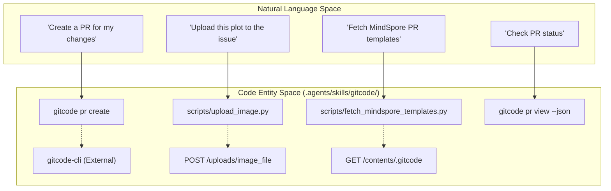
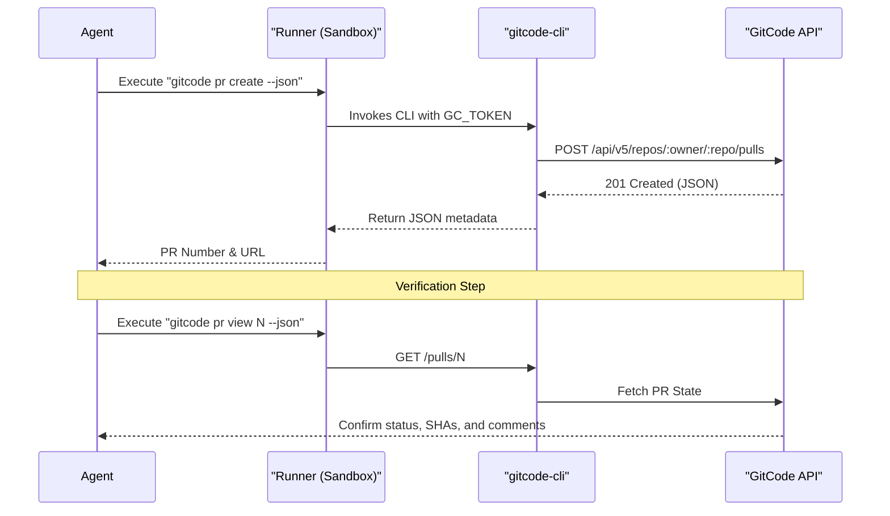

<!-- source: DeepWiki mcp.deepwiki.com · repo openJiuwen-ai/sciencediscovery · page 5.3 GitCode Agent Skills · fetched 2026-11-02 -->

# GitCode Agent Skills

Relevant source files

The following files were used as context for generating this wiki page:

- [.agents/skills/gitcode/SKILL.md](.agents/skills/gitcode/SKILL.md)
- [.agents/skills/gitcode/scripts/download_image.py](.agents/skills/gitcode/scripts/download_image.py)
- [.agents/skills/gitcode/scripts/fetch_mindspore_templates.py](.agents/skills/gitcode/scripts/fetch_mindspore_templates.py)
- [.agents/skills/gitcode/scripts/upload_image.py](.agents/skills/gitcode/scripts/upload_image.py)

The `gitcode` skill provides the ScienceDiscovery agent with the ability to manage the lifecycle of issues and pull requests (PRs) on the GitCode platform. It integrates the `gitcode-cli` tool into the agent's workspace, enabling structured interaction with repositories, including metadata management, image handling, and MindSpore-specific template caching.

## Architecture and Integration

The skill is implemented as a project-local skill located in `.agents/skills/gitcode/`. It relies on the `gitcode-cli` Python package for API interactions and standard `git` for code transport.

### Natural Language to Code Entity Mapping

The following diagram bridges user-level intents to the specific CLI commands and scripts defined in the skill.

**Intent to Execution Mapping**

**Sources:**
- [.agents/skills/gitcode/SKILL.md:1-103]()
- [.agents/skills/gitcode/scripts/upload_image.py:16-35]()
- [.agents/skills/gitcode/scripts/fetch_mindspore_templates.py:16-33]()

## Key Components

### 1. GitCode CLI Integration
The skill primary interface is the `gitcode` command. The agent is instructed to always use `--json` flags to ensure machine-readable responses and to avoid scraping HTML from the web interface [.agents/skills/gitcode/SKILL.md:21-27]().

*   **Transport Requirement**: The skill mandates **SSH** for code transport (`git@gitcode.com:...`). HTTPS is discouraged as it often fails or hangs due to credential requirements in headless environments [.agents/skills/gitcode/SKILL.md:27-27]().
*   **Canonical Hosts**: The skill treats `gitcode.com` and `atomgit.com` as identical, preferring `gitcode.com` for all generated URLs [.agents/skills/gitcode/SKILL.md:32-38]().

### 2. Image Pipeline
Since GitCode's `raw.gitcode.com` requires authentication for user-uploaded images, the skill includes specialized scripts to handle the upload/download flow.

| Script | Purpose | Implementation Detail |
| :--- | :--- | :--- |
| `upload_image.py` | Uploads local files to a repo's attachment store. | Uses `POST /uploads/image_file` with base64 `attach` payload [.agents/skills/gitcode/scripts/upload_image.py:205-212](). |
| `download_image.py` | Fetches images from `raw.gitcode.com`. | Injects `Authorization: Bearer <token>` into standard GET requests [.agents/skills/gitcode/scripts/download_image.py:165-173](). |

**Sources:**
- [.agents/skills/gitcode/scripts/upload_image.py:1-213]()
- [.agents/skills/gitcode/scripts/download_image.py:1-180]()

### 3. MindSpore Template Cache
To ensure compliance with organizational standards, the `fetch_mindspore_templates.py` script synchronizes issue and PR templates from the `mindspore/.gitcode` repository [.agents/skills/gitcode/scripts/fetch_mindspore_templates.py:16-25]().

*   **Logic**: It recursively walks the `.gitcode/` tree via the Contents API and saves `.yml` and `.md` files to a local `.gitignored` cache [.agents/skills/gitcode/scripts/fetch_mindspore_templates.py:152-162]().
*   **Default Ref**: It defaults to the `master` branch of `mindspore/.gitcode` [.agents/skills/gitcode/scripts/fetch_mindspore_templates.py:50-54]().

**Sources:**
- [.agents/skills/gitcode/scripts/fetch_mindspore_templates.py:152-211]()

## Data Flow: PR Creation and Review

The following sequence diagram illustrates the data flow when an agent creates and verifies a Pull Request.

**PR Lifecycle Data Flow**

**Sources:**
- [.agents/skills/gitcode/SKILL.md:81-103]()
- [.agents/skills/gitcode/SKILL.md:111-117]()

## Authentication and Security

The skill follows a strict token resolution hierarchy to avoid leaking credentials:
1.  `GC_TOKEN` environment variable.
2.  `GITCODE_TOKEN` environment variable.
3.  `~/.config/gc/auth.json` (managed by `gitcode auth login`).

**Token Resolution Implementation:**
All scripts (`upload_image.py`, `download_image.py`, `fetch_mindspore_templates.py`) share a common `resolve_token(host)` function logic that checks these sources without printing the secrets to logs [.agents/skills/gitcode/scripts/upload_image.py:92-132](), [.agents/skills/gitcode/scripts/download_image.py:103-132]().

## Error Handling

The skill defines specific recovery procedures for common API conflicts:

*   **409 Conflict**: Occurs when a PR already exists for a branch. The agent is instructed to read the existing PR using `pr view` instead of blindly retrying or renaming branches [.agents/skills/gitcode/SKILL.md:109-109]().
*   **403 Forbidden**: Occurs during image downloads or PR approvals. The agent must check if it has the necessary repository roles or if the `Authorization` header is correctly formed as `Bearer <token>` [.agents/skills/gitcode/scripts/download_image.py:18-24]().

**Sources:**
- [.agents/skills/gitcode/SKILL.md:109-109]()
- [.agents/skills/gitcode/scripts/download_image.py:174-178]()

---

