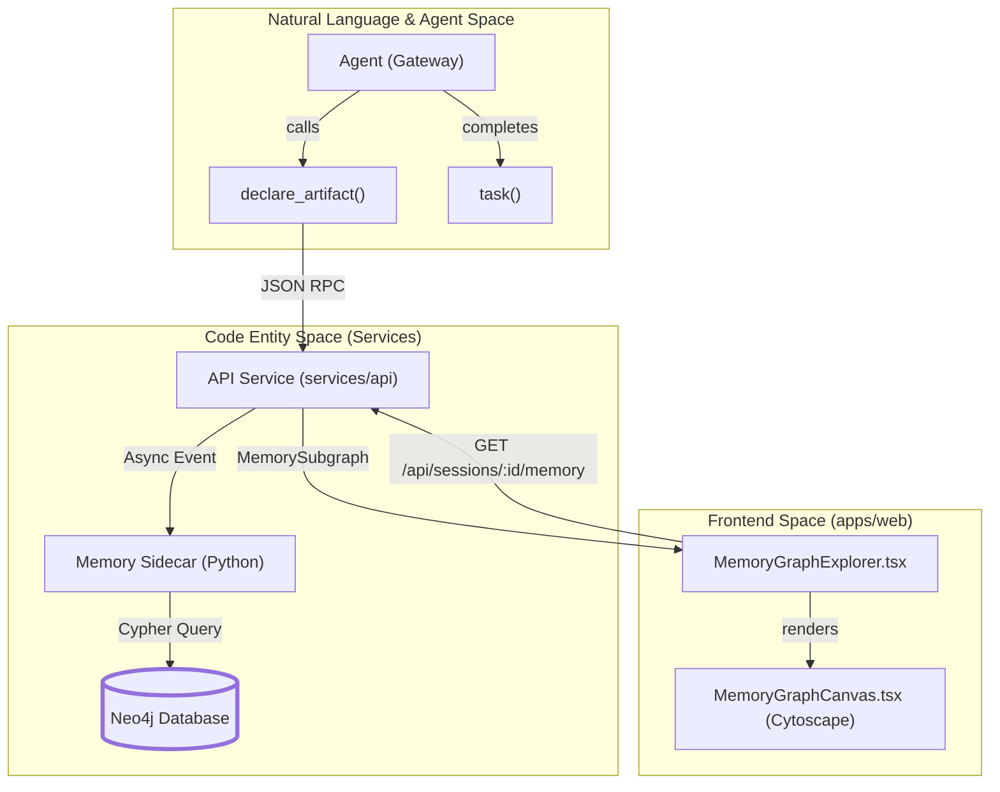
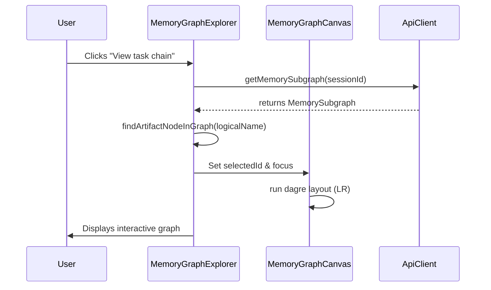

<!-- source: DeepWiki mcp.deepwiki.com · repo openJiuwen-ai/sciencediscovery · page 6 Science Memory Graph · fetched 2026-11-02 -->

# Science Memory Graph

Relevant source files

The following files were used as context for generating this wiki page:

- [apps/web/src/MemoryGraphCanvas.tsx](apps/web/src/MemoryGraphCanvas.tsx)
- [apps/web/src/MemoryGraphExplorer.tsx](apps/web/src/MemoryGraphExplorer.tsx)
- [apps/web/src/MemoryGraphProduct.tsx](apps/web/src/MemoryGraphProduct.tsx)
- [apps/web/src/MemoryGraphSettingsEditor.tsx](apps/web/src/MemoryGraphSettingsEditor.tsx)
- [apps/web/src/MemoryGraphView.tsx](apps/web/src/MemoryGraphView.tsx)
- [apps/web/src/NodeField.tsx](apps/web/src/NodeField.tsx)

The **Science Memory Graph** is an experimental feature in ScienceDiscovery that provides a persistent, structured representation of research activities, task chains, and citation networks using a Neo4j graph database. It enables agents to maintain long-term context across sessions and allows users to visualize the provenance and logical flow of scientific discoveries.

## Architecture Overview

The feature follows a four-layer architecture spanning the entire monorepo:

1.  **Storage Layer (Neo4j):** A graph database storing nodes (Tasks, Papers, Artifacts) and edges (produces, cites, next).
2.  **Schema Layer (`@science-agent/schema`):** Defines the graph ontology and API request/response types.
3.  **Service Layer (API & Python Sidecar):** The Node.js API manages connection state and querying, while the Python Gateway (via `deer-flow`) handles the asynchronous writing of graph data during agent execution.
4.  **Frontend Layer (`apps/web`):** A Cytoscape-based visualization engine for exploring task chains and artifact provenance.

### Data Flow Diagram

The following diagram illustrates how an agent's action in the Natural Language Space is translated into a persistent graph entity.

**Sources:** [apps/web/src/MemoryGraphView.tsx:62-67](), [apps/web/src/MemoryGraphExplorer.tsx:100-128](), [apps/web/src/MemoryGraphCanvas.tsx:142-150]()

---

## Data Model (Ontology)

The graph represents scientific workflows through specific node labels and edge types.

### Node Labels
| Label | Description | Key Metadata (`extra`) |
| :--- | :--- | :--- |
| `ResearchGoal` | The high-level objective of a session. | `core_objective`, `domain` |
| `SubTask` | A discrete step in the research plan. | `task_type`, `status`, `task_id` |
| `Paper` | A scientific publication found during research. | `title`, `link`, `authors` |
| `Evidence` | A specific claim or data point extracted from text. | `content`, `confidence`, `locator` |
| `Code` | An execution event (e.g., Python script). | `code_id` (Run ID), `tool` |
| `Artifact` | A file produced by the system (CSV, PDB, etc.). | `path`, `artifact_id`, `version` |

### Edge Types
| Type | Direction | Meaning |
| :--- | :--- | :--- |
| `produces` | Code/Task → Artifact | Indicates the source of a file. |
| `next` | Task → Task | Represents the temporal sequence of execution. |
| `cites` | Paper → Paper | Represents a bibliographic reference. |
| `extracted_from` | Evidence → Paper | Links a data point to its source publication. |
| `input` | Artifact → Code | Indicates a file used as input for execution. |

**Sources:** [apps/web/src/MemoryGraphCanvas.tsx:25-43](), [apps/web/src/MemoryGraphExplorer.tsx:26-33](), [apps/web/src/MemoryGraphProduct.tsx:28-29]()

---

## Frontend Implementation

The frontend provides two primary views: a **Thumbnail Card** in the workspace panel and a **Full-Screen Explorer**.

### Visualization Engine (`MemoryGraphCanvas`)
The system uses `cytoscape` with the `dagre` layout engine to render the graph. The layout is configured as "Left-to-Right" (`LR`) to optimize the wide aspect ratio of the explorer panel.

*   **Layout Logic:** The `hierarchyLayout` function dynamically adjusts node and rank separation based on the total node count to prevent overcrowding in large graphs [apps/web/src/MemoryGraphCanvas.tsx:115-126]().
*   **Node Naming:** The `graphNodeDisplayNames` function prevents label collisions (e.g., multiple `run_python` nodes) by appending a `#n` suffix to repeated node names [apps/web/src/MemoryGraphCanvas.tsx:69-87]().

### Explorer and Provenance (`MemoryGraphExplorer`)
The explorer allows users to "walk" the chain of discovery. It integrates directly with the Artifact and Evidence systems:
*   **Artifact Resolution:** The `useResolvedArtifactName` hook maps graph nodes back to session artifacts by matching `artifact_id` or `logicalName` [apps/web/src/MemoryGraphProduct.tsx:38-82]().
*   **Chain Walking:** Users can trigger an "Auto-Chain" view which filters the graph to show only the upstream/downstream dependencies of a specific node [apps/web/src/MemoryGraphExplorer.tsx:153-157]().

**Sources:** [apps/web/src/MemoryGraphExplorer.tsx:51-71](), [apps/web/src/MemoryGraphCanvas.tsx:169-180](), [apps/web/src/MemoryGraphProduct.tsx:38-42]()

---

## Configuration and Management

Science Memory is an **opt-in** feature. It requires an external Neo4j instance.

### Enabling the Service
The service status is managed in the **System Settings** under the "Science Memory" group. The `MemoryGraphSettingsEditor` handles the following configuration:
*   **Neo4j URI:** Typically `http://127.0.0.1:7474`.
*   **Authentication:** Username and Password storage.
*   **Status States:**
    *   `healthy`: Connected and functional.
    *   `degraded`: Service enabled but unreachable.
    *   `needs-password`: Credentials missing or invalid.
    *   `disabled`: Feature toggled off.

**Sources:** [apps/web/src/MemoryGraphSettingsEditor.tsx:21-46](), [apps/web/src/MemoryGraphView.tsx:73-84]()

### Polling and Synchronization
Because graph writes occur asynchronously in the Python sidecar, the frontend does not rely solely on the standard session `refreshKey`. Instead, `MemoryGraphView` implements a `GRAPH_POLL_MS` (default 8 seconds) timer to re-fetch the subgraph and update the UI as the agent works [apps/web/src/MemoryGraphView.tsx:24-58]().

### Node Detail Rendering
When a node is selected, the `NodeProperties` component dispatches to specialized detail views based on the node label:
*   `ResearchGoalDetail`: Shows core objectives and topic scope.
*   `SubTaskDetail`: Shows task type and execution status (e.g., "succeeded").
*   `EvidenceDetail`: Partitions extra attributes into "Content", "Meta", and "Raw" buckets using `partitionEvidenceExtra`.

**Sources:** [apps/web/src/MemoryGraphProduct.tsx:88-104](), [apps/web/src/NodeField.tsx:48-62]()

---

