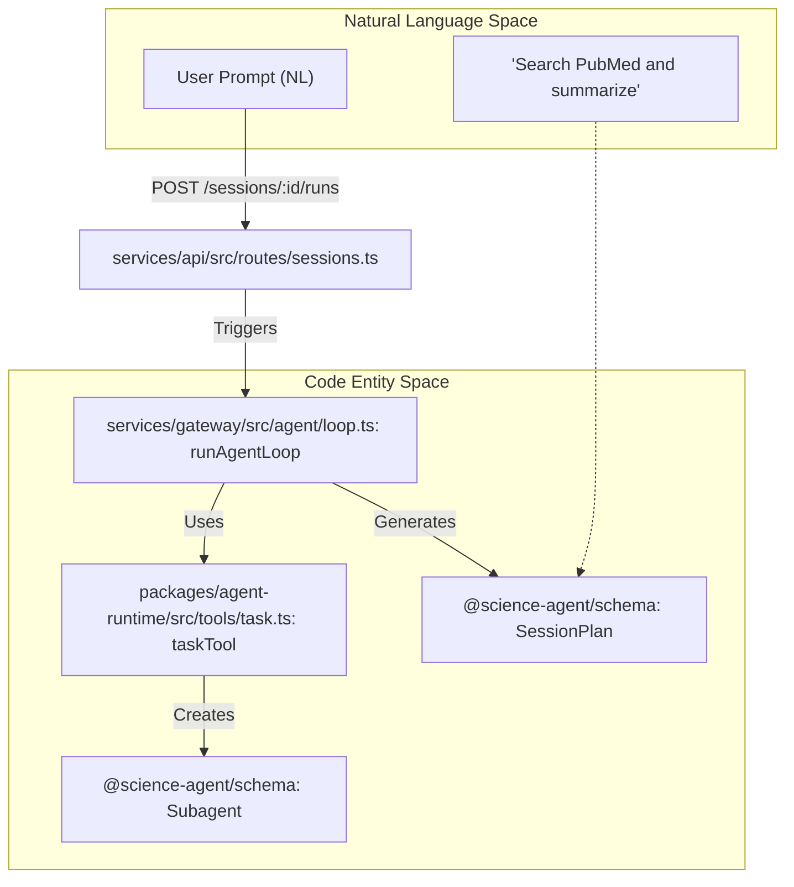
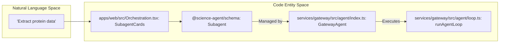

<!-- source: DeepWiki mcp.deepwiki.com · repo openJiuwen-ai/sciencediscovery · page 7 Subagent Orchestration and Governance · fetched 2026-11-02 -->

# Subagent Orchestration and Governance

Relevant source files

The following files were used as context for generating this wiki page:

- [apps/web/src/Orchestration.tsx](apps/web/src/Orchestration.tsx)
- [apps/web/src/composer/ConnectorPicker.tsx](apps/web/src/composer/ConnectorPicker.tsx)
- [apps/web/src/composer/WorkbenchNavigation.tsx](apps/web/src/composer/WorkbenchNavigation.tsx)
- [apps/web/src/composer/model.tsx](apps/web/src/composer/model.tsx)

ScienceDiscovery employs a hierarchical multi-agent model where a lead agent orchestrates specialized subagents to perform complex scientific tasks. This system is governed by strict tool contracts, workspace isolation, and loop-protection mechanisms to ensure reliability and safety in autonomous research workflows.

## Lead-Prompt Orchestration

The orchestration begins at the **Gateway Service**, which manages the primary LangChain agent loop [services/gateway/src/agent/loop.ts:1-20](). The lead agent uses a specific prompt strategy to decompose user queries into structured plans and sub-tasks.

### Plan Management
The lead agent proposes a `SessionPlan` which is rendered in the UI via the `PlanCard` component [apps/web/src/Orchestration.tsx:43-68]().
- **Feasibility Assessment**: Every plan includes a `feasibilityConfidence` score [apps/web/src/Orchestration.tsx:37-40]().
- **State Tracking**: Plans move through states such as `proposed`, `accepted`, and `recorded` [apps/web/src/Orchestration.tsx:54-63]().

### Natural Language to Code Entity Mapping: Orchestration
The following diagram illustrates how natural language intents from the user are translated into internal code entities within the Gateway and API services.

Sources: [apps/web/src/Orchestration.tsx:17-50](), [services/gateway/src/agent/loop.ts:1-20]()

## Subagent Lifecycle and Task Contract

Subagents are invoked using the `task` tool [packages/agent-runtime/src/tools/task.ts](). This tool establishes a formal contract between the lead and the child.

### The Task Tool Contract
When the lead agent calls the `task` tool, it must provide:
1.  **Subagent Type**: e.g., `literature-searcher`, `code-engineer`.
2.  **Prompt**: The specific instructions for the subagent.
3.  **Output JSON Schema**: A `Zod` or JSON schema that the subagent's final answer must satisfy.
4.  **Max Turns**: A hard limit on the number of tool-use iterations the subagent can perform.

### Child Workspace Isolation
Each subagent operates within a **Child Workspace**.
- **Path Isolation**: Subagents are restricted to specific sub-directories within the session's data folder.
- **Tool Filtering**: Subagents may be granted a subset of the lead agent's tools (e.g., a `report-writer` might not have `run_python` access).

Sources: [apps/web/src/Orchestration.tsx:91-148](), [packages/agent-runtime/src/tools/task.ts]()

## Governance and Safety Mechanisms

To prevent runaway costs or infinite loops, the system implements several governance layers.

### Tool-Loop Protection
The Gateway monitors the sequence of tool calls for every agent. If an agent repeats the same tool call with identical arguments multiple times, the system triggers:
- **REPEATED_TOOL_CALL**: A warning injected into the agent's history.
- **TOOL_LOOP_DETECTED**: A terminal state that halts the subagent to prevent token exhaustion.

### Result Validation
Before a subagent's result is returned to the lead, it is validated against the `outputJsonSchema` provided in the task definition. If validation fails, the subagent is prompted to correct its output format.

### History Summarization Checkpoints
As the turn count increases, the system performs **History Summarization**. This process compresses earlier turns into a concise summary to stay within the model's context window while preserving critical context (e.g., artifact IDs created).

| Feature | Implementation | Purpose |
| :--- | :--- | :--- |
| **Turn Limits** | `maxTurns` in `Subagent` schema | Prevents infinite execution. |
| **Usage Tracking** | `usage.totalTokens` | Monitors cost and model constraints [apps/web/src/Orchestration.tsx:93](). |
| **Output Schema** | `outputJsonSchema` | Ensures lead agent receives machine-readable data. |

Sources: [apps/web/src/Orchestration.tsx:119-145](), [packages/schema/src/index.ts]()

## DeerFlow Orchestration

The system utilizes **DeerFlow** for managing the execution flow of agents. 

### Trade-offs and Design
- **Pros**: Provides robust state management and resumption capabilities for long-running scientific workflows.
- **Cons**: Introduces overhead in state serialization; requires careful management of the `SessionStore` to prevent SQLite bloat.

### Code Entity Mapping: Execution Flow
This diagram bridges the high-level "Subagent" concept to the specific classes and functions that handle its execution.

Sources: [apps/web/src/Orchestration.tsx:102-120](), [services/gateway/src/agent/loop.ts:1-20]()

## Specialized Specialists

The lead agent can delegate to specific `Specialists`, which are pre-configured subagent templates with tailored system prompts and toolsets.

- **Specialist Management**: Users can define and edit specialists via the `SpecialistManager` [apps/web/src/Orchestration.tsx:150-162]().
- **Skill Integration**: Specialists are often associated with specific `SkillDescriptors` (e.g., `antibody-protenix-pipeline`) [apps/web/src/composer/WorkbenchNavigation.tsx:37-48]().

### Connector Governance
Subagents access external scientific databases through **Connectors** (e.g., PubMed, UniProt). The `ConnectorPicker` component governs which external data sources are active for a given session [apps/web/src/composer/ConnectorPicker.tsx:37-49]().

Sources: [apps/web/src/Orchestration.tsx:150-165](), [apps/web/src/composer/ConnectorPicker.tsx:70-85](), [apps/web/src/composer/WorkbenchNavigation.tsx:31-48]()

---

