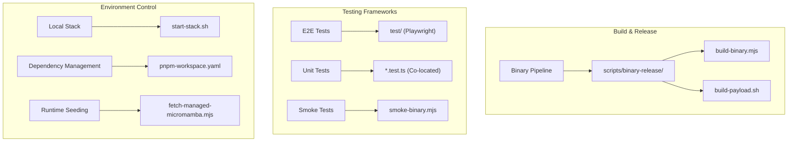
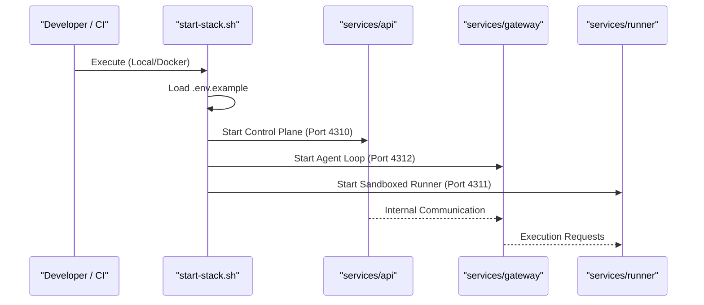

<!-- source: DeepWiki mcp.deepwiki.com · repo openJiuwen-ai/sciencediscovery · page 9 Infrastructure: Testing, Scripts, and CI · fetched 2026-11-02 -->

# Infrastructure: Testing, Scripts, and CI

Relevant source files

The following files were used as context for generating this wiki page:

- [.gitattributes](.gitattributes)
- [.gitignore](.gitignore)
- [.npmrc](.npmrc)
- [CODEOWNERS](CODEOWNERS)

The ScienceDiscovery infrastructure is designed to support a complex, multi-language monorepo containing Node.js services, Python agent loops, and sandboxed execution environments. The project utilizes a `pnpm` workspace structure to manage dependencies across the `apps/`, `services/`, and `packages/` directories, ensuring consistent builds and type safety.

The infrastructure focuses on three primary pillars:
1.  **Multi-Layer Testing**: Ranging from co-located unit tests to Playwright-based end-to-end browser automation.
2.  **Binary Release Pipeline**: A sophisticated build process that bundles the entire application, including managed scientific runtimes, into a single executable.
3.  **Local Development Tooling**: Scripts to orchestrate the multi-process stack in both native and containerized modes.

### Repository Organization and Conventions

The codebase follows strict conventions for environment isolation and version control. The `.gitignore` is configured to exclude local caches for both Python (`.venv`, `.uv-cache`) and Node.js (`node_modules`, `.pnpm-store`), while preserving critical agent skill configurations in `.agents/` [[.gitignore:1-57]](). 

To maintain cross-platform script compatibility, `.gitattributes` enforces `LF` line endings for all `.sh` and `.bash` files [[.gitattributes:1-2]](). Dependency management is locked via `.npmrc` to ensure exact versioning, preventing drift across development environments [[.npmrc:1-1]]().

### System Component Mapping

The following diagram maps the infrastructure components to their respective code entities:

**Infrastructure to Code Mapping**

Sources: [[.gitignore:17-24]](), [[.gitignore:37-41]]()

### Testing Strategy Overview

ScienceDiscovery employs a layered testing approach to ensure stability across the control plane and the agent execution loop. 

*   **Unit & Integration Tests**: These are co-located with the source code (e.g., `*.test.ts`) to verify individual services (API, Runner, Launcher) and shared logic in `packages/`.
*   **Frontend Testing**: Located in `apps/web/tests/`, these focus on React reducers and SSE (Server-Sent Events) stream isolation.
*   **E2E Testing**: The `test/` directory contains Playwright specifications that simulate user interactions in the browser, covering full research workflows from session creation to artifact generation.

For details, see [Testing Strategy](#9.1).

### Binary Release and Packaging

The application is distributed as a self-contained ELF binary. This is achieved through a specialized pipeline in `scripts/binary-release/`. The process involves:
1.  **Payload Generation**: Bundling the API, Gateway, and Runner services.
2.  **Runtime Seeding**: Fetching and embedding `micromamba` to ensure scientific environments (Python/R) are available without host-side configuration.
3.  **Digest Verification**: Using `digest-tree.mjs` to create integrity manifests for the embedded files.

For details, see [Binary Release and Packaging](#9.2).

### Execution Flow: Local Stack and CI

The `start-stack.sh` script serves as the primary entry point for developers, supporting both local native execution and Docker-based modes. It orchestrates the three-process architecture (API, Gateway, Runner) and ensures environment variables defined in `.env` files are correctly propagated.

**Process Orchestration Flow**

Sources: [[.gitignore:26-30]]()

### Code Ownership

Maintenance responsibilities are defined in the `CODEOWNERS` file. Default reviews for infrastructure and core services are routed to the primary maintainers to ensure code quality and architectural consistency across the monorepo [[CODEOWNERS:1-10]]().

Sources: [[CODEOWNERS:1-10]](), [[.gitignore:1-57]](), [[.gitattributes:1-2]](), [[.npmrc:1-1]]()

---

