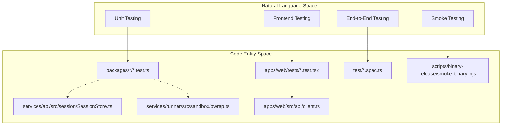
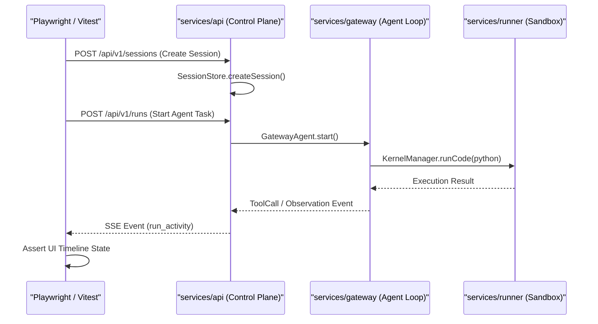

<!-- source: DeepWiki mcp.deepwiki.com · repo openJiuwen-ai/sciencediscovery · page 9.1 Testing Strategy · fetched 2026-11-02 -->

# Testing Strategy

Relevant source files

The following files were used as context for generating this wiki page:

- [.gitattributes](.gitattributes)
- [CONTRIBUTING.md](CONTRIBUTING.md)

ScienceDiscovery employs a multi-layer testing strategy designed to ensure the reliability of its three-process runtime (API, Gateway, Runner) and the integrity of the agent-loop execution. The strategy spans from low-level unit tests for shared logic to full End-to-End (E2E) browser automation using Playwright.

## 1. Multi-Layer Testing Architecture

The testing framework is divided into four distinct layers, each targeting a specific boundary of the system.

### 1.1 Co-located Unit Tests (`*.test.ts`)
Unit tests are co-located with their respective source files across the monorepo packages. These tests focus on pure logic, data transformations, and service-level internal state machines.

*   **API Service**: Tests the `SessionStore` SQLite operations, the `Run` lifecycle state machine, and SSE event generation.
*   **Runner Service**: Validates `Bubblewrap` command construction, `seccomp` profile generation, and kernel manager resource allocation.
*   **Packages**: Extensive testing of `packages/schema` for type validation, `packages/cas` for content-addressed storage integrity, and `packages/mcp-sources` for connector trust boundaries.

### 1.2 Frontend Unit and Component Tests (`tests/*.test.tsx`)
Located within `apps/web/tests/`, these tests utilize Vitest and React Testing Library. They focus on:
*   **Reducers & State**: Testing complex state transitions in the session and run activity reducers.
*   **Stream Isolation**: Simulating SSE (Server-Sent Events) payloads to ensure the UI correctly maps agent events (thinking, tool calls, plan updates) to timeline cards.
*   **Artifact Rendering**: Verifying that `CsvArtifactWindow` and `MolstarWindow` correctly parse and display data from the API.

### 1.3 End-to-End (E2E) Specs (`test/`)
High-level browser automation tests using **Playwright**. These specs reside in the root `test/` directory and validate the entire user journey:
*   Project creation and session initialization.
*   Agent interaction (sending prompts and receiving multi-step tool responses).
*   Permission request/grant flows.
*   Environment and skill management UI.

### 1.4 Gateway and API Smoke Suites
These suites validate the integration between the TypeScript API and the Python Gateway (DeerFlow). They include:
*   **Mock Suites**: Using Vitest to mock the Gateway response to test API resilience.
*   **Real Smoke Suites**: Executed via `scripts/binary-release/smoke-binary.mjs` to verify that the packaged ELF binary correctly bootstraps the environment and executes a basic "Hello World" agent task.

## 2. Code Entity Mapping

The following diagram bridges the "Natural Language Space" of testing concepts to the "Code Entity Space" by mapping test types to their implementation files and directories.

**Test Layer to Code Mapping**

*Sources: [9.1. Testing Strategy Description](), [scripts/binary-release/smoke-binary.mjs:1-50]()*

## 3. Data Flow and Execution Environment

The testing environment mimics the production runtime by isolating the API, Gateway, and Runner. During E2E and Smoke testing, the system validates the flow of data through these boundaries.

**Test Data Flow Diagram**

*Sources: [services/api/src/session/SessionStore.ts:1-100](), [apps/web/src/api/client.ts:1-28]()*

## 4. Key Testing Utilities and Scripts

### 4.1 Binary Smoke Testing
The `smoke-binary.mjs` script is critical for the release pipeline. It verifies that the `ScienceDiscovery` ELF binary, which embeds the runtime payload, can successfully:
1.  Extract the payload to a temporary directory.
2.  Bootstrap the `uv` and `micromamba` environments.
3.  Launch the three-process stack.
4.  Execute a programmatic test case against the local API port.

### 4.2 CI Integration
Testing is integrated into the build pipeline defined in `scripts/binary-release/`. The pipeline ensures that no binary is distributed unless it passes the full suite of unit and smoke tests.

| Test Category | Tool | Location | Purpose |
| :--- | :--- | :--- | :--- |
| **Unit** | Vitest | `packages/**/*.test.ts` | Shared logic and schema validation |
| **Frontend** | Vitest / RTL | `apps/web/tests/` | UI component and state logic |
| **E2E** | Playwright | `test/` | Full browser-based user flows |
| **Binary Smoke** | Node.js | `scripts/binary-release/` | Packaged binary verification |

*Sources: [scripts/binary-release/smoke-binary.mjs:1-100](), [CONTRIBUTING.md:1-7]()*

---

