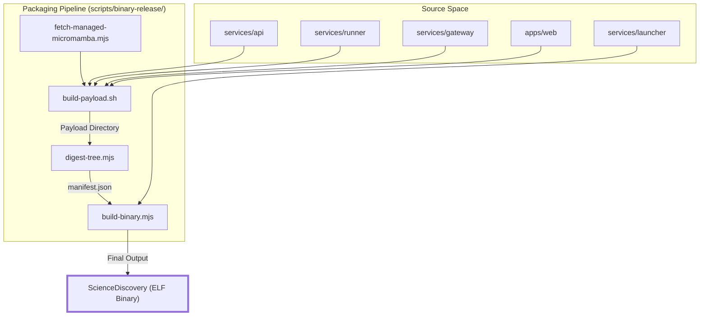

<!-- source: DeepWiki mcp.deepwiki.com · repo openJiuwen-ai/sciencediscovery · page 9.2 Binary Release and Packaging · fetched 2026-11-02 -->

# 9.2 Binary Release and Packaging

<details>
<summary>Relevant source files</summary>

The following files were used as context for generating this wiki page:

- [.agents/skills/deploy/SKILL.md](.agents/skills/deploy/SKILL.md)
- [.gitattributes](.gitattributes)

</details>


The ScienceDiscovery project is distributed as a single, self-contained ELF binary. This binary encapsulates the entire runtime environment, including the API service, the Gateway agent loop, the Sandbox Runner, and the necessary Python/Node.js dependencies. The packaging pipeline ensures that the complex multi-service architecture can be deployed with zero external dependencies other than a standard Linux environment and `bubblewrap` for sandboxing.

## Release Pipeline Overview

The release process is orchestrated by a series of scripts located in `scripts/binary-release/`. The pipeline transforms the monorepo source code into a compressed payload, which is then embedded into a specialized launcher executable.

### Build Workflow

The build follows a strict sequence to ensure integrity and reproducibility:
1.  **Dependency Seeding**: `fetch-managed-micromamba.mjs` downloads the platform-specific `micromamba` binary used for environment management.
2.  **Payload Preparation**: `build-payload.sh` compiles the TypeScript services (API, Runner, Launcher) and the React frontend, then aggregates them with the Gateway Python source.
3.  **Content Digesting**: `digest-tree.mjs` generates a manifest of all files in the payload to enable integrity checks during extraction.
4.  **Binary Construction**: `build-binary.mjs` uses `pkg` to bundle the launcher code and the payload into the final `ScienceDiscovery` ELF file.

### Data Flow Diagram
The following diagram illustrates how source components are transformed into the final release binary.

"Source to Binary Transformation"

**Sources:** [.agents/skills/deploy/SKILL.md:48-55](), [.agents/skills/deploy/SKILL.md:104-113]()

---

## The Payload Structure

The "Payload" is the heart of the binary release. It contains everything needed to bootstrap the system on a fresh machine.

### Embedding Mechanism
The launcher service is designed to recognize when it is running from within a `pkg`-bundled environment. When the user executes `./ScienceDiscovery serve`, the launcher locates its internal virtual filesystem (usually `/snapshot/science-discovery/`) and extracts the embedded payload to the user's data directory (defaulting to `./science-agent-data/`) [.agents/skills/deploy/SKILL.md:114-118]().

### Managed Runtimes
The file `scripts/binary-release/runtimes.json` (referenced in the pipeline) defines the specific versions of external runtimes that must be bundled. This includes:
*   **Micromamba**: Used by the Runner to create isolated Python and R environments.
*   **Node.js**: The internal version used to execute the API and Runner services.

The script `fetch-managed-micromamba.mjs` ensures that the correct architecture-specific binary (x86_64 or aarch64) is fetched and placed in the payload [.agents/skills/deploy/SKILL.md:53-55]().

---

## Deployment and Bootstrapping

When the binary is executed for the first time, it performs a "First-Launch Dependency Bootstrap."

### The `serve` Command Lifecycle
1.  **Extraction**: The launcher extracts the internal payload to the `--data-dir` [.agents/skills/deploy/SKILL.md:117-118]().
2.  **Integrity Check**: The launcher verifies the extracted files against the `manifest.json` generated by `digest-tree.mjs`.
3.  **Environment Setup**:
    *   Installs `uv` for Python package management.
    *   Bootstraps the `deer-flow` agent engine.
    *   Installs gateway dependencies into a managed environment [.agents/skills/deploy/SKILL.md:114-116]().
4.  **Service Orchestration**: The launcher starts the Gateway (port 4312) and Runner (port 4311) in the background, then starts the API (port 4310) [.agents/skills/deploy/SKILL.md:111-113]().

### Deployment Prerequisites
The binary release relies on the host system for low-level sandboxing capabilities.

| Requirement | Purpose | Verification Command |
| :--- | :--- | :--- |
| **Bubblewrap** | Provides unprivileged user namespace sandboxing for code execution. | `bwrap --version` |
| **User Namespaces** | Required for `bwrap` to function without root. | `sysctl kernel.unprivileged_userns_clone` |
| **AppArmor** | On Ubuntu 24.04+, must be configured to allow unprivileged namespaces. | `sysctl kernel.apparmor_restrict_unprivileged_userns` |

**Sources:** [.agents/skills/deploy/SKILL.md:62-79](), [.agents/skills/deploy/SKILL.md:89-91]()

---

## Release Verification (Smoke Testing)

The pipeline includes `smoke-binary.mjs`, which automates the validation of a produced binary.

### Smoke Test Sequence
1.  **Execution**: Launches the binary using the `serve` command in a clean temporary directory.
2.  **Health Check**: Polls the API `/health` endpoint to ensure all internal services (Gateway and Runner) have reported as healthy.
3.  **Sandbox Probe**: Attempts a simple `run_python` tool call to verify that `bwrap` is correctly interacting with the host kernel and that the embedded `micromamba` can execute code [.agents/skills/deploy/SKILL.md:72-79]().

### Implementation Mapping
"Code Entity Space to Packaging Logic"
```mermaid
graph LR
    subgraph "Logic (Natural Language)"
        "Create Payload"
        "Generate Hashes"
        "Embed Assets"
        "Verify Binary"
    end

    subgraph "Code Entities (Scripts)"
        BP["build-payload.sh"]
        DT["digest-tree.mjs"]
        BB["build-binary.mjs"]
        SB["smoke-binary.mjs"]
    end

    "Create Payload" -.-> BP
    "Generate Hashes" -.-> DT
    "Embed Assets" -.-> BB
    "Verify Binary" -.-> SB
```

**Sources:** [.agents/skills/deploy/SKILL.md:59-70](), [.agents/skills/deploy/SKILL.md:99-102]()

---

