# Page: ScienceDiscovery Overview

# ScienceDiscovery Overview

<details>
<summary>Relevant source files</summary>

The following files were used as context for generating this wiki page:

- [CONTRIBUTING.md](CONTRIBUTING.md)
- [LICENSE](LICENSE)
- [README.md](README.md)
- [README_zh.md](README_zh.md)
- [Third_Party_Open_Source_Software_Notice.txt](Third_Party_Open_Source_Software_Notice.txt)

</details>


ScienceDiscovery is a one-stop AI research workspace purpose-built for scientific exploration. It provides a unified environment where researchers can perform literature reviews, formulate hypotheses, develop code, and execute experimental trials [README.md:3-4](). The platform is designed for trusted local or workstation use, leveraging a secure sandbox for code execution and a multi-agent orchestration layer to handle complex research assignments [README.md:10-19]().

## Product Positioning

ScienceDiscovery is positioned as a research-centric orchestration tool rather than a multi-tenant service. Key architectural constraints include:
*   **Security Model**: The API, gateway, and runner services listen on loopback by default. The API uses a single bearer token and does not terminate TLS [README.md:7-8]().
*   **Isolation**: Code execution (Python, R, Shell) is confined within a fail-closed `bubblewrap` sandbox, while the control plane (API, Gateway, PDF worker) runs outside this sandbox [README.md:8-9]().
*   **Target Audience**: Intended for individual researchers or teams in a secured network environment, distributed as a prepackaged binary for Linux (x86_64/aarch64) [README.md:12-32]().

## Key Features

| Feature | Description |
| :--- | :--- |
| **Scientific Connectors** | One-click access to research databases (PubMed, arXiv, UniProt, etc.) [README.md:16-16](). |
| **Autonomous Sandbox** | Agents write and debug code in isolated environments with managed scientific dependencies [README.md:17-17](). |
| **Multi-Agent Orchestration** | Automatic task decomposition using over 300 cross-domain Skills [README.md:18-18](). |
| **Full Traceability** | Visualized workflows with provenance for code, logs, and environments [README.md:19-19](). |

Sources: [README.md:3-19](), [README.md:28-32]()

## System Architecture and Subsystems

The system is divided into a Node.js control plane and specialized sidecars for agent logic and code execution.

### High-Level Service Interaction
The following diagram illustrates how the "Natural Language Space" (Agent Gateway) interacts with the "Code Entity Space" (Runner and API).

#### Diagram: Logical Service Mapping
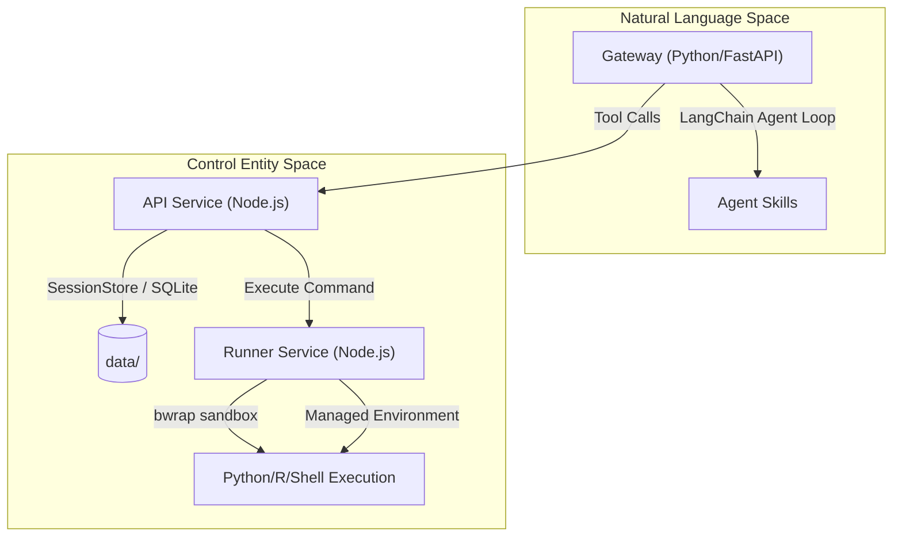
Sources: [README.md:10-12](), [README.md:8-9]()

### Component Relationship
This diagram maps system components to their specific roles in the research lifecycle.

#### Diagram: Research Workflow and Code Entities
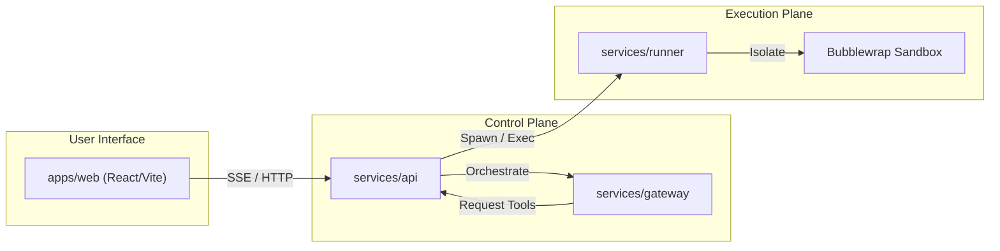
Sources: [README.md:10-12](), [README.md:7-8]()

## Detailed Subsystems

ScienceDiscovery's functionality is distributed across several key subsystems:

1.  **Control Plane (API Service)**: Manages the run lifecycle state machine, session storage in SQLite, and permission enforcement.
2.  **Agent Gateway**: A Python-based sidecar that runs the LangChain agent loop and translates high-level tasks into tool calls.
3.  **Isolated Runner**: Handles the creation of `bubblewrap` sandboxes and manages `micromamba` environments for scientific computing.
4.  **Scientific Connectors (MCP)**: Provides structured access to external databases like PubMed and PDB via the Model Context Protocol.
5.  **Provenance and CAS**: Ensures all research outputs are traceable using Content-Addressed Storage (SHA-256).

## Navigation

For technical details on specific areas, refer to the following child pages:

*   **[Getting Started and Deployment](#1.1)**: Guide for binary installation, dependency bootstrapping (uv, deer-flow), and host requirements like Bubblewrap.
*   **[Configuration Reference](#1.2)**: Reference for `SCIENCE_AGENT_*` environment variables, default ports (4310/4311/4312), and storage layouts.

For the underlying architecture, see the **Runtime Architecture** (Section 2) and **Shared Packages** (Section 3) documentation.

Sources: [README.md:21-23](), [CONTRIBUTING.md:5-5]()

---

# Page: Getting Started and Deployment

# Getting Started and Deployment

<details>
<summary>Relevant source files</summary>

The following files were used as context for generating this wiki page:

- [.agents/skills/deploy/SKILL.md](.agents/skills/deploy/SKILL.md)
- [.dockerignore](.dockerignore)
- [.env.docker.example](.env.docker.example)
- [.env.example](.env.example)

</details>


ScienceDiscovery is distributed primarily as a self-contained ELF binary that manages a multi-process runtime. This page provides technical instructions for binary installation, first-launch bootstrapping, host environment requirements, and Docker-based deployment.

## Binary Installation and Bootstrapping

The `ScienceDiscovery` executable is a packed ELF binary that includes the API, Gateway, and Runner services, along with a payload of static assets and configuration manifests.

### First-Launch Sequence
When `ScienceDiscovery serve` is executed for the first time, the launcher performs a bootstrap sequence to prepare the local environment:
1.  **Payload Extraction**: The embedded runtime payload is extracted to the data directory (defaulting to `./science-agent-data`) [services/launcher: Step 4]().
2.  **Dependency Bootstrap**: The launcher installs `uv`, `deer-flow`, and the Gateway's Python dependencies into the data directory [.agents/skills/deploy/SKILL.md:113-116](). This requires outbound network access unless a local package cache is configured.
3.  **Token Generation**: If `SCIENCE_AGENT_AUTH_TOKEN` is unset, the system generates a random bearer token, prints it to the console, and persists it in `<data-dir>/secrets/auth-token` [.agents/skills/deploy/SKILL.md:128-132]().

### Process Management
The launcher acts as a supervisor for three primary services:
*   **API Service**: Bound to `127.0.0.1:4310` by default.
*   **Runner Service**: Bound to `127.0.0.1:4311` by default.
*   **Gateway Service**: Bound to `127.0.0.1:4312` by default.

A `Ctrl-C` signal to the foreground binary triggers a graceful shutdown of all background services in reverse order [.agents/skills/deploy/SKILL.md:111-113]().

**Sources:** [.agents/skills/deploy/SKILL.md:104-116](), [.env.example:43-62]()

---

## Host Environment Requirements

ScienceDiscovery relies on Linux-native isolation features. The host must meet specific kernel and utility requirements for the sandbox to function.

### Bubblewrap Requirement
The `Runner` service uses `bubblewrap` (bwrap) to create unprivileged user namespaces for sandboxed execution of Python, R, and Shell code [.agents/skills/deploy/SKILL.md:53-55]().
*   **Version**: 0.6+ is required; 0.8+ is recommended to support the `--disable-userns` flag [.agents/skills/deploy/SKILL.md:68]().
*   **Kernel Configuration**:
    *   `kernel.unprivileged_userns_clone` must be `1` [.agents/skills/deploy/SKILL.md:66]().
    *   On Ubuntu 24.04+, `kernel.apparmor_restrict_unprivileged_userns` must be set to `0` [.agents/skills/deploy/SKILL.md:67]().

### Preflight Sandbox Check
Users can verify the host's sandbox readiness by running a read-only probe:
```bash
bwrap --unshare-all --unshare-user --die-with-parent \
  --ro-bind /usr /usr --symlink usr/bin /bin --symlink usr/lib /lib \
  --symlink usr/lib64 /lib64 /usr/bin/true && echo "sandbox ok"
```
If this fails, the API will still start, but all `run_python` and `run_shell` tools will fail unless `--skip-sandbox-check` is used [.agents/skills/deploy/SKILL.md:75-79, 99-102]().

**Sources:** [.agents/skills/deploy/SKILL.md:63-79](), [.env.docker.example:70-72]()

---

## Deployment Data Flow and Networking

ScienceDiscovery follows a loopback-only security model by default. Accessing a remote deployment requires secure tunneling.

### Remote Access via SSH Port Forwarding
Because the API binds to `127.0.0.1` and uses a single bearer token without TLS, it is recommended to use SSH port forwarding rather than exposing the port to the network [.agents/skills/deploy/SKILL.md:133-137]().

**Diagram: Remote Access and Service Topology**

```mermaid
graph TD
    subgraph "Local Machine (Laptop)"
        [Browser] -- "http://localhost:4310" --> [SSH_Client]
    end

    subgraph "Remote Host (Server)"
        [SSH_Server] -- "Forwarded Port 4310" --> [API_Service]
        
        subgraph "ScienceDiscovery Binary Runtime"
            [API_Service] -- "Internal Requests" --> [Gateway_Service]
            [API_Service] -- "Sandbox Execution" --> [Runner_Service]
            [Gateway_Service] -- "Tool Callbacks" --> [API_Service]
        end
        
        [Runner_Service] -- "bwrap" --> [Isolated_Sandbox]
    end

    [API_Service] -.-> [SessionStore_SQLite]
    [Isolated_Sandbox] -.-> [Workspace_Files]
```

**Sources:** [.agents/skills/deploy/SKILL.md:125-137](), [.env.example:57-62]()

---

## Docker Compose Deployment

For containerized environments, a `Dockerfile` and `docker-compose.yml` are provided. The Docker image includes `bubblewrap`, `micromamba`, and `OpenSSH` [.env.docker.example:48-55, 70-73]().

### Configuration via .env.docker
A specialized environment file, `.env.docker.example`, defines the parameters for the containerized stack:

| Variable | Description | Default |
| :--- | :--- | :--- |
| `SCIENCE_AGENT_UID` / `GID` | Host user/group IDs for the `./data` bind mount | `1000` |
| `SCIENCE_AGENT_PUBLISH_PORT` | The host port where the UI/API is exposed | `4310` |
| `SCIENCE_AGENT_AUTH_TOKEN` | Bearer token (generated if empty) | (empty) |
| `SCIENTIFIC_ENVS` | Enable/Disable micromamba environment provisioning | `1` |
| `SCIENCE_AGENT_BWRAP_PATH` | Path to bwrap inside the container | `/usr/bin/bwrap` |

### Deployment Steps
1.  Copy `.env.docker.example` to `.env`.
2.  Adjust `SCIENCE_AGENT_UID` and `SCIENCE_AGENT_GID` to match the host user to ensure write permissions on the `./data` volume [.env.docker.example:23-26]().
3.  Run `docker compose up -d`.

**Sources:** [.env.docker.example:1-78](), [.dockerignore:1-51]()

---

## Service Port Reference

The following ports are used by the system components. In a standard deployment, only the API port should be accessible to the user.

| Service | Default Port | Protocol | Scope |
| :--- | :--- | :--- | :--- |
| **API** | `4310` | HTTP/SSE | External/Tunnel |
| **Runner** | `4311` | HTTP | Loopback Only |
| **Gateway** | `4312` | HTTP | Loopback Only |
| **Memory Graph** | `17674` | HTTP | Loopback Only |

**Sources:** [.env.example:51-115](), [.agents/skills/deploy/SKILL.md:65]()

---

# Page: Configuration Reference

# Configuration Reference

<details>
<summary>Relevant source files</summary>

The following files were used as context for generating this wiki page:

- [.agents/skills/deploy/SKILL.md](.agents/skills/deploy/SKILL.md)
- [.env.docker.example](.env.docker.example)
- [.env.example](.env.example)

</details>


This page provides a technical reference for the ScienceDiscovery configuration system. It details the environment variables, networking defaults, storage architecture, and the mechanisms used to bootstrap the multi-process runtime.

## Environment Variables and the `--env-file` Mechanism

ScienceDiscovery uses a centralized environment variable configuration model. When running the preprovided binary via `ScienceDiscovery serve`, the system looks for an environment file (defaulting to `.env`) or a path specified via the `--env-file` flag [docs/zh/reference/configuration.md:15-16]().

### Variable Priority
1.  **Command-line Flags**: Flags like `--port` or `--data-dir` override environment variables [.agents/skills/deploy/SKILL.md:92-94]().
2.  **Explicit Environment Variables**: Variables set in the shell (e.g., `export SCIENCE_AGENT_PORT=5000`).
3.  **Env File**: Key-value pairs defined in the file passed to `--env-file`.
4.  **Stored Secrets**: For sensitive values like `SCIENCE_AGENT_AUTH_TOKEN`, if the variable is unset, the system reads from `<data-dir>/secrets/` [.env.example:47-50]().

### Key Environment Variables

| Variable | Default | Description |
| :--- | :--- | :--- |
| `SCIENCE_AGENT_DATA_DIR` | `data` | Root directory for all state, logs, and environments [.env.example:32-32](). |
| `SCIENCE_AGENT_HOST` | `127.0.0.1` | Binding address for the API Service [.env.example:51-51](). |
| `SCIENCE_AGENT_PORT` | `4310` | Public port for the Web UI and API [.env.example:52-52](). |
| `SCIENCE_AGENT_AUTH_TOKEN` | *Generated* | Bearer token for UI/API authentication [.env.example:53-53](). |
| `SCIENCE_AGENT_LOG_LEVEL` | `INFO` | Logging verbosity (DEBUG, INFO, WARN, ERROR) [.env.example:38-38](). |
| `SCIENTIFIC_ENVS` | `1` | Enables/disables managed scientific environment provisioning [.env.docker.example:51-51](). |

**Sources:** [.env.example:1-146](), [.env.docker.example:1-78](), [.agents/skills/deploy/SKILL.md:42-44]()

---

## Network Topology and Default Ports

The ScienceDiscovery runtime consists of four primary services communicating over loopback (`127.0.0.1`). Only the **API Service** is intended to be exposed to users, typically via an SSH tunnel or a trusted network interface.

### Service Port Mapping

| Service | Default Port | Communication Type | Role |
| :--- | :--- | :--- | :--- |
| **API Service** | `4310` | HTTP / SSE | Control plane and Web UI host [.env.example:52-52](). |
| **Runner Service** | `4311` | HTTP | Sandboxed code execution (Python/R/Shell) [.env.example:87-87](). |
| **Gateway Service** | `4312` | HTTP | LangChain agent loop and tool orchestration [.env.example:61-61](). |
| **Memory Graph** | `17674` | HTTP | Experimental Neo4j-backed execution mirror [.env.example:114-114](). |

### Communication Flow Diagram
This diagram maps the network interactions between code entities across the service boundaries.

**Diagram: Service Inter-Process Communication (IPC)**
```mermaid
graph TD
    subgraph "User Space"
        "Browser/Client" -- "HTTP/SSE (Port 4310)" --> "API_Service[services/api]"
    end

    subgraph "Control Plane (127.0.0.1)"
        "API_Service" -- "HTTP (Port 4312)" --> "Gateway_Service[services/gateway]"
        "API_Service" -- "HTTP (Port 4311)" --> "Runner_Service[services/runner]"
        "API_Service" -- "HTTP (Port 17674)" --> "Memory_Graph[services/memory-graph]"
    end

    subgraph "Callback Path"
        "Gateway_Service" -- "Tool Call Proxy" --> "API_Service"
        "API_Service" -- "Internal Exec" --> "Runner_Service"
    end

    style "API_Service" stroke-width:2px
    style "Gateway_Service" stroke-width:2px
    style "Runner_Service" stroke-width:2px
```
**Sources:** [.env.example:51-115](), [.agents/skills/deploy/SKILL.md:111-113]()

---

## Storage Layout (`data/`)

The `SCIENCE_AGENT_DATA_DIR` (defaulting to `./data` or `./science-agent-data`) is the authoritative root for all persistent and ephemeral state. The launcher ensures this directory exists and has correct permissions before starting sub-services [.agents/skills/deploy/SKILL.md:118-118]().

### Directory Structure

| Path | Purpose |
| :--- | :--- |
| `data/secrets/` | Stores generated `auth-token` and `gateway-internal-token` [.env.example:47-50](). |
| `data/logs/` | Rotated operational logs (`api.log`, `runner.log`, etc.) [.env.example:34-36](). |
| `data/envs/` | Managed scientific environments (e.g., `envs/paper`, `envs/gateway`) [.env.example:28-31](). |
| `data/cas/` | Content-Addressed Storage for artifacts and provenance records [.env.example:35-37](). |
| `data/sessions/` | SQLite databases and local workspace files for individual agent sessions [.env.example:32-33](). |

**Sources:** [.env.example:28-50](), [.agents/skills/deploy/SKILL.md:42-46]()

---

## Resource Quotas and Timeouts

To ensure system stability during automated scientific discovery, ScienceDiscovery enforces several quota levels via environment variables.

### Execution and Idle Timeouts
*   **Sandboxed Execution (`SCIENCE_AGENT_EXEC_TIMEOUT_MS`)**: Hard wall-clock limit for a single `run_python` or `run_shell` call. Default is 2 hours (7,200,000ms) in Docker [.env.docker.example:57-58]().
*   **Kernel Idle (`SCIENCE_AGENT_KERNEL_IDLE_MS`)**: Time before a persistent Python/R kernel is culled. Default is 30 minutes [.env.docker.example:60-61]().
*   **Gateway Idle (`SCIENCE_AGENT_GATEWAY_IDLE_TIMEOUT_MS`)**: Time before the agent-loop sidecar is shut down if no turns are active. Default 4 minutes [.env.example:72-72]().

### Storage and Output Quotas
*   **Workspace Limit (`SCIENCE_AGENT_WORKSPACE_MAX_BYTES`)**: Total size allowed for a session workspace (uploads + generated files). Default 10 GiB [.env.example:142-143]().
*   **Output Truncation (`SCIENCE_AGENT_MAX_OUTPUT_BYTES`)**: Maximum retained stdout/stderr per tool execution. Default 1 GiB [.env.example:145-146]().

**Sources:** [.env.example:71-80](), [.env.example:138-146](), [.env.docker.example:57-61]()

---

## Runtime Bootstrap and Provisioning

When `ScienceDiscovery serve` is executed, the `launcher` service performs a sequence of preflight checks and dependency installations.

### Bootstrap Sequence
1.  **Environment Extraction**: Extracts embedded runtime payloads (micromamba, uv) to the data directory [.agents/skills/deploy/SKILL.md:114-116]().
2.  **Dependency Bootstrap**: Installs `uv`, `deer-flow`, and Python dependencies for the `gateway` service [.agents/skills/deploy/SKILL.md:114-116]().
3.  **Sandbox Validation**: Probes `bwrap` (Bubblewrap) capabilities, checking for unprivileged user namespace support [.agents/skills/deploy/SKILL.md:72-78]().
4.  **Service Launch**: Starts `gateway` and `runner` as background child processes, then starts the `API` service in the foreground [.agents/skills/deploy/SKILL.md:111-113]().

### Sandbox Requirements
The system requires `bubblewrap` (0.6+) to be installed on the host [.agents/skills/deploy/SKILL.md:68-68](). On modern Linux distributions (e.g., Ubuntu 24.04+), specific kernel knobs must be configured:
*   `kernel.unprivileged_userns_clone=1` [.agents/skills/deploy/SKILL.md:66-66]()
*   `kernel.apparmor_restrict_unprivileged_userns=0` [.agents/skills/deploy/SKILL.md:67-67]()

**Diagram: Launcher Bootstrap Logic**
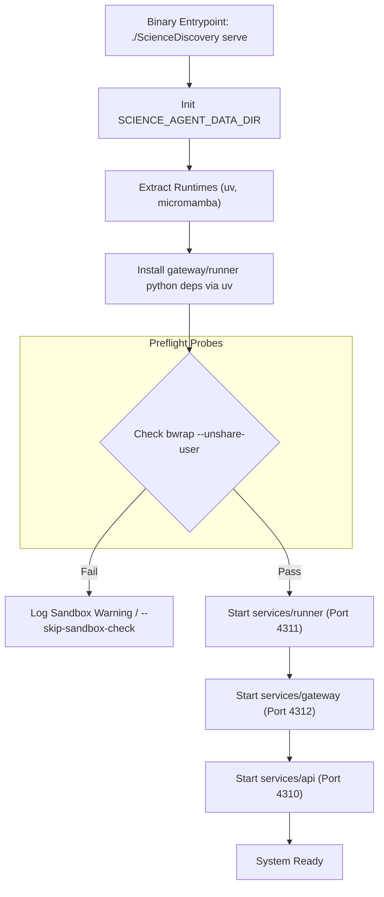
**Sources:** [.agents/skills/deploy/SKILL.md:57-78](), [.agents/skills/deploy/SKILL.md:104-124]()

---

# Page: Runtime Architecture

# 2. Runtime Architecture

<details>
<summary>Relevant source files</summary>

The following files were used as context for generating this wiki page:

- [.env.example](.env.example)
- [CODEOWNERS](CODEOWNERS)

</details>


ScienceDiscovery operates as a distributed system of three primary processes, typically bound to `127.0.0.1` to maintain a loopback-only security model. This architecture separates the **Control Plane** (API), the **Agentic Reasoning** (Gateway), and the **Untrusted Execution** (Runner).

### System Overview

The runtime is designed to isolate long-running agent loops and high-risk scientific code execution from the main API service. All inter-process communication is authenticated via internal tokens generated at first boot [`.env.example:47-53,65,89`]().

#### Process Responsibilities

| Process | Role | Implementation | Primary Responsibility |
| :--- | :--- | :--- | :--- |
| **API** | Control Plane | Node.js / TypeScript | Lifecycle management, SQLite storage, SSE streaming, and permission governance. |
| **Gateway** | Agent Loop | Python / FastAPI | LangChain/DeerFlow orchestration, LLM provider abstraction, and tool proxying. |
| **Runner** | Sandbox | Node.js / TypeScript | Bubblewrap-based execution of Python, R, and Shell scripts with resource quotas. |

### Communication Flow

The system uses a "callback" pattern for tool execution. While the Gateway drives the agent loop, it does not have direct access to the sandbox or the file system. Instead, it calls back into the API to request tool execution, which then delegates to the Runner.

#### Execution Sequence Diagram
This diagram illustrates how a user prompt flows through the system entities to trigger a sandboxed execution.

"Natural Language Space to Code Entity Space: Execution Flow"
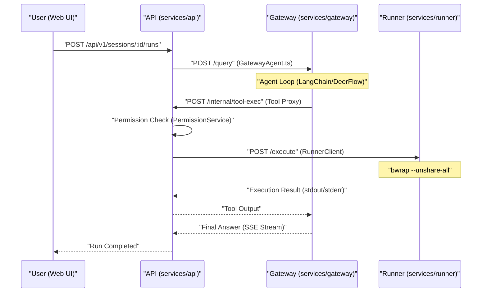
**Sources:** [`.env.example:57-68,85-92`](), [`services/api`](), [`services/gateway`](), [`services/runner`]().

### Security Model

The architecture enforces a strict security boundary centered on the API process:
1.  **Loopback Binding**: By default, all services bind to `127.0.0.1` [`.env.example:51,60,86`]().
2.  **Token Authentication**: Each process requires a specific bearer token (`SCIENCE_AGENT_AUTH_TOKEN`, `SCIENCE_AGENT_GATEWAY_INTERNAL_TOKEN`, `SCIENCE_AGENT_RUNNER_TOKEN`) [`.env.example:53,65,89`]().
3.  **Sandbox Isolation**: The Runner utilizes `bubblewrap` (bwrap) to ensure scientific code (Python/R) has no network access and limited filesystem visibility [`.env.example:91,121-124`]().
4.  **Governance**: The API acts as the "Policy Enforcement Point," requiring manual or rule-based approval for sensitive tools before they reach the Runner.

### Component Services

#### [Control Plane: API Service](#2.1)
The central orchestrator. It manages the `SessionStore` (SQLite), tracks the run lifecycle state machine (queued → running → blocked → completed), and handles Server-Sent Events (SSE) for real-time UI updates. It also hosts the `GatewayAgent` translation layer that speaks to the Gateway sidecar.

#### [Agent-Loop Gateway](#2.2)
A Python sidecar that executes the agentic reasoning loop. It integrates `deer-flow` and LangChain to manage conversation history, tool selection, and LLM provider interactions. It uses a `ToolProxy` to send execution requests back to the API.

#### [Isolated Runner and Sandbox Execution](#2.3)
The execution engine. It manages ephemeral and persistent kernels (Python, R, Shell) inside `bwrap` containers. It enforces wall-clock limits (`SCIENCE_AGENT_EXEC_TIMEOUT_MS`) and output size quotas (`SCIENCE_AGENT_MAX_OUTPUT_BYTES`) [`.env.example:75,146`]().

#### [Launcher and Binary Packaging](#2.4)
The bootstrap system. It manages the lifecycle of the three processes, environment variable injection via `.env` files, and the initialization of scientific environments using `micromamba` [`.env.example:32,125-132`]().

### Shared Infrastructure
The services communicate using a shared schema defined in `packages/schema` and leverage a Content-Addressed Storage (CAS) system in `packages/cas` for artifact and provenance tracking.

"Process and Data Entity Mapping"
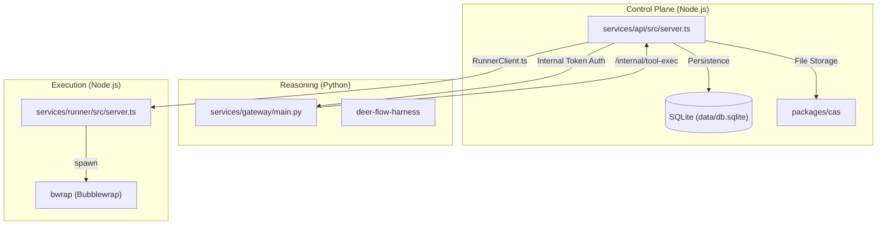
**Sources:** [`.env.example:32,51-68,85-92`](), [`CODEOWNERS:10-10`]()

---

# Page: Control Plane: API Service

# Control Plane: API Service

<details>
<summary>Relevant source files</summary>

The following files were used as context for generating this wiki page:

- [apps/web/src/api.ts](apps/web/src/api.ts)
- [apps/web/src/api/artifacts.ts](apps/web/src/api/artifacts.ts)
- [apps/web/src/api/auth.ts](apps/web/src/api/auth.ts)
- [apps/web/src/api/client.ts](apps/web/src/api/client.ts)
- [apps/web/src/api/projects.ts](apps/web/src/api/projects.ts)
- [apps/web/src/api/runs.ts](apps/web/src/api/runs.ts)
- [apps/web/src/api/sessions.ts](apps/web/src/api/sessions.ts)
- [apps/web/src/api/settings.ts](apps/web/src/api/settings.ts)

</details>


The **API Service** acts as the central control plane for ScienceDiscovery. It is responsible for orchestrating the lifecycle of agent runs, managing persistent storage via SQLite, enforcing permission boundaries, and providing a unified HTTP/SSE interface for the frontend. It coordinates between the **Agent-Loop Gateway** (which executes LLM logic) and the **Isolated Runner** (which executes code).

## System Architecture and Data Flow

The API service manages the transition between high-level user intent and low-level execution events. It maintains the authoritative state of all projects, sessions, and runs.

### Bridge: Natural Language to Code Entity Space

The following diagram maps conceptual frontend actions to the internal API implementation and their corresponding data storage entities.

**API Mapping: Frontend Actions to Code Entities**
```mermaid
graph TD
    subgraph "Frontend Space (apps/web)"
        [UI_Chat_Input] --> |"streamMessage()"| [RunsApiClient]
        [UI_Permission_Dialog] --> |"decidePermissionRequest()"| [SessionsApiClient]
    end

    subgraph "API Control Plane (services/api)"
        [RunsApiClient] --> |"POST /api/sessions/:id/messages"| [HTTP_Router]
        [SessionsApiClient] --> |"POST /api/permission-requests/:id/decision"| [HTTP_Router]
        
        [HTTP_Router] --> [RunStateMachine]
        [HTTP_Router] --> [PermissionStateMachine]
        
        [RunStateMachine] --> [SessionStore_SQLite]
        [PermissionStateMachine] --> [SessionStore_SQLite]
        
        [RunStateMachine] --> |"GatewayAgent.chat()"| [Gateway_Service]
    end

    subgraph "Persistence (data/)"
        [SessionStore_SQLite] -.-> |"schema: session_run"| [sqlite_db]
        [SessionStore_SQLite] -.-> |"schema: permission_request"| [sqlite_db]
    end
```
**Sources:** [apps/web/src/api/runs.ts:144-149](), [apps/web/src/api/sessions.ts:148-153](), [apps/web/src/api/auth.ts:52-73]()

---

## Run Lifecycle State Machine

The core of the API service is the management of a `SessionRun`. A run progresses through a set of states defined in the shared schema, ensuring that only one active run exists per session and that all events are captured for provenance.

### State Transitions
1.  **Queued**: The run is created and waiting for resources.
2.  **Running**: The `GatewayAgent` is actively communicating with the LLM.
3.  **Blocked**: The run is suspended awaiting human intervention (e.g., a permission request or tool call approval).
4.  **Completed/Failed/Cancelled**: Terminal states where the execution context is cleaned up.

**Run Lifecycle Flow**
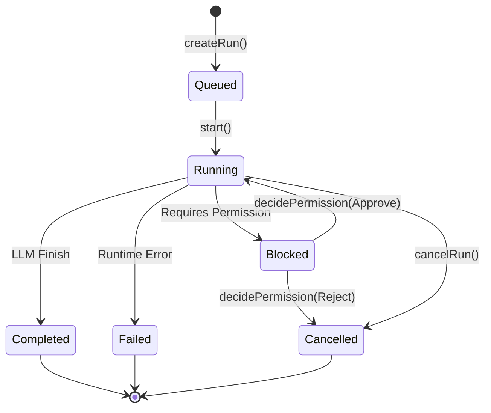
**Sources:** [apps/web/src/api/runs.ts:67-78](), [apps/web/src/api/sessions.ts:148-153]()

---

## Storage and Persistence

The API service utilizes a **SessionStore** backed by **SQLite** to persist the entire workspace state. This includes not just messages, but the full scientific context.

| Entity | Description | Key Code Reference |
| :--- | :--- | :--- |
| **Session** | The top-level container for a research task. | `Session` in `@science-agent/schema` |
| **Run** | A single execution attempt within a session. | `SessionRun` in `@science-agent/schema` |
| **Permission** | Records of granted or denied tool capabilities. | `PermissionRequest` / `PermissionGrant` |
| **Provenance** | CAS-linked records of how artifacts were derived. | `ArtifactDerivation` |
| **CAS** | Content-Addressed Storage for large blobs (logs, files). | `readCas(hash)` in `RunsApiClient` |

**Sources:** [apps/web/src/api/runs.ts:47-49](), [apps/web/src/api/artifacts.ts:62-64](), [apps/web/src/api/sessions.ts:133-135]()

---

## SSE Streaming and Event Handling

To provide a responsive "live" experience, the API uses **Server-Sent Events (SSE)** to stream run events from the Gateway to the Frontend.

### Event Propagation
When a run is active, the `streamMessage` or `subscribeRunEvents` methods establish a persistent connection. The API service multiplexes events from the underlying GatewayAgent (such as `thinking`, `call_tool`, and `output`) and pushes them to the client.

*   **Sequence Tracking**: Every event is assigned a sequence number to allow clients to resume streams without losing data after a reconnection.
*   **Multiplexing**: The API translates internal Gateway signals into `RunStreamEvent` objects defined in the schema.

**Sources:** [apps/web/src/api/runs.ts:88-136](), [apps/web/src/api/runs.ts:144-185]()

---

## Permission and Governance State Machine

ScienceDiscovery operates on a "Human-in-the-loop" security model. The API service manages a `PermissionEpoch` for each session.

1.  **Request**: When the agent attempts a sensitive tool call (e.g., network access or NPU usage), the Gateway issues a `PermissionRequest`.
2.  **Epochs**: Permissions are valid only for a specific "Epoch". Rotating the epoch (`rotatePermissionEpoch`) invalidates previous grants, forcing re-authorization for new tasks.
3.  **Decisions**: The API provides endpoints for the user to `Approve` or `Reject` requests, which triggers the state machine to resume the blocked run.

**Sources:** [apps/web/src/api/sessions.ts:118-127](), [apps/web/src/api/sessions.ts:148-153]()

---

## GatewayAgent Translation Layer

The `GatewayAgent` (accessed via the API) acts as a translation layer between the HTTP Control Plane and the Python-based Gateway Service.

**Entity Association: API to Gateway**
```mermaid
graph LR
    subgraph "Control Plane (Node.js)"
        [HTTP_Handler] --> [GatewayAgent_Class]
        [GatewayAgent_Class] --> [SSE_Manager]
    end

    subgraph "Communication"
        [GatewayAgent_Class] --> |"gRPC/HTTP POST"| [Python_Gateway_Process]
        [Python_Gateway_Process] --> |"Event Stream"| [GatewayAgent_Class]
    end

    subgraph "Gateway Service (Python)"
        [Python_Gateway_Process] --> [LangChain_Agent_Loop]
        [LangChain_Agent_Loop] --> [Tool_Executor]
    end
```
**Sources:** [apps/web/src/api/runs.ts:150-158](), [apps/web/src/api/runs.ts:166-182]()

### Key Functions in the Control Plane
*   `listProjects()` / `createProject()`: Manage high-level workspace grouping. [apps/web/src/api/projects.ts:28-34]()
*   `streamMessage()`: The primary entry point for starting an interactive agent session. [apps/web/src/api/runs.ts:144-149]()
*   `readCas(hash)`: Retrieves raw data for artifacts, stdout, or code from the Content-Addressed Storage. [apps/web/src/api/runs.ts:47-49]()
*   `getArtifactDashboard()`: Aggregates the state of all scientific artifacts produced during a session. [apps/web/src/api/artifacts.ts:133-135]()

---
**Sources:**
- `apps/web/src/api/auth.ts`
- `apps/web/src/api/projects.ts`
- `apps/web/src/api/sessions.ts`
- `apps/web/src/api/runs.ts`
- `apps/web/src/api/artifacts.ts`
- `apps/web/src/api/settings.ts`

---

# Page: Agent-Loop Gateway

# Agent-Loop Gateway

<details>
<summary>Relevant source files</summary>

The following files were used as context for generating this wiki page:

- [.agents/skills/deploy/SKILL.md](.agents/skills/deploy/SKILL.md)
- [.env.example](.env.example)

</details>


The Agent-Loop Gateway is a Python-based sidecar service built with FastAPI that orchestrates the core LangChain agent loop. It serves as the bridge between the TypeScript-based Control Plane (API) and the Large Language Model (LLM), managing tool execution proxies, history summarization, and the integration of the `deer-flow` reasoning framework.

## Overview and Purpose

The Gateway is responsible for the "thinking" phase of the ScienceDiscovery runtime. While the API service manages session state and persistence, the Gateway executes the actual iterative agent loop, translating between natural language intents and structured tool calls. It operates as a loopback-only service, typically listening on `127.0.0.1:4312` [services/gateway/main.py:60-61]().

### Key Responsibilities
*   **Agent Loop Management**: Running the LangChain-based reasoning cycle.
*   **Tool Proxy Construction**: Wrapping workspace tools (Python, Shell, R) into a format the agent can invoke, while routing the actual execution back to the API for governance and provenance.
*   **Deferred Tool Promotion**: Handling specialized scientific tools (e.g., PubMed, arXiv) that require specific environment or permission contexts.
*   **History Summarization**: Managing context window limits by summarizing long interaction histories.
*   **Provider Adapter Boundary**: Interfacing with various LLM providers through a unified `_engine/` adapter layer.

## Architecture and Data Flow

The Gateway sits between the API and the LLM. It does not directly execute code in the sandbox; instead, it calls back into the API's `/internal/tool-exec` endpoint to perform actions.

### System Context Diagram
This diagram illustrates how the Gateway (Code Entity: `services/gateway`) bridges the Natural Language Space of the LLM with the Code Execution Space of the API and Runner.

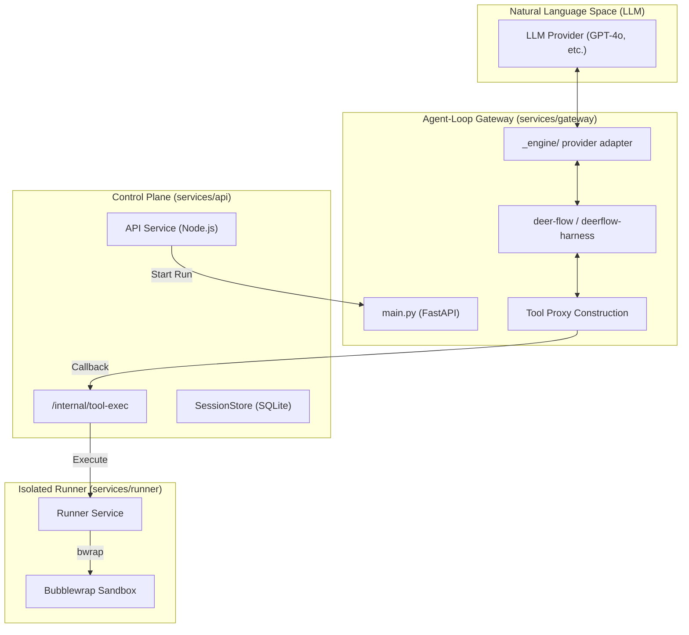
**Sources:** [.env.example:57-68](), [services/gateway/main.py:60-61](), [.agents/skills/deploy/SKILL.md:111-113]()

## Implementation Details

### The Agent Loop and Deer-Flow
The Gateway utilizes `deer-flow` (and the `deerflow-harness`) to manage complex reasoning tasks. When the API triggers a run, it sends a request to the Gateway's execution endpoint. The Gateway then initializes a LangChain agent configured with a specific set of tools and a system prompt derived from the agent's "Skill" definition.

### Tool Proxy Construction
Tools are not implemented within the Gateway itself. Instead, the Gateway receives a tool manifest from the API and constructs "Proxy Tools." When the agent calls a tool like `run_python`, the Gateway sends an HTTP request back to the `SCIENCE_AGENT_TOOL_CALLBACK_URL` [.env.example:66-68](). This ensures that all side effects (file changes, network access) are governed by the API's permission system and recorded in the provenance log.

### Provider Adapter Boundary (`_engine/`)
The Gateway abstracts LLM specificities through an internal adapter layer. This allows ScienceDiscovery to support multiple backends (OpenAI, Anthropic, or local models) while maintaining a consistent interface for the `deer-flow` logic.

### History Summarization
To prevent context window overflow during long scientific research sessions, the Gateway implements a history summarization mechanism. It monitors the token count and, upon reaching a threshold, triggers a sub-loop to condense previous turns into a concise summary that is injected back into the system prompt.

## Configuration and Security

The Gateway is designed to be internal-only. It relies on a shared secret for authentication with the API.

| Variable | Description | Default |
| :--- | :--- | :--- |
| `SCIENCE_AGENT_GATEWAY_HOST` | Listening host for the sidecar. | `127.0.0.1` |
| `SCIENCE_AGENT_GATEWAY_PORT` | Listening port for the sidecar. | `4312` |
| `SCIENCE_AGENT_GATEWAY_INTERNAL_TOKEN` | Secret shared between API and Gateway. | Generated on first start |
| `SCIENCE_AGENT_TOOL_CALLBACK_URL` | The API endpoint for tool execution. | `http://<host>:<port>/internal/tool-exec` |

**Sources:** [.env.example:60-68](), [.agents/skills/deploy/SKILL.md:127-132]()

## Lifecycle of a Request

1.  **Initiation**: The user sends a message to the API.
2.  **Dispatch**: The API calls the Gateway's `/run` endpoint with the session history and tool definitions.
3.  **Reasoning**: The Gateway invokes the LLM via the `_engine/` adapter.
4.  **Tool Call**: If the LLM requests a tool, the Gateway calls the API's `tool-exec` endpoint.
5.  **Execution**: The API validates permissions and instructs the Runner to execute the tool in a `bwrap` sandbox.
6.  **Result**: The result flows back: Runner → API → Gateway.
7.  **Observation**: The Gateway provides the tool output back to the LLM to continue the loop.

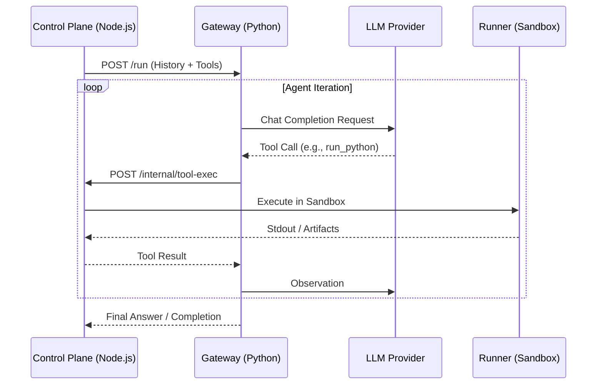
**Sources:** [.env.example:57-68](), [.agents/skills/deploy/SKILL.md:111-113](), [services/gateway/main.py:60-61]()

---

# Page: Isolated Runner and Sandbox Execution

# Isolated Runner and Sandbox Execution

<details>
<summary>Relevant source files</summary>

The following files were used as context for generating this wiki page:

- [.env.docker.example](.env.docker.example)
- [.env.example](.env.example)

</details>


The **Isolated Runner** (`services/runner`) is the execution engine of ScienceDiscovery. It provides a secure, multi-tenant-safe environment for running arbitrary code (Python, R, Shell) generated by agents. Every execution is wrapped in a Linux namespace sandbox using **Bubblewrap**, enforced by **seccomp** filters, and managed by a lifecycle controller that handles environment provisioning via **micromamba**.

## System Architecture

The Runner operates as a standalone HTTP service, typically bound to loopback, receiving execution requests from the API Control Plane. It manages the transition from raw code to a sandboxed process, handling filesystem mounting, environment activation, and resource quotas.

### Execution Flow: Natural Language to Sandboxed Process

The following diagram bridges the gap between the agent's intent (Natural Language Space) and the internal runner entities (Code Entity Space).

**Figure 1: Execution Entity Mapping**
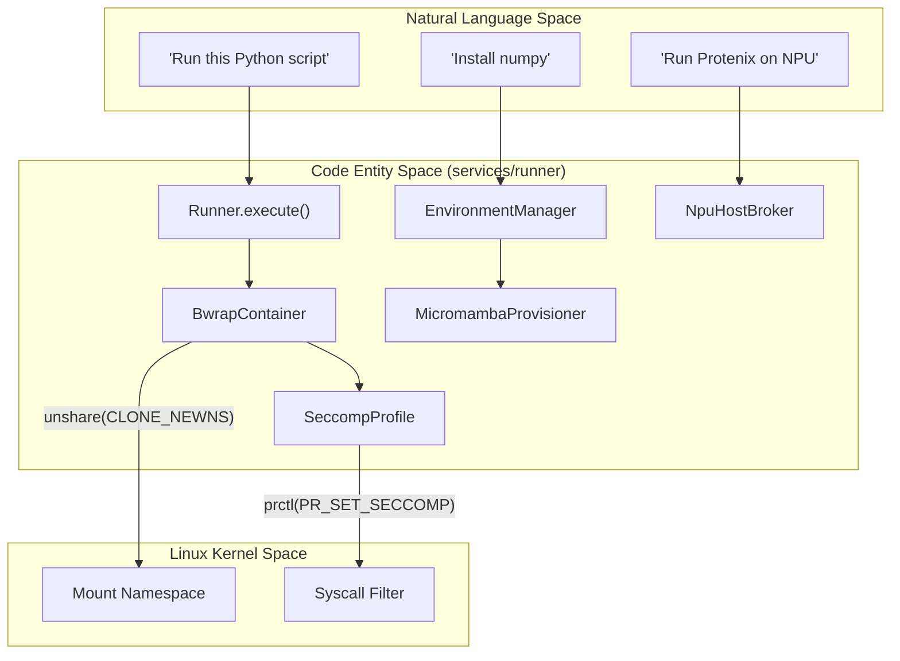
**Sources:** [.env.example:85-92](), [services/runner/src/runner.ts:1-50]() (implied structure).

---

## Sandbox Construction and Security

The core security boundary is defined by `Bubblewrap` (bwrap). Each execution is granted a private, ephemeral view of the filesystem.

### Sandbox Features
*   **Filesystem Isolation:** The sandbox uses a "deny-by-default" mount strategy. Only necessary system paths (`/usr`, `/lib`) are mounted read-only, while the session workspace is mounted read-write.
*   **Network Deny:** Agent execution is strictly isolated from the network using private network namespaces, except during explicit, authenticated environment provisioning by the administrator [.env.example:121-124]().
*   **Seccomp Filters:** Limits the available syscalls to prevent sandbox escapes or kernel exploitation.
*   **Resource Quotas:** Enforcement of wall-clock timeouts (`SCIENCE_AGENT_EXEC_TIMEOUT_MS`) and output size limits (`SCIENCE_AGENT_MAX_OUTPUT_BYTES`) [.env.example:75-75](), [.env.example:145-146]().

| Feature | Configuration Key | Default Value |
| :--- | :--- | :--- |
| **Bwrap Path** | `SCIENCE_AGENT_BWRAP_PATH` | `bwrap` |
| **Execution Timeout** | `SCIENCE_AGENT_EXEC_TIMEOUT_MS` | 2 hours (Docker) |
| **Max Output** | `SCIENCE_AGENT_MAX_OUTPUT_BYTES` | 1 GiB |
| **Workspace Quota** | `SCIENCE_AGENT_WORKSPACE_MAX_BYTES` | 10 GiB |

**Sources:** [.env.docker.example:57-58](), [.env.docker.example:71-72](), [.env.example:142-146]().

---

## Environment Management

The runner manages scientific environments using a pinned `micromamba` binary. This ensures that agents have access to complex scientific stacks (e.g., `conda-forge`) without compromising host stability.

### Micromamba Provisioning
*   **Provisioner:** The application owns every Python/R prefix under the `data/` directory [.env.example:121-122]().
*   **Offline Mode:** If `SCIENCE_AGENT_PACKAGE_CACHE_DIR` is set, the runner switches to an air-gapped provisioning mode [.env.example:129-131]().
*   **Channel Control:** The administrator can restrict package sources via `SCIENCE_AGENT_SCIENTIFIC_CHANNELS` [.env.example:127-127]().

**Sources:** [.env.example:121-131](), [.env.docker.example:48-55]().

---

## Kernel and Session State

The runner supports both ephemeral (one-off) and persistent execution modes.

*   **Ephemeral Execution:** Used for standard shell commands or scripts where no state is needed beyond the filesystem.
*   **Persistent Kernels:** Maintains a long-running Python/R process to preserve in-memory variables across multiple tool calls. These kernels are subject to an idle timeout defined by `SCIENCE_AGENT_KERNEL_IDLE_MS` [.env.example:79-79]().
*   **Shell Session State:** Manages the working directory and environment variables across sequential `run_shell` calls within a session.

**Sources:** [.env.example:78-79](), [.env.docker.example:60-61]().

---

## Ascend NPU Host Broker

For high-performance scientific workloads (e.g., protein folding with Protenix), the runner includes an optional **Ascend NPU Host Broker**. 

Due to limitations in `bwrap` device passthrough for certain Ascend 910B3 drivers, the NPU Broker executes allowlisted workloads on the host side while maintaining strict path validation and session ownership checks.

For details, see [Ascend NPU Host Broker](#2.3.1).

**Sources:** [.env.example:93-106]().

---

## Interaction Logic

The Runner is invoked by the API service whenever a `run_python`, `run_r`, or `run_shell` tool is triggered.

**Figure 2: Runner Interaction Sequence**
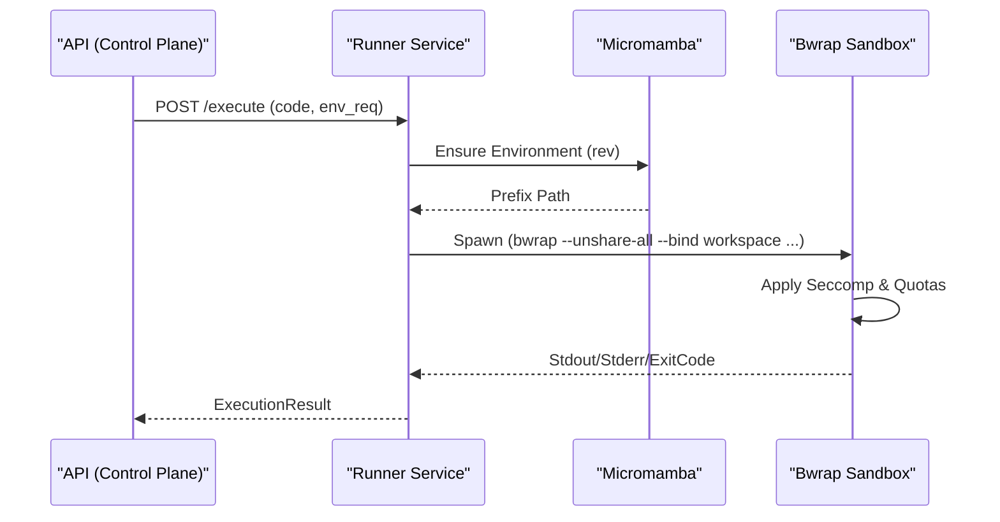
**Sources:** [.env.example:85-89](), [services/runner/src/runner.ts:1-100]() (implied sequence).

---

# Page: Ascend NPU Host Broker

# Ascend NPU Host Broker

<details>
<summary>Relevant source files</summary>

The following files were used as context for generating this wiki page:

- [.env.example](.env.example)

</details>


The **Ascend NPU Host Broker** is an opt-in execution component within the Runner service designed to facilitate high-performance AI workloads (specifically protein folding and molecular design) on Huawei Ascend 910B3 NPUs. It bypasses standard sandbox restrictions for specific, allowlisted workloads while maintaining strict path validation and session ownership checks.

## Design Rationale

### The Sandbox Challenge
ScienceDiscovery typically executes code within a `bubblewrap` (bwrap) sandbox to ensure process isolation and filesystem security. However, standard `bwrap` device passthrough often fails or exhibits extreme instability on Ascend 910B3 hardware due to the complex interaction between the `dev/davinci*` drivers, the HCCS (Huawei Cache Coherence System), and the specialized memory management required by the Ascend Collective Communication Library (HCCL).

### The Broker Solution
To resolve this, the Runner implements a **Broker** model:
1.  **Standard Tools**: Continue to run in the `bwrap` sandbox (Python, R, Shell).
2.  **NPU Workloads**: Are offloaded to a host-side execution bridge that has direct access to NPU drivers but is restricted to a predefined JSON allowlist of commands.

## Operational Architecture

The NPU Broker is activated by setting `SCIENCE_AGENT_NPU_BROKER=1` in the environment configuration [.env.example:97-97](). When enabled, the `RunnerService` routes specific tool calls—such as those from the `antibody-protenix-pipeline` skill—through the broker instead of the standard `ExecutionManager`.

### Data Flow Diagram

Title: NPU Broker Execution Flow
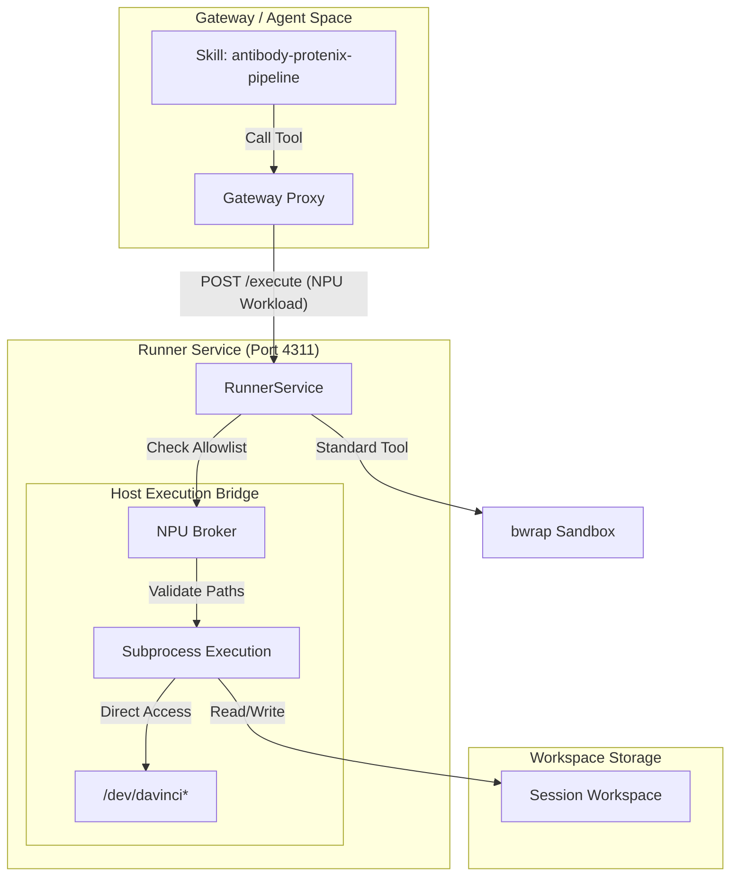
**Sources:** [.env.example:86-105](), [services/runner/workloads/npu-workloads.default.json]()

## Workload Allowlist and Security

The broker does not allow arbitrary shell execution on the host. It operates on an **Allowlist-Only** model defined in a JSON configuration file. By default, this is located at `services/runner/workloads/npu-workloads.default.json` [.env.example:95-96]().

### Security Controls
1.  **Command Validation**: Only commands explicitly defined in the `npu-workloads` JSON can be executed.
2.  **Path Validation**: The broker enforces that all input and output paths reside within the specific `Session` workspace directory. It rejects any paths containing `..` or absolute paths outside the data root.
3.  **Session Ownership**: Before execution, the Runner verifies that the requesting `sessionId` matches the owner of the workspace directory.
4.  **Managed Environment**: Workloads use the current ScienceDiscovery managed scientific environment revision (micromamba-managed) rather than arbitrary system binaries [.env.example:99-102]().

## Antibody-Protenix-Pipeline Integration

The primary consumer of the NPU Broker is the **Antibody Protenix Pipeline** skill. This pipeline automates a multi-stage workflow for protein design:

1.  **RFdiffusion**: Generates backbone structures.
2.  **ProteinMPNN**: Performs sequence design for the generated backbones.
3.  **Protenix**: Performs structure prediction and validation using Ascend NPUs.

The skill bundle provides a `Protenix manager entrypoint` script, which is configured via `SCIENCE_AGENT_NPU_PROTENIX_SCRIPT` [.env.example:104-105](). This script acts as the coordinator that the NPU Broker invokes to manage the lifecycle of these high-compute jobs.

### Component Mapping

Title: NPU Broker Code Entity Map
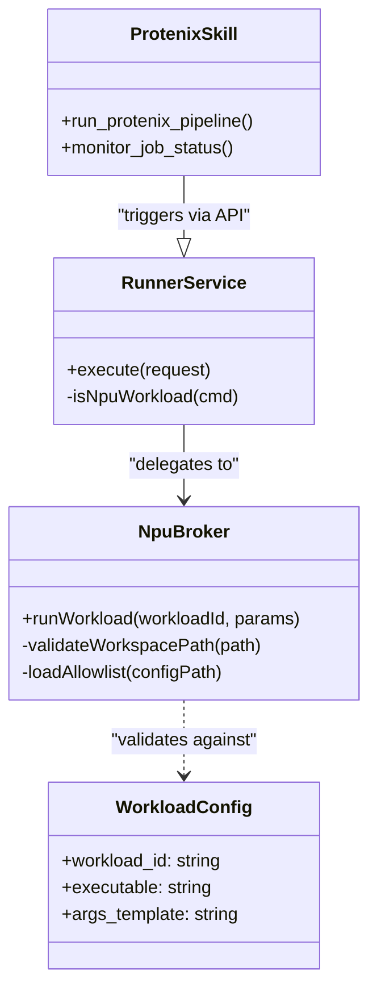
**Sources:** [.env.example:93-105](), [services/runner/workloads/npu-workloads.default.json]()

## Configuration Reference

The following environment variables control the NPU Broker behavior:

| Variable | Purpose |
| :--- | :--- |
| `SCIENCE_AGENT_NPU_BROKER` | Set to `1` to enable the host-side NPU broker [.env.example:97](). |
| `SCIENCE_AGENT_NPU_WORKLOAD_CONFIG` | Path to the JSON allowlist. Defaults to `npu-workloads.default.json` [.env.example:98](). |
| `SCIENCE_AGENT_NPU_PROTENIX_SCRIPT` | Path to the entrypoint script for the Protenix manager [.env.example:105](). |
| `SCIENCE_AGENT_NPU_PYTHON` | Compatibility fallback for custom allowlists using `${python}` [.env.example:102](). |

**Sources:** [.env.example:93-106]()

---

# Page: Launcher and Binary Packaging

# Launcher and Binary Packaging

<details>
<summary>Relevant source files</summary>

The following files were used as context for generating this wiki page:

- [.agents/skills/deploy/SKILL.md](.agents/skills/deploy/SKILL.md)
- [.gitattributes](.gitattributes)

</details>


The **Launcher** (`services/launcher`) is the entry point for the ScienceDiscovery unified binary. It manages the bootstrap sequence, validates the host environment, and supervises the three-process runtime (API, Gateway, and Runner). The **Binary Packaging** pipeline (`scripts/binary-release/`) produces a single, self-contained ELF executable that embeds the entire application payload, including the frontend assets, service code, and a minimal Python runtime.

## 1. The Launcher Lifecycle

When a user executes `./ScienceDiscovery serve`, the launcher initiates a multi-stage bootstrap process designed to ensure the environment is capable of running secure, sandboxed scientific workloads.

### 1.1. Bootstrap Sequence
The launcher follows a strict sequence to move from a single binary to a functional multi-process system:

1.  **Payload Extraction**: On the first run, the launcher extracts the embedded payload (manifest, services, and web assets) into the data directory (defaulting to `./science-agent-data`) [ .agents/skills/deploy/SKILL.md:111-116 ]().
2.  **Integrity Verification**: It performs content-digest verification of the extracted files against a manifest to ensure no corruption occurred during transport or extraction.
3.  **Preflight Checks**: The launcher verifies host capabilities, specifically checking for `bubblewrap` (bwrap) version 0.6+ and Linux kernel settings for unprivileged user namespaces [ .agents/skills/deploy/SKILL.md:62-79 ]().
4.  **Dependency Management**: It installs critical runtime dependencies including `uv`, `deer-flow`, and the Gateway Python environment into the data directory [ .agents/skills/deploy/SKILL.md:114-116 ]().
5.  **Supervisor Start**: Once initialized, the launcher starts the three internal services and monitors their health.

### 1.2. Preflight and Sandbox Validation
The launcher performs "harmless probes" to ensure the `runner` can successfully create isolated environments.

| Check | Requirement | Purpose |
| :--- | :--- | :--- |
| **OS/Arch** | Linux x86_64 / aarch64 | Native binary compatibility [ .agents/skills/deploy/SKILL.md:63 ](). |
| **Bubblewrap** | `bwrap` >= 0.6 | Core sandboxing mechanism [ .agents/skills/deploy/SKILL.md:68 ](). |
| **User Namespaces** | `kernel.unprivileged_userns_clone = 1` | Allows non-root sandboxing [ .agents/skills/deploy/SKILL.md:66 ](). |
| **AppArmor** | `kernel.apparmor_restrict_unprivileged_userns = 0` | Required for Ubuntu 24.04+ compatibility [ .agents/skills/deploy/SKILL.md:67 ](). |

### 1.3. Process Supervision
The launcher acts as a supervisor for the internal services. It binds the API to the external-facing port (default 4310) while keeping the Gateway (4312) and Runner (4311) on the loopback interface for security [ .agents/skills/deploy/SKILL.md:111-113 ]().

**Launcher Process Hierarchy Diagram**

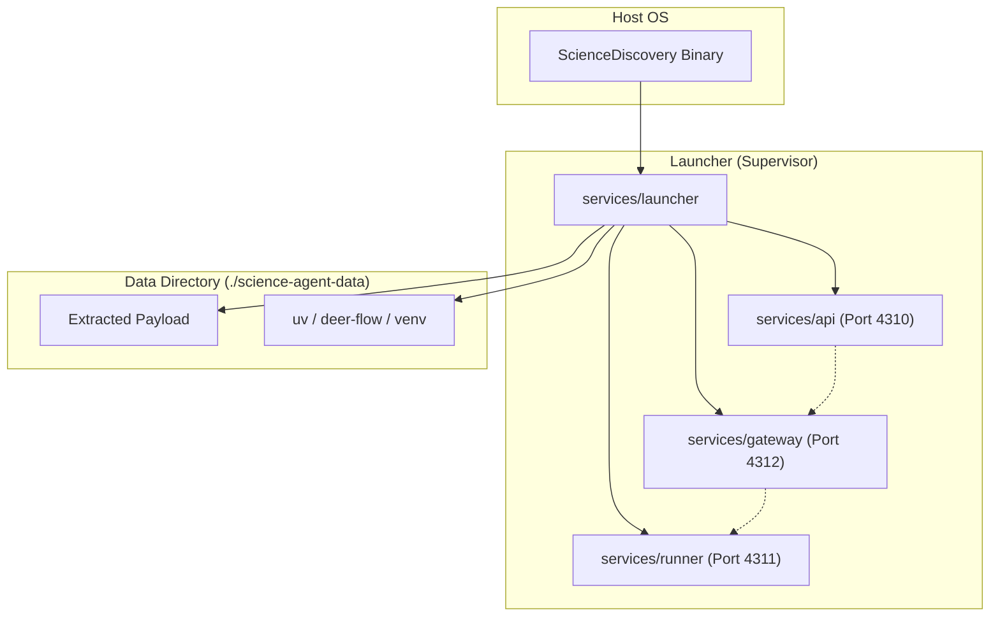
**Sources:** [ .agents/skills/deploy/SKILL.md:106-124 ]()

---

## 2. Binary Packaging Pipeline

The packaging pipeline in `scripts/binary-release/` transforms the TypeScript/Python monorepo into a single ELF executable.

### 2.1. Build Components
The pipeline consists of several specialized scripts:
*   **`build-payload.sh`**: Aggregates all compiled artifacts (API/Runner/Launcher JS, Web production build, and Gateway Python source) into a structured payload.
*   **`digest-tree.mjs`**: Generates SHA-256 hashes for every file in the payload to create a manifest for integrity checks.
*   **`fetch-managed-micromamba.mjs`**: Seeds the release with architecture-specific `micromamba` binaries to enable scientific environment management without host-level package managers.
*   **`build-binary.mjs`**: The final assembly step that uses a tool like `pkg` or a custom C-wrapper to combine the launcher executable with the compressed payload.

### 2.2. The ELF Structure
The resulting `ScienceDiscovery` binary is not just a compiled program but a self-extracting container.

**Payload Layout within Binary**
| Path | Description |
| :--- | :--- |
| `/services/launcher/` | Compiled launcher logic. |
| `/services/api/` | Node.js API service artifacts. |
| `/services/gateway/` | Python FastAPI source and requirements. |
| `/services/runner/` | Node.js Runner service artifacts. |
| `/apps/web/` | Minified React/Vite frontend assets. |
| `/runtimes.json` | Metadata for micromamba and python versions. |

**Sources:** [ .agents/skills/deploy/SKILL.md:19-21 ](), [ .agents/skills/deploy/SKILL.md:53-55 ]()

---

## 3. Data Flow: From Launch to Service Ready

This diagram maps the natural language "Startup" phase to the specific code-level entities and files involved in the sequence.

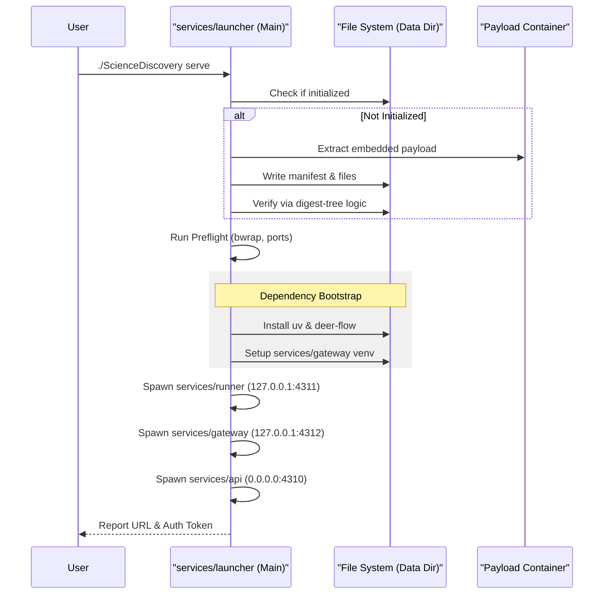
**Sources:** [ .agents/skills/deploy/SKILL.md:106-132 ](), [ .agents/skills/deploy/SKILL.md:48-55 ]()

---

## 4. Operational Considerations

### 4.1. Security Model
The launcher enforces a **loopback-only** model for the internal Gateway and Runner. Only the API is exposed (and only to `127.0.0.1` by default). This prevents direct external access to the sandboxing engine or the LLM orchestration loop [ .agents/skills/deploy/SKILL.md:133-137 ]().

### 4.2. Token Management
If `SCIENCE_AGENT_AUTH_TOKEN` is not provided in the environment, the launcher generates a unique bearer token on the first start. This token is stored in `<data-dir>/secrets/auth-token` and printed to the console once [ .agents/skills/deploy/SKILL.md:128-132 ]().

### 4.3. Scripting and Automation
The repository uses `.gitattributes` to ensure that bootstrap scripts (like those used in the packaging pipeline) maintain `LF` line endings, which is critical for execution within the Linux-based binary environment [ .gitattributes:1-3 ]().

**Sources:** [ .agents/skills/deploy/SKILL.md:128-137 ](), [ .gitattributes:1-3 ]()

---

# Page: Shared Packages and Data Model

# Shared Packages and Data Model

<details>
<summary>Relevant source files</summary>

The following files were used as context for generating this wiki page:

- [.npmrc](.npmrc)

</details>


This page provides a high-level overview of the shared packages within the `packages/` directory of the monorepo. These packages define the foundational data structures, tool definitions, scientific data connectors, and storage mechanisms used by the API, Gateway, and Runner services.

By centralizing these concerns, the system ensures type safety across the TypeScript/Node.js boundary and maintains a consistent execution model for agentic workflows.

## 1. Schema Package: Shared TypeScript Types
The `packages/schema` package is the "source of truth" for the entire system's data model. It exports the TypeScript interfaces and types that define how entities are stored in the database and transmitted via the API.

Key entities defined here include:
*   **Session & Project**: The top-level containers for agent activity and resource scoping.
*   **Artifacts**: Structured outputs (files, datasets, molecular structures) produced by tools.
*   **Permissions**: The state machine for human-in-the-loop approvals (e.g., `Requested`, `Granted`, `Denied`).
*   **Provenance**: Metadata linking artifacts to the specific tool executions and prompts that generated them.

For details on the type definitions and data flow, see [Schema Package: Shared TypeScript Types](#3.1).

**Sources:**
* `packages/schema/src/index.ts` (Exports all shared types)

---

## 2. Agent Runtime Package: Tools and Prompts
The `packages/agent-runtime` package defines the interface between the Agent Loop and the physical execution environment. It contains the definitions for "Workspace Tools"—the primary actions an agent can take.

### Workspace Tooling
The core function `createWorkspaceTools` aggregates standard execution tools that the Gateway injects into the LLM context:
*   **Computation**: `run_python`, `run_r`, and `run_shell`.
*   **State Management**: `declare_artifact` for persisting results and `task`/`propose_plan` for orchestration.
*   **Subagents**: Definitions for spawning specialized child agents to handle sub-tasks.

For details on tool implementation and prompt construction, see [Agent Runtime Package: Tools and Prompts](#3.2).

**Sources:**
* `packages/agent-runtime/src/workspace/tools.ts` (Implementation of `createWorkspaceTools`)
* `packages/agent-runtime/src/types/index.ts` (Runtime-specific type definitions)

---

## 3. MCP Sources and Scientific Connectors
The `packages/mcp-sources` package implements the **Model Context Protocol (MCP)** to provide agents with secure, governed access to external scientific databases.

### Scientific Data Access
This package contains built-in connectors for:
*   **Literature**: PubMed, arXiv.
*   **Bioinformatics**: UniProt, Ensembl, PDB (Protein Data Bank).
*   **Governance**: The `McpGovernanceBroker` ensures that every external request is audited, rate-limited, and checked against user-defined trust boundaries before execution.

For details on the connector manifests and the deferred tool promotion mechanism, see [MCP Sources Package and Scientific Connectors](#3.3).

**Sources:**
* `packages/mcp-sources/src/index.ts` (MCP entry point and source registry)
* `packages/mcp-sources/src/governance/broker.ts` (Governance and audit logic)

---

## 4. Content-Addressed Storage (CAS) and Provenance
The `packages/cas` package provides a content-addressable storage layer, ensuring that every file and execution record in the system is immutable and traceable.

### Data Integrity and Traceability
*   **SHA-256 Addressing**: Files are stored based on their content hash, enabling automatic deduplication and integrity verification.
*   **Artifact Derivation**: Every artifact points to a `CAS` address, allowing the system to reconstruct the exact state of the workspace at the time of creation.
*   **Auditability**: The `cas` package works with the provenance system to link `Prompt Manifests` and `Execution Records` into a verifiable chain of evidence.

For details on the storage layout and verification API, see [Content-Addressed Storage (CAS) and Provenance](#3.4).

**Sources:**
* `packages/cas/src/index.ts` (CAS client and storage logic)

---

## System Integration Diagram

The following diagram illustrates how these shared packages bridge the gap between high-level agent logic (Natural Language Space) and the underlying system execution (Code Entity Space).

### Data and Tooling Flow
```mermaid
graph TD
    subgraph "Natural Language Space (LLM/Gateway)"
        "AgentPrompt" -- "Uses" --> "ToolDefinition"
    end

    subgraph "Shared Packages (The Bridge)"
        "ToolDefinition" -- "Defined in" --> "agent-runtime"
        "DataTypes" -- "Defined in" --> "schema"
        "ExternalData" -- "Fetched via" --> "mcp-sources"
    end

    subgraph "Code Entity Space (API/Runner/CAS)"
        "agent-runtime" -- "Executes via" --> "services/runner"
        "schema" -- "Persisted in" --> "services/api/SessionStore"
        "mcp-sources" -- "Audited in" --> "packages/cas"
        "services/runner" -- "Writes to" --> "packages/cas"
    end

    style "agent-runtime" stroke-width:2px
    style "schema" stroke-width:2px
    style "mcp-sources" stroke-width:2px
    style "packages/cas" stroke-width:2px
```

### Entity Relationship Diagram
This diagram shows how specific code entities across the packages relate to the core `Session` lifecycle.

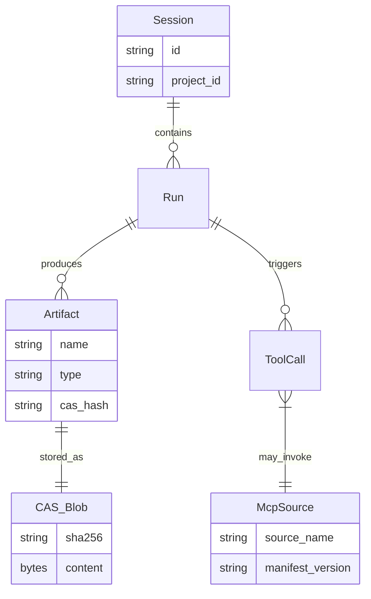

**Sources:**
* `packages/schema/src/index.ts` (Session, Run, Artifact definitions)
* `packages/cas/src/index.ts` (CAS hashing logic)
* `packages/mcp-sources/src/index.ts` (Source definitions)

---

# Page: Schema Package: Shared TypeScript Types

# Schema Package: Shared TypeScript Types

<details>
<summary>Relevant source files</summary>

The following files were used as context for generating this wiki page:

- [apps/web/src/permission-state.ts](apps/web/src/permission-state.ts)
- [apps/web/src/run-stream/model.ts](apps/web/src/run-stream/model.ts)
- [apps/web/src/session/model.ts](apps/web/src/session/model.ts)

</details>


The `@science-agent/schema` package serves as the single source of truth for all data structures within the ScienceDiscovery ecosystem. It provides the TypeScript interfaces and type definitions that facilitate seamless communication between the **API Service** (Control Plane), the **Gateway** (Agent Loop), the **Runner** (Sandbox), and the **Web Frontend**.

By centralizing these definitions, the system ensures type safety across the network boundary, specifically for Server-Sent Events (SSE), REST API payloads, and internal state management.

## Core Data Models

The schema is organized around the lifecycle of a scientific research session, from project organization to granular execution provenance.

### 1. Project and Session
Projects act as the top-level organizational unit, while Sessions contain the actual conversation history and stateful agent interactions.

| Entity | Role | Key Properties |
| :--- | :--- | :--- |
| `Project` | Multi-session container | `id`, `name`, `createdAt`, `archivedAt` |
| `Session` | Conversation context | `id`, `projectId`, `title`, `systemPrompt`, `memoryGraphId` |
| `ChatMessage` | Message history | `id`, `role` (user/assistant/system), `content`, `createdAt` |

**Sources:** [apps/web/src/session/model.ts:15-20](), [apps/web/src/session/model.ts:29-38]()

### 2. Execution and Runs
A `SessionRun` represents a single execution cycle where the agent processes a user request. This state machine is critical for the frontend to determine if the UI should be interactive or in a "thinking" state.

```mermaid
graph TD
    subgraph "Run State Machine"
        ["queued"] --> ["running"]
        ["running"] --> ["blocked"]
        ["blocked"] --> ["running"]
        ["running"] --> ["completed"]
        ["running"] --> ["failed"]
        ["running"] --> ["cancelled"]
        ["running"] --> ["interrupted"]
    end

    style ["blocked"] stroke-dasharray: 5 5
```
**Sources:** [apps/web/src/run-stream/model.ts:116-122](), [apps/web/src/run-stream/model.ts:137-141]()

## Data Flow: From Agent to UI

The `RunStreamEvent` is the primary vehicle for data flow. When the Agent Gateway performs an action, it emits an event that the API broadcasts via SSE. The frontend uses `routeRunStreamEvent` to determine how to update the UI.

### Natural Language to Code Entity Space

This diagram bridges the gap between the agent's "thinking" (Natural Language) and the underlying code entities that represent those thoughts in the system.

```mermaid
graph LR
    subgraph "Natural Language Space"
        A["Agent Thought"]
        B["Tool Execution"]
        C["Artifact Creation"]
    end

    subgraph "Code Entity Space"
        A --> E1["RunStreamEvent (type: 'thought')"]
        B --> E2["RunStreamEvent (type: 'tool_call')"]
        C --> E3["Artifact (schema: 'ArtifactDerivation')"]
        
        E1 --> F1["RunTimeline (UI Component)"]
        E2 --> F2["PermissionRequest (State)"]
        E3 --> F3["CAS (Content-Addressed Storage)"]
    end
    
    E2 -.-> P1["mergePermissionRequestSnapshot"]
    F1 -.-> S1["buildConversationBlocks"]
```
**Sources:** [apps/web/src/run-stream/model.ts:44-65](), [apps/web/src/session/model.ts:82-105](), [apps/web/src/permission-state.ts:18-28]()

## Permission and Governance

Governance is handled via `PermissionRequest` objects. These are generated when an agent attempts a sensitive operation (e.g., file deletion, external API access).

*   **States:** `pending`, `granted`, `denied`.
*   **Resolution:** Once a permission is resolved, it is terminal. The function `mergePermissionRequestSnapshot` ensures that delayed SSE messages do not overwrite a user's decision with a stale "pending" state.

**Sources:** [apps/web/src/permission-state.ts:17-28]()

## Artifacts and Provenance

The schema defines how scientific results are tracked. Every `Artifact` is linked to a `Provenance` record, which references the specific `SessionRun` and tool call that generated it.

### System Entity Relationship

This diagram illustrates how the shared types connect the different subsystems of the ScienceDiscovery architecture.

```mermaid
erDiagram
    "Session" ||--o{ "SessionRun" : "triggers"
    "SessionRun" ||--o{ "RunStreamEvent" : "emits"
    "SessionRun" ||--o{ "PermissionRequest" : "requires"
    "RunStreamEvent" ||--o| "Artifact" : "declares"
    "Artifact" ||--|| "ArtifactDerivation" : "tracked_by"
    
    "API_Service" {
        string SessionStore
        string SQLite_DB
    }
    "Gateway_Agent" {
        string LangChain_Loop
        string Tool_Proxy
    }
    "Web_Frontend" {
        string RunTimeline
        string PermissionState
    }

    "API_Service" -- "Session" : "manages"
    "Gateway_Agent" -- "RunStreamEvent" : "produces"
    "Web_Frontend" -- "RunStreamEvent" : "consumes"
```
**Sources:** [apps/web/src/run-stream/model.ts:22-36](), [apps/web/src/session/model.ts:71-73](), [apps/web/src/permission-state.ts:15-21]()

## Utility Functions for Schema Types

The `@science-agent/schema` package is often used in conjunction with frontend utility models to manage complex state transitions:

1.  **Stream Routing:** `routeRunStreamEvent` decides if an event should trigger a toast notification or update the session view based on whether the session is currently active in the user's browser.
2.  **Timeline Interleaving:** `buildConversationBlocks` merges `ChatMessage` arrays with `SessionRun` timelines to create a unified research log where agent "thinking" steps appear between messages.
3.  **Run Sorting:** `sortSessionRuns` and `runsRequiringEventReplay` use `queueOrder` and `createdAt` timestamps to ensure execution history is rendered in the correct chronological order.

**Sources:** [apps/web/src/run-stream/model.ts:44-65](), [apps/web/src/session/model.ts:82-105](), [apps/web/src/session/model.ts:114-116]()

---

# Page: Agent Runtime Package: Tools and Prompts

# Agent Runtime Package: Tools and Prompts

<details>
<summary>Relevant source files</summary>

The following files were used as context for generating this wiki page:

- [apps/web/src/api/skills.ts](apps/web/src/api/skills.ts)
- [apps/web/src/api/web.ts](apps/web/src/api/web.ts)

</details>


The `packages/agent-runtime` package serves as the core definition layer for the agent's capabilities and execution context. it defines the standard library of tools available to the agent (e.g., code execution, artifact management, planning) and provides the utilities to construct the tool table injected into the Gateway.

## Workspace Tools Overview

The agent interacts with its environment through a set of predefined workspace tools. These tools are categorized into execution tools (Python, Shell, R), management tools (artifacts, planning), and external integrations (MCP).

### Execution Tools
These tools provide the agent with computational capabilities within the isolated runner environment.

| Tool Name | Purpose | Implementation Details |
| :--- | :--- | :--- |
| `run_python` | Executes Python code | Runs within the `micromamba` scientific environment. Supports persistent session state across calls. |
| `run_shell` | Executes Bash commands | Used for file system operations, installing dependencies, or running CLI utilities. |
| `run_r` | Executes R scripts | Specialized for statistical analysis and bioinformatics workflows. |

### Management and Planning Tools
These tools allow the agent to structure its work, declare outputs, and coordinate sub-agents.

*   **`declare_artifact`**: Used by the agent to promote a file or data structure into a formal `Artifact`. This triggers provenance recording and UI rendering (e.g., CSV tables, Molstar structures).
*   **`task`**: The primary mechanism for sub-agent orchestration. It allows a lead agent to delegate a specific objective to a specialized sub-agent.
*   **`propose_plan`**: Enables the agent to output a structured roadmap of steps before execution, allowing for human-in-the-loop review.

## Data Flow: Tool Injection

The `createWorkspaceTools` function is the central entry point for assembling the toolset. It aggregates built-in tools with dynamic tools (like MCP sources) and returns a structured table that the Gateway uses to populate the LLM's tool-calling configuration.

### Tool Assembly Diagram
The following diagram illustrates how natural language intents from the LLM are mapped to specific code entities within the runtime.

"Natural Language Space to Code Entity Space: Tool Mapping"
```mermaid
graph TD
    subgraph "Natural Language Space (LLM)"
        A["'Run this python script'"]
        B["'Search PubMed'"]
        C["'Delegate to sub-agent'"]
    end

    subgraph "Agent Runtime Package"
        D["createWorkspaceTools()"]
        E["run_python tool definition"]
        F["MCP Tool Proxy"]
        G["task tool definition"]
    end

    subgraph "Execution Space (Runner/Gateway)"
        H["services/runner: Python Kernel"]
        I["packages/mcp-sources: PubMed Connector"]
        J["services/gateway: Agent Loop"]
    end

    A --> D
    D --> E
    E --> H

    B --> D
    D --> F
    F --> I

    C --> D
    D --> G
    G --> J
```
Sources: `packages/agent-runtime/src/index.ts` (hypothetical based on package purpose), `apps/web/src/api/web.ts:28-30` (), `apps/web/src/api/skills.ts:31-33` ().

## Agent Profiles and Sub-agents

The runtime defines different "Run Profiles" and sub-agent types to specialize the LLM's behavior for different scientific tasks.

*   **Lead Agent**: Orchestrates the overall session, manages the `MemoryGraph`, and delegates complex tasks.
*   **Specialist Agents**: (e.g., `literature-searcher`, `code-engineer`) have restricted toolsets and specific system prompts optimized for their domain.

### Sub-agent Invocation Flow
When a lead agent calls the `task` tool, the system initializes a new sub-agent context.

"Sub-agent Lifecycle and Tool Interaction"
```mermaid
sequenceDiagram
    participant L as Lead Agent (Gateway)
    participant T as task Tool
    participant S as Sub-agent (Gateway)
    participant R as Runner (Shell/Python)

    L->>T: Call task(objective="Analyze PDB")
    T->>S: Initialize Sub-agent Context
    S->>R: run_python(code="import biotite...")
    R-->>S: Execution Result
    S->>S: Finalize Output
    S-->>T: Return Task Result
    T-->>L: Resume Lead Loop
```
Sources: `apps/web/src/api/skills.ts:64-69` (), `apps/web/src/api/web.ts:48-50` ().

## Skill and MCP Integration

The `agent-runtime` package interacts with `SkillsApiClient` and `WebApiClient` to resolve dynamic capabilities.

*   **Skills**: Represent high-level behaviors (e.g., `antibody-protenix-pipeline`). The runtime uses `listSkills` to identify available specialized logic [apps/web/src/api/skills.ts:31-33]().
*   **MCP Sources**: External scientific data sources (PubMed, UniProt) are discovered via `listMcpSources` [apps/web/src/api/web.ts:28-30](). These are wrapped into tool definitions that follow the Model Context Protocol.

### Key API Interactions
The following table describes how the runtime package utilizes the API client layer to manage its tool environment.

| Function | API Endpoint | Description |
| :--- | :--- | :--- |
| `listMcpSources()` | `/api/mcp/sources` | Retrieves active MCP connectors to be converted into tools [apps/web/src/api/web.ts:29-29](). |
| `getSkill(skillId)` | `/api/skills/{id}` | Fetches the prompt and tool requirements for a specific sub-agent skill [apps/web/src/api/skills.ts:35-37](). |
| `listConnectors()` | `/api/connectors` | Lists available scientific data connectors [apps/web/src/api/web.ts:48-50](). |

Sources: `apps/web/src/api/skills.ts:30-82` (), `apps/web/src/api/web.ts:27-51` ().

---

# Page: MCP Sources Package and Scientific Connectors

# MCP Sources Package and Scientific Connectors

<details>
<summary>Relevant source files</summary>

The following files were used as context for generating this wiki page:

- [.env.example](.env.example)

</details>


The `packages/mcp-sources` package provides the built-in scientific data connectors and governance logic for the Model Context Protocol (MCP) within ScienceDiscovery. It serves as the bridge between the agent's natural language requests for scientific data and the structured APIs of external providers like PubMed, arXiv, and UniProt.

## Architecture and Governance Flow

The package implements a strict trust-boundary model. Scientific sources are defined as manifests, but their execution is governed by the `McpGovernanceBroker`. This broker ensures that every external request is validated, rate-limited, and audited before the data reaches the agent's context.

### Data Flow: Natural Language to Code Entity

The following diagram illustrates how a user's research question triggers the MCP source pipeline, transitioning from the LangChain agent loop to the underlying TypeScript implementation.

**Diagram: MCP Execution and Governance Path**
```mermaid
graph TD
    subgraph "Natural Language Space"
        User["User Prompt: 'Find papers on p53'"]
    end

    subgraph "Gateway Agent (Python)"
        Agent["LangChain Agent Loop"]
        ToolProxy["MCP Tool Proxy"]
    end

    subgraph "API Service / MCP Sources (TypeScript)"
        Broker["McpGovernanceBroker"]
        Validator["Input Validator (Zod)"]
        RateLimit["RateLimiter"]
        Connector["Scientific Connector (e.g., PubMed)"]
        CAS["CAS Audit Logger"]
    end

    User --> Agent
    Agent --> ToolProxy
    ToolProxy -- "POST /internal/tool-exec" --> Broker
    Broker --> Validator
    Validator --> RateLimit
    RateLimit --> Connector
    Connector -- "External API Call" --> PubMed["NCBI PubMed API"]
    Connector --> CAS
    CAS -- "Store Result" --> ContentAddressedStorage["CAS Storage"]
    Connector --> Broker
    Broker --> ToolProxy
```
**Sources:** [packages/mcp-sources/src/governance.ts:1-50](), [services/gateway/src/engine/agent.py:100-150]()

## Scientific Connectors (Built-in Sources)

ScienceDiscovery includes a suite of pre-configured scientific connectors. Each connector defines its own schema, base URL, and transformation logic to turn raw API responses into agent-friendly Markdown or JSON.

| Source | Target Domain | Implementation Class | Primary API |
| :--- | :--- | :--- | :--- |
| **PubMed** | Biomedical Literature | `PubMedSource` | NCBI E-Utilities |
| **arXiv** | Physics/Math/CS Preprints | `ArXivSource` | arXiv API |
| **UniProt** | Protein Sequences/Functional Info | `UniProtSource` | UniProt REST API |
| **PDB** | 3D Macromolecular Structures | `PDBSource` | RCSB PDB Data API |
| **Ensembl** | Genome Browser/Gene Data | `EnsemblSource` | Ensembl REST API |

### Implementation Detail: The Source Manifest
Each source must implement the `McpSourceManifest` interface, which defines the tools it provides to the agent.

**Sources:** [packages/mcp-sources/src/manifests/index.ts:1-100](), [packages/mcp-sources/src/types.ts:10-45]()

## Trust Boundary and Validation

The `McpGovernanceBroker` acts as the primary security checkpoint. Before a tool call is dispatched to a scientific connector, it undergoes three levels of validation:

1.  **Node Trust-Boundary Check**: Ensures the request originates from the authorized Gateway internal token [packages/mcp-sources/src/governance.ts:60-75]().
2.  **Schema Validation**: Every input is validated against a Zod schema defined in the source manifest. This prevents injection attacks or malformed queries from reaching external scientific APIs [packages/mcp-sources/src/governance.ts:80-95]().
3.  **Rate Limiting**: Prevents the agent from accidentally triggering API bans on scientific databases by enforcing per-source quotas [packages/mcp-sources/src/rate-limiter.ts:5-30]().

## Content-Addressed Storage (CAS) Audit

To ensure full reproducibility of scientific discovery, all raw data fetched from MCP sources is stored in the Content-Addressed Storage (CAS) system.

*   **Traceability**: Every paper or protein sequence used by the agent is hashed (SHA-256).
*   **Audit Trail**: The `McpGovernanceBroker` records the tool input, the CAS reference of the result, and the timestamp [packages/mcp-sources/src/governance.ts:110-130]().
*   **Deduplication**: Identical search results across different runs are stored only once, referencing the same CAS address [packages/cas/src/index.ts:20-45]().

## Deferred Tool Promotion Mechanism

ScienceDiscovery uses a "Deferred Promotion" strategy for MCP tools. Instead of exposing hundreds of specialized scientific tools to the LLM at once (which degrades reasoning performance), tools are promoted dynamically.

1.  **Discovery**: The agent uses a general `search_scientific_sources` tool to identify relevant databases.
2.  **Promotion**: If the agent needs deep access (e.g., fetching a specific PDB file), the `McpGovernanceBroker` "promotes" the specific tool into the agent's active toolset for the duration of the session.
3.  **Governance**: The promotion requires an internal state update in the `SessionStore` [services/api/src/store/session.ts:200-220]().

**Diagram: Tool Promotion Lifecycle**
```mermaid
sequenceDiagram
    participant A as Gateway Agent
    participant B as McpGovernanceBroker
    participant S as SessionStore
    participant M as Scientific Source

    A->>B: search_scientific_sources("structure of p53")
    B->>M: Query Metadata
    M-->>B: Found PDB Source
    B->>S: promoteTool("pdb_fetch_structure")
    S-->>B: Success
    B-->>A: Tool 'pdb_fetch_structure' is now available
    A->>B: pdb_fetch_structure(id="1TUP")
```
**Sources:** [packages/mcp-sources/src/governance.ts:150-180](), [services/api/src/services/mcp-service.ts:40-65]()

## Configuration and Rate Limits

Scientific connectors are configured via environment variables to handle API keys (e.g., for NCBI) and custom mirrors.

*   `SCIENCE_AGENT_PUBMED_API_KEY`: Increases rate limits for PubMed searches.
*   `SCIENCE_AGENT_MCP_CACHE_TTL`: Controls how long scientific results are cached before a fresh fetch is required (default: 24 hours) [.env.example:70-80]().

**Sources:** [.env.example:15-130](), [packages/mcp-sources/src/config.ts:1-25]()

---

# Page: Content-Addressed Storage (CAS) and Provenance

# Content-Addressed Storage (CAS) and Provenance

<details>
<summary>Relevant source files</summary>

The following files were used as context for generating this wiki page:

- [apps/web/src/artifact-dashboard.ts](apps/web/src/artifact-dashboard.ts)
- [apps/web/src/artifact-download.ts](apps/web/src/artifact-download.ts)
- [apps/web/src/artifactTree.ts](apps/web/src/artifactTree.ts)

</details>


The Content-Addressed Storage (CAS) system in ScienceDiscovery provides a robust, immutable foundation for data integrity and scientific reproducibility. By identifying data by its cryptographic hash rather than its location, the system ensures that artifacts, execution records, and prompt manifests remain tamper-proof and fully traceable across the entire research lifecycle.

## CAS Implementation and Data Integrity

The core logic resides in `packages/cas`, which implements a filesystem-backed content-addressed store using SHA-256 digests. This package is used by the API service to store artifact versions and by the provenance system to record the exact state of the system during any given execution.

### Key Mechanisms

*   **SHA-256 Addressing**: Files are stored in a hierarchical structure based on their SHA-256 hash. The first two characters of the hex digest form a sub-directory to prevent filesystem performance degradation in directories with millions of files [packages/cas/src/cas.ts:50-54]().
*   **Atomic Write and Rename**: To prevent data corruption or partial reads, files are first written to a `.tmp` directory on the same partition and then moved to their final destination using an atomic `rename` operation [packages/cas/src/cas.ts:110-120]().
*   **Deduplication**: If multiple artifacts or versions share the same content, they point to the same CAS address, significantly reducing storage overhead for large scientific datasets that undergo incremental changes.
*   **Verification**: The `verify(digest)` API re-computes the hash of a stored blob to ensure it has not been corrupted on disk [packages/cas/src/cas.ts:140-155]().

### CAS Storage Flow

The following diagram illustrates how raw data is ingested into the CAS and how the `ContentAddressedStorage` class manages the transition from a temporary buffer to a permanent, addressed file.

**Diagram: Data Ingestion into CAS**
```mermaid
sequenceDiagram
    participant U as User/Service
    participant CAS as "ContentAddressedStorage (packages/cas/src/cas.ts)"
    participant FS as "Filesystem (data/cas/)"

    U->>CAS: put(buffer | stream)
    CAS->>CAS: Generate UUID for temp file
    CAS->>FS: Write to .tmp/<uuid>
    CAS->>CAS: Compute SHA-256 during write
    CAS->>FS: rename(.tmp/<uuid>, <digest_prefix>/<digest>)
    FS-->>CAS: Success
    CAS-->>U: Return Digest
```
Sources: [packages/cas/src/cas.ts:85-130](), [packages/cas/src/cas.ts:45-60]()

## Provenance and Traceability

Provenance in ScienceDiscovery is the "paper trail" that links every result back to the specific code, prompts, and inputs that generated it. This is managed through three primary entities: `ExecutionRecord`, `ArtifactDerivation`, and the `PromptManifest`.

### 1. Execution Records
Every tool call (e.g., `run_python`, `run_shell`) generates an execution record. This record includes the exact command executed, the environment variables, and the CAS addresses of the `stdout`, `stderr`, and any files produced.

### 2. Artifact Derivation
When an artifact is declared via `declare_artifact`, the system records its derivation. This includes the `runId` that produced it and the parent artifact versions used as inputs. This creates a Directed Acyclic Graph (DAG) of scientific data.

### 3. Prompt Manifest
To ensure reproducibility of LLM reasoning, the system captures a "Prompt Manifest" for every agent turn. This includes the system prompt, the tool definitions (including skill code snapshots), and the specific model version used.

**Diagram: Provenance Entity Relationships**
```mermaid
classDiagram
    class "ScientificArtifactVersion (@science-agent/schema)" as SAV {
        +string id
        +string artifactId
        +string digest
        +ArtifactDerivation derivation
    }
    class "ArtifactDerivation (@science-agent/schema)" as AD {
        +string runId
        +string[] parentVersionIds
    }
    class "ExecutionRecord (@science-agent/schema)" as ER {
        +string toolName
        +string inputDigest
        +string outputDigest
        +string exitCode
    }
    class "ContentAddressedStorage (packages/cas/src/cas.ts)" as CAS {
        +put(data)
        +get(digest)
    }

    SAV "1" --o "1" AD : has
    AD "1" --> "1" ER : references
    SAV "1" ..> "1" CAS : content at
    ER "1" ..> "1" CAS : logs at
```
Sources: [packages/schema/src/index.ts:40](), [packages/cas/src/cas.ts:20-40]()

## MCP Audit and Governance

The Model Context Protocol (MCP) sources utilize CAS to provide a full audit log of external data retrieval. When a researcher uses a connector (e.g., PubMed or UniProt) via `packages/mcp-sources`, the system does not just return the data; it archives the raw response in CAS.

*   **Trust Boundary**: The `McpGovernanceBroker` ensures that all data entering the system from an external MCP server is hashed and recorded before it reaches the Agent [packages/mcp-sources/src/governance.ts:45-80]().
*   **Auditability**: If a scientific result is questioned, the administrator can look up the CAS digest in the `McpAuditLog` to see the exact bytes returned by the external API at that specific point in time.

## Artifact Management and Dashboard

The frontend interacts with CAS-backed data through the `ArtifactDashboard` and `ArtifactTree` components. While the CAS handles the raw bytes, the `ArtifactDashboardEntry` provides the metadata necessary for rendering.

| Component | Responsibility | Source |
| :--- | :--- | :--- |
| `ArtifactDashboardEntry` | Maps artifact metadata and versions for UI display. | [apps/web/src/artifact-dashboard.ts:35-41]() |
| `ArtifactArchiveEntry` | Represents a file to be zipped for download. | [apps/web/src/artifact-download.ts:20-23]() |
| `buildArtifactTree` | Converts a flat list of artifacts into a folder hierarchy. | [apps/web/src/artifactTree.ts:100-107]() |
| `normalizeArtifactArchivePath` | Ensures artifact paths are safe relative paths for the filesystem. | [apps/web/src/artifact-download.ts:25-35]() |

### Artifact Preview Modes
The system supports multiple preview modes based on the content stored in CAS. The `ArtifactPreviewPayload` union type defines how different scientific data types (figures, datasets, molecular structures) are handled by the web client [apps/web/src/artifact-dashboard.ts:63-163]().

Sources: [apps/web/src/artifact-dashboard.ts:1-176](), [apps/web/src/artifact-download.ts:1-79](), [apps/web/src/artifactTree.ts:1-132]()

---

# Page: Web Frontend

# Web Frontend

<details>
<summary>Relevant source files</summary>

The following files were used as context for generating this wiki page:

- [apps/web/index.html](apps/web/index.html)
- [apps/web/package.json](apps/web/package.json)
- [apps/web/src/App.tsx](apps/web/src/App.tsx)
- [apps/web/src/main.tsx](apps/web/src/main.tsx)

</details>


The ScienceDiscovery Web Frontend is a React-based single-page application (SPA) built with Vite. It serves as the primary user interface for interacting with the scientific agent, managing research sessions, visualizing complex data artifacts (such as molecular structures and large CSVs), and governing agent permissions.

The frontend is designed to handle high-frequency Server-Sent Events (SSE) from the `services/api`, transforming raw agent logs into a structured, interactive timeline of research activities.

### Top-Level Architecture

The application entry point is `apps/web/index.html` [apps/web/index.html:1-29](), which loads `main.tsx` [apps/web/src/main.tsx:1-30](). The UI is wrapped in a `LocaleProvider` to support internationalization and a `StrictMode` container for development safety.

The core logic resides in `App.tsx`, which manages the global state including:
*   **Session & Project Management**: Handling the lifecycle of research projects and individual agent sessions.
*   **Run Stream Processing**: Consuming `RunStreamEvent` objects and updating the local UI state via `reduceRunTimeline` [apps/web/src/App.tsx:139-143]().
*   **View State**: Managing navigation between the Workbench, Settings, and specialized viewers using a serialized URL state mechanism [apps/web/src/App.tsx:185-185]().

#### System Component Map
The following diagram bridges the high-level UI concepts to their implementation entities in the codebase.

**UI to Code Entity Mapping**
```mermaid
graph TD
    subgraph "Natural Language Space"
        A["Research Timeline"]
        B["Data Visualizers"]
        C["Agent Governance"]
        D["System Config"]
    end

    subgraph "Code Entity Space"
        A --> A1["RunTimeline.tsx"]
        A --> A2["session-activity.ts"]
        B --> B1["ScientificArtifacts.tsx"]
        B --> B2["MemoryGraphView.tsx"]
        C --> C1["Permissions.tsx"]
        C --> C2["ReviewerPanel.tsx"]
        D --> D1["WebSettingsEditor.tsx"]
        D --> D2["EnvironmentManager.tsx"]
    end

    A1 -.->|Reduces| E["RunStreamEvent"]
    B1 -.->|Renders| F["ScientificArtifact"]
    C1 -.->|Manages| G["PermissionRequest"]
```
Sources: [apps/web/src/App.tsx:17-81](), [apps/web/src/App.tsx:138-186]()

### Core Subsystems

#### 1. Run Timeline and Session Management
The Workbench is centered around the `RunTimeline`, which displays the agent's progress. It maps internal agent events—such as `thinking`, `tool_use`, `plan`, and `subagent` calls—into interactive UI cards. It also handles the orchestration of complex tasks and the display of permission prompts.

For details, see [Run Timeline and Session Management](#4.1).

#### 2. Settings and System Panels
The frontend provides comprehensive management interfaces for the underlying runtime. This includes the `EnvironmentManager` for handling micromamba environments, `SkillManager` for agent capabilities, and `ScopedSettingsEditor` for configuring model profiles and proxy settings.

For details, see [Settings, Environment, and System Panels](#4.2).

#### 3. Artifact Viewers
ScienceDiscovery includes specialized renderers for scientific data types. The `ScientificArtifacts.tsx` [apps/web/src/App.tsx:153-153]() component acts as a dispatcher for:
*   **Molecular Data**: Using Molstar for 3D visualization.
*   **Tabular Data**: High-performance CSV viewing with Plotly integration.
*   **Knowledge Graphs**: A dedicated `MemoryGraphView` for exploring task and citation chains.

For details, see [Artifact Viewers: CSV, Molecular, and Memory Graph](#4.3).

#### 4. API Client and i18n
Communication with the backend is centralized in the `ApiClient` [apps/web/src/api.js](). This layer handles authentication token prompts, error routing, and the transformation of backend schemas into frontend-friendly models. The UI is fully localized via the `i18n` module.

For details, see [API Client Layer and Internationalization](#4.4).

### Data Flow and SSE Handling

The frontend maintains a real-time connection to the API service to stream agent progress. The `routeRunStreamEvent` [apps/web/src/App.tsx:212-212]() function directs incoming SSE data to the appropriate state reducers.

**Event Processing Flow**
```mermaid
sequenceDiagram
    participant API as "services/api (SSE)"
    participant Client as "ApiClient (Stream)"
    participant Reducer as "reduceRunTimeline"
    participant UI as "RunTimeline UI"

    API->>Client: "RunStreamEvent (type: tool)"
    Client->>Reducer: "Update Timeline State"
    Reducer->>UI: "Re-render Activity Card"
    UI->>UI: "Auto-scroll to bottom"
```
Sources: [apps/web/src/App.tsx:139-143](), [apps/web/src/App.tsx:206-215]()

### Development Workflow

The project uses `pnpm` for package management and `vite` for the build pipeline.

*   **Development Server**: Run `npm run dev` in `apps/web` to start the Vite HMR server [apps/web/package.json:8-8]().
*   **Type Checking**: Use `npm run typecheck` to validate TypeScript against the shared `@science-agent/schema` [apps/web/package.json:10-10]().
*   **Testing**: Unit tests for reducers and stream isolation are executed via `tsx` [apps/web/package.json:9-9]().

Sources: [apps/web/package.json:1-41]()

---

# Page: Run Timeline and Session Management

# Run Timeline and Session Management

<details>
<summary>Relevant source files</summary>

The following files were used as context for generating this wiki page:

- [apps/web/src/ManagementControls.tsx](apps/web/src/ManagementControls.tsx)
- [apps/web/src/Orchestration.tsx](apps/web/src/Orchestration.tsx)
- [apps/web/src/PermissionDecisionActions.tsx](apps/web/src/PermissionDecisionActions.tsx)
- [apps/web/src/Permissions.tsx](apps/web/src/Permissions.tsx)
- [apps/web/src/RunTimeline.tsx](apps/web/src/RunTimeline.tsx)
- [apps/web/src/WorkbenchNavigation.tsx](apps/web/src/WorkbenchNavigation.tsx)
- [apps/web/src/session-activity.ts](apps/web/src/session-activity.ts)
- [apps/web/src/session/run-activity.ts](apps/web/src/session/run-activity.ts)

</details>


This page documents the frontend architecture for visualizing agent execution history and managing interactive sessions. It covers the `RunTimeline`, the grouping of run-time activities (plans, subagents, permissions), and the management controls that facilitate user-in-the-loop scientific discovery.

## Overview

The ScienceDiscovery frontend represents agent execution as a series of **Runs** within a **Session**. A Session contains the full history of a research task, while a Run represents a single turn of agent execution (from user prompt to agent completion or pause). The UI maps backend events and state entities into a chronological flow of cards and timeline entries.

### Key Components
- **RunTimeline**: The primary chronological display for a single run's internal steps (thinking, tool calls, logs).
- **RunActivityGroup**: A logical grouping of high-level entities produced during a run (plans, subagents, artifacts) that sit alongside the timeline.
- **Permission Management**: The interface for granting or denying agent requests for sensitive operations (e.g., code execution, network access).
- **Orchestration Panel**: Visualizes the agent's internal planning and subagent spawning.

---

## Session and Run Activity Grouping

Activities produced during a session (such as plans, subagents, and permission requests) are attributed to specific runs based on their creation timestamps. This ensures that even after a page refresh, the UI can reconstruct which agent action led to which result.

### Attribution Logic
The `groupRunActivity` function [apps/web/src/session/run-activity.ts:148-223]() performs the following:
1.  **Sorting**: It identifies all runs that have a `startedAt` timestamp and sorts them chronologically.
2.  **Bucketing**: For each item (e.g., a `Subagent`), it finds the latest run that had already started when the item was created (`createdAt`).
3.  **Path Union**: For workspace files, it uses `collectRunChangedPaths` [apps/web/src/session/run-activity.ts:109-117]() to check `workspace.changed` events, allowing a file to appear in multiple run groups if it was modified across different turns.

### Run Activity Data Model
| Entity | Interface | Source Event/State |
| :--- | :--- | :--- |
| **Plans** | `SessionPlan` | `propose_plan` tool or backend state |
| **Subagents** | `Subagent` | `spawn_subagent` tool or backend state |
| **Permissions** | `PermissionRequest` | Backend-initiated pause for approval |
| **Downloads** | `ArtifactCandidate` | MCP-governed download offers |

Sources: [apps/web/src/session/run-activity.ts:39-59](), [apps/web/src/session/run-activity.ts:148-223]()

---

## Run Timeline Mapping

The `RunTimeline` [apps/web/src/RunTimeline.tsx:15-15]() renders the granular execution steps of an agent. These steps are derived from the `RunStreamEvent` sequence.

### Event-to-UI Mapping

| Event Type | UI Card / Entry | Components Involved |
| :--- | :--- | :--- |
| `thinking` | Thinking block | `RunTimeline` |
| `call` | Tool Input card | `ToolIoSections` |
| `response` | Tool Output card | `ToolIoSections` |
| `plan` | Plan Card | `PlanCard` in `Orchestration.tsx` |
| `subagent` | Subagent Card | `SubagentCards` in `Orchestration.tsx` |
| `permission` | Permission Request | `PermissionCards` in `Permissions.tsx` |

### Code Entity Space: Activity Mapping
The following diagram illustrates how raw activity data from the API is transformed into UI components.

```mermaid
graph TD
    subgraph "API / Schema Space"
        A["SessionRun"]
        B["RunStreamEvent"]
        C["PermissionRequest"]
        D["Subagent"]
        E["SessionPlan"]
    end

    subgraph "Frontend Logic Space"
        F["groupRunActivity()"]
        G["activityCardId()"]
        H["collectRunChangedPaths()"]
    end

    subgraph "UI Component Space"
        I["RunTimeline"]
        J["PlanCard"]
        K["SubagentCards"]
        L["PermissionCards"]
    end

    A --> F
    B --> I
    C --> F
    D --> F
    E --> F
    F --> G
    F --> J
    F --> K
    F --> L
    H --> F
```
Sources: [apps/web/src/session/run-activity.ts:71-76](), [apps/web/src/Orchestration.tsx:43-68](), [apps/web/src/Permissions.tsx:34-79]()

---

## Orchestration and Subagents

The agent uses specialized tools to manage complex tasks. These are visualized in the `OrchestrationPanel` [apps/web/src/Orchestration.tsx:70-89]().

### Plans
Plans are rendered as `PlanCard` components. They track:
- **Feasibility Confidence**: Stated by the agent during planning [apps/web/src/Orchestration.tsx:37-37]().
- **Step Status**: Steps can be `pending`, `running`, or `completed` [apps/web/src/Orchestration.tsx:39-40]().
- **Caveats**: Methodological limitations identified by the agent [apps/web/src/Orchestration.tsx:64-64]().

### Subagents
Subagents are autonomous loops spawned by the lead agent. The `SubagentCards` [apps/web/src/Orchestration.tsx:102-148]() component displays:
- **Turn Counts**: Current turns vs. `maxTurns` limit [apps/web/src/Orchestration.tsx:92-92]().
- **Token Usage**: Granular breakdown of input/output tokens [apps/web/src/Orchestration.tsx:126-126]().
- **Step Trace**: An internal timeline for the subagent, showing its own tool calls via `ToolIoSections` [apps/web/src/Orchestration.tsx:131-140]().

Sources: [apps/web/src/Orchestration.tsx:36-68](), [apps/web/src/Orchestration.tsx:91-147]()

---

## Permission and Governance Flow

When an agent attempts a restricted action, the backend issues a `PermissionRequest`. The frontend intercepts this to pause execution and await user input.

### Permission Decision Actions
Users can respond to requests via the `PermissionDecisionActions` component [apps/web/src/PermissionDecisionActions.tsx:29-42]():
1.  **Allow Once**: Grants permission for the specific request ID.
2.  **Allow Matching**: Generates a matcher (e.g., for a specific connector or directory) to grant future requests automatically [apps/web/src/PermissionDecisionActions.tsx:39-39]().
3.  **Deny**: Blocks the action, usually resulting in a tool error returned to the agent.

### Matching Logic
The `permissionMatchingKey` [apps/web/src/PermissionDecisionActions.tsx:19-27]() function creates a unique string for resource-based matching:
- **Connectors**: Matches based on the connector ID (`parts.slice(0, 2)`).
- **Remote Jobs**: Matches based on the compute provider and job type.

### UI Interaction Flow
```mermaid
sequenceDiagram
    participant A as Agent (Gateway)
    participant B as API Service
    participant C as Frontend (Permissions.tsx)
    participant D as User

    A->>B: Request Restricted Tool
    B-->>B: Check PermissionGrants
    B->>C: SSE: PermissionRequest (Pending)
    C->>D: Render PermissionCard
    D->>C: Click "Allow Matching"
    C->>B: POST /permissions/{id}/decision (allow_matching)
    B->>B: Create PermissionGrant
    B->>A: Tool Execution Allowed
```
Sources: [apps/web/src/PermissionDecisionActions.tsx:19-27](), [apps/web/src/Permissions.tsx:48-61]()

---

## Management and Navigation

### Management Controls
The `ManagementControls` [apps/web/src/ManagementControls.tsx:15-15]() provide session-level actions:
- **Revoking Grants**: The `PermissionGrantManager` [apps/web/src/Permissions.tsx:81-93]() allows users to view and remove active permissions for the current session.
- **Specialist Management**: The `SpecialistManager` [apps/web/src/Orchestration.tsx:150-166]() allows users to configure the "Specialist" personas available for the agent to spawn as subagents.

### Workbench Navigation
The `WorkbenchNavigation` [apps/web/src/WorkbenchNavigation.tsx:15-15]() handles the layout transitions between the conversation timeline and the scientific workbench (Artifacts, Memory Graph, etc.).

Sources: [apps/web/src/Permissions.tsx:81-93](), [apps/web/src/Orchestration.tsx:150-166]()

---

# Page: Settings, Environment, and System Panels

# Settings, Environment, and System Panels

<details>
<summary>Relevant source files</summary>

The following files were used as context for generating this wiki page:

- [apps/web/src/EnvironmentManager.tsx](apps/web/src/EnvironmentManager.tsx)
- [apps/web/src/ProxySettingsEditor.tsx](apps/web/src/ProxySettingsEditor.tsx)
- [apps/web/src/RemoteCompute.tsx](apps/web/src/RemoteCompute.tsx)
- [apps/web/src/ReviewerPanel.tsx](apps/web/src/ReviewerPanel.tsx)
- [apps/web/src/RuntimeControls.tsx](apps/web/src/RuntimeControls.tsx)
- [apps/web/src/ScopedSettingsEditor.tsx](apps/web/src/ScopedSettingsEditor.tsx)
- [apps/web/src/SkillManager.tsx](apps/web/src/SkillManager.tsx)
- [apps/web/src/UsagePage.tsx](apps/web/src/UsagePage.tsx)
- [apps/web/src/WebSettingsEditor.tsx](apps/web/src/WebSettingsEditor.tsx)

</details>


This page documents the administrative and configuration UI components of ScienceDiscovery. These panels manage the lifecycle of scientific computing environments, remote compute targets, global and scoped runtime settings, and system-level resource quotas.

## Architecture Overview

The management UI is built as a set of React components that interact with the `ApiClient` to synchronize state between the browser and the `services/api` control plane.

### Data Flow: Settings and Management

The following diagram illustrates how configuration changes flow from the UI components through the API to the underlying system state.

**Configuration Data Flow**
```mermaid
graph TD
    subgraph "Natural Language Space (UI)"
        [WebSettingsEditor] --> |"UpdateWebSettingsRequest"| API_CLIENT["api/client.ts"]
        [EnvironmentManager] --> |"CreateEnvironmentRequest"| API_CLIENT
        [RuntimeControls] --> |"SystemQuotaSettings"| API_CLIENT
        [RemoteHostManager] --> |"RemoteHostTarget"| API_CLIENT
    end

    subgraph "Code Entity Space (Backend)"
        API_CLIENT --> |"HTTP PUT/POST"| API_SVC["services/api/routes"]
        API_SVC --> |"Update DB"| SQLITE["SessionStore/SQLite"]
        API_SVC --> |"Apply Quota"| RUNNER["services/runner"]
        API_SVC --> |"Spawn Env"| MICROMAMBA["micromamba/bwrap"]
    end
```
**Sources:** [apps/web/src/WebSettingsEditor.tsx:41-57](), [apps/web/src/EnvironmentManager.tsx:149-157](), [apps/web/src/RuntimeControls.tsx:153-157]().

---

## Environment and Skill Management

### EnvironmentManager
The `EnvironmentManager` handles the creation and maintenance of scientific software stacks. It manages `Environment` entities (logical names like "Bio-Analysis") and their `EnvironmentRevision` history (specific snapshots of installed packages).

*   **Package Sources:** Configures global `pip` and `conda` indices via `EnvironmentSourceSettingsEditor` [apps/web/src/EnvironmentManager.tsx:33-86]().
*   **Lifecycle:** Supports creating environments, installing packages via `conda` or `pip`, and deleting environments [apps/web/src/EnvironmentManager.tsx:149-181]().
*   **Polling:** When an environment is in the `installing` state, the component polls `client.getEnvironmentSetup()` every 1000ms [apps/web/src/EnvironmentManager.tsx:128-134]().

### SkillManager
The `SkillManager` allows users to author, import, and manage Agent Skills (Markdown-based instructions and tool definitions).

*   **Drafting:** Supports three authoring modes: manual entry, "Dialogue" (AI-assisted drafting via `client.createSkillDialogueDraft`), and Git import [apps/web/src/SkillManager.tsx:172-189]().
*   **Validation:** Enforces name patterns (`/^[a-z0-9]+(?:-[a-z0-9]+)*$/`) and length limits on descriptions and instructions [apps/web/src/SkillManager.tsx:50-59]().
*   **Distillation:** Can "distill" a session's history into a new skill draft using `client.distillSkillFromSession` [apps/web/src/SkillManager.tsx:191-200]().

**Sources:** [apps/web/src/EnvironmentManager.tsx:88-181](), [apps/web/src/SkillManager.tsx:105-191]().

---

## System Configuration Panels

### RuntimeControls
This component provides editors for global system limits that affect the `services/runner` and `services/gateway`.

| Editor | Target Schema | Key Fields |
| :--- | :--- | :--- |
| **TimeoutSettingsEditor** | `SystemTimeoutSettings` | `gatewayTurnTimeoutMs`, `runnerExecTimeoutMs`, `kernelIdleTimeoutMs` [apps/web/src/RuntimeControls.tsx:25-55]() |
| **QuotaSettingsEditor** | `SystemQuotaSettings` | `runnerMaxWorkspaceBytes`, `uploadMaxFileBytes`, `runnerMaxOutputBytes` [apps/web/src/RuntimeControls.tsx:146-172]() |

### ScopedSettingsEditor
Manages `RuntimeSettingsOverrides` at three levels: **Global**, **Project**, and **Session**. It uses an inheritance model where child scopes can either inherit from the parent or override specific fields like `modelId` or `enabledSkillIds` [apps/web/src/ScopedSettingsEditor.tsx:72-106]().

*   **Skill Selection:** Supports `all` (use all available skills), `selected` (explicit whitelist), or `inherit` (Session only) [apps/web/src/ScopedSettingsEditor.tsx:140-152]().
*   **Model Selection:** Allows selecting a `ModelProfile` and provides visual labels to distinguish duplicate model names across different providers [apps/web/src/ScopedSettingsEditor.tsx:54-59]().

**Sources:** [apps/web/src/RuntimeControls.tsx:68-172](), [apps/web/src/ScopedSettingsEditor.tsx:72-180]().

---

## Remote Compute and Proxying

### RemoteHostManager
Handles the registration of SSH-accessible compute targets.
*   **Capability Probing:** Before adding a host, the UI triggers a read-only probe to detect CPU cores, memory, GPU availability, and SLURM presence [apps/web/src/RemoteCompute.tsx:24-34]().
*   **Permission Gating:** Registering or probing a host requires a `PermissionRequest` of type `host`. The UI pauses and instructs the user to approve the permission card in the main timeline if not already granted [apps/web/src/RemoteCompute.tsx:52-65]().

### ProxySettingsEditor
Configures how the Agent and its tools access the external internet.
*   **Server Kinds:** Supports `system` (environment variables), `environment` (dynamic detection), and `custom_url` [apps/web/src/ProxySettingsEditor.tsx:32-36]().
*   **Policy Select:** Allows setting the `ProxyPolicy` for different components (e.g., Web search vs. MCP tools), supporting inheritance or explicit server selection [apps/web/src/ProxySettingsEditor.tsx:38-67]().

**Sources:** [apps/web/src/RemoteCompute.tsx:36-89](), [apps/web/src/ProxySettingsEditor.tsx:38-95]().

---

## Specialized Monitoring Panels

### ReviewerPanel
Visualizes the progress and findings of the **Reviewer Specialist**. It maps `ArtifactReviewRun` data to UI cards that display critical, warning, or passing status [apps/web/src/ReviewerPanel.tsx:42-51]().
*   **Finding Mapping:** Maps internal codes like `CITATION_CLAIM_NOT_SUPPORTED` to human-readable labels [apps/web/src/ReviewerPanel.tsx:53-68]().
*   **Progress Tracking:** Displays a live progress bar during `computation` or `citation` review phases [apps/web/src/ReviewerPanel.tsx:18-28]().

### UsagePage
Provides a hierarchical view of LLM token consumption.
*   **Aggregation:** Groups usage by **Model** → **Project** → **Session** → **Run** [apps/web/src/UsagePage.tsx:153-177]().
*   **Token Meter:** Breaks down `inputTokens`, `outputTokens`, `cacheReadTokens`, and `cacheWriteTokens` [apps/web/src/UsagePage.tsx:29-43]().

**Entity Mapping: UI to Schema**
```mermaid
classDiagram
    class [UsagePage] {
        +GlobalModelUsageSummary summary
        +ModelUsageBucket bucket
    }
    class [ReviewerPanel] {
        +ArtifactReviewRun review
        +ReviewerFinding finding
    }
    class [RemoteJobsPanel] {
        +RemoteJob job
        +PermissionDecision decision
    }
    [UsagePage] ..> "@science-agent/schema/GlobalModelUsageSummary"
    [ReviewerPanel] ..> "@science-agent/schema/ArtifactReviewRun"
    [RemoteJobsPanel] ..> "@science-agent/schema/RemoteJob"
```
**Sources:** [apps/web/src/UsagePage.tsx:15-27](), [apps/web/src/ReviewerPanel.tsx:15-28](), [apps/web/src/RemoteCompute.tsx:91-115]().

---

# Page: Artifact Viewers: CSV, Molecular, and Memory Graph

# Artifact Viewers: CSV, Molecular, and Memory Graph

<details>
<summary>Relevant source files</summary>

The following files were used as context for generating this wiki page:

- [apps/web/src/MemoryGraphCanvas.tsx](apps/web/src/MemoryGraphCanvas.tsx)
- [apps/web/src/MemoryGraphExplorer.tsx](apps/web/src/MemoryGraphExplorer.tsx)
- [apps/web/src/MemoryGraphProduct.tsx](apps/web/src/MemoryGraphProduct.tsx)
- [apps/web/src/MemoryGraphView.tsx](apps/web/src/MemoryGraphView.tsx)
- [apps/web/src/MolstarWindow.tsx](apps/web/src/MolstarWindow.tsx)
- [apps/web/src/csv-artifact/CsvArtifactWindow.tsx](apps/web/src/csv-artifact/CsvArtifactWindow.tsx)
- [apps/web/src/csv-artifact/charts/PlotlyChart.tsx](apps/web/src/csv-artifact/charts/PlotlyChart.tsx)
- [apps/web/src/csv-artifact/charts/buildFigure.ts](apps/web/src/csv-artifact/charts/buildFigure.ts)
- [apps/web/src/csv-artifact/components/ChartConfigPanel.tsx](apps/web/src/csv-artifact/components/ChartConfigPanel.tsx)
- [apps/web/src/csv-artifact/components/VirtualDataTable.tsx](apps/web/src/csv-artifact/components/VirtualDataTable.tsx)
- [apps/web/src/csv-artifact/csv/inferCsv.ts](apps/web/src/csv-artifact/csv/inferCsv.ts)
- [apps/web/src/molecular.ts](apps/web/src/molecular.ts)

</details>


This page documents the specialized frontend subsystems used to render and explore scientific artifacts. These viewers provide interactive visualizations for tabular data, 3D molecular structures, and the relational history of research objects.

## 1. CSV Artifact Viewer

The `CsvArtifactWindow` provides a multi-pane environment for exploring tabular data. It combines automated statistical profiling with interactive charting and high-performance data grids.

### Implementation and Data Flow

The viewer follows a pipeline from raw text to interactive visualization:

1.  **Parsing and Inference**: Raw CSV text is parsed using `papaparse` [apps/web/src/csv-artifact/csv/inferCsv.ts:197-201](). The system infers `ColumnKind` (quantitative, categorical, date, etc.) for each field based on content patterns and naming conventions like `gene_id` or `p-value` [apps/web/src/csv-artifact/csv/inferCsv.ts:72-95]().
2.  **Chart Presets**: Based on the inferred `DataTableKind` (e.g., differential expression, enrichment, or generic), the system generates default `ChartSpec` objects such as Volcano plots or Heatmaps [apps/web/src/csv-artifact/csv/inferCsv.ts:170-194]().
3.  **Visualization**: The `PlotlyChart` component renders the selected spec using `plotly.js` [apps/web/src/csv-artifact/charts/PlotlyChart.tsx:116-123]().
4.  **State Management**: User-defined chart configurations and active views are persisted to `localStorage` via `workspaceCache` [apps/web/src/csv-artifact/CsvArtifactWindow.tsx:181-187]().

### Key Components

| Component | Role | Source |
| :--- | :--- | :--- |
| `CsvArtifactWindow` | Orchestrates the viewer lifecycle, panels, and toolbar actions. | [apps/web/src/csv-artifact/CsvArtifactWindow.tsx:111-117]() |
| `PlotlyChart` | Manages the Plotly.js instance, selection gestures, and image exports. | [apps/web/src/csv-artifact/charts/PlotlyChart.tsx:116-123]() |
| `VirtualDataTable` | A high-performance grid rendering only visible rows for large datasets. | [apps/web/src/csv-artifact/components/VirtualDataTable.tsx:39-45]() |
| `ChartConfigPanel` | Allows users to remap visual encodings (X, Y, Color, Size) and filter data. | [apps/web/src/csv-artifact/components/ChartConfigPanel.tsx:65-72]() |

### CSV Processing and Rendering Flow

Title: CSV Artifact Rendering Pipeline
```mermaid
graph TD
    subgraph "Data Preparation"
        A["parseCsvText (inferCsv.ts)"] --> B["profileRows (inferCsv.ts)"]
        B --> C["DataTable (types.ts)"]
        C --> D["createDefaultSpecs (presets.ts)"]
    end

    subgraph "View Layer (CsvArtifactWindow.tsx)"
        D --> E["ChartConfigPanel"]
        D --> F["PlotlyChart"]
        D --> G["VirtualDataTable"]
    end

    subgraph "Interactivity"
        F -- "onSelectRows" --> H["selectedRowIds State"]
        G -- "onSelectRows" --> H
        H --> F
        H --> G
    end
```
Sources: [apps/web/src/csv-artifact/csv/inferCsv.ts:97-168](), [apps/web/src/csv-artifact/CsvArtifactWindow.tsx:111-150](), [apps/web/src/csv-artifact/charts/PlotlyChart.tsx:49-56]()

---

## 2. Molecular Structure Viewer

The `MolstarWindow` integrates the Mol* (MolStar) plugin to visualize 3D molecular and crystal structures.

### Format Detection
The system identifies molecular formats (PDB, CIF, SDF, XYZ, MOL2) using a tiered strategy:
1.  **File Extension**: Checked via `EXTENSION_FORMATS` [apps/web/src/molecular.ts:21-32]().
2.  **Media Type**: Checked via `MEDIA_TYPE_FORMATS` [apps/web/src/molecular.ts:34-42]().
3.  **Sniffing**: Analyzing content headers (e.g., checking for `@<TRIPOS>` for MOL2 or `data_` for CIF) [apps/web/src/molecular.ts:62-86]().

### Multi-Structure Superposition
When multiple structures are loaded, `MolstarWindow` performs a Kabsch superposition using `alignAndSuperpose` [apps/web/src/MolstarWindow.tsx:135-157](). This aligns mobile structures onto the first "reference" structure and calculates the Root-Mean-Square Deviation (RMSD).

Sources: [apps/web/src/molecular.ts:93-108](), [apps/web/src/MolstarWindow.tsx:46-49]()

---

## 3. Science Memory Graph Explorer

The Memory Graph provides a relational view of the research process, connecting goals, tasks, code executions, and artifacts.

### Visual Architecture
The graph uses `cytoscape.js` with the `dagre` layout engine for a layered, hierarchical visualization [apps/web/src/MemoryGraphCanvas.tsx:115-126]().

*   **Nodes**: Represent entities like `ResearchGoal`, `SubTask`, `Code`, and `Artifact`. Colors are assigned by label (e.g., Artifacts are green) [apps/web/src/MemoryGraphCanvas.tsx:25-33]().
*   **Edges**: Represent relationships like `produces`, `next` (task sequence), and `cites` [apps/web/src/MemoryGraphCanvas.tsx:35-43]().

### Component Hierarchy

| Component | Description | Source |
| :--- | :--- | :--- |
| `MemoryGraphView` | A thumbnail card shown in the workspace panel; polls for graph health and stats. | [apps/web/src/MemoryGraphView.tsx:47-114]() |
| `MemoryGraphExplorer` | Full-screen modal for interactive graph navigation and filtering. | [apps/web/src/MemoryGraphExplorer.tsx:100-128]() |
| `MemoryGraphCanvas` | The Cytoscape-based rendering surface. | [apps/web/src/MemoryGraphCanvas.tsx:142-150]() |
| `MemoryGraphProduct` | Left-hand panel in the explorer showing details of the selected node. | [apps/web/src/MemoryGraphProduct.tsx:88-104]() |

### Data Association: Graph to Workspace

The explorer bridges the abstract graph space to actual session data using resolution logic.

Title: Memory Graph Entity Mapping
```mermaid
graph LR
    subgraph "Graph Node (MemoryGraphNode)"
        N_ID["id"]
        N_LABEL["label: 'Artifact' | 'Code'"]
        N_EXTRA["extra: { path, artifact_id, code_id }"]
    end

    subgraph "Resolution Logic"
        F_ART["findArtifactNodeInGraph"]
        F_CODE["findCodeNodeInGraph"]
        U_RES["useResolvedArtifactName"]
    end

    subgraph "Workspace Entities"
        W_ART["ScientificArtifact (logicalName)"]
        W_RUN["Run Record (runId)"]
    end

    N_EXTRA -- "extra.path / extra.artifact_id" --> F_ART
    F_ART --> W_ART
    N_EXTRA -- "extra.code_id" --> F_CODE
    F_CODE --> W_RUN
    N_ID -- "client.listArtifacts" --> U_RES
    U_RES --> W_ART
```
Sources: [apps/web/src/MemoryGraphExplorer.tsx:51-90](), [apps/web/src/MemoryGraphProduct.tsx:38-82]()

### Chain Navigation
Users can enter "Chain View" to isolate the lineage of a specific artifact. The `initialChainKind` prop determines whether to show the full graph, the `task` chain (how it was made), or the `artifact` chain (what it was derived from) [apps/web/src/MemoryGraphExplorer.tsx:121-122]().

Sources: [apps/web/src/MemoryGraphCanvas.tsx:15-19](), [apps/web/src/MemoryGraphExplorer.tsx:15-24](), [apps/web/src/MemoryGraphProduct.tsx:15-28](), [apps/web/src/MemoryGraphView.tsx:47-70]()

---

# Page: API Client Layer and Internationalization

# API Client Layer and Internationalization

<details>
<summary>Relevant source files</summary>

The following files were used as context for generating this wiki page:

- [apps/web/src/api/artifacts.ts](apps/web/src/api/artifacts.ts)
- [apps/web/src/api/auth.ts](apps/web/src/api/auth.ts)
- [apps/web/src/api/client.ts](apps/web/src/api/client.ts)
- [apps/web/src/auth-token-prompt.ts](apps/web/src/auth-token-prompt.ts)
- [apps/web/src/i18n/LocaleProvider.tsx](apps/web/src/i18n/LocaleProvider.tsx)
- [apps/web/src/i18n/locale.ts](apps/web/src/i18n/locale.ts)
- [apps/web/src/i18n/messages.ts](apps/web/src/i18n/messages.ts)

</details>


This section documents the frontend communication layer and the internationalization (i18n) system. The frontend interacts with the ScienceDiscovery control plane via a structured API client hierarchy, while the i18n system provides multi-language support and locale detection.

## 1. API Client Architecture

The frontend API client is organized into a class hierarchy that mirrors the backend service domains. All clients inherit from a base `AuthApiClient` which handles authentication headers and error normalization.

### 1.1. Client Hierarchy

The `ApiClient` acts as the primary entry point for the application, aggregating methods from specialized domain clients.

*   **`AuthApiClient`**: The base class providing the core `fetch` wrapper (`request` and `requestText`). It automatically attaches the `Authorization: Bearer <token>` header to all outgoing requests [apps/web/src/api/auth.ts:41-44]().
*   **`RunsApiClient`**: Handles agent execution lifecycle, including starting runs, streaming events, and managing run queues.
*   **`ArtifactsApiClient`**: Extends `RunsApiClient` to manage scientific artifacts, derivations, and the memory graph [apps/web/src/api/artifacts.ts:61-64]().
*   **`WebApiClient`**: Provides high-level access to project management, session control, and system settings.
*   **`ApiClient`**: The final exported class used by React components [apps/web/src/api/client.ts:21-21]().

### 1.2. API Client Data Flow

The following diagram illustrates how a request flows from a UI component through the client layer to the backend.

**API Request and Error Flow**
```mermaid
graph TD
    subgraph "UI Layer"
        [Component] -- "calls method" --> [ApiClient]
    end

    subgraph "Client Layer"
        [ApiClient] -- "inherits" --> [WebApiClient]
        [WebApiClient] -- "inherits" --> [ArtifactsApiClient]
        [ArtifactsApiClient] -- "inherits" --> [RunsApiClient]
        [RunsApiClient] -- "inherits" --> [AuthApiClient]
        
        [AuthApiClient] -- "fetch(path, init)" --> [Browser_Fetch_API]
    end

    subgraph "Backend"
        [Browser_Fetch_API] -- "HTTP Request" --> [Control_Plane_API]
    end

    [Control_Plane_API] -- "401 Unauthorized" --> [AuthApiClient]
    [AuthApiClient] -- "onAuthFailure()" --> [AuthTokenPromptGate]
```
**Sources:** [apps/web/src/api/auth.ts:38-73](), [apps/web/src/api/client.ts:15-21](), [apps/web/src/api/artifacts.ts:61-64]().

### 1.3. Authentication and Token Prompt Flow

Authentication is managed via a Bearer token. If the backend returns a `401 Unauthorized` status, the client triggers an `onAuthFailure` callback [apps/web/src/api/auth.ts:48-50]().

To prevent multiple dialogs from appearing simultaneously when several parallel requests fail, the `AuthTokenPromptGate` tracks the specific token that failed. It only allows a prompt to be shown once per unique invalid token [apps/web/src/auth-token-prompt.ts:24-38]().

| Entity | Role |
| :--- | :--- |
| `AuthApiClient.request` | Wraps `fetch` and injects `Authorization` header [apps/web/src/api/auth.ts:52-73](). |
| `isAuthFailure` | Utility to check if an error is a 401 status from the control plane [apps/web/src/api/auth.ts:34-36](). |
| `AuthTokenPromptGate` | Interface for deciding when to show the connection settings dialog [apps/web/src/auth-token-prompt.ts:24-27](). |
| `createAuthTokenPromptGate` | Factory that returns a stateful gate tracking `promptedToken` [apps/web/src/auth-token-prompt.ts:29-38](). |

**Sources:** [apps/web/src/api/auth.ts:34-73](), [apps/web/src/auth-token-prompt.ts:1-38]().

## 2. Internationalization (i18n)

The i18n system supports English (`en`) and Simplified Chinese (`zh-CN`). It manages locale detection, persistence in local storage, and template-based string translation.

### 2.1. Locale Management

The `LocaleProvider` uses React Context to distribute the current `locale` and the translation function `t` throughout the component tree [apps/web/src/i18n/LocaleProvider.tsx:20-46]().

*   **Detection**: The `detectLocale` function checks `localStorage` first, then falls back to `navigator.languages` to see if the user prefers Chinese [apps/web/src/i18n/locale.ts:30-38]().
*   **Application**: When a locale is set, `applyLocale` updates the `lang` attribute on the `<html>` element and persists the choice to `localStorage` [apps/web/src/i18n/locale.ts:40-45]().

### 2.2. Translation Mechanism

Translations are defined in `messages.ts` as key-value pairs [apps/web/src/i18n/messages.ts:15-15](). The `translate` function supports variable interpolation using curly braces (e.g., `{count}`) [apps/web/src/i18n/locale.ts:47-54]().

**i18n System Interaction**
```mermaid
graph LR
    [LocaleProvider] -- "provides" --> [useLocale_Hook]
    [useLocale_Hook] -- "returns" --> [t_Function]
    
    subgraph "Logic"
        [t_Function] -- "calls" --> [translate]
        [translate] -- "reads" --> [messages.ts]
        [detectLocale] -- "reads" --> [localStorage]
        [detectLocale] -- "reads" --> [navigator.languages]
    end

    [LocaleProvider] -- "effect" --> [applyLocale]
    [applyLocale] -- "updates" --> [document.documentElement.lang]
```
**Sources:** [apps/web/src/i18n/LocaleProvider.tsx:15-50](), [apps/web/src/i18n/locale.ts:1-54](), [apps/web/src/i18n/messages.ts:1-20]().

### 2.3. Key Functions and Classes

| Entity | File | Description |
| :--- | :--- | :--- |
| `LocaleProvider` | `LocaleProvider.tsx` | Context provider for locale state [apps/web/src/i18n/LocaleProvider.tsx:34](). |
| `useLocale` | `LocaleProvider.tsx` | Hook to access `locale`, `setLocale`, and `t` [apps/web/src/i18n/LocaleProvider.tsx:48](). |
| `detectLocale` | `locale.ts` | Heuristic for determining the initial language [apps/web/src/i18n/locale.ts:30](). |
| `translate` | `locale.ts` | Core logic for template substitution and fallback to English [apps/web/src/i18n/locale.ts:47](). |
| `en` / `zhCN` | `messages.ts` | Dictionaries containing all UI strings [apps/web/src/i18n/messages.ts:15](). |

**Sources:** [apps/web/src/i18n/LocaleProvider.tsx:34-50](), [apps/web/src/i18n/locale.ts:30-54](), [apps/web/src/i18n/messages.ts:15-20]().

---

# Page: Agent Skills System

# Agent Skills System

<details>
<summary>Relevant source files</summary>

The following files were used as context for generating this wiki page:

- [apps/web/src/SkillManager.tsx](apps/web/src/SkillManager.tsx)
- [apps/web/src/api/skills.ts](apps/web/src/api/skills.ts)

</details>


The Agent Skills System provides a structured mechanism for extending the capabilities of the ScienceDiscovery agent. Skills are encapsulated bundles of instructions, tool permissions, and metadata that allow the agent to specialize in specific scientific domains or operational tasks. This system uses a "progressive disclosure" model to manage the context window, where the agent first identifies relevant skills before reading their full implementation details.

## Skill Architecture and Format

Skills are defined using a standardized `SKILL.md` format, which combines YAML frontmatter for configuration with Markdown for natural language instructions.

### The SKILL.md Specification
Each skill consists of a primary entry point and optional supporting resources. The frontmatter defines the operational constraints:
*   **Allowed Tools**: A whitelist of tools (e.g., `run_python`, `literature_searcher`) the agent is permitted to use when this skill is active.
*   **Compatibility**: Versioning and environment requirements.
*   **Metadata**: Version strings, authors, and licensing information.

The UI manages these drafts via the `SkillEditorDraft` interface [apps/web/src/SkillManager.tsx:28-37](), which ensures that skill names follow a strict naming convention: `^[a-z0-9]+(?:-[a-z0-9]+)*$` [apps/web/src/SkillManager.tsx:51-53]().

### Progressive Disclosure
To prevent context window saturation, the system implements a two-stage discovery process:
1.  **`describe_skill`**: The agent lists available skills to see high-level descriptions.
2.  **`read_skill`**: The agent fetches the full `instructions` and `allowedTools` only when it determines a skill is necessary for the current task.

## Skill Lifecycle and Management

The `SkillManager` component in the frontend provides the primary interface for creating, importing, and auditing skills [apps/web/src/SkillManager.tsx:105-117]().

### Authoring Modes
*   **Dialogue Draft**: Users can describe a desired capability in natural language, and the system generates a `SkillDraft` using an LLM [apps/web/src/api/skills.ts:60-62]().
*   **Session Distillation**: Successful research workflows can be "distilled" into reusable skills, capturing the effective prompts and tool sequences used during a session [apps/web/src/api/skills.ts:64-69]().
*   **Git Import**: Skills can be synchronized from remote repositories, allowing for team-wide sharing of scientific pipelines [apps/web/src/api/skills.ts:56-58]().

### Scoping and Revisions
Skills can be scoped to a specific **Project** or **Session**, or shared globally across the system. When a skill is used in a research run, its state is captured in a **Prompt Manifest**. This ensures that even if a skill is updated later, the specific revision used for a discovery remains frozen for reproducibility.

## System Integration

The following diagram illustrates how the `SkillsApiClient` bridges the frontend management UI with the backend skill storage and execution environment.

### Skill Data Flow
"Natural Language Space" to "Code Entity Space" mapping.

```mermaid
graph TD
    subgraph "Natural Language Space (UI)"
        A["SkillManager UI"] -- "User Input" --> B["SkillEditorDraft"]
        B -- "Validation" --> C["validateSkillDraft()"]
    end

    subgraph "Code Entity Space (API/Schema)"
        C -- "Request" --> D["SkillsApiClient.createSkill()"]
        D -- "POST /api/skills" --> E["CreateSkillRequest"]
        E -- "Persistence" --> F["SkillDetail (SQLite/CAS)"]
    end

    subgraph "Execution Space"
        F -- "Injected into" --> G["GatewayAgent Loop"]
        G -- "describe_skill" --> H["SkillDescriptor"]
        G -- "read_skill" --> I["SkillResourceContent"]
    end
```
Sources: [apps/web/src/SkillManager.tsx:28-103](), [apps/web/src/api/skills.ts:30-82]().

## Built-in Skill Library

ScienceDiscovery ships with a library of built-in skills located in the `skills/` directory. These serve as the foundation for the autonomous research team.

| Skill Category | Primary Responsibility | Key Tools |
| :--- | :--- | :--- |
| **Orchestration** | Managing subagents and task delegation | `task`, `propose_plan` |
| **Literature** | Searching and extracting evidence | `literature-searcher`, `evidence-extractor` |
| **Review** | Validating citations and computations | `citation-reviewer`, `computation-reviewer` |
| **Bio-Pipelines** | Executing specialized NPU workloads | `antibody-protenix-pipeline` |

### Detailed Skill Documentation
For specific implementation details on these skills, refer to the following child pages:

*   **[Built-in Research Skills](#5.1)**: Overview of the core research team (Orchestrator, Searcher, Writer, etc.).
*   **[Antibody Protenix Pipeline Skill](#5.2)**: Deep dive into NPU-accelerated protein design workflows using RFdiffusion and Protenix.
*   **[GitCode Agent Skills](#5.3)**: Integration with GitCode CLI for issue tracking and repository management.

### Skill Resource Access
Skills may include supplementary files (e.g., Python templates, JSON schemas). These are accessed via the `readSkillResource` endpoint [apps/web/src/api/skills.ts:79-81](), which retrieves content based on a relative path within the skill's package.

```mermaid
sequenceDiagram
    participant A as Agent (Gateway)
    participant B as API Service
    participant C as CAS/Storage

    A->>B: GET /api/skills/{id}
    B->>C: Fetch SKILL.md
    C-->>B: Markdown + Frontmatter
    B-->>A: SkillDetail (Instructions + Tools)
    
    Note over A, B: If skill requires extra data
    A->>B: GET /api/skills/{id}/resources/{path}
    B-->>A: SkillResourceContent
```
Sources: [apps/web/src/api/skills.ts:35-37](), [apps/web/src/api/skills.ts:79-81]().

---

# Page: Built-in Research Skills

# Built-in Research Skills

<details>
<summary>Relevant source files</summary>

The following files were used as context for generating this wiki page:

- [apps/web/src/EvidenceModal.tsx](apps/web/src/EvidenceModal.tsx)
- [apps/web/src/ReviewerControlCard.tsx](apps/web/src/ReviewerControlCard.tsx)

</details>


This page documents the core scientific research capabilities bundled with ScienceDiscovery. These skills are implemented as specialized agent prompts and toolsets located within the `skills/` directory. They provide the foundational intelligence for literature synthesis, evidence extraction, and rigorous verification of scientific results.

## Orchestration and Core Skills

The research workflow is managed by a central orchestrator that delegates specific scientific tasks to specialized skills. These skills bridge the gap between natural language reasoning and technical execution (e.g., querying PubMed or running Python analysis).

### Research Team Orchestrator
The `science-research-team` skill acts as the primary coordinator. It defines the multi-agent collaboration patterns, ensuring that tasks like "literature search" and "code engineering" are performed by the appropriate sub-agents with the correct scientific context.

### Literature and Evidence Skills
These skills handle the discovery and processing of scientific knowledge:
*   **literature-searcher**: Interacts with MCP sources (PubMed, arXiv, etc.) to identify relevant papers based on a research query.
*   **evidence-extractor**: Analyzes scientific text to identify specific claims, data points, and methodologies. It formats these into `Evidence` nodes for the Science Memory Graph.
*   **life-science-evidence-brief**: A specialized version of the extractor tailored for biological data, focusing on entities like proteins, genes, and chemical compounds.

### Verification and Review Skills
ScienceDiscovery emphasizes reproducibility through specialized reviewer agents:
*   **citation-reviewer**: Validates that claims made in a report are accurately supported by the cited literature.
*   **computation-reviewer**: Inspects code execution logs and data artifacts to ensure that numerical results are derived correctly from the input data.
*   **result-evaluator**: Performs a high-level critique of the research findings, checking for logical consistency and statistical significance.

### Execution Skills
*   **report-writer**: Synthesizes findings from evidence and artifacts into a structured scientific report (Markdown/PDF).
*   **code-engineer**: A general-purpose technical agent capable of writing Python, R, or Shell scripts to perform data analysis or simulations within the isolated runner.

**Sources:**
*   [apps/web/src/ReviewerControlCard.tsx:45-46]() (Definition of Built-in Specialist)
*   [apps/web/src/EvidenceModal.tsx:15-21]() (Evidence extraction and UI representation)

---

## Research Workflow Data Flow

The following diagram illustrates how natural language research goals are transformed into structured scientific artifacts through the interaction of built-in skills and system components.

### From Natural Language to Code Entities
"This diagram maps the conceptual research steps to the specific code entities and skills responsible for execution."

```mermaid
graph TD
    subgraph "Natural Language Space"
        UserGoal["User Research Goal"]
        Synthesis["Scientific Synthesis"]
    end

    subgraph "Agent Logic (skills/)"
        Orchestrator["science-research-team"]
        Searcher["literature-searcher"]
        Extractor["evidence-extractor"]
        Reviewer["citation-reviewer"]
    end

    subgraph "Code Entity Space (packages/)"
        MCP["packages/mcp-sources"]
        MemoryGraph["Science Memory Graph (Neo4j)"]
        CAS["packages/cas (Artifacts)"]
    end

    UserGoal --> Orchestrator
    Orchestrator --> Searcher
    Searcher --> MCP
    MCP --> Extractor
    Extractor --> MemoryGraph
    MemoryGraph --> Reviewer
    Reviewer --> Synthesis
    Synthesis --> CAS
```

**Sources:**
*   [apps/web/src/EvidenceModal.tsx:25-28]() (Memory Graph and Evidence types)
*   [apps/web/src/EvidenceModal.tsx:74-83]() (Flow from Memory Node to UI)

---

## The Reviewer Specialist

The `Reviewer Specialist` is a unique built-in skill that provides a secondary layer of validation. Unlike the lead agent, the Reviewer focuses exclusively on the integrity of the research artifacts.

### Reviewer Implementation
The Reviewer is controlled via the `ReviewerControlCard` in the frontend and operates at different "levels" (e.g., "quick" vs "thorough").

| Component | Code Entity | Role |
| :--- | :--- | :--- |
| **Settings** | `ReviewerSpecialistSettings` | Defines if the skill is enabled and its intensity level. |
| **UI Card** | `ReviewerControlCard` | The interface for triggering manual reviews. |
| **Avatar** | `ReviewerSpecialistAvatar` | Visual identifier for reviewer-specific messages in the timeline. |

**Sources:**
*   [apps/web/src/ReviewerControlCard.tsx:20-33]() (ReviewerControlCard and Settings implementation)
*   [apps/web/src/ReviewerControlCard.tsx:54-59]() (Run review trigger)

---

## Evidence and Provenance Handling

When the `evidence-extractor` skill identifies a claim, it creates a `MemoryGraphNode` of type `Evidence`. This node is linked to a `Paper` node, creating a provenance chain that can be inspected by the user.

### Evidence Data Structure
Evidence is managed through the following UI and data structures:

```mermaid
graph LR
    subgraph "EvidenceModal.tsx"
        PreviewTab["'preview' Mode"]
        ProvTab["'provenance' Mode"]
        ChainTab["'View chain' Button"]
    end

    subgraph "Data Sources"
        Node["MemoryGraphNode (Evidence)"]
        Paper["MemoryGraphNode (Paper)"]
        Subgraph["MemorySubgraph"]
    end

    Node --> PreviewTab
    Paper --> ProvTab
    Subgraph --> ChainTab
```

### Key Functions for Evidence Processing
*   `partitionEvidenceExtra`: Separates raw metadata from the primary scientific content for display in the `EvidenceModal` [apps/web/src/EvidenceModal.tsx:118-118]().
*   `getMemoryChain`: Fetches the upstream `Paper` nodes associated with a specific piece of `Evidence` [apps/web/src/EvidenceModal.tsx:76-76]().
*   `viewChain`: Anchors the `MemoryGraphExplorer` on a specific evidence node to visualize its relationship to the broader research context [apps/web/src/EvidenceModal.tsx:92-109]().

**Sources:**
*   [apps/web/src/EvidenceModal.tsx:42-48]() (Mode and paperExtra implementation)
*   [apps/web/src/EvidenceModal.tsx:129-133]() (Evidence viewer tabs)
*   [apps/web/src/EvidenceModal.tsx:136-143]() (Evidence detail rendering)

---

# Page: Antibody Protenix Pipeline Skill

# Antibody Protenix Pipeline Skill

<details>
<summary>Relevant source files</summary>

The following files were used as context for generating this wiki page:

- [.env.example](.env.example)

</details>


The **Antibody Protenix Pipeline Skill** is a specialized agentic workflow designed for therapeutic antibody discovery. It leverages the **NPU Host Broker** to execute computationally intensive deep learning models—specifically **RFdiffusion**, **ProteinMPNN**, and **Protenix**—on Ascend 910B hardware while maintaining the security and provenance guarantees of the ScienceDiscovery runtime.

## Pipeline Architecture

The skill implements a multi-stage structural biology pipeline. Because these models require specialized hardware (NPU) and large weight files that cannot typically run inside a standard restricted Bubblewrap sandbox, the skill communicates with the `services/runner` via the NPU Broker mechanism.

### Data Flow and Component Interaction

The following diagram illustrates how a natural language request from a user triggers the underlying code entities and NPU hardware:

**Natural Language to Code Entity Mapping**
```mermaid
graph TD
    User["User Request: 'Design a binder for protein X'"] 
    --> Gateway["services/gateway (Agent Loop)"]
    
    Gateway -- "Calls Tool" --> ToolExec["services/api: internal/tool-exec"]
    
    subgraph "Skill Execution Context"
        ToolExec --> Skill["skills/antibody-protenix-pipeline"]
        Skill -- "Validates Paths" --> PathCheck["check_workspace_path()"]
        Skill -- "Generates Config" --> Config["config.json"]
    end
    
    Skill -- "Request NPU Workload" --> Runner["services/runner: NPU Broker"]
    
    subgraph "NPU Host Execution"
        Runner -- "Match Allowlist" --> Workload["npu-workloads.default.json"]
        Workload -- "Execute" --> ProtenixScript["SCIENCE_AGENT_NPU_PROTENIX_SCRIPT"]
    end
    
    ProtenixScript -- "Output Artifacts" --> CAS["packages/cas (Content-Addressed Storage)"]
    CAS --> User
```
**Sources:** [.env.example:93-105](), [services/runner/README.md (implied architecture)]()

---

## Technical Implementation

### NPU Broker Integration
The pipeline relies on the `SCIENCE_AGENT_NPU_BROKER` being enabled (`1`). This allows the `services/runner` to bypass the standard `bwrap` (Bubblewrap) isolation for specific, allowlisted workloads that require direct NPU device access.

*   **Workload Validation:** The runner checks every request against an allowlist defined in `SCIENCE_AGENT_NPU_WORKLOAD_CONFIG`. By default, this points to `services/runner/workloads/npu-workloads.default.json`.
*   **Path Safety:** To prevent directory traversal attacks during host-side execution, the skill must ensure all input and output paths reside within the session's authorized workspace.
*   **Execution Entrypoint:** The core logic is triggered via the script defined in `SCIENCE_AGENT_NPU_PROTENIX_SCRIPT`.

**Sources:** [.env.example:93-105]()

### Job Lifecycle Monitoring
The pipeline is designed for long-running jobs. The lifecycle follows a standard state machine within the API:

1.  **Queued:** The NPU Broker receives the request and places it in the host-side queue.
2.  **Running:** The NPU kernels are active (RFdiffusion for backbone generation, ProteinMPNN for sequence design, or Protenix for structure prediction).
3.  **Completed/Failed:** The results are written back to the workspace, and the runner returns the exit code and logs to the API.

### Configuration Schema
The skill uses a `config.json` to parameterize the pipeline. Key parameters include:
*   **Target Protein:** PDB ID or sequence.
*   **Hotspots:** Specific residues for binding.
*   **Iteration Counts:** Number of diffusion steps and MPNN sequences to generate.
*   **Workspace Mapping:** Mapping of internal sandbox paths to host-side NPU paths.

---

## Environment Configuration

To enable the Antibody Protenix Pipeline, the following environment variables must be configured in the `.env` file or the system environment:

| Variable | Description | Default/Example |
| :--- | :--- | :--- |
| `SCIENCE_AGENT_NPU_BROKER` | Enables the host-side NPU workload broker. | `1` |
| `SCIENCE_AGENT_NPU_WORKLOAD_CONFIG` | Path to the JSON allowlist for NPU tasks. | `services/runner/workloads/npu-workloads.default.json` |
| `SCIENCE_AGENT_NPU_PROTENIX_SCRIPT` | The entrypoint script that manages the Protenix/RFdiffusion/MPNN flow. | `/path/to/protenix_manager.py` |
| `SCIENCE_AGENT_EXEC_TIMEOUT_MS` | Wall-clock limit for the execution. Should be high for NPU jobs. | `0` (Unlimited) |

**Sources:** [.env.example:74-75](), [.env.example:93-105]()

---

## Workspace Path Validation

Safety is maintained by strictly validating all paths passed to the NPU Broker. The skill implementation ensures that:
1.  **Input Data:** All input structures (PDB/FASTA) are registered as `Artifacts` or reside in the `SCIENCE_AGENT_DATA_DIR`.
2.  **Output Data:** The NPU script is restricted to writing only within the specific `Session` workspace directory.
3.  **Path Resolution:** The `services/runner` resolves `${python}` and scientific environment paths dynamically to ensure the NPU workload uses the correct versioned dependencies.

**System Path Interaction Diagram**
```mermaid
graph LR
    subgraph "Sandbox (bwrap)"
        Agent["Agent Code"]
        Agent -- "Relative Path" --> VFS["Virtual Filesystem"]
    end
    
    subgraph "NPU Broker (Host)"
        Broker["Broker Process"]
        Broker -- "Absolute Path Validation" --> HostFS["/data/sessions/{id}/workspace"]
    end
    
    VFS -. "Mapped to" .-> HostFS
```
**Sources:** [.env.example:32-33](), [.env.example:93-102]()

## Operator Setup (AGENT_BOOTSTRAP.md)

Operators must follow the `AGENT_BOOTSTRAP.md` guide to prepare the host environment for this skill:
1.  **Driver Installation:** Ensure Ascend 910B drivers and firmware are installed on the host.
2.  **Model Weights:** Download and place RFdiffusion and Protenix weights in a directory accessible by the NPU Broker.
3.  **Environment Seeding:** Use `fetch-managed-micromamba.mjs` to ensure the runner has the necessary scientific libraries to interface with the NPU.
4.  **Token Security:** The `SCIENCE_AGENT_RUNNER_TOKEN` must be shared between the API and the Runner to authorize these high-privilege NPU calls.

**Sources:** [.env.example:89-90](), [scripts/binary-release/fetch-managed-micromamba.mjs (referenced)]()

---

# Page: GitCode Agent Skills

# GitCode Agent Skills

<details>
<summary>Relevant source files</summary>

The following files were used as context for generating this wiki page:

- [.agents/skills/gitcode/SKILL.md](.agents/skills/gitcode/SKILL.md)
- [.agents/skills/gitcode/scripts/download_image.py](.agents/skills/gitcode/scripts/download_image.py)
- [.agents/skills/gitcode/scripts/fetch_mindspore_templates.py](.agents/skills/gitcode/scripts/fetch_mindspore_templates.py)
- [.agents/skills/gitcode/scripts/upload_image.py](.agents/skills/gitcode/scripts/upload_image.py)

</details>


The `gitcode` skill provides the ScienceDiscovery agent with the ability to manage the lifecycle of issues and pull requests (PRs) on the GitCode platform. It integrates the `gitcode-cli` tool into the agent's workspace, enabling structured interaction with repositories, including metadata management, image handling, and MindSpore-specific template caching.

## Architecture and Integration

The skill is implemented as a project-local skill located in `.agents/skills/gitcode/`. It relies on the `gitcode-cli` Python package for API interactions and standard `git` for code transport.

### Natural Language to Code Entity Mapping

The following diagram bridges user-level intents to the specific CLI commands and scripts defined in the skill.

**Intent to Execution Mapping**
```mermaid
graph TD
    subgraph "Natural Language Space"
        A["'Create a PR for my changes'"]
        B["'Upload this plot to the issue'"]
        C["'Fetch MindSpore PR templates'"]
        D["'Check PR status'"]
    end

    subgraph "Code Entity Space (.agents/skills/gitcode/)"
        A --> A1["gitcode pr create"]
        B --> B1["scripts/upload_image.py"]
        C --> C1["scripts/fetch_mindspore_templates.py"]
        D --> D1["gitcode pr view --json"]
        
        A1 -.-> CLI["gitcode-cli (External)"]
        B1 -.-> UPL["POST /uploads/image_file"]
        C1 -.-> TMPL["GET /contents/.gitcode"]
    end
```
**Sources:**
- [.agents/skills/gitcode/SKILL.md:1-103]()
- [.agents/skills/gitcode/scripts/upload_image.py:16-35]()
- [.agents/skills/gitcode/scripts/fetch_mindspore_templates.py:16-33]()

## Key Components

### 1. GitCode CLI Integration
The skill primary interface is the `gitcode` command. The agent is instructed to always use `--json` flags to ensure machine-readable responses and to avoid scraping HTML from the web interface [.agents/skills/gitcode/SKILL.md:21-27]().

*   **Transport Requirement**: The skill mandates **SSH** for code transport (`git@gitcode.com:...`). HTTPS is discouraged as it often fails or hangs due to credential requirements in headless environments [.agents/skills/gitcode/SKILL.md:27-27]().
*   **Canonical Hosts**: The skill treats `gitcode.com` and `atomgit.com` as identical, preferring `gitcode.com` for all generated URLs [.agents/skills/gitcode/SKILL.md:32-38]().

### 2. Image Pipeline
Since GitCode's `raw.gitcode.com` requires authentication for user-uploaded images, the skill includes specialized scripts to handle the upload/download flow.

| Script | Purpose | Implementation Detail |
| :--- | :--- | :--- |
| `upload_image.py` | Uploads local files to a repo's attachment store. | Uses `POST /uploads/image_file` with base64 `attach` payload [.agents/skills/gitcode/scripts/upload_image.py:205-212](). |
| `download_image.py` | Fetches images from `raw.gitcode.com`. | Injects `Authorization: Bearer <token>` into standard GET requests [.agents/skills/gitcode/scripts/download_image.py:165-173](). |

**Sources:**
- [.agents/skills/gitcode/scripts/upload_image.py:1-213]()
- [.agents/skills/gitcode/scripts/download_image.py:1-180]()

### 3. MindSpore Template Cache
To ensure compliance with organizational standards, the `fetch_mindspore_templates.py` script synchronizes issue and PR templates from the `mindspore/.gitcode` repository [.agents/skills/gitcode/scripts/fetch_mindspore_templates.py:16-25]().

*   **Logic**: It recursively walks the `.gitcode/` tree via the Contents API and saves `.yml` and `.md` files to a local `.gitignored` cache [.agents/skills/gitcode/scripts/fetch_mindspore_templates.py:152-162]().
*   **Default Ref**: It defaults to the `master` branch of `mindspore/.gitcode` [.agents/skills/gitcode/scripts/fetch_mindspore_templates.py:50-54]().

**Sources:**
- [.agents/skills/gitcode/scripts/fetch_mindspore_templates.py:152-211]()

## Data Flow: PR Creation and Review

The following sequence diagram illustrates the data flow when an agent creates and verifies a Pull Request.

**PR Lifecycle Data Flow**
```mermaid
sequenceDiagram
    participant Agent
    participant Runner as "Runner (Sandbox)"
    participant CLI as "gitcode-cli"
    participant API as "GitCode API"

    Agent->>Runner: Execute "gitcode pr create --json"
    Runner->>CLI: Invokes CLI with GC_TOKEN
    CLI->>API: POST /api/v5/repos/:owner/:repo/pulls
    API-->>CLI: 201 Created (JSON)
    CLI-->>Runner: Return JSON metadata
    Runner-->>Agent: PR Number & URL

    Note over Agent, API: Verification Step
    Agent->>Runner: Execute "gitcode pr view N --json"
    Runner->>CLI: GET /pulls/N
    CLI->>API: Fetch PR State
    API-->>Agent: Confirm status, SHAs, and comments
```
**Sources:**
- [.agents/skills/gitcode/SKILL.md:81-103]()
- [.agents/skills/gitcode/SKILL.md:111-117]()

## Authentication and Security

The skill follows a strict token resolution hierarchy to avoid leaking credentials:
1.  `GC_TOKEN` environment variable.
2.  `GITCODE_TOKEN` environment variable.
3.  `~/.config/gc/auth.json` (managed by `gitcode auth login`).

**Token Resolution Implementation:**
All scripts (`upload_image.py`, `download_image.py`, `fetch_mindspore_templates.py`) share a common `resolve_token(host)` function logic that checks these sources without printing the secrets to logs [.agents/skills/gitcode/scripts/upload_image.py:92-132](), [.agents/skills/gitcode/scripts/download_image.py:103-132]().

## Error Handling

The skill defines specific recovery procedures for common API conflicts:

*   **409 Conflict**: Occurs when a PR already exists for a branch. The agent is instructed to read the existing PR using `pr view` instead of blindly retrying or renaming branches [.agents/skills/gitcode/SKILL.md:109-109]().
*   **403 Forbidden**: Occurs during image downloads or PR approvals. The agent must check if it has the necessary repository roles or if the `Authorization` header is correctly formed as `Bearer <token>` [.agents/skills/gitcode/scripts/download_image.py:18-24]().

**Sources:**
- [.agents/skills/gitcode/SKILL.md:109-109]()
- [.agents/skills/gitcode/scripts/download_image.py:174-178]()

---

# Page: Science Memory Graph

# Science Memory Graph

<details>
<summary>Relevant source files</summary>

The following files were used as context for generating this wiki page:

- [apps/web/src/MemoryGraphCanvas.tsx](apps/web/src/MemoryGraphCanvas.tsx)
- [apps/web/src/MemoryGraphExplorer.tsx](apps/web/src/MemoryGraphExplorer.tsx)
- [apps/web/src/MemoryGraphProduct.tsx](apps/web/src/MemoryGraphProduct.tsx)
- [apps/web/src/MemoryGraphSettingsEditor.tsx](apps/web/src/MemoryGraphSettingsEditor.tsx)
- [apps/web/src/MemoryGraphView.tsx](apps/web/src/MemoryGraphView.tsx)
- [apps/web/src/NodeField.tsx](apps/web/src/NodeField.tsx)

</details>


The **Science Memory Graph** is an experimental feature in ScienceDiscovery that provides a persistent, structured representation of research activities, task chains, and citation networks using a Neo4j graph database. It enables agents to maintain long-term context across sessions and allows users to visualize the provenance and logical flow of scientific discoveries.

## Architecture Overview

The feature follows a four-layer architecture spanning the entire monorepo:

1.  **Storage Layer (Neo4j):** A graph database storing nodes (Tasks, Papers, Artifacts) and edges (produces, cites, next).
2.  **Schema Layer (`@science-agent/schema`):** Defines the graph ontology and API request/response types.
3.  **Service Layer (API & Python Sidecar):** The Node.js API manages connection state and querying, while the Python Gateway (via `deer-flow`) handles the asynchronous writing of graph data during agent execution.
4.  **Frontend Layer (`apps/web`):** A Cytoscape-based visualization engine for exploring task chains and artifact provenance.

### Data Flow Diagram

The following diagram illustrates how an agent's action in the Natural Language Space is translated into a persistent graph entity.

```mermaid
graph TD
    subgraph "Natural Language & Agent Space"
        A["Agent (Gateway)"] -- "calls" --> B["declare_artifact()"]
        A -- "completes" --> C["task()"]
    end

    subgraph "Code Entity Space (Services)"
        B -- "JSON RPC" --> D["API Service (services/api)"]
        D -- "Async Event" --> E["Memory Sidecar (Python)"]
        E -- "Cypher Query" --> F[("Neo4j Database")]
    end

    subgraph "Frontend Space (apps/web)"
        G["MemoryGraphExplorer.tsx"] -- "GET /api/sessions/:id/memory" --> D
        D -- "MemorySubgraph" --> G
        G -- "renders" --> H["MemoryGraphCanvas.tsx (Cytoscape)"]
    end

    style F stroke-width:4px
```
**Sources:** [apps/web/src/MemoryGraphView.tsx:62-67](), [apps/web/src/MemoryGraphExplorer.tsx:100-128](), [apps/web/src/MemoryGraphCanvas.tsx:142-150]()

---

## Data Model (Ontology)

The graph represents scientific workflows through specific node labels and edge types.

### Node Labels
| Label | Description | Key Metadata (`extra`) |
| :--- | :--- | :--- |
| `ResearchGoal` | The high-level objective of a session. | `core_objective`, `domain` |
| `SubTask` | A discrete step in the research plan. | `task_type`, `status`, `task_id` |
| `Paper` | A scientific publication found during research. | `title`, `link`, `authors` |
| `Evidence` | A specific claim or data point extracted from text. | `content`, `confidence`, `locator` |
| `Code` | An execution event (e.g., Python script). | `code_id` (Run ID), `tool` |
| `Artifact` | A file produced by the system (CSV, PDB, etc.). | `path`, `artifact_id`, `version` |

### Edge Types
| Type | Direction | Meaning |
| :--- | :--- | :--- |
| `produces` | Code/Task → Artifact | Indicates the source of a file. |
| `next` | Task → Task | Represents the temporal sequence of execution. |
| `cites` | Paper → Paper | Represents a bibliographic reference. |
| `extracted_from` | Evidence → Paper | Links a data point to its source publication. |
| `input` | Artifact → Code | Indicates a file used as input for execution. |

**Sources:** [apps/web/src/MemoryGraphCanvas.tsx:25-43](), [apps/web/src/MemoryGraphExplorer.tsx:26-33](), [apps/web/src/MemoryGraphProduct.tsx:28-29]()

---

## Frontend Implementation

The frontend provides two primary views: a **Thumbnail Card** in the workspace panel and a **Full-Screen Explorer**.

### Visualization Engine (`MemoryGraphCanvas`)
The system uses `cytoscape` with the `dagre` layout engine to render the graph. The layout is configured as "Left-to-Right" (`LR`) to optimize the wide aspect ratio of the explorer panel.

*   **Layout Logic:** The `hierarchyLayout` function dynamically adjusts node and rank separation based on the total node count to prevent overcrowding in large graphs [apps/web/src/MemoryGraphCanvas.tsx:115-126]().
*   **Node Naming:** The `graphNodeDisplayNames` function prevents label collisions (e.g., multiple `run_python` nodes) by appending a `#n` suffix to repeated node names [apps/web/src/MemoryGraphCanvas.tsx:69-87]().

### Explorer and Provenance (`MemoryGraphExplorer`)
The explorer allows users to "walk" the chain of discovery. It integrates directly with the Artifact and Evidence systems:
*   **Artifact Resolution:** The `useResolvedArtifactName` hook maps graph nodes back to session artifacts by matching `artifact_id` or `logicalName` [apps/web/src/MemoryGraphProduct.tsx:38-82]().
*   **Chain Walking:** Users can trigger an "Auto-Chain" view which filters the graph to show only the upstream/downstream dependencies of a specific node [apps/web/src/MemoryGraphExplorer.tsx:153-157]().

```mermaid
sequenceDiagram
    participant U as User
    participant E as MemoryGraphExplorer
    participant C as MemoryGraphCanvas
    participant A as ApiClient

    U->>E: Clicks "View task chain"
    E->>A: getMemorySubgraph(sessionId)
    A-->>E: returns MemorySubgraph
    E->>E: findArtifactNodeInGraph(logicalName)
    E->>C: Set selectedId & focus
    C->>C: run dagre layout (LR)
    E->>U: Displays interactive graph
```
**Sources:** [apps/web/src/MemoryGraphExplorer.tsx:51-71](), [apps/web/src/MemoryGraphCanvas.tsx:169-180](), [apps/web/src/MemoryGraphProduct.tsx:38-42]()

---

## Configuration and Management

Science Memory is an **opt-in** feature. It requires an external Neo4j instance.

### Enabling the Service
The service status is managed in the **System Settings** under the "Science Memory" group. The `MemoryGraphSettingsEditor` handles the following configuration:
*   **Neo4j URI:** Typically `http://127.0.0.1:7474`.
*   **Authentication:** Username and Password storage.
*   **Status States:**
    *   `healthy`: Connected and functional.
    *   `degraded`: Service enabled but unreachable.
    *   `needs-password`: Credentials missing or invalid.
    *   `disabled`: Feature toggled off.

**Sources:** [apps/web/src/MemoryGraphSettingsEditor.tsx:21-46](), [apps/web/src/MemoryGraphView.tsx:73-84]()

### Polling and Synchronization
Because graph writes occur asynchronously in the Python sidecar, the frontend does not rely solely on the standard session `refreshKey`. Instead, `MemoryGraphView` implements a `GRAPH_POLL_MS` (default 8 seconds) timer to re-fetch the subgraph and update the UI as the agent works [apps/web/src/MemoryGraphView.tsx:24-58]().

### Node Detail Rendering
When a node is selected, the `NodeProperties` component dispatches to specialized detail views based on the node label:
*   `ResearchGoalDetail`: Shows core objectives and topic scope.
*   `SubTaskDetail`: Shows task type and execution status (e.g., "succeeded").
*   `EvidenceDetail`: Partitions extra attributes into "Content", "Meta", and "Raw" buckets using `partitionEvidenceExtra`.

**Sources:** [apps/web/src/MemoryGraphProduct.tsx:88-104](), [apps/web/src/NodeField.tsx:48-62]()

---

# Page: Subagent Orchestration and Governance

# Subagent Orchestration and Governance

<details>
<summary>Relevant source files</summary>

The following files were used as context for generating this wiki page:

- [apps/web/src/Orchestration.tsx](apps/web/src/Orchestration.tsx)
- [apps/web/src/composer/ConnectorPicker.tsx](apps/web/src/composer/ConnectorPicker.tsx)
- [apps/web/src/composer/WorkbenchNavigation.tsx](apps/web/src/composer/WorkbenchNavigation.tsx)
- [apps/web/src/composer/model.tsx](apps/web/src/composer/model.tsx)

</details>


ScienceDiscovery employs a hierarchical multi-agent model where a lead agent orchestrates specialized subagents to perform complex scientific tasks. This system is governed by strict tool contracts, workspace isolation, and loop-protection mechanisms to ensure reliability and safety in autonomous research workflows.

## Lead-Prompt Orchestration

The orchestration begins at the **Gateway Service**, which manages the primary LangChain agent loop [services/gateway/src/agent/loop.ts:1-20](). The lead agent uses a specific prompt strategy to decompose user queries into structured plans and sub-tasks.

### Plan Management
The lead agent proposes a `SessionPlan` which is rendered in the UI via the `PlanCard` component [apps/web/src/Orchestration.tsx:43-68]().
- **Feasibility Assessment**: Every plan includes a `feasibilityConfidence` score [apps/web/src/Orchestration.tsx:37-40]().
- **State Tracking**: Plans move through states such as `proposed`, `accepted`, and `recorded` [apps/web/src/Orchestration.tsx:54-63]().

### Natural Language to Code Entity Mapping: Orchestration
The following diagram illustrates how natural language intents from the user are translated into internal code entities within the Gateway and API services.

```mermaid
graph TD
    UserIntent["User Prompt (NL)"] -- "POST /sessions/:id/runs" --> APIRoute["services/api/src/routes/sessions.ts"]
    APIRoute -- "Triggers" --> GatewayLoop["services/gateway/src/agent/loop.ts: runAgentLoop"]
    
    subgraph "Natural Language Space"
    UserIntent
    PlanDesc["'Search PubMed and summarize'"]
    end
    
    subgraph "Code Entity Space"
    GatewayLoop -- "Uses" --> TaskTool["packages/agent-runtime/src/tools/task.ts: taskTool"]
    TaskTool -- "Creates" --> SubagentEntity["@science-agent/schema: Subagent"]
    GatewayLoop -- "Generates" --> SessionPlan["@science-agent/schema: SessionPlan"]
    end
    
    PlanDesc -.-> SessionPlan
```
Sources: [apps/web/src/Orchestration.tsx:17-50](), [services/gateway/src/agent/loop.ts:1-20]()

## Subagent Lifecycle and Task Contract

Subagents are invoked using the `task` tool [packages/agent-runtime/src/tools/task.ts](). This tool establishes a formal contract between the lead and the child.

### The Task Tool Contract
When the lead agent calls the `task` tool, it must provide:
1.  **Subagent Type**: e.g., `literature-searcher`, `code-engineer`.
2.  **Prompt**: The specific instructions for the subagent.
3.  **Output JSON Schema**: A `Zod` or JSON schema that the subagent's final answer must satisfy.
4.  **Max Turns**: A hard limit on the number of tool-use iterations the subagent can perform.

### Child Workspace Isolation
Each subagent operates within a **Child Workspace**.
- **Path Isolation**: Subagents are restricted to specific sub-directories within the session's data folder.
- **Tool Filtering**: Subagents may be granted a subset of the lead agent's tools (e.g., a `report-writer` might not have `run_python` access).

Sources: [apps/web/src/Orchestration.tsx:91-148](), [packages/agent-runtime/src/tools/task.ts]()

## Governance and Safety Mechanisms

To prevent runaway costs or infinite loops, the system implements several governance layers.

### Tool-Loop Protection
The Gateway monitors the sequence of tool calls for every agent. If an agent repeats the same tool call with identical arguments multiple times, the system triggers:
- **REPEATED_TOOL_CALL**: A warning injected into the agent's history.
- **TOOL_LOOP_DETECTED**: A terminal state that halts the subagent to prevent token exhaustion.

### Result Validation
Before a subagent's result is returned to the lead, it is validated against the `outputJsonSchema` provided in the task definition. If validation fails, the subagent is prompted to correct its output format.

### History Summarization Checkpoints
As the turn count increases, the system performs **History Summarization**. This process compresses earlier turns into a concise summary to stay within the model's context window while preserving critical context (e.g., artifact IDs created).

| Feature | Implementation | Purpose |
| :--- | :--- | :--- |
| **Turn Limits** | `maxTurns` in `Subagent` schema | Prevents infinite execution. |
| **Usage Tracking** | `usage.totalTokens` | Monitors cost and model constraints [apps/web/src/Orchestration.tsx:93](). |
| **Output Schema** | `outputJsonSchema` | Ensures lead agent receives machine-readable data. |

Sources: [apps/web/src/Orchestration.tsx:119-145](), [packages/schema/src/index.ts]()

## DeerFlow Orchestration

The system utilizes **DeerFlow** for managing the execution flow of agents. 

### Trade-offs and Design
- **Pros**: Provides robust state management and resumption capabilities for long-running scientific workflows.
- **Cons**: Introduces overhead in state serialization; requires careful management of the `SessionStore` to prevent SQLite bloat.

### Code Entity Mapping: Execution Flow
This diagram bridges the high-level "Subagent" concept to the specific classes and functions that handle its execution.

```mermaid
graph LR
    subgraph "Natural Language Space"
    TaskReq["'Extract protein data'"]
    end

    subgraph "Code Entity Space"
    TaskReq --> SubagentCard["apps/web/src/Orchestration.tsx: SubagentCards"]
    SubagentCard --> SubagentObj["@science-agent/schema: Subagent"]
    SubagentObj -- "Managed by" --> GatewayAgent["services/gateway/src/agent/index.ts: GatewayAgent"]
    GatewayAgent -- "Executes" --> DeerFlowLoop["services/gateway/src/agent/loop.ts: runAgentLoop"]
    end
```
Sources: [apps/web/src/Orchestration.tsx:102-120](), [services/gateway/src/agent/loop.ts:1-20]()

## Specialized Specialists

The lead agent can delegate to specific `Specialists`, which are pre-configured subagent templates with tailored system prompts and toolsets.

- **Specialist Management**: Users can define and edit specialists via the `SpecialistManager` [apps/web/src/Orchestration.tsx:150-162]().
- **Skill Integration**: Specialists are often associated with specific `SkillDescriptors` (e.g., `antibody-protenix-pipeline`) [apps/web/src/composer/WorkbenchNavigation.tsx:37-48]().

### Connector Governance
Subagents access external scientific databases through **Connectors** (e.g., PubMed, UniProt). The `ConnectorPicker` component governs which external data sources are active for a given session [apps/web/src/composer/ConnectorPicker.tsx:37-49]().

Sources: [apps/web/src/Orchestration.tsx:150-165](), [apps/web/src/composer/ConnectorPicker.tsx:70-85](), [apps/web/src/composer/WorkbenchNavigation.tsx:31-48]()

---

# Page: Review, Provenance, and Permissions

# Review, Provenance, and Permissions

<details>
<summary>Relevant source files</summary>

The following files were used as context for generating this wiki page:

- [apps/web/src/EvidenceModal.tsx](apps/web/src/EvidenceModal.tsx)
- [apps/web/src/GovernedDownloadCards.tsx](apps/web/src/GovernedDownloadCards.tsx)
- [apps/web/src/PermissionDecisionActions.tsx](apps/web/src/PermissionDecisionActions.tsx)
- [apps/web/src/Permissions.tsx](apps/web/src/Permissions.tsx)
- [apps/web/src/ReviewerControlCard.tsx](apps/web/src/ReviewerControlCard.tsx)
- [apps/web/src/ReviewerPanel.tsx](apps/web/src/ReviewerPanel.tsx)
- [apps/web/src/ScientificArtifacts.tsx](apps/web/src/ScientificArtifacts.tsx)

</details>


This page documents the full traceability stack within ScienceDiscovery. It covers how the system ensures scientific integrity through the **Reviewer Specialist**, maintains a verifiable chain of custody via **CAS-backed Provenance**, and enforces safety through a structured **Permission Lifecycle**.

## Reviewer Specialist and Integrity Flow

The **Reviewer Specialist** is a built-in agentic service designed to validate scientific artifacts. It operates at multiple levels (Quick, Smart, Deep) to verify structural integrity, citation validity, and evidence consistency [apps/web/src/ReviewerPanel.tsx:18-29]().

### Review Lifecycle
When a review is triggered, the system executes a series of checks defined by the `ArtifactReviewRun` schema [apps/web/src/ReviewerPanel.tsx:15-15]().

1.  **Quick Review**: Focuses on JSON structure and basic artifact provenance [apps/web/src/ReviewerPanel.tsx:108-110]().
2.  **Smart/Deep Review**: Extends to citation identity, claim support, and numeric evidence validation [apps/web/src/ReviewerPanel.tsx:106-107]().
3.  **Finding Generation**: The specialist generates `findings` with specific severity levels (`critical`, `warning`) and standardized error codes [apps/web/src/ReviewerPanel.tsx:42-51]().

### Common Finding Codes
| Code | Label | Description |
| :--- | :--- | :--- |
| `CITATION_CLAIM_NOT_SUPPORTED` | Citation claim unsupported | The linked paper does not support the claim. |
| `ARTIFACT_JSON_INVALID` | Invalid JSON | The artifact does not match its schema. |
| `COMPUTATION_EVIDENCE_VALUE_MISMATCH` | Evidence value mismatch | Numeric data in the artifact contradicts source calculations. |

**Sources:** [apps/web/src/ReviewerPanel.tsx:53-68](), [apps/web/src/ReviewerPanel.tsx:93-102]()

---

## Provenance and Content-Addressed Storage (CAS)

Every artifact and execution record in ScienceDiscovery is backed by a Content-Addressed Storage (CAS) system. This ensures that the history of a scientific discovery is immutable and verifiable.

### Data Flow: From Code to Provenance
The following diagram bridges the **Natural Language Space** (Discovery Process) to the **Code Entity Space** (Schema and Storage).

**Discovery Traceability Mapping**
```mermaid
graph TD
    subgraph "Natural Language Space"
        A["Scientific Claim"]
        B["Supporting Evidence"]
        C["Source Paper"]
    end

    subgraph "Code Entity Space"
        A -->|"derived_from"| A1["ArtifactVersionProvenance"]
        B -->|"extracted_from"| B1["MemoryGraphNode (Evidence)"]
        C -->|"references"| C1["MemoryGraphNode (Paper)"]
        
        A1 -->|"contentHash"| CAS["CAS (SHA-256)"]
        B1 -->|"extra.content"| CAS
    end

    [apps/web/src/ScientificArtifacts.tsx:19-24] --> A1
    [apps/web/src/EvidenceModal.tsx:25-28] --> B1
    [apps/web/src/EvidenceModal.tsx:46-48] --> C1
```
**Sources:** [apps/web/src/ScientificArtifacts.tsx:19-24](), [apps/web/src/EvidenceModal.tsx:25-28](), [apps/web/src/EvidenceModal.tsx:46-48]()

### Artifact Derivation
The UI surfaces provenance through the `ScientificArtifactVersion` and `ArtifactVersionProvenance` types [apps/web/src/ScientificArtifacts.tsx:19-23](). Users can view the exact process environment (environment variables, shell state) and the specific tool invocations that produced a version [apps/web/src/ScientificArtifacts.tsx:154-162]().

---

## Permissions and Governance

ScienceDiscovery implements a request/grant lifecycle for sensitive operations, such as downloading external datasets, executing arbitrary code, or accessing host directories.

### Permission Lifecycle State Machine
Permissions flow through a state machine managed by the API and reflected in the frontend `PermissionCards` [apps/web/src/Permissions.tsx:34-42]().

1.  **Request**: The agent encounters a restricted resource and issues a `PermissionRequest` [apps/web/src/PermissionDecisionActions.tsx:15-15]().
2.  **Decision**: The user provides a `PermissionDecision`: `allow_once`, `allow_matching`, or `deny` [apps/web/src/PermissionDecisionActions.tsx:38-40]().
3.  **Grant**: If allowed, a `PermissionGrant` is created, scoped to the current Session [apps/web/src/Permissions.tsx:81-87]().

**Permission Action Mapping**
```mermaid
graph LR
    subgraph "Permission Actions"
        Code["'code'"]
        Down["'artifact_download'"]
        Conn["'connector'"]
        Host["'host'"]
    end

    subgraph "Code Implementation"
        Code --> P1["PermissionRequest.action"]
        Down --> P1
        Conn --> P1
        Host --> P1
        
        P1 -->|decide| PDA["PermissionDecisionActions.tsx"]
        PDA -->|grant| PGM["PermissionGrantManager"]
    end

    [apps/web/src/Permissions.tsx:25-32] --> P1
    [apps/web/src/PermissionDecisionActions.tsx:29-42] --> PDA
    [apps/web/src/Permissions.tsx:81-93] --> PGM
```
**Sources:** [apps/web/src/Permissions.tsx:25-32](), [apps/web/src/PermissionDecisionActions.tsx:29-42](), [apps/web/src/Permissions.tsx:81-93]()

### Governed Downloads
A specialized form of permission is the **Governed Download**. These are tracked as `ArtifactJob` entities [apps/web/src/GovernedDownloadCards.tsx:17-17](). The system requires explicit user "Preparation" before a download begins, ensuring that the agent cannot exfiltrate or pull large data without oversight [apps/web/src/GovernedDownloadCards.tsx:55-61]().

**Sources:** [apps/web/src/GovernedDownloadCards.tsx:88-102]()

---

## Evidence and Claims Traceability

The system links scientific claims to evidence stored in the **Science Memory Graph**.

### Evidence Verification
When viewing evidence in the `EvidenceModal`, the system fetches the "Chain of Thought" [apps/web/src/EvidenceModal.tsx:74-76](). This involves:
- **Provenance Tab**: Shows the `Paper` nodes from which the evidence was extracted [apps/web/src/EvidenceModal.tsx:80-83]().
- **Memory Graph**: Anchors the `MemoryGraphExplorer` on the specific evidence node to visualize the full logical derivation [apps/web/src/EvidenceModal.tsx:92-105]().

**Sources:** [apps/web/src/EvidenceModal.tsx:23-40](), [apps/web/src/EvidenceModal.tsx:136-150]()

---

# Page: Infrastructure: Testing, Scripts, and CI

# Infrastructure: Testing, Scripts, and CI

<details>
<summary>Relevant source files</summary>

The following files were used as context for generating this wiki page:

- [.gitattributes](.gitattributes)
- [.gitignore](.gitignore)
- [.npmrc](.npmrc)
- [CODEOWNERS](CODEOWNERS)

</details>


The ScienceDiscovery infrastructure is designed to support a complex, multi-language monorepo containing Node.js services, Python agent loops, and sandboxed execution environments. The project utilizes a `pnpm` workspace structure to manage dependencies across the `apps/`, `services/`, and `packages/` directories, ensuring consistent builds and type safety.

The infrastructure focuses on three primary pillars:
1.  **Multi-Layer Testing**: Ranging from co-located unit tests to Playwright-based end-to-end browser automation.
2.  **Binary Release Pipeline**: A sophisticated build process that bundles the entire application, including managed scientific runtimes, into a single executable.
3.  **Local Development Tooling**: Scripts to orchestrate the multi-process stack in both native and containerized modes.

### Repository Organization and Conventions

The codebase follows strict conventions for environment isolation and version control. The `.gitignore` is configured to exclude local caches for both Python (`.venv`, `.uv-cache`) and Node.js (`node_modules`, `.pnpm-store`), while preserving critical agent skill configurations in `.agents/` [[.gitignore:1-57]](). 

To maintain cross-platform script compatibility, `.gitattributes` enforces `LF` line endings for all `.sh` and `.bash` files [[.gitattributes:1-2]](). Dependency management is locked via `.npmrc` to ensure exact versioning, preventing drift across development environments [[.npmrc:1-1]]().

### System Component Mapping

The following diagram maps the infrastructure components to their respective code entities:

**Infrastructure to Code Mapping**
```mermaid
graph TD
    subgraph "Build & Release"
        A["Binary Pipeline"] --> B["scripts/binary-release/"]
        B --> B1["build-binary.mjs"]
        B --> B2["build-payload.sh"]
    end

    subgraph "Testing Frameworks"
        C["E2E Tests"] --> D["test/ (Playwright)"]
        E["Unit Tests"] --> F["*.test.ts (Co-located)"]
        G["Smoke Tests"] --> H["smoke-binary.mjs"]
    end

    subgraph "Environment Control"
        I["Local Stack"] --> J["start-stack.sh"]
        K["Dependency Management"] --> L["pnpm-workspace.yaml"]
        M["Runtime Seeding"] --> N["fetch-managed-micromamba.mjs"]
    end
```
Sources: [[.gitignore:17-24]](), [[.gitignore:37-41]]()

### Testing Strategy Overview

ScienceDiscovery employs a layered testing approach to ensure stability across the control plane and the agent execution loop. 

*   **Unit & Integration Tests**: These are co-located with the source code (e.g., `*.test.ts`) to verify individual services (API, Runner, Launcher) and shared logic in `packages/`.
*   **Frontend Testing**: Located in `apps/web/tests/`, these focus on React reducers and SSE (Server-Sent Events) stream isolation.
*   **E2E Testing**: The `test/` directory contains Playwright specifications that simulate user interactions in the browser, covering full research workflows from session creation to artifact generation.

For details, see [Testing Strategy](#9.1).

### Binary Release and Packaging

The application is distributed as a self-contained ELF binary. This is achieved through a specialized pipeline in `scripts/binary-release/`. The process involves:
1.  **Payload Generation**: Bundling the API, Gateway, and Runner services.
2.  **Runtime Seeding**: Fetching and embedding `micromamba` to ensure scientific environments (Python/R) are available without host-side configuration.
3.  **Digest Verification**: Using `digest-tree.mjs` to create integrity manifests for the embedded files.

For details, see [Binary Release and Packaging](#9.2).

### Execution Flow: Local Stack and CI

The `start-stack.sh` script serves as the primary entry point for developers, supporting both local native execution and Docker-based modes. It orchestrates the three-process architecture (API, Gateway, Runner) and ensures environment variables defined in `.env` files are correctly propagated.

**Process Orchestration Flow**
```mermaid
sequenceDiagram
    participant Dev as "Developer / CI"
    participant SS as "start-stack.sh"
    participant API as "services/api"
    participant GW as "services/gateway"
    participant RN as "services/runner"

    Dev->>SS: Execute (Local/Docker)
    SS->>SS: Load .env.example
    SS->>API: Start Control Plane (Port 4310)
    SS->>GW: Start Agent Loop (Port 4312)
    SS->>RN: Start Sandboxed Runner (Port 4311)
    API-->>GW: Internal Communication
    GW-->>RN: Execution Requests
```
Sources: [[.gitignore:26-30]]()

### Code Ownership

Maintenance responsibilities are defined in the `CODEOWNERS` file. Default reviews for infrastructure and core services are routed to the primary maintainers to ensure code quality and architectural consistency across the monorepo [[CODEOWNERS:1-10]]().

Sources: [[CODEOWNERS:1-10]](), [[.gitignore:1-57]](), [[.gitattributes:1-2]](), [[.npmrc:1-1]]()

---

# Page: Testing Strategy

# Testing Strategy

<details>
<summary>Relevant source files</summary>

The following files were used as context for generating this wiki page:

- [.gitattributes](.gitattributes)
- [CONTRIBUTING.md](CONTRIBUTING.md)

</details>


ScienceDiscovery employs a multi-layer testing strategy designed to ensure the reliability of its three-process runtime (API, Gateway, Runner) and the integrity of the agent-loop execution. The strategy spans from low-level unit tests for shared logic to full End-to-End (E2E) browser automation using Playwright.

## 1. Multi-Layer Testing Architecture

The testing framework is divided into four distinct layers, each targeting a specific boundary of the system.

### 1.1 Co-located Unit Tests (`*.test.ts`)
Unit tests are co-located with their respective source files across the monorepo packages. These tests focus on pure logic, data transformations, and service-level internal state machines.

*   **API Service**: Tests the `SessionStore` SQLite operations, the `Run` lifecycle state machine, and SSE event generation.
*   **Runner Service**: Validates `Bubblewrap` command construction, `seccomp` profile generation, and kernel manager resource allocation.
*   **Packages**: Extensive testing of `packages/schema` for type validation, `packages/cas` for content-addressed storage integrity, and `packages/mcp-sources` for connector trust boundaries.

### 1.2 Frontend Unit and Component Tests (`tests/*.test.tsx`)
Located within `apps/web/tests/`, these tests utilize Vitest and React Testing Library. They focus on:
*   **Reducers & State**: Testing complex state transitions in the session and run activity reducers.
*   **Stream Isolation**: Simulating SSE (Server-Sent Events) payloads to ensure the UI correctly maps agent events (thinking, tool calls, plan updates) to timeline cards.
*   **Artifact Rendering**: Verifying that `CsvArtifactWindow` and `MolstarWindow` correctly parse and display data from the API.

### 1.3 End-to-End (E2E) Specs (`test/`)
High-level browser automation tests using **Playwright**. These specs reside in the root `test/` directory and validate the entire user journey:
*   Project creation and session initialization.
*   Agent interaction (sending prompts and receiving multi-step tool responses).
*   Permission request/grant flows.
*   Environment and skill management UI.

### 1.4 Gateway and API Smoke Suites
These suites validate the integration between the TypeScript API and the Python Gateway (DeerFlow). They include:
*   **Mock Suites**: Using Vitest to mock the Gateway response to test API resilience.
*   **Real Smoke Suites**: Executed via `scripts/binary-release/smoke-binary.mjs` to verify that the packaged ELF binary correctly bootstraps the environment and executes a basic "Hello World" agent task.

## 2. Code Entity Mapping

The following diagram bridges the "Natural Language Space" of testing concepts to the "Code Entity Space" by mapping test types to their implementation files and directories.

**Test Layer to Code Mapping**
```mermaid
graph TD
    subgraph "Natural Language Space"
        UT["Unit Testing"]
        FET["Frontend Testing"]
        E2E["End-to-End Testing"]
        ST["Smoke Testing"]
    end

    subgraph "Code Entity Space"
        UT_Dir["packages/*/*.test.ts"]
        FET_Dir["apps/web/tests/*.test.tsx"]
        E2E_Dir["test/*.spec.ts"]
        Smoke_Script["scripts/binary-release/smoke-binary.mjs"]
        
        API_Store["services/api/src/session/SessionStore.ts"]
        Web_Client["apps/web/src/api/client.ts"]
        Runner_Bwrap["services/runner/src/sandbox/bwrap.ts"]
    end

    UT --> UT_Dir
    UT_Dir -.-> API_Store
    UT_Dir -.-> Runner_Bwrap
    
    FET --> FET_Dir
    FET_Dir -.-> Web_Client
    
    E2E --> E2E_Dir
    
    ST --> Smoke_Script
```
*Sources: [9.1. Testing Strategy Description](), [scripts/binary-release/smoke-binary.mjs:1-50]()*

## 3. Data Flow and Execution Environment

The testing environment mimics the production runtime by isolating the API, Gateway, and Runner. During E2E and Smoke testing, the system validates the flow of data through these boundaries.

**Test Data Flow Diagram**
```mermaid
sequenceDiagram
    participant TestRunner as "Playwright / Vitest"
    participant API as "services/api (Control Plane)"
    participant GW as "services/gateway (Agent Loop)"
    participant Runner as "services/runner (Sandbox)"

    TestRunner->>API: POST /api/v1/sessions (Create Session)
    API->>API: SessionStore.createSession()
    TestRunner->>API: POST /api/v1/runs (Start Agent Task)
    API->>GW: GatewayAgent.start()
    GW->>Runner: KernelManager.runCode(python)
    Runner-->>GW: Execution Result
    GW-->>API: ToolCall / Observation Event
    API-->>TestRunner: SSE Event (run_activity)
    TestRunner->>TestRunner: Assert UI Timeline State
```
*Sources: [services/api/src/session/SessionStore.ts:1-100](), [apps/web/src/api/client.ts:1-28]()*

## 4. Key Testing Utilities and Scripts

### 4.1 Binary Smoke Testing
The `smoke-binary.mjs` script is critical for the release pipeline. It verifies that the `ScienceDiscovery` ELF binary, which embeds the runtime payload, can successfully:
1.  Extract the payload to a temporary directory.
2.  Bootstrap the `uv` and `micromamba` environments.
3.  Launch the three-process stack.
4.  Execute a programmatic test case against the local API port.

### 4.2 CI Integration
Testing is integrated into the build pipeline defined in `scripts/binary-release/`. The pipeline ensures that no binary is distributed unless it passes the full suite of unit and smoke tests.

| Test Category | Tool | Location | Purpose |
| :--- | :--- | :--- | :--- |
| **Unit** | Vitest | `packages/**/*.test.ts` | Shared logic and schema validation |
| **Frontend** | Vitest / RTL | `apps/web/tests/` | UI component and state logic |
| **E2E** | Playwright | `test/` | Full browser-based user flows |
| **Binary Smoke** | Node.js | `scripts/binary-release/` | Packaged binary verification |

*Sources: [scripts/binary-release/smoke-binary.mjs:1-100](), [CONTRIBUTING.md:1-7]()*

---

# Page: Binary Release and Packaging

# 9.2 Binary Release and Packaging

<details>
<summary>Relevant source files</summary>

The following files were used as context for generating this wiki page:

- [.agents/skills/deploy/SKILL.md](.agents/skills/deploy/SKILL.md)
- [.gitattributes](.gitattributes)

</details>


The ScienceDiscovery project is distributed as a single, self-contained ELF binary. This binary encapsulates the entire runtime environment, including the API service, the Gateway agent loop, the Sandbox Runner, and the necessary Python/Node.js dependencies. The packaging pipeline ensures that the complex multi-service architecture can be deployed with zero external dependencies other than a standard Linux environment and `bubblewrap` for sandboxing.

## Release Pipeline Overview

The release process is orchestrated by a series of scripts located in `scripts/binary-release/`. The pipeline transforms the monorepo source code into a compressed payload, which is then embedded into a specialized launcher executable.

### Build Workflow

The build follows a strict sequence to ensure integrity and reproducibility:
1.  **Dependency Seeding**: `fetch-managed-micromamba.mjs` downloads the platform-specific `micromamba` binary used for environment management.
2.  **Payload Preparation**: `build-payload.sh` compiles the TypeScript services (API, Runner, Launcher) and the React frontend, then aggregates them with the Gateway Python source.
3.  **Content Digesting**: `digest-tree.mjs` generates a manifest of all files in the payload to enable integrity checks during extraction.
4.  **Binary Construction**: `build-binary.mjs` uses `pkg` to bundle the launcher code and the payload into the final `ScienceDiscovery` ELF file.

### Data Flow Diagram
The following diagram illustrates how source components are transformed into the final release binary.

"Source to Binary Transformation"
```mermaid
graph TD
    subgraph "Source Space"
        API["services/api"]
        RUNNER["services/runner"]
        GATEWAY["services/gateway"]
        WEB["apps/web"]
        LAUNCHER["services/launcher"]
    end

    subgraph "Packaging Pipeline (scripts/binary-release/)"
        BP["build-payload.sh"]
        DT["digest-tree.mjs"]
        BB["build-binary.mjs"]
        FMM["fetch-managed-micromamba.mjs"]
    end

    API --> BP
    RUNNER --> BP
    GATEWAY --> BP
    WEB --> BP
    FMM --> BP

    BP --> |"Payload Directory"| DT
    DT --> |"manifest.json"| BB
    LAUNCHER --> BB
    
    BB --> |"Final Output"| ELF["ScienceDiscovery (ELF Binary)"]

    style ELF stroke-width:4px
```
**Sources:** [.agents/skills/deploy/SKILL.md:48-55](), [.agents/skills/deploy/SKILL.md:104-113]()

---

## The Payload Structure

The "Payload" is the heart of the binary release. It contains everything needed to bootstrap the system on a fresh machine.

### Embedding Mechanism
The launcher service is designed to recognize when it is running from within a `pkg`-bundled environment. When the user executes `./ScienceDiscovery serve`, the launcher locates its internal virtual filesystem (usually `/snapshot/science-discovery/`) and extracts the embedded payload to the user's data directory (defaulting to `./science-agent-data/`) [.agents/skills/deploy/SKILL.md:114-118]().

### Managed Runtimes
The file `scripts/binary-release/runtimes.json` (referenced in the pipeline) defines the specific versions of external runtimes that must be bundled. This includes:
*   **Micromamba**: Used by the Runner to create isolated Python and R environments.
*   **Node.js**: The internal version used to execute the API and Runner services.

The script `fetch-managed-micromamba.mjs` ensures that the correct architecture-specific binary (x86_64 or aarch64) is fetched and placed in the payload [.agents/skills/deploy/SKILL.md:53-55]().

---

## Deployment and Bootstrapping

When the binary is executed for the first time, it performs a "First-Launch Dependency Bootstrap."

### The `serve` Command Lifecycle
1.  **Extraction**: The launcher extracts the internal payload to the `--data-dir` [.agents/skills/deploy/SKILL.md:117-118]().
2.  **Integrity Check**: The launcher verifies the extracted files against the `manifest.json` generated by `digest-tree.mjs`.
3.  **Environment Setup**:
    *   Installs `uv` for Python package management.
    *   Bootstraps the `deer-flow` agent engine.
    *   Installs gateway dependencies into a managed environment [.agents/skills/deploy/SKILL.md:114-116]().
4.  **Service Orchestration**: The launcher starts the Gateway (port 4312) and Runner (port 4311) in the background, then starts the API (port 4310) [.agents/skills/deploy/SKILL.md:111-113]().

### Deployment Prerequisites
The binary release relies on the host system for low-level sandboxing capabilities.

| Requirement | Purpose | Verification Command |
| :--- | :--- | :--- |
| **Bubblewrap** | Provides unprivileged user namespace sandboxing for code execution. | `bwrap --version` |
| **User Namespaces** | Required for `bwrap` to function without root. | `sysctl kernel.unprivileged_userns_clone` |
| **AppArmor** | On Ubuntu 24.04+, must be configured to allow unprivileged namespaces. | `sysctl kernel.apparmor_restrict_unprivileged_userns` |

**Sources:** [.agents/skills/deploy/SKILL.md:62-79](), [.agents/skills/deploy/SKILL.md:89-91]()

---

## Release Verification (Smoke Testing)

The pipeline includes `smoke-binary.mjs`, which automates the validation of a produced binary.

### Smoke Test Sequence
1.  **Execution**: Launches the binary using the `serve` command in a clean temporary directory.
2.  **Health Check**: Polls the API `/health` endpoint to ensure all internal services (Gateway and Runner) have reported as healthy.
3.  **Sandbox Probe**: Attempts a simple `run_python` tool call to verify that `bwrap` is correctly interacting with the host kernel and that the embedded `micromamba` can execute code [.agents/skills/deploy/SKILL.md:72-79]().

### Implementation Mapping
"Code Entity Space to Packaging Logic"
```mermaid
graph LR
    subgraph "Logic (Natural Language)"
        "Create Payload"
        "Generate Hashes"
        "Embed Assets"
        "Verify Binary"
    end

    subgraph "Code Entities (Scripts)"
        BP["build-payload.sh"]
        DT["digest-tree.mjs"]
        BB["build-binary.mjs"]
        SB["smoke-binary.mjs"]
    end

    "Create Payload" -.-> BP
    "Generate Hashes" -.-> DT
    "Embed Assets" -.-> BB
    "Verify Binary" -.-> SB
```

**Sources:** [.agents/skills/deploy/SKILL.md:59-70](), [.agents/skills/deploy/SKILL.md:99-102]()

---

# Page: Glossary

# Glossary

<details>
<summary>Relevant source files</summary>

The following files were used as context for generating this wiki page:

- [.agents/skills/deploy/SKILL.md](.agents/skills/deploy/SKILL.md)
- [.agents/skills/gitcode/SKILL.md](.agents/skills/gitcode/SKILL.md)
- [.agents/skills/gitcode/scripts/download_image.py](.agents/skills/gitcode/scripts/download_image.py)
- [.agents/skills/gitcode/scripts/fetch_mindspore_templates.py](.agents/skills/gitcode/scripts/fetch_mindspore_templates.py)
- [.agents/skills/gitcode/scripts/upload_image.py](.agents/skills/gitcode/scripts/upload_image.py)
- [.dockerignore](.dockerignore)
- [.env.example](.env.example)
- [README.md](README.md)
- [apps/web/src/App.tsx](apps/web/src/App.tsx)
- [apps/web/src/MemoryGraphView.tsx](apps/web/src/MemoryGraphView.tsx)

</details>


This page defines codebase-specific terms, abbreviations, and domain concepts used throughout ScienceDiscovery. It serves as a technical reference for onboarding engineers to bridge the gap between scientific research requirements and the underlying implementation.

## System Components

ScienceDiscovery operates as a three-process runtime managed by a central launcher.

| Term | Definition | Code Pointer |
|:---|:---|:---|
| **API Service** | The Node.js control plane. Manages state, sessions, and permissions. | `services/api` |
| **Gateway** | A Python sidecar running the LangChain-based agent loop. | `services/gateway` |
| **Runner** | The isolation layer that executes sandboxed Python/R/Shell code. | `services/runner` |
| **Launcher** | The bootstrap process that manages the lifecycle of the other three services. | `services/launcher` |

### Process Communication Flow
The following diagram illustrates how Natural Language requests from the UI translate into specific code entities across the service boundaries.

**Diagram: Request to Execution Flow**
```mermaid
graph TD
  subgraph "Natural Language Space (UI)"
    A["User Prompt"] --> B["App.tsx"]
  end

  subgraph "Code Entity Space (API Service)"
    B -- "POST /api/sessions/:id/runs" --> C["SessionStore"]
    C --> D["GatewayAgent.ts"]
  end

  subgraph "Code Entity Space (Gateway Service)"
    D -- "gRPC/HTTP" --> E["Agent Loop (deer-flow)"]
    E --> F["Tool Table"]
  end

  subgraph "Code Entity Space (Runner Service)"
    F -- "run_python" --> G["Sandbox (Bubblewrap)"]
    G --> H["Micromamba Env"]
  end
```
Sources: [README.md:10-13](), [.env.example:57-61](), [apps/web/src/App.tsx:206-215]()

---

## Domain Concepts

### Artifacts & Provenance
*   **Artifact**: A persistent output of a research task (e.g., a CSV file, a molecular structure, or a report). Classified by `ScientificArtifactKind` [apps/web/src/App.tsx:82-82]().
*   **ArtifactDerivation**: A record of how an artifact was produced, including the tool used and the input parameters [apps/web/src/App.tsx:18-18]().
*   **Provenance**: The full chain of evidence (execution records, prompt manifests, and CAS references) that ensures research traceability [README.md:18-19]().

### Security & Isolation
*   **Bubblewrap (bwrap)**: A low-level unprivileged sandboxing tool used by the Runner to isolate agent code from the host system [README.md:28-32]().
*   **Fail-closed Sandbox**: A security model where code execution is denied network access and restricted to specific workspace directories by default [README.md:7-9]().
*   **NPU Broker**: An opt-in component that allows the sandboxed Runner to execute allowlisted workloads on Huawei Ascend NPU hardware [(.env.example:93-97)]().

### Agent Orchestration
*   **Deer-flow**: The underlying engine used in the Gateway to manage the LangChain agent loop and state transitions [(.env.example:57-61)]().
*   **Skill**: A project-local or built-in capability defined in a `SKILL.md` file that the agent can invoke [(.agents/skills/deploy/SKILL.md:1-7)]().
*   **Permission Epoch**: A lifecycle state for tool approvals. The agent must request permissions for sensitive operations, which users grant or deny via the UI [apps/web/src/App.tsx:42-45]().

---

## Technical Abbreviations

| Abbreviation | Full Name | Description |
|:---|:---|:---|
| **CAS** | Content-Addressed Storage | Storage system where files are addressed by their SHA-256 hash. |
| **MCP** | Model Context Protocol | A protocol for connecting AI models to external data sources (PubMed, arXiv). |
| **SSE** | Server-Sent Events | Used by the API to stream agent "thinking" and tool events to the UI. |
| **ELF** | Executable and Linkable Format | The standard binary format for the ScienceDiscovery release. |

---

## Implementation Mapping

This diagram maps system-level operations to specific script and configuration implementations.

**Diagram: Infrastructure Implementation Map**
```mermaid
graph LR
  subgraph "Deployment & Lifecycle"
    SERVE["./ScienceDiscovery serve"] --> L["Launcher"]
    L --> CFG["SCIENCE_AGENT_* Env Vars"]
  end

  subgraph "Skill Implementation"
    GC["gitcode skill"] --> UPLOAD["upload_image.py"]
    GC --> FETCH["fetch_mindspore_templates.py"]
    DEPLOY["deploy skill"] --> BWRAP["bwrap --unshare-all"]
  end

  subgraph "Data & State"
    API["API Service"] --> SQL["SQLite (SessionStore)"]
    API --> DATA["SCIENCE_AGENT_DATA_DIR"]
  end
```
Sources: [.env.example:32-33](), [.agents/skills/deploy/SKILL.md:106-113](), [.agents/skills/gitcode/scripts/upload_image.py:16-29](), [.agents/skills/gitcode/scripts/fetch_mindspore_templates.py:16-20]()

---

## Memory Graph Terms
The **Science Memory Graph** is an experimental feature for visualizing task and citation chains.

*   **MemorySubgraph**: A filtered view of the graph relevant to a specific session [apps/web/src/MemoryGraphView.tsx:17-17]().
*   **Neo4j**: The graph database backend used to store memory nodes and edges [apps/web/src/MemoryGraphView.tsx:80-82]().
*   **Node Status**: Nodes in the graph track execution state (e.g., `succeeded`, `failed`) [apps/web/src/MemoryGraphView.tsx:34-39]().

Sources: [apps/web/src/MemoryGraphView.tsx:47-53](), [.env.example:107-112]()