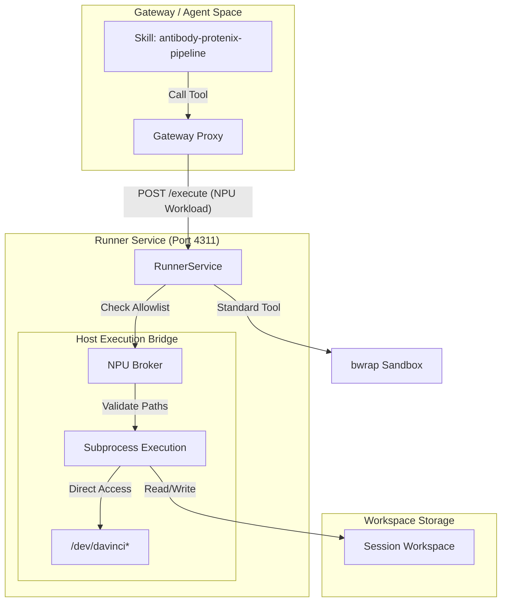
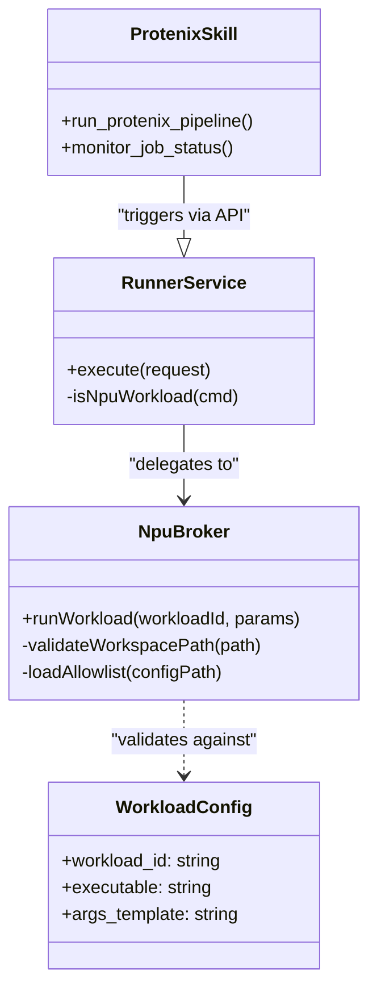

<!-- source: DeepWiki mcp.deepwiki.com · repo openJiuwen-ai/sciencediscovery · extra page Ascend NPU Host Broker · fetched 2026-11-02 -->

# Ascend NPU Host Broker

Relevant source files

The following files were used as context for generating this wiki page:

- [.env.example](.env.example)

The **Ascend NPU Host Broker** is an opt-in execution component within the Runner service designed to facilitate high-performance AI workloads (specifically protein folding and molecular design) on Huawei Ascend 910B3 NPUs. It bypasses standard sandbox restrictions for specific, allowlisted workloads while maintaining strict path validation and session ownership checks.

## Design Rationale

### The Sandbox Challenge
ScienceDiscovery typically executes code within a `bubblewrap` (bwrap) sandbox to ensure process isolation and filesystem security. However, standard `bwrap` device passthrough often fails or exhibits extreme instability on Ascend 910B3 hardware due to the complex interaction between the `dev/davinci*` drivers, the HCCS (Huawei Cache Coherence System), and the specialized memory management required by the Ascend Collective Communication Library (HCCL).

### The Broker Solution
To resolve this, the Runner implements a **Broker** model:
1.  **Standard Tools**: Continue to run in the `bwrap` sandbox (Python, R, Shell).
2.  **NPU Workloads**: Are offloaded to a host-side execution bridge that has direct access to NPU drivers but is restricted to a predefined JSON allowlist of commands.

## Operational Architecture

The NPU Broker is activated by setting `SCIENCE_AGENT_NPU_BROKER=1` in the environment configuration [.env.example:97-97](). When enabled, the `RunnerService` routes specific tool calls—such as those from the `antibody-protenix-pipeline` skill—through the broker instead of the standard `ExecutionManager`.

### Data Flow Diagram

Title: NPU Broker Execution Flow

**Sources:** [.env.example:86-105](), [services/runner/workloads/npu-workloads.default.json]()

## Workload Allowlist and Security

The broker does not allow arbitrary shell execution on the host. It operates on an **Allowlist-Only** model defined in a JSON configuration file. By default, this is located at `services/runner/workloads/npu-workloads.default.json` [.env.example:95-96]().

### Security Controls
1.  **Command Validation**: Only commands explicitly defined in the `npu-workloads` JSON can be executed.
2.  **Path Validation**: The broker enforces that all input and output paths reside within the specific `Session` workspace directory. It rejects any paths containing `..` or absolute paths outside the data root.
3.  **Session Ownership**: Before execution, the Runner verifies that the requesting `sessionId` matches the owner of the workspace directory.
4.  **Managed Environment**: Workloads use the current ScienceDiscovery managed scientific environment revision (micromamba-managed) rather than arbitrary system binaries [.env.example:99-102]().

## Antibody-Protenix-Pipeline Integration

The primary consumer of the NPU Broker is the **Antibody Protenix Pipeline** skill. This pipeline automates a multi-stage workflow for protein design:

1.  **RFdiffusion**: Generates backbone structures.
2.  **ProteinMPNN**: Performs sequence design for the generated backbones.
3.  **Protenix**: Performs structure prediction and validation using Ascend NPUs.

The skill bundle provides a `Protenix manager entrypoint` script, which is configured via `SCIENCE_AGENT_NPU_PROTENIX_SCRIPT` [.env.example:104-105](). This script acts as the coordinator that the NPU Broker invokes to manage the lifecycle of these high-compute jobs.

### Component Mapping

Title: NPU Broker Code Entity Map

**Sources:** [.env.example:93-105](), [services/runner/workloads/npu-workloads.default.json]()

## Configuration Reference

The following environment variables control the NPU Broker behavior:

| Variable | Purpose |
| :--- | :--- |
| `SCIENCE_AGENT_NPU_BROKER` | Set to `1` to enable the host-side NPU broker [.env.example:97](). |
| `SCIENCE_AGENT_NPU_WORKLOAD_CONFIG` | Path to the JSON allowlist. Defaults to `npu-workloads.default.json` [.env.example:98](). |
| `SCIENCE_AGENT_NPU_PROTENIX_SCRIPT` | Path to the entrypoint script for the Protenix manager [.env.example:105](). |
| `SCIENCE_AGENT_NPU_PYTHON` | Compatibility fallback for custom allowlists using `${python}` [.env.example:102](). |

**Sources:** [.env.example:93-106]()

---

