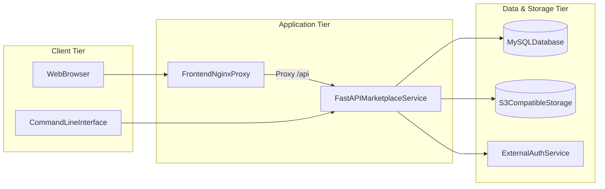
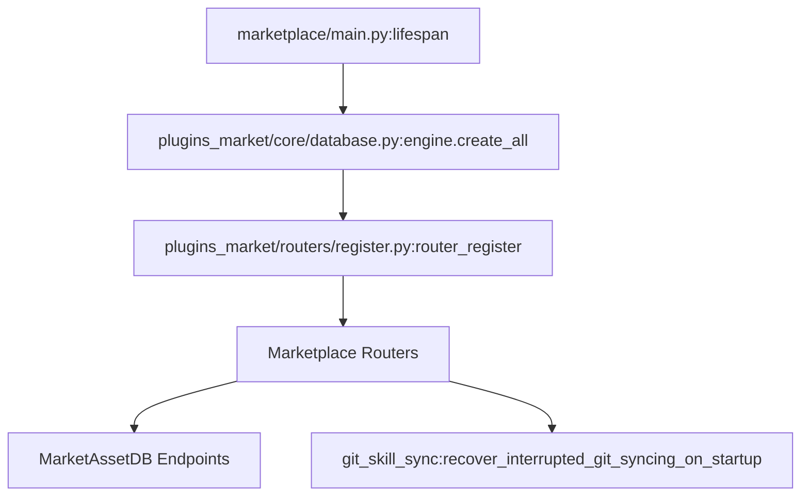
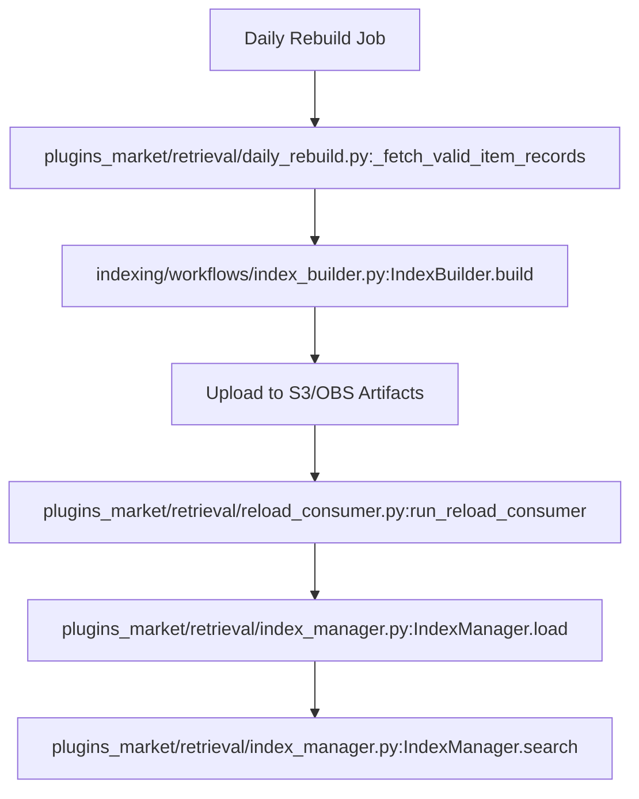

<!-- source: DeepWiki mcp.deepwiki.com · repo openJiuwen-ai/skillhub · page 1 Overview · fetched 2026-11-02 -->

# Overview

<details>
<summary>Relevant source files</summary>

The following files were used as context for generating this wiki page:

- [README.md](README.md)
- [README_zh.md](README_zh.md)
- [docker/Dockerfile.skill-runner](docker/Dockerfile.skill-runner)
- [docker/k8s/marketplace-config.yaml](docker/k8s/marketplace-config.yaml)
- [docker/skill-agent-worker/entrypoint.sh](docker/skill-agent-worker/entrypoint.sh)
- [docs/zh/README.md](docs/zh/README.md)
- [marketplace/main.py](marketplace/main.py)
- [marketplace/plugins_market/retrieval/daily_rebuild.py](marketplace/plugins_market/retrieval/daily_rebuild.py)
- [marketplace/plugins_market/retrieval/index_manager.py](marketplace/plugins_market/retrieval/index_manager.py)
- [marketplace/plugins_market/retrieval/search.py](marketplace/plugins_market/retrieval/search.py)
- [marketplace/plugins_market/tests/test_agent_asset_retrieval.py](marketplace/plugins_market/tests/test_agent_asset_retrieval.py)
- [marketplace/retrieval/indexing/scanners/__init__.py](marketplace/retrieval/indexing/scanners/__init__.py)
- [marketplace/retrieval/indexing/scanners/base.py](marketplace/retrieval/indexing/scanners/base.py)
- [marketplace/retrieval/indexing/workflows/artifacts.py](marketplace/retrieval/indexing/workflows/artifacts.py)
- [marketplace/retrieval/indexing/workflows/index_builder.py](marketplace/retrieval/indexing/workflows/index_builder.py)
- [skill-runner/executor/pod_manager.py](skill-runner/executor/pod_manager.py)
- [skill-runner/pyproject.toml](skill-runner/pyproject.toml)

</details>


openJiuwen Agentic Hub (**SkillHub**) is an open-source skill hosting and distribution platform designed for self-hosted team deployments within the openJiuwen ecosystem [README.md:1-9](). It serves as an asset marketplace supporting skills, swarm skills, agent plugins, templates, and Model Context Protocol (MCP) connectors [README.md:26](). It also optionally supports ClawHub-compatible API protocols for integration with existing external client tools [README.md:10-11]().

For installation, environment configuration, and local running steps, see [Getting Started and Local Development](#1.1). For an in-depth breakdown of the asset taxonomy, versions, visibility rules, and publish workflows, see [Domain Concepts: Assets, Plugin Types and Lifecycle](#1.2).

## High-Level Architecture

The system is composed of several decoupled tiers: a React/Vite single-page application frontend served via Nginx, a FastAPI-powered marketplace backend (`marketplace`), external storage backing (MinIO or Huawei OBS), a MySQL transactional database, and external authentication integration [README.md:32-55]().


Sources: [README.md:32-55]()

## Subsystem Breakdown

### Marketplace Backend (`marketplace`)
Built on Python >= 3.11.4 and FastAPI, the backend handles asset publishing, version control, metadata validation, moderation pipelines, and presigned downloads [README.md:4, 26, 61](). It initializes database sessions via SQLAlchemy (`plugins_market/core/database.py`) and bootstraps core routing and middleware inside `marketplace/main.py` [README.md:61]().

### Frontend Web Application (`frontend`)
A React 18 and Vite Single Page Application using Material-UI (MUI) [README.md:5, 62](). It delivers marketplace browsing, tag filtering, asset detail visualization, version file tree inspectors, a publishing wizard drawer, and an administrative control console.

### Retrieval, Recommendation and Dispatch Subsystems
Located under `plugins_market/retrieval/` and `marketplace/retrieval/`, this subsystem builds lexical (BM25), vector embedding, and hierarchical tree indexes over scanned packages [marketplace/plugins_market/retrieval/daily_rebuild.py:3-20](). The `IndexManager` (`plugins_market/retrieval/index_manager.py`) implements a Read-Copy-Update (RCU) concurrency pattern for lock-free reads during runtime searches [marketplace/plugins_market/retrieval/index_manager.py:3-7]().

### Tooling, Playground and Skill-Runner
Includes CLI packages (`cli_core`, `openjiuwen_plugin`, `jiuwen_teamskills`), an isolated `skill-runner` execution container service utilizing a pod manager, and playground session APIs hosted within the marketplace backend.

## Repository Layout

```text
.
├── marketplace/          # FastAPI backend service (plugins_market, retrieval, validation)
├── frontend/             # React/Vite web application UI
├── cli/                  # CLI tooling and packaging modules
├── skill-runner/         # Execution worker service and LLM proxy
├── docker/               # Dockerfiles, Compose files, and Kubernetes manifests
└── docs/                 # User guides, API references, and deployment manuals
```
Sources: [README.md:1-167](), [README_zh.md:1-160]()

---

## Code Space Bridge: Request Lifecycle and Routing

To bridge natural language concepts to concrete code identifiers, the following diagram illustrates how the FastAPI application bootstrap in `marketplace/main.py` registers routing subsystems via `plugins_market/routers/register.py`.


Sources: [marketplace/main.py:118-163]()

## Code Space Bridge: Retrieval Indexing and RCU Lifecycle

This diagram maps the natural language indexing and search pipeline to its underlying classes and functions, tracking how index records are fetched and managed in memory.


Sources: [marketplace/plugins_market/retrieval/daily_rebuild.py:99-177](), [marketplace/plugins_market/retrieval/index_manager.py:60-158](), [marketplace/retrieval/indexing/workflows/index_builder.py:98-129]()

---

