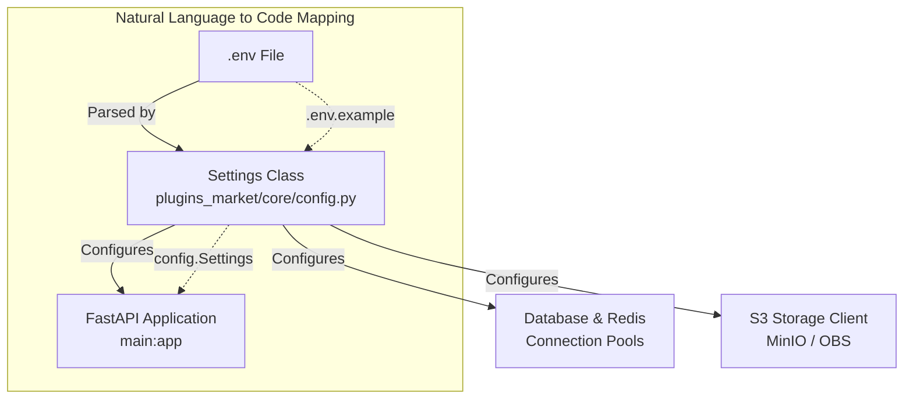
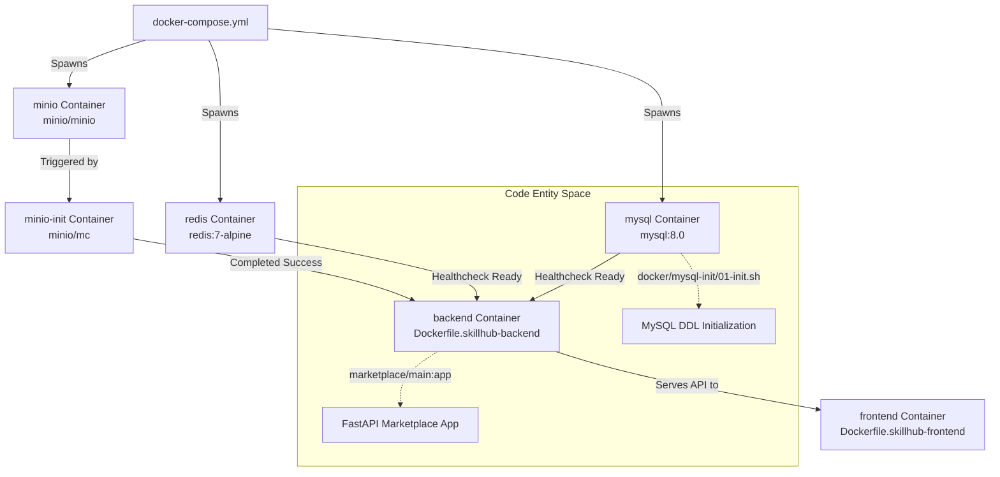

<!-- source: DeepWiki mcp.deepwiki.com · repo openJiuwen-ai/skillhub · page 1.1 Getting Started and Local Development · fetched 2026-11-02 -->

# Getting Started and Local Development

Relevant source files

The following files were used as context for generating this wiki page:

- [.env.example](.env.example)
- [docker/Dockerfile.skillhub-backend](docker/Dockerfile.skillhub-backend)
- [docker/docker-compose.override.yml.example](docker/docker-compose.override.yml.example)
- [docker/docker-compose.yml](docker/docker-compose.yml)
- [docker/mysql-init/01-init.sh](docker/mysql-init/01-init.sh)
- [marketplace/plugins_market/core/config.py](marketplace/plugins_market/core/config.py)
- [marketplace/pyproject.toml](marketplace/pyproject.toml)

## Purpose and Scope

This page covers the installation, environment configuration, containerized orchestration via Docker Compose, local frontend and backend startup procedures, and database initialization pipelines for the openJiuwen SkillHub codebase. It details how the FastAPI marketplace backend [marketplace/plugins_market/core/config.py]() interacts with environment variables and how containers are provisioned [docker/docker-compose.yml]().

Sources:
- [marketplace/plugins_market/core/config.py]()
- [docker/docker-compose.yml]()

---

## Environment Configuration and Settings

The SkillHub backend relies on Pydantic's `BaseSettings` within `marketplace/plugins_market/core/config.py` to parse and validate runtime parameters. Configuration can be supplied via a local `.env` file or direct environment variables. 

Key configuration categories include:
- **Server Binding**: `STORE_HOST` and `STORE_PORT` define the Uvicorn listener address.
- **Database Connection**: `DB_TYPE`, `DB_HOST`, `DB_PORT`, `DB_USER`, `DB_PASSWORD`, and `STORE_DB_NAME` establish the MySQL connection parameters.
- **Object Storage**: `STORAGE_TYPE` (MinIO or OBS), `MARKET_BUCKET_NAME`, `MARKET_S3_ENDPOINT`, and credential keys.
- **OAuth Integration**: Providers for GitCode, GitHub, and AgentOS.

Sources:
- [marketplace/plugins_market/core/config.py:31-162]()
- [.env.example:1-162]()

---

## Dependencies and Python Package Layout

Backend dependencies and packaging metadata are defined in `marketplace/pyproject.toml`. The project uses modern build tools (`setuptools` with `wheel`) and specifies required versions for FastAPI, SQLAlchemy, Pydantic v2, Redis, and retrieval engines.

| Dependency Category | Key Packages | Version Constraint |
| :--- | :--- | :--- |
| Web Framework | `fastapi`, `uvicorn[standard]` | `==0.115.11`, `>=0.35` |
| Validation & Settings | `pydantic`, `pydantic-settings` | `==2.11.7`, `==2.5.2` |
| Database & ORM | `sqlalchemy`, `pymysql` | `==2.0.41`, `==1.1.1` |
| Caching & Storage | `redis`, `boto3` | `>=5.0.0`, `>=1.34.0` |

Sources:
- [marketplace/pyproject.toml:1-44]()

---

## Containerized Local Development with Docker Compose

For local development and self-validation, `docker/docker-compose.yml` orchestrates five core services: `mysql`, `redis`, `minio`, `minio-init`, `backend`, and `frontend`.

The backend image is built using a multi-stage Dockerfile (`docker/Dockerfile.skillhub-backend`) that uses `uv` to build a wheel package in the builder stage and installs it into a slim runtime container.

Sources:
- [docker/docker-compose.yml:25-161]()
- [docker/Dockerfile.skillhub-backend:1-81]()

---

## Database Initialization Pipeline

Upon initial startup, the MySQL container executes `docker/mysql-init/01-init.sh`. This script sequentially applies baseline DDL scripts followed by incremental migration scripts.

The initialization execution order runs as follows:
1. **Baseline DDL**: Executes table creations for `market_assets`, `market_asset_versions`, `market_asset_interactions`, `audit_logs`, `plugin_fetch_records`, and `site_notifications` located under `/sql/baseline/openjiuwen_market/DDL/`.
2. **Incremental DDL/DML**: Applies versioned schema upgrades (such as `v0.0.2.B001`, `v0.0.2.B002`, and `v0.0.2.B003`) adding git sources, moderation tables, group ACLs, and visibility rules.

Sources:
- [docker/mysql-init/01-init.sh:1-56]()
- [docker/docker-compose.yml:41-44]()

---

