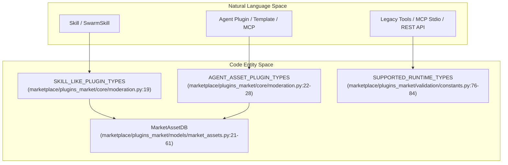
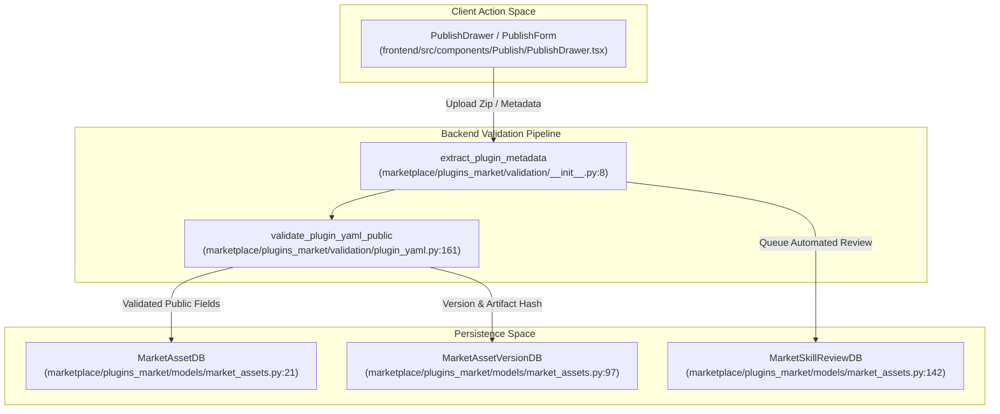

<!-- source: DeepWiki mcp.deepwiki.com · repo openJiuwen-ai/skillhub · page 1.2 Domain Concepts: Assets, Plugin Types and Lifecycle · fetched 2026-11-02 -->

# Domain Concepts: Assets, Plugin Types and Lifecycle

Relevant source files

The following files were used as context for generating this wiki page:

- [CHANGELOG.md](CHANGELOG.md)
- [docs/zh/SUMMARY.md](docs/zh/SUMMARY.md)
- [frontend/src/components/Publish/PublishDrawer.tsx](frontend/src/components/Publish/PublishDrawer.tsx)
- [frontend/src/utils/pluginType.ts](frontend/src/utils/pluginType.ts)
- [frontend/src/utils/publishFieldLabels.ts](frontend/src/utils/publishFieldLabels.ts)
- [marketplace/plugins_market/core/moderation.py](marketplace/plugins_market/core/moderation.py)
- [marketplace/plugins_market/models/market_assets.py](marketplace/plugins_market/models/market_assets.py)
- [marketplace/plugins_market/tests/test_m3_agent_moderation_flow.py](marketplace/plugins_market/tests/test_m3_agent_moderation_flow.py)
- [marketplace/plugins_market/tests/test_moderated_market_asset_types.py](marketplace/plugins_market/tests/test_moderated_market_asset_types.py)
- [marketplace/plugins_market/validation/__init__.py](marketplace/plugins_market/validation/__init__.py)
- [marketplace/plugins_market/validation/base.py](marketplace/plugins_market/validation/base.py)
- [marketplace/plugins_market/validation/constants.py](marketplace/plugins_market/validation/constants.py)
- [marketplace/plugins_market/validation/plugin_yaml.py](marketplace/plugins_market/validation/plugin_yaml.py)
- [marketplace/plugins_market/validation/types/__init__.py](marketplace/plugins_market/validation/types/__init__.py)

## Purpose and Scope
This document outlines the core domain concepts of the `openJiuwen-ai/skillhub` platform, focusing on the asset and plugin type taxonomy, versioning rules, visibility controls, moderation states, and the publish lifecycle. It bridges high-level architectural concepts with the concrete data models, validation functions, and service logic implemented in the backend codebase (`plugins_market`).

Sources: `CHANGELOG.md:16-19`, `marketplace/plugins_market/models/market_assets.py:21-122`, `marketplace/plugins_market/core/moderation.py:1-78`

---

## 1. Asset and Plugin Type Taxonomy
The platform manages multiple runtime asset and plugin types, categorized into skill-like assets, agent-wrapped packaging types, and legacy tool integrations. These classifications drive runtime dispatch, search indexing group partitioning, and moderation requirements.

Supported runtime types are defined centrally in `marketplace/plugins_market/validation/constants.py:68-84`:
- **Skill-like Types (`skill`, `swarmskill`)**: Executable agent workflows and multi-agent coordination rules. Aligned with `SKILL_LIKE_PLUGIN_TYPES` in `marketplace/plugins_market/core/moderation.py:19`.
- **Agent Asset Types (`agent-plugin`, `agent-template`, `agent-mcp`)**: Packaging wrappers for multi-agent capabilities (plugins, expert templates, Model Context Protocol connectors). Defined as `AGENT_ASSET_PLUGIN_TYPES` in `marketplace/plugins_market/core/moderation.py:22-28`.
- **Legacy Tool Types (`tools`, `mcp-stdio`, `restful-api`)**: Direct tool interfaces bypassing strict platform content moderation (`MODERATED_MARKET_ASSET_TYPES` excludes these, per `marketplace/plugins_market/core/moderation.py:31-32`).

Title: Asset Taxonomy and Code Mapping

Sources: `marketplace/plugins_market/validation/constants.py:68-84`, `marketplace/plugins_market/core/moderation.py:13-33`, `marketplace/plugins_market/models/market_assets.py:21-61`

---

## 2. Versions and Versioning Semantics
Asset versions are tracked at both the aggregate asset level (`MarketAssetDB`) and the individual version record level (`MarketAssetVersionDB`). 

- **Semantic Versioning**: Standard releases follow strict Semantic Versioning (`x.y.z`), enforced by `VERSION_PATTERN` in `marketplace/plugins_market/validation/constants.py:27`.
- **Git Commit Versions**: For Git-synced repositories, versions are normalized to 7-character lowercase hexadecimal strings (`GIT_COMMIT_VERSION_PATTERN`), extracted via `commit_full_sha_to_version` in `marketplace/plugins_market/validation/constants.py:33-40`.
- **Database Schema**: Each version record stores artifact metadata, changelogs, file paths, and SHA-256 digests in `MarketAssetVersionDB` (`marketplace/plugins_market/models/market_assets.py:97-122`).

Sources: `marketplace/plugins_market/validation/constants.py:24-64`, `marketplace/plugins_market/models/market_assets.py:97-122`

---

## 3. Visibility and Access Control
Assets support granular visibility controls managed via the `visibility` column on `MarketAssetDB` (`marketplace/plugins_market/models/market_assets.py:43`):
- **Public (`public`)**: Published to the open marketplace, discoverable via search and indexing.
- **Private (`private`)**: Restricted to authors, system administrators, or authorized group ACL members via `ViewerContext`.

Access enforcement relies on permission checks executed against the asset's publisher ID, visibility flag, and approval state (`marketplace/plugins_market/tests/test_m3_agent_moderation_flow.py:126-184`).

Sources: `marketplace/plugins_market/models/market_assets.py:43`, `marketplace/plugins_market/tests/test_m3_agent_moderation_flow.py:126-184`, `marketplace/plugins_market/tests/test_moderated_market_asset_types.py:97-136`

---

## 4. Moderation States and Automated Review
Assets subject to content checks participate in an asynchronous review pipeline. The review lifecycle transitions through specific moderation statuses:

- **States**: `PENDING`, `APPROVED`, `REJECTED`, defined in `marketplace/plugins_market/core/moderation.py:14-16`.
- **Aggregation**: The primary `MarketAssetDB.moderation_status` is computed dynamically from its constituent `MarketAssetVersionDB` rows. If any version is pending, the asset shows pending status; approval requires at least one approved version (`marketplace/plugins_market/models/market_assets.py:37-38`).
- **Automated Review Engine**: Detailed execution reports, risk scores, and policy checks are persisted in `MarketSkillReviewDB` (`marketplace/plugins_market/models/market_assets.py:142-171`).

Sources: `marketplace/plugins_market/core/moderation.py:13-77`, `marketplace/plugins_market/models/market_assets.py:37-41,142-171`

---

## 5. Publish Lifecycle and Data Flow
The publish lifecycle handles archive upload, safety extraction, YAML configuration parsing, metadata validation, and state commitment.

Title: Publish Lifecycle and Data Flow

Sources: `marketplace/plugins_market/validation/__init__.py:1-10`, `marketplace/plugins_market/validation/plugin_yaml.py:140-202`, `marketplace/plugins_market/models/market_assets.py:21-122`, `frontend/src/components/Publish/PublishDrawer.tsx:1-103`

---

