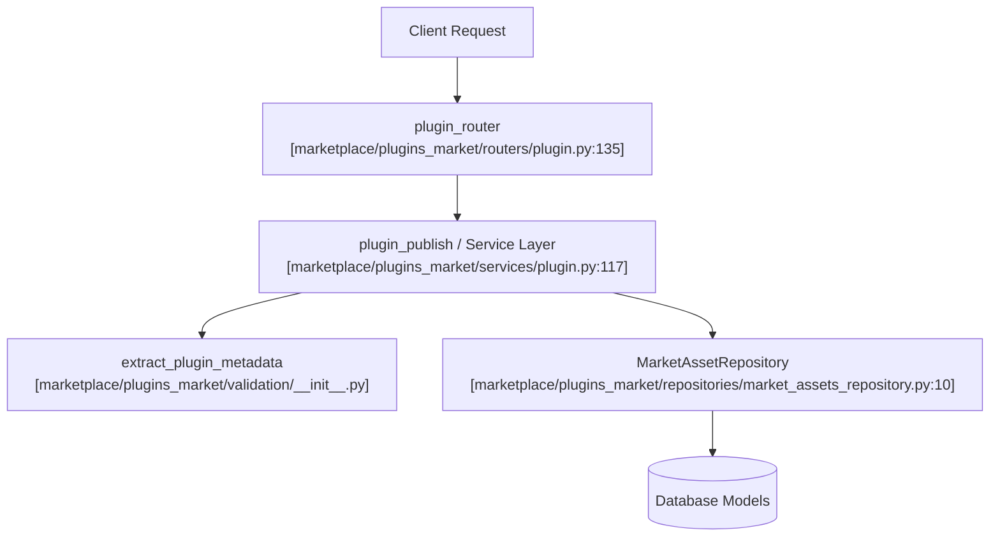
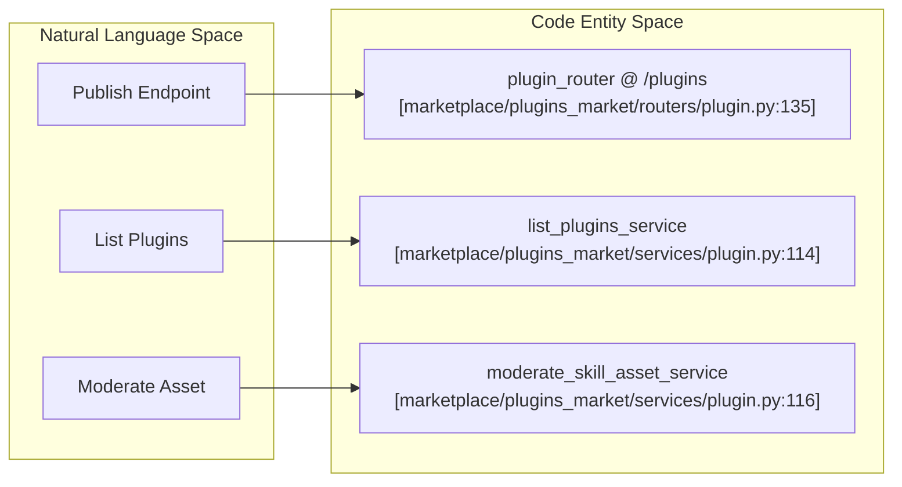

<!-- source: DeepWiki mcp.deepwiki.com · repo openJiuwen-ai/skillhub · page 2.1 Plugin APIs and Services · fetched 2026-11-02 -->

# Plugin APIs and Services

Relevant source files

The following files were used as context for generating this wiki page:

- [marketplace/plugins_market/repositories/__init__.py](marketplace/plugins_market/repositories/__init__.py)
- [marketplace/plugins_market/repositories/market_assets_repository.py](marketplace/plugins_market/repositories/market_assets_repository.py)
- [marketplace/plugins_market/routers/interaction.py](marketplace/plugins_market/routers/interaction.py)
- [marketplace/plugins_market/routers/plugin.py](marketplace/plugins_market/routers/plugin.py)
- [marketplace/plugins_market/schemas/plugin.py](marketplace/plugins_market/schemas/plugin.py)
- [marketplace/plugins_market/services/plugin.py](marketplace/plugins_market/services/plugin.py)

## Purpose and Scope
This section provides a high-level overview of the marketplace backend APIs, service layer orchestration, data repositories, and schemas governing asset lifecycle management in openJiuwen Agentic Hub (`skillhub`). The plugin subsystem handles publishing, listing, downloading, deleting, and moderating diverse asset types including skills, swarm skills, agent plugins, templates, and MCP connectors.

For granular implementation details, refer to the child pages:
- [Data Model and SQL Schema](#2.1.1)
- [Package Validation Pipeline](#2.1.2)
- [Import and Publish Wrapping](#2.1.3)
- [Moderation and Skill Review](#2.1.4)

---

## Architectural Overview of the Plugin Subsystem

The plugin backend is built around a standard layered architecture using FastAPI routers, business logic services, and SQLAlchemy repositories. Incoming HTTP requests are intercepted by `plugin_router` [marketplace/plugins_market/routers/plugin.py:135-136] and delegated to transaction-aware service functions in `plugins_market.services` [marketplace/plugins_market/services/plugin.py:3-122], which interact with database repositories such as `MarketAssetRepository` [marketplace/plugins_market/repositories/market_assets_repository.py:10] for persistence.

### Component Interaction Flow

*Sources: [marketplace/plugins_market/routers/plugin.py:135-136](), [marketplace/plugins_market/services/plugin.py:117](), [marketplace/plugins_market/repositories/market_assets_repository.py:10]()*

---

## Core API Endpoints and Routers

The plugin API exposes several groups of operations defined in `plugins_market/routers/plugin.py`:

- **Publishing & Import**: Endpoints for uploading plugin packages, validating metadata, and executing single or bulk imports (`SkillImportBundle`, `PluginPublishForm`) [marketplace/plugins_market/schemas/plugin.py:26-97].
- **Listing & Search**: Filterable list queries (`PluginListQuery`) supporting pagination, tag filtering (`parse_tag_filter`) [marketplace/plugins_market/repositories/market_assets_repository.py:72], and visibility rules.
- **Download & Files**: Retrieval of version-specific metadata, signed storage URLs (`PluginTemplatePresignData`), and file trees (`VersionFilesData`) [marketplace/plugins_market/schemas/plugin.py:156-195].
- **Deletion**: Soft or hard deletion of asset versions (`PluginVersionDeleteData`, `AssetVersionDeleteData`) [marketplace/plugins_market/schemas/plugin.py:172-187].
- **Moderation**: Administrative review endpoints (`SkillModerationRequest`, `SkillModerationResult`) [marketplace/plugins_market/schemas/plugin.py:101-103] for approving or rejecting submitted assets.

### End-to-End Request Routing to Code Entities

*Sources: [marketplace/plugins_market/routers/plugin.py:135](), [marketplace/plugins_market/services/plugin.py:114-116]()*

---

## Service Layer and Repository Abstraction

The service layer orchestrates business transactions, conflict resolution, version checks, and asynchronous review scheduling. Key responsibilities include:
- **Conflict Handling**: Managing version collisions, force-publish overrides, and deduplication flags (`PluginPublishResult.deduplicated`) [marketplace/plugins_market/schemas/plugin.py:85].
- **Audit Logging**: Recording critical events such as moderation decisions via `audit_log` [marketplace/plugins_market/services/plugin.py:28].
- **Repositories**: `MarketAssetRepository`, `MarketAssetVersionRepository`, and `MarketSkillReviewRepository` encapsulate all raw SQLAlchemy queries, handling complex filters for pending moderation queues and group skill grants [marketplace/plugins_market/repositories/__init__.py:10-14].

Sources: [marketplace/plugins_market/services/plugin.py:3-122](), [marketplace/plugins_market/repositories/market_assets_repository.py:10-19]()

---

## Schemas and Data Transfer Objects

Pydantic schemas in `plugins_market/schemas/plugin.py` define the contracts for API request validation and response serialization. Key structures include:
- `AssetCreate` & `AssetVersionCreate`: Internal models for mapping parsed package descriptors to database records [marketplace/plugins_market/schemas/plugin.py:40-68].
- `PluginListItem` & `PluginVersionDetail`: Detailed metadata schemas returned to frontend consumers [marketplace/plugins_market/schemas/plugin.py:75-221].
- `SkillImportResponse` & `AssetImportResponse`: Aggregated result containers for bulk operations [marketplace/plugins_market/schemas/plugin.py:123-150].

Sources: [marketplace/plugins_market/schemas/plugin.py:1-223]()

---

## Related Child Documentation

For deeper exploration into specific subsystems, consult the corresponding child pages:
- **Data Model and SQL Schema**: [Data Model and SQL Schema](#2.1.1)
- **Package Validation Pipeline**: [Package Validation Pipeline](#2.1.2)
- **Import and Publish Wrapping**: [Import and Publish Wrapping](#2.1.3)
- **Moderation and Skill Review**: [Moderation and Skill Review](#2.1.4)

---

