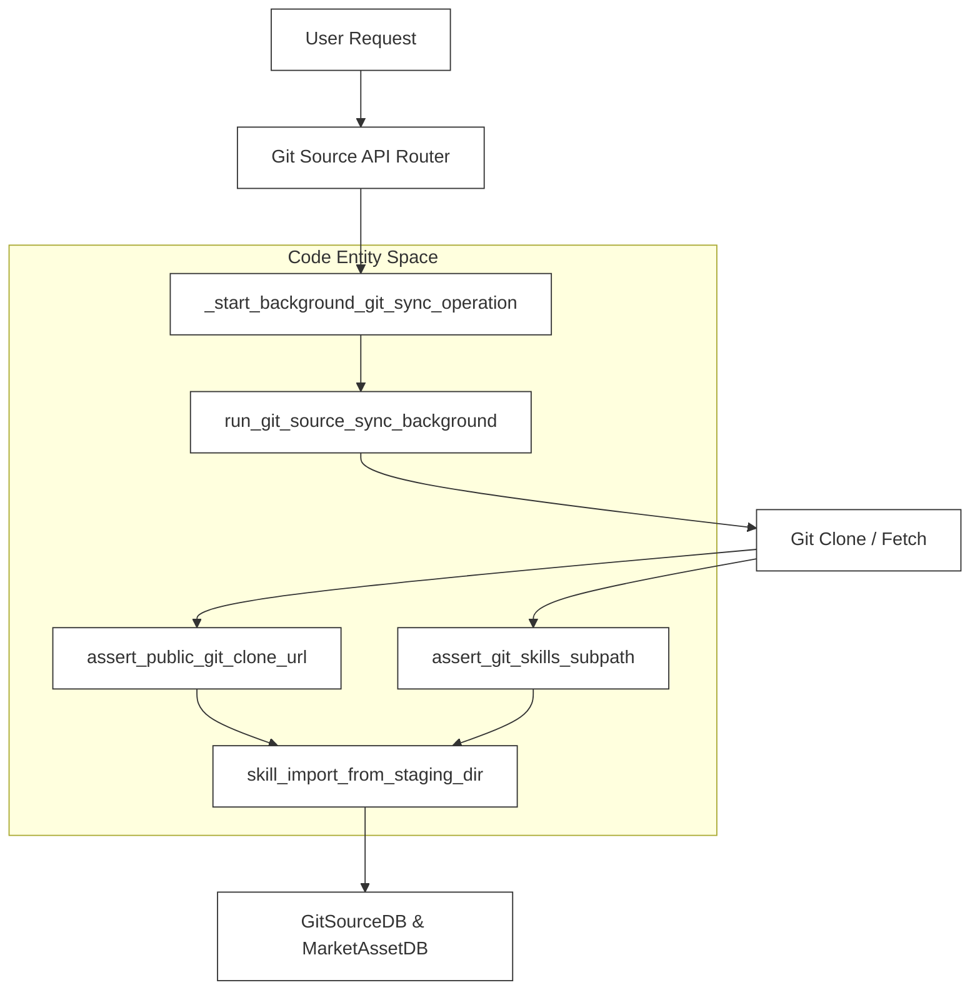
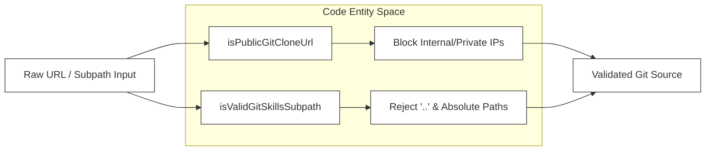
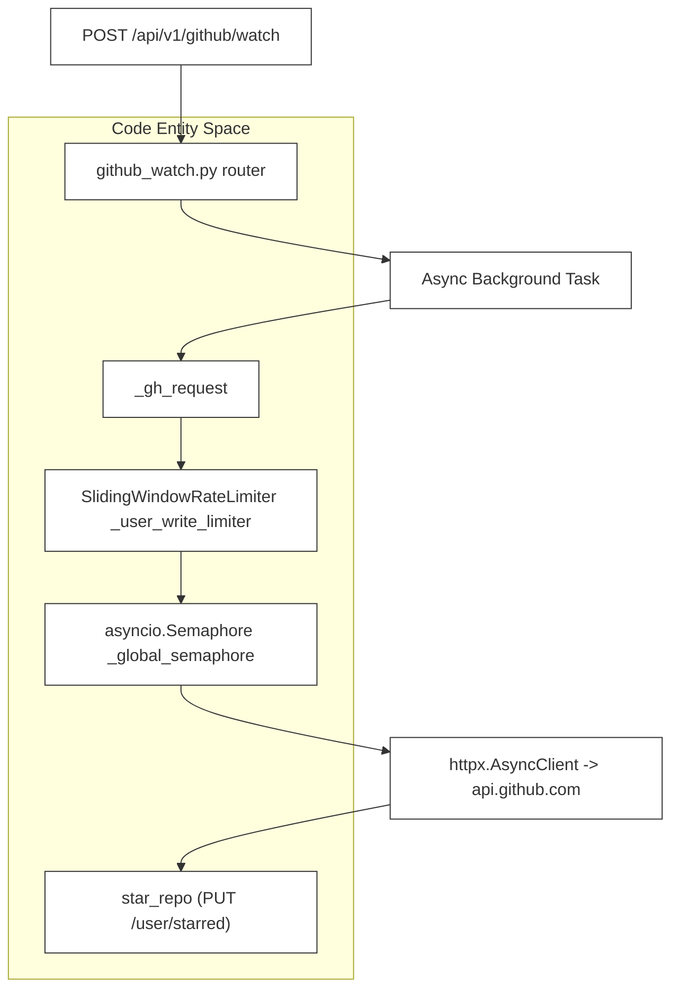
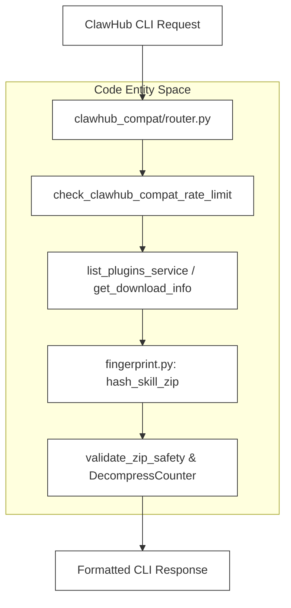

<!-- source: DeepWiki mcp.deepwiki.com · repo openJiuwen-ai/skillhub · page 2.4 Git Sync, GitHub Integration and ClawHub Compatibility · fetched 2026-11-02 -->

# Git Sync, GitHub Integration and ClawHub Compatibility

Relevant source files

The following files were used as context for generating this wiki page:

- [cli/cli_core/utils.py](cli/cli_core/utils.py)
- [frontend/src/api/githubWatch.ts](frontend/src/api/githubWatch.ts)
- [frontend/src/api/index.ts](frontend/src/api/index.ts)
- [frontend/src/components/Common/WatchOpenJiuwenRepos.tsx](frontend/src/components/Common/WatchOpenJiuwenRepos.tsx)
- [frontend/src/components/Profile/GitSourcesPanel.tsx](frontend/src/components/Profile/GitSourcesPanel.tsx)
- [frontend/src/index.css](frontend/src/index.css)
- [frontend/src/utils/formatSkillVersionLabel.ts](frontend/src/utils/formatSkillVersionLabel.ts)
- [frontend/src/utils/gitSkillsSubpathSafety.ts](frontend/src/utils/gitSkillsSubpathSafety.ts)
- [frontend/src/utils/gitUrlSafety.ts](frontend/src/utils/gitUrlSafety.ts)
- [marketplace/plugins_market/clawhub_compat/fingerprint.py](marketplace/plugins_market/clawhub_compat/fingerprint.py)
- [marketplace/plugins_market/clawhub_compat/router.py](marketplace/plugins_market/clawhub_compat/router.py)
- [marketplace/plugins_market/core/github_proxy.py](marketplace/plugins_market/core/github_proxy.py)
- [marketplace/plugins_market/repositories/git_source_repository.py](marketplace/plugins_market/repositories/git_source_repository.py)
- [marketplace/plugins_market/routers/github_watch.py](marketplace/plugins_market/routers/github_watch.py)
- [marketplace/plugins_market/services/git_skill_sync.py](marketplace/plugins_market/services/git_skill_sync.py)
- [marketplace/plugins_market/utils/git_ref_rules.py](marketplace/plugins_market/utils/git_ref_rules.py)
- [marketplace/plugins_market/utils/git_skills_subpath_rules.py](marketplace/plugins_market/utils/git_skills_subpath_rules.py)

### Purpose and Scope
This section details the backend and frontend subsystems responsible for external repository integrations in the openJiuwen Agentic Hub (SkillHub). This covers automated Git source synchronization for batch skill publishing, strict URL and subpath safety validation to prevent server-side request forgery (SSRF) and path traversal, GitHub repository watch/star proxying with sliding-window rate limiting, and the ClawHub CLI compatibility routing and asset fingerprinting layer.

---

### 1. Git Source Repositories and Skill Sync Engine
The Git skill synchronization service (`marketplace/plugins_market/services/git_skill_sync.py`) enables users to register external Git repositories and batch-import or synchronize skills into the marketplace [marketplace/plugins_market/services/git_skill_sync.py:1-4](). 

Key architectural components and workflow steps include:
* **Background Sync Coordination**: Synchronizations execute asynchronously via background runner functions such as `_start_background_git_sync_operation` and `run_git_source_sync_background`, updating status fields and logging telemetry with operation contexts [marketplace/plugins_market/services/git_skill_sync.py:153-186]()
* **Ref and Subpath Constraints**: Branches or tags are validated using ref rules [marketplace/plugins_market/services/git_skill_sync.py:66](), while target skill paths are verified via subpath assertion checks [marketplace/plugins_market/services/git_skill_sync.py:67]().
* **Normalization and Staging**: Cloned bundles are processed, scanned, and ingested utilizing standard skill entry resolvers [marketplace/plugins_market/imports/skill_entries.py:48-53]() and staging import handlers [marketplace/plugins_market/imports/skill_import_service.py:54]().

*Sources: marketplace/plugins_market/services/git_skill_sync.py:1-194*, `marketplace/plugins_market/imports/skill_entries.py:48-53`, `marketplace/plugins_market/imports/skill_import_service.py:54`

---

### 2. Subpath and URL Safety Enforcement
To protect the backend infrastructure from malicious repository sources, internal network scanning, and traversal exploits, both the backend Python package and the frontend application enforce strict safety rules.

* **URL Safety**: `marketplace/plugins_market/utils/git_url_safety.py` (paired with frontend `frontend/src/utils/gitUrlSafety.ts`) validates that clone targets use public HTTP/HTTPS protocols and rejects reserved loopback, link-local, or private IP address spaces (e.g., `127.0.0.1`, `10.0.0.0/8`, `192.168.0.0/16`, `localhost`, and cloud metadata endpoints) [frontend/src/utils/gitUrlSafety.ts:5-75]().
* **Subpath Safety**: `marketplace/plugins_market/utils/git_skills_subpath_rules.py` (and frontend `frontend/src/utils/gitSkillsSubpathSafety.ts`) ensures that user-supplied subpaths do not contain absolute paths, Windows drive identifiers, null bytes, or directory traversal components (`..`) [marketplace/plugins_market/utils/git_skills_subpath_rules.py:15-53]().

*Sources: marketplace/plugins_market/utils/git_skills_subpath_rules.py:1-53*, `frontend/src/utils/gitUrlSafety.ts:1-76`, `frontend/src/utils/gitSkillsSubpathSafety.ts:1-28`

---

### 3. GitHub Watch and Star Proxy
The GitHub integration features a dedicated proxy routing layer (`marketplace/plugins_market/routers/github_watch.py` and `marketplace/plugins_market/core/github_proxy.py`) that empowers users to batch-star core openJiuwen repositories under the `openJiuwen-ai` organization [marketplace/plugins_market/routers/github_watch.py:1-70]().

Key mechanisms include:
* **Asynchronous Proxying**: `star_repo` issues authenticated `PUT` requests against `https://api.github.com/user/starred/{owner}/{repo}` using the user's OAuth Bearer token [marketplace/plugins_market/core/github_proxy.py:33-186]().
* **Sliding-Window Rate Limiting**: To prevent hitting GitHub content generation limits (e.g., 80 requests/minute per token), `_user_write_limiter` monitors per-token SHA-256 hash buckets, while `_global_semaphore` caps concurrent outbound requests [marketplace/plugins_market/core/github_proxy.py:44-149]().
* **Retry and Backoff**: Upstream `403` responses containing `Retry-After` headers trigger automatic fallback sleeping and single-attempt retries [marketplace/plugins_market/core/github_proxy.py:161-174]().

*Sources: marketplace/plugins_market/routers/github_watch.py:1-191*, `marketplace/plugins_market/core/github_proxy.py:1-187`

---

### 4. ClawHub CLI Compatibility Router and Fingerprinting
SkillHub exposes a compatibility layer mirroring the ClawHub CLI contract under `/api/v1` (`marketplace/plugins_market/clawhub_compat/router.py`) [marketplace/plugins_market/clawhub_compat/router.py:1-54]().

Core components:
* **Compatibility Router**: Translates native ClawHub search, resolve, inspect, and download requests into marketplace backend service calls (`list_plugins_service`, `get_download_info`) while filtering for skill-like plugin taxonomies [marketplace/plugins_market/clawhub_compat/router.py:45-100]().
* **Fingerprinting**: `marketplace/plugins_market/clawhub_compat/fingerprint.py` computes cryptographic hashes and validates zip member paths securely using `DecompressCounter` and `validate_zip_safety` to prevent zip-bomb vectors during CLI asset inspection [marketplace/plugins_market/clawhub_compat/router.py:21-42]().
* **Rate Limiting & Clamping**: Enforces client IP rate limits (`check_clawhub_compat_rate_limit`) and caps query parameters (such as `--limit` clamping to `CLAWHUB_LIMIT_CAP`) to guarantee predictable upstream performance [marketplace/plugins_market/clawhub_compat/router.py:52-115]().

*Sources: marketplace/plugins_market/clawhub_compat/router.py:1-175*, `marketplace/plugins_market/clawhub_compat/fingerprint.py:1-50`

---

