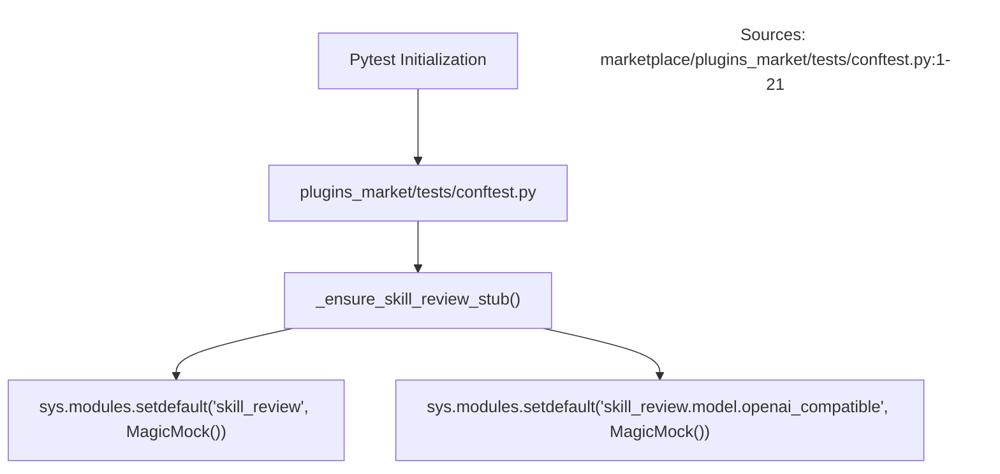
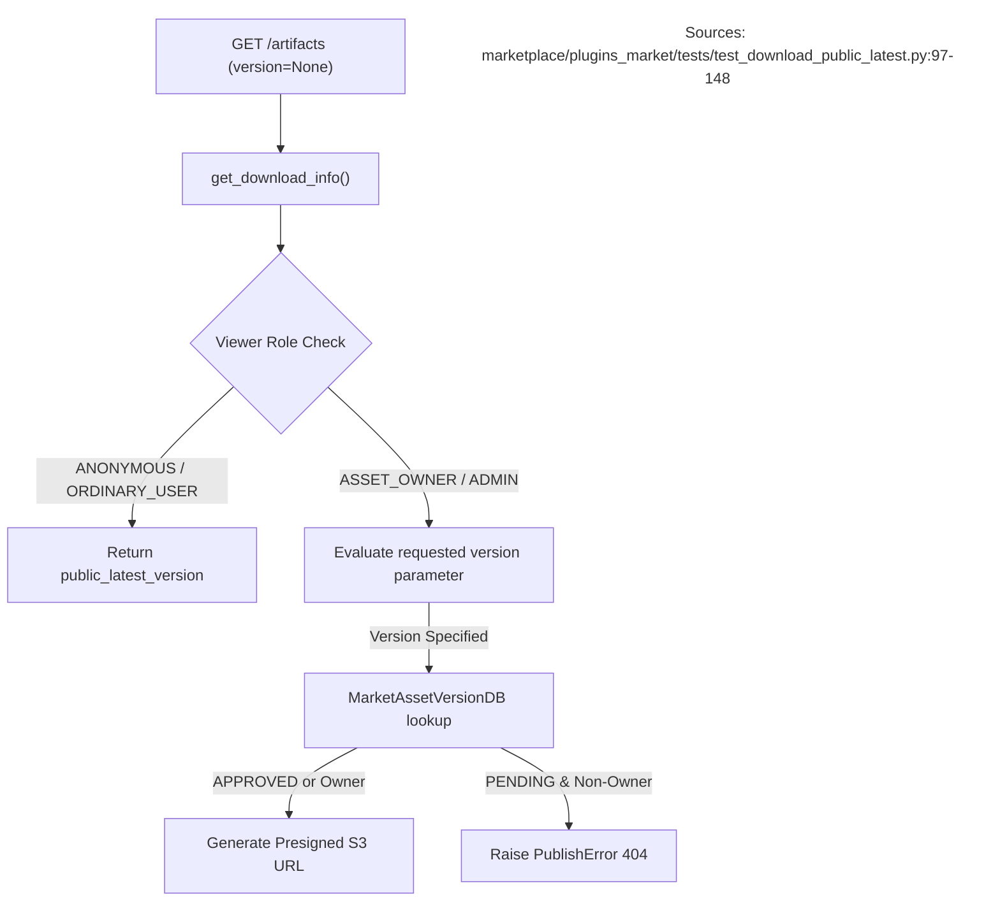
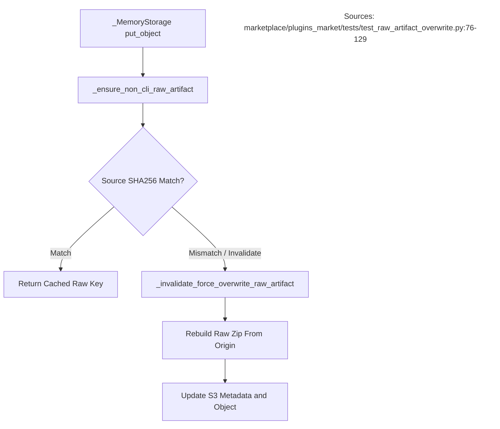
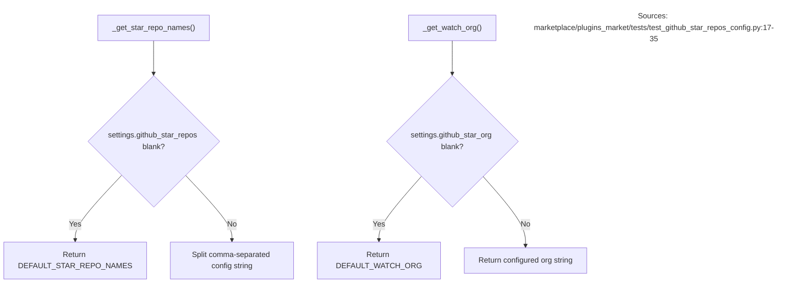

<!-- source: DeepWiki mcp.deepwiki.com · repo openJiuwen-ai/skillhub · page 2.5 Backend Testing · fetched 2026-11-02 -->

# Backend Testing

Relevant source files

The following files were used as context for generating this wiki page:

- [marketplace/plugins_market/tests/conftest.py](marketplace/plugins_market/tests/conftest.py)
- [marketplace/plugins_market/tests/test_download_public_latest.py](marketplace/plugins_market/tests/test_download_public_latest.py)
- [marketplace/plugins_market/tests/test_github_star_repos_config.py](marketplace/plugins_market/tests/test_github_star_repos_config.py)
- [marketplace/plugins_market/tests/test_raw_artifact_overwrite.py](marketplace/plugins_market/tests/test_raw_artifact_overwrite.py)
- [marketplace/plugins_market/tests/test_retrieval_diagnostics.py](marketplace/plugins_market/tests/test_retrieval_diagnostics.py)
- [marketplace/retrieval/retrieval/lexical/bm25.py](marketplace/retrieval/retrieval/lexical/bm25.py)
- [marketplace/retrieval/retrieval/semantic/embedding.py](marketplace/retrieval/retrieval/semantic/embedding.py)

## Purpose and Scope
This section details the backend testing infrastructure and test suites for the openJiuwen Agentic Hub (SkillHub) marketplace service, residing under `plugins_market/tests/`. The test suite validates critical backend subsystems including authorization rules, package artifact invalidation, retrieval diagnostic logging, and configuration fallbacks. Tests are executed using `pytest` alongside specialized in-memory database and storage mocks.

Sources: `marketplace/plugins_market/tests/conftest.py:1-21` [marketplace/plugins_market/tests/conftest.py:1-20]()

---

## Test Environment and Dependency Stubbing

The lightweight test environment relies on `plugins_market/tests/conftest.py` to intercept and stub heavy optional runtime dependencies—most notably the `skill_review` module and its OpenAI-compatible submodules—before test execution begins.

*Diagram 1: Natural Language Space to Code Entity Space Mapping for Pytest Environment Stubbing*

Sources: `marketplace/plugins_market/tests/conftest.py:1-21` [marketplace/plugins_market/tests/conftest.py:1-20]()

---

## Download Permissions and Version Routing Tests

The module `marketplace/plugins_market/tests/test_download_public_latest.py` validates artifact download routing rules, ensuring that anonymous or ordinary users requesting unversioned downloads receive `public_latest_version` instead of an unpublished pending version [marketplace/plugins_market/tests/test_download_public_latest.py:3-119]().

*Diagram 2: Natural Language Space to Code Entity Space Mapping for Download Permissions*

Key test scenarios covered in `test_download_public_latest.py`:
* `test_unspecified_version_returns_public_latest_not_pending`: Verifies that querying without a version correctly resolves to `1.0.0` rather than a pending `2.0.0` version across different viewer roles [marketplace/plugins_market/tests/test_download_public_latest.py:97-119]().
* `test_owner_can_download_pending_when_version_specified`: Confirms asset owners can explicitly download pending versions [marketplace/plugins_market/tests/test_download_public_latest.py:121-134]().
* `test_ordinary_user_cannot_download_pending_when_version_specified`: Ensures a `404` `PublishError` is raised for unauthorized users [marketplace/plugins_market/tests/test_download_public_latest.py:136-148]().

Sources: `marketplace/plugins_market/tests/test_download_public_latest.py:1-207` [marketplace/plugins_market/tests/test_download_public_latest.py:1-206]()

---

## Raw Artifact Invalidation and Overwrite Tests

The test suite in `marketplace/plugins_market/tests/test_raw_artifact_overwrite.py` utilizes an in-memory S3 storage mock (`_MemoryStorage`) to verify cache invalidation and raw zip reconstruction when source plugins or their permissions payloads are modified [marketplace/plugins_market/tests/test_raw_artifact_overwrite.py:18-129]().

Sources: `marketplace/plugins_market/tests/test_raw_artifact_overwrite.py:1-203` [marketplace/plugins_market/tests/test_raw_artifact_overwrite.py:1-203]()

---

## Retrieval Diagnostics and Logging Tests

The test suite in `marketplace/plugins_market/tests/test_retrieval_diagnostics.py` validates that search scoring thresholds, filter rejection counts, and truncation behaviors are correctly recorded via structured logs without altering retrieval results [marketplace/plugins_market/tests/test_retrieval_diagnostics.py:3-127]().

| Test Function | Target Subsystem / Class | Validated Behavior |
| --- | --- | --- |
| `test_logs_actual_threshold_and_rejected_scores` | `RetrievalLoggingTests.search()` | Ensures embedding/BM25 min-score filtering logs threshold violations and rejected samples properly [marketplace/plugins_market/tests/test_retrieval_diagnostics.py:74-90](). |
| `test_top_k_is_separate_from_score_filtering` | `BM25Finder` / `EmbeddingFinder` | Verifies `top_k` truncation counters remain distinct from score-based filtering removals [marketplace/plugins_market/tests/test_retrieval_diagnostics.py:91-96](). |
| `test_model_error_preserves_fallback` | `FixedEmbedding` / `Retriever` | Checks that embedding model timeouts or runtime errors trigger graceful fallbacks [marketplace/plugins_market/tests/test_retrieval_diagnostics.py:122-126](). |

Sources: `marketplace/plugins_market/tests/test_retrieval_diagnostics.py:1-130` [marketplace/plugins_market/tests/test_retrieval_diagnostics.py:1-129]()

---

## Configuration and Feature Flag Tests

Tests in `marketplace/plugins_market/tests/test_github_star_repos_config.py` check configuration fallback mechanisms for GitHub integration settings such as `github_star_repos` and `github_star_org` [marketplace/plugins_market/tests/test_github_star_repos_config.py:3-34]().

Sources: `marketplace/plugins_market/tests/test_github_star_repos_config.py:1-35` [marketplace/plugins_market/tests/test_github_star_repos_config.py:1-34]()

---

