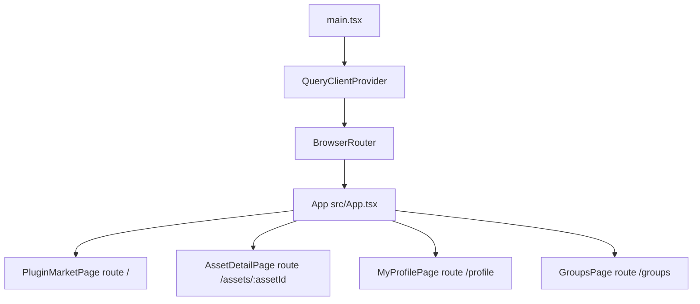
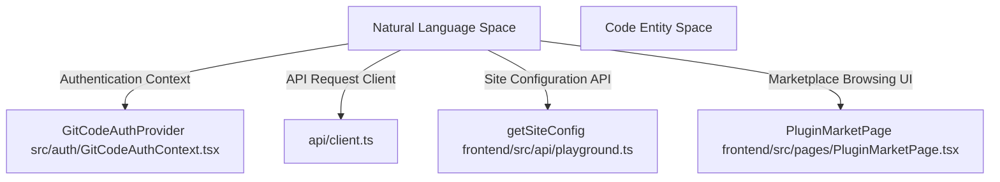

<!-- source: DeepWiki mcp.deepwiki.com · repo openJiuwen-ai/skillhub · page 3 Frontend Web Application · fetched 2026-11-02 -->

# Frontend Web Application

Relevant source files

The following files were used as context for generating this wiki page:

- [Third_Party_Open_Source_Software_Notice.txt](Third_Party_Open_Source_Software_Notice.txt)
- [frontend/index.html](frontend/index.html)
- [frontend/package-lock.json](frontend/package-lock.json)
- [frontend/package.json](frontend/package.json)
- [frontend/src/App.tsx](frontend/src/App.tsx)
- [frontend/src/api/playground.ts](frontend/src/api/playground.ts)
- [frontend/src/main.tsx](frontend/src/main.tsx)
- [frontend/src/pages/LoginPage.tsx](frontend/src/pages/LoginPage.tsx)
- [frontend/src/pages/MyPluginDetailPage.tsx](frontend/src/pages/MyPluginDetailPage.tsx)
- [frontend/src/pages/MyProfilePage.tsx](frontend/src/pages/MyProfilePage.tsx)
- [marketplace/plugins_market/routers/site_public.py](marketplace/plugins_market/routers/site_public.py)

The Frontend Web Application is a Single Page Application (SPA) built using React 18, Vite, React Router, Material-UI (MUI), and Tailwind CSS [frontend/package.json:1-51](). It provides the user interface for browsing marketplace assets, managing user profiles, publishing skill packages, and interacting with agent sandboxes.

Sources: [frontend/package.json:1-51]()

## Routing Shell and Core Architecture

The frontend application initializes via `src/main.tsx`, configuring the React Query provider (`QueryClientProvider`), `BrowserRouter`, and the authentication provider (`GitCodeAuthProvider`) [frontend/src/main.tsx:99-110](). The routing shell and layout structure are defined in `src/App.tsx`, which manages global components such as the publish drawer, site footer, scroll restoration, and route endpoints for marketplace views, asset details, user profiles, and group collaboration [frontend/src/App.tsx:1-62]().

*Figure 1: Frontend Routing Shell Architecture*

Sources: [frontend/src/main.tsx:99-110](), [frontend/src/App.tsx:1-62]()

## Child Pages Overview

The frontend architecture is modularized into four primary child pages covering specific functional domains:

### Marketplace Browsing UI (#3.1)
Covers `PluginMarketPage`, hooks, tag searching and color-coding, asset detail pages, and version file trees. For details, see [Marketplace Browsing UI](#3.1).

Sources: [frontend/src/App.tsx:51-53]()

### Publishing UI and Client-side Packaging (#3.2)
Covers `PublishDrawer`, `PublishForm`, client-side zip builders (`buildSkillPublishZip`), and agent zip inspection. For details, see [Publishing UI and Client-side Packaging](#3.2).

Sources: [frontend/src/App.tsx:10-13]()

### Profile, Groups and Admin Console (#3.3)
Covers `MyProfilePage` tabs, plugin detail/version management (`MyPluginDetailPage`), group collaboration pages, git sources panels, and audit log components. For details, see [Profile, Groups and Admin Console](#3.3).

Sources: [frontend/src/App.tsx:6-7](), [frontend/src/pages/MyProfilePage.tsx:1-50]()

### Frontend Auth, API Client and Shared Components (#3.4)
Covers `GitCodeAuthContext`, token storage mechanisms, API client configurations (`api/client.ts`), site configuration loading, layout headers, footers, and privacy pages. For details, see [Frontend Auth, API Client and Shared Components](#3.4).

Sources: [frontend/src/api/playground.ts:103-116](), [marketplace/plugins_market/routers/site_public.py:14-26]()

*Figure 2: Natural Language to Code Entity Mapping for Frontend Services*

Sources: [frontend/src/main.tsx:1-110](), [frontend/src/api/playground.ts:103-116]()

---

