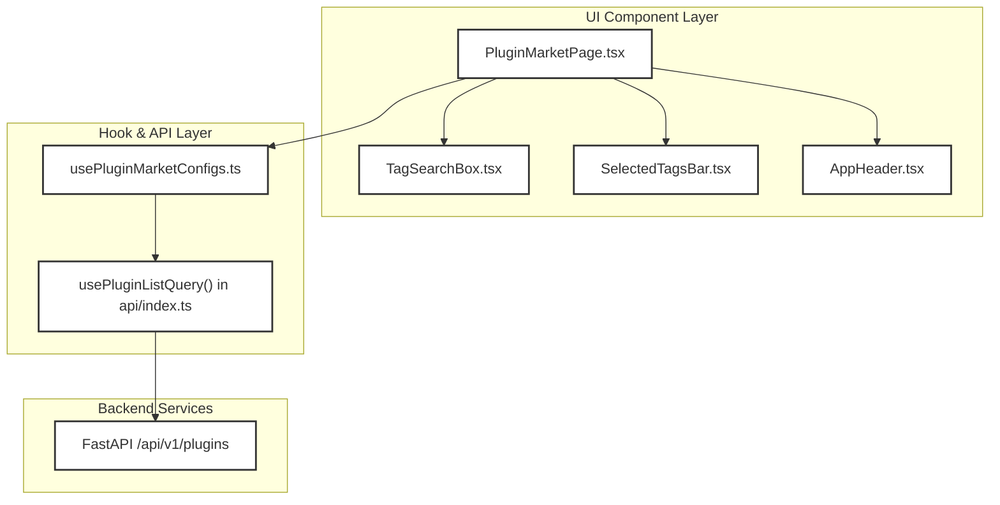
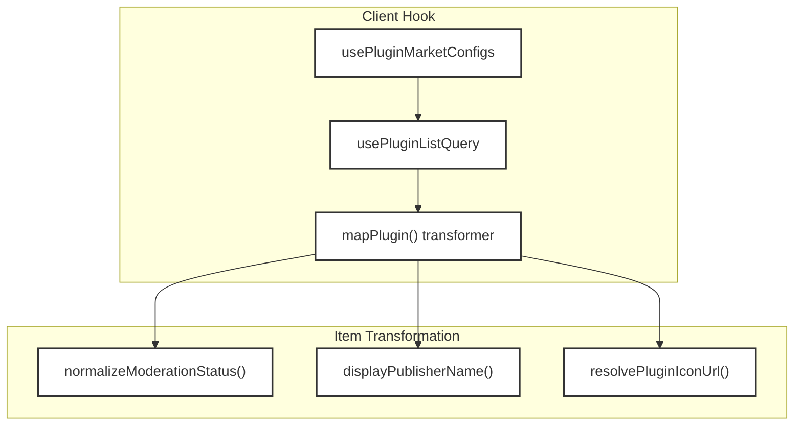
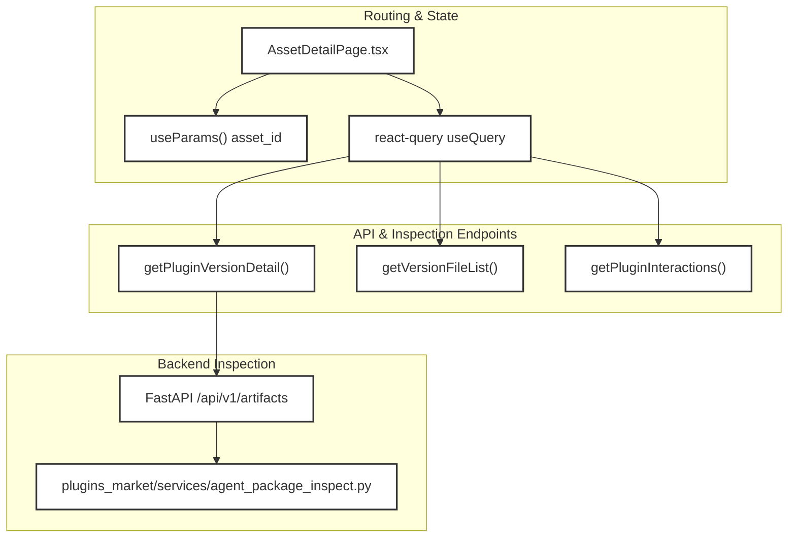

<!-- source: DeepWiki mcp.deepwiki.com · repo openJiuwen-ai/skillhub · page 3.1 Marketplace Browsing UI · fetched 2026-11-02 -->

# Marketplace Browsing UI

Relevant source files

The following files were used as context for generating this wiki page:

- [frontend/src/api/plugin.ts](frontend/src/api/plugin.ts)
- [frontend/src/components/Marketplace/SelectedTagsBar.tsx](frontend/src/components/Marketplace/SelectedTagsBar.tsx)
- [frontend/src/components/Marketplace/TagSearchBox.tsx](frontend/src/components/Marketplace/TagSearchBox.tsx)
- [frontend/src/hooks/usePluginMarketConfigs.ts](frontend/src/hooks/usePluginMarketConfigs.ts)
- [frontend/src/locales/en-US.json](frontend/src/locales/en-US.json)
- [frontend/src/locales/zh-CN.json](frontend/src/locales/zh-CN.json)
- [frontend/src/pages/AssetDetailPage.tsx](frontend/src/pages/AssetDetailPage.tsx)
- [frontend/src/pages/PluginMarketPage.tsx](frontend/src/pages/PluginMarketPage.tsx)
- [frontend/src/utils/fileTypeUtils.ts](frontend/src/utils/fileTypeUtils.ts)
- [frontend/src/utils/tagColors.ts](frontend/src/utils/tagColors.ts)
- [marketplace/plugins_market/services/agent_package_inspect.py](marketplace/plugins_market/services/agent_package_inspect.py)
- [marketplace/plugins_market/tests/test_agent_assets_mvp.py](marketplace/plugins_market/tests/test_agent_assets_mvp.py)
- [marketplace/plugins_market/tests/test_agent_package_inspect.py](marketplace/plugins_market/tests/test_agent_package_inspect.py)
- [marketplace/plugins_market/validation/_pipeline.py](marketplace/plugins_market/validation/_pipeline.py)
- [marketplace/plugins_market/validation/localized_manifest.py](marketplace/plugins_market/validation/localized_manifest.py)
- [marketplace/plugins_market/validation/types/agent_asset.py](marketplace/plugins_market/validation/types/agent_asset.py)
- [marketplace/plugins_market/validation/types/agent_mcp.py](marketplace/plugins_market/validation/types/agent_mcp.py)

The Marketplace Browsing UI provides the primary React-based graphical interface for discovering, searching, filtering, and inspecting assets within openJiuwen Agentic Hub (SkillHub). Its scope encompasses the main marketplace landing container (`PluginMarketPage`), custom React query hooks (`usePluginMarketConfigs`), advanced tag filtering components and color mappings, the individual asset and version inspection view (`AssetDetailPage`), hierarchical version file trees (`VersionFileTree`), and localized string dictionaries (`zh-CN.json`, `en-US.json`).

---

## 1. Marketplace Landing Architecture (`PluginMarketPage`)

The marketplace landing view is implemented in `frontend/src/pages/PluginMarketPage.tsx`. It acts as a single-page application (SPA) routing container that manages URL search parameters (`searchParams`) for active asset types (`MarketTabPluginType`), search keywords, category filters, and view modes (grid versus list).

*Figure 1: Marketplace Browsing Data Flow from UI Shell to Backend API.*

Sources: `frontend/src/pages/PluginMarketPage.tsx:1-2210`, `frontend/src/hooks/usePluginMarketConfigs.ts:1-174`, `frontend/src/api/plugin.ts:1-1061`

The component reads and writes search parameters via `useSearchParams` [frontend/src/pages/PluginMarketPage.tsx:5]. It synchronizes active tabs with local storage key `skillhub.marketplace.activeType` [frontend/src/pages/PluginMarketPage.tsx:87] and provides support for multiple asset classifications: `skill`, `swarmskill`, `agent-plugin`, `agent-template`, and `agent-mcp` [frontend/src/pages/PluginMarketPage.tsx:41-47].

Sources: `frontend/src/pages/PluginMarketPage.tsx:1-174`

---

## 2. Configuration and Query Hooks (`usePluginMarketConfigs`)

Data fetching for the marketplace grid and list views is encapsulated by the `usePluginMarketConfigs` hook defined in `frontend/src/hooks/usePluginMarketConfigs.ts`. This hook abstracts raw API payloads into structured `MarketPlugin` objects.

*Figure 2: Hook Architecture for Marketplace Plugin Configuration Mapping.*

Sources: `frontend/src/hooks/usePluginMarketConfigs.ts:46-174`, `frontend/src/api/plugin.ts:18-105`

The hook accepts `UsePluginMarketConfigsParams` containing pagination parameters, search keywords, runtime filters, category identifiers, and exact tag filters [frontend/src/hooks/usePluginMarketConfigs.ts:46-62]. It maps raw backend `MarketplacePluginItem` structures into normalized UI interfaces, filtering out unmoderated or rejected entries from public views [frontend/src/hooks/usePluginMarketConfigs.ts:99-162].

Sources: `frontend/src/hooks/usePluginMarketConfigs.ts:1-174`

---

## 3. Tag Search, Selection, and Color Systems

Tag management relies on utilities in `frontend/src/utils/tagColors.ts` combined with interactive UI components like `TagSearchBox` and `SelectedTagsBar`. 

Tags are assigned deterministic color themes using `buildTagColorMap` with a fallback to `TAG_NEUTRAL` [frontend/src/pages/PluginMarketPage.tsx:51]. The `TagSearchBox` component supports keyword-based filtering, recent tag history storage (`saveRecentTag`) [frontend/src/pages/PluginMarketPage.tsx:58], and Pinyin-based sorting support for Chinese tag characters via `pinyin-pro` [frontend/src/pages/PluginMarketPage.tsx:60].

Sources: `frontend/src/pages/PluginMarketPage.tsx:51-62`, `frontend/src/utils/tagColors.ts:1-100`

---

## 4. Asset Detail and Agent Profile Views (`AssetDetailPage`)

The asset inspection view (`AssetDetailPage.tsx`) renders comprehensive metadata, changelogs, version dropdown selectors, and agent package profile capabilities [frontend/src/pages/AssetDetailPage.tsx:1-1636].

*Figure 3: Asset Detail Inspection and Agent Package Profile Extraction Flow.*

Sources: `frontend/src/pages/AssetDetailPage.tsx:1-1636`, `marketplace/plugins_market/services/agent_package_inspect.py:1-308`

When rendering agent templates or swarm assets, the detail page reads capability manifests extracted by `extract_agent_package_profile` on the backend [marketplace/plugins_market/services/agent_package_inspect.py:58-187], populating requirement lists for skills, tools, MCP connectors, and subagents [marketplace/plugins_market/tests/test_agent_package_inspect.py:58-71].

Sources: `frontend/src/pages/AssetDetailPage.tsx:18-36`, `marketplace/plugins_market/services/agent_package_inspect.py:1-187`

---

## 5. Version File Tree Component (`VersionFileTree`)

The file tree component renders the internal directory and file layout of a selected asset version package. It communicates with version file listing APIs to present a hierarchical view of code files, manifests, and documentation.

- **File Tree Navigation**: Users can click files on the tree to inspect content [frontend/src/locales/zh-CN.json:181-187].
- **Binary Guard**: Non-text files trigger binary preview warnings while text assets load asynchronously [frontend/src/locales/zh-CN.json:181-186].
- **Integration**: Mounted inside `AssetDetailPage.tsx` utilizing `VersionFileEntry` data types [frontend/src/pages/AssetDetailPage.tsx:15].

Sources: `frontend/src/pages/AssetDetailPage.tsx:15`, `frontend/src/locales/zh-CN.json:181-188`, `frontend/src/api/plugin.ts:32`

---

## 6. Localization Infrastructure

Internationalization is maintained via JSON dictionary bundles located at `frontend/src/locales/zh-CN.json` and `frontend/src/locales/en-US.json`. 

The dictionary namespaces separate common UI elements, pagination controls, breadcrumbs, search placeholders, and marketplace-specific asset tabs (`skill`, `swarmskill`, `agent-plugin`, `agent-template`, `agent-mcp`) [frontend/src/locales/zh-CN.json:1-47].

Sources: `frontend/src/locales/zh-CN.json:1-867`, `frontend/src/locales/en-US.json:1-868`

---

