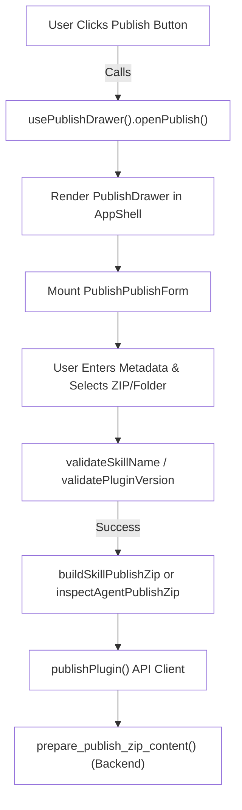
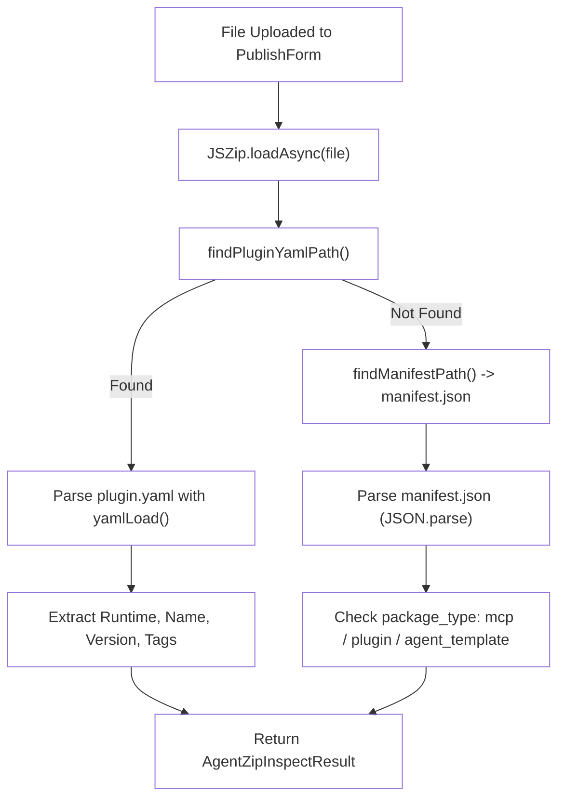

<!-- source: DeepWiki mcp.deepwiki.com · repo openJiuwen-ai/skillhub · page 3.2 Publishing UI and Client-side Packaging · fetched 2026-11-02 -->

# Publishing UI and Client-side Packaging

Relevant source files

The following files were used as context for generating this wiki page:

- [frontend/src/components/Common/AppHeader.tsx](frontend/src/components/Common/AppHeader.tsx)
- [frontend/src/components/Common/PluginMarkdown.tsx](frontend/src/components/Common/PluginMarkdown.tsx)
- [frontend/src/components/Publish/PublishForm.tsx](frontend/src/components/Publish/PublishForm.tsx)
- [frontend/src/contexts/PublishDrawer.tsx](frontend/src/contexts/PublishDrawer.tsx)
- [frontend/src/pages/PublishPluginPage.tsx](frontend/src/pages/PublishPluginPage.tsx)
- [frontend/src/utils/buildSkillPublishZip.ts](frontend/src/utils/buildSkillPublishZip.ts)
- [frontend/src/utils/detectAgentPublishZip.ts](frontend/src/utils/detectAgentPublishZip.ts)
- [marketplace/plugins_market/imports/publish_wrap.py](marketplace/plugins_market/imports/publish_wrap.py)
- [marketplace/plugins_market/imports/skill_entries.py](marketplace/plugins_market/imports/skill_entries.py)
- [marketplace/plugins_market/tests/test_multi_asset_import.py](marketplace/plugins_market/tests/test_multi_asset_import.py)
- [marketplace/plugins_market/tests/test_publish_wrap.py](marketplace/plugins_market/tests/test_publish_wrap.py)

## Purpose and Scope
This page details the implementation of the publishing workflow in the SkillHub frontend application. It covers the state management via `PublishDrawer` and `PublishForm`, client-side ZIP packaging algorithms in `buildSkillPublishZip`, native and wrapped agent ZIP inspection logic in `inspectAgentPublishZip`, dynamic form field labeling, and the markdown rendering pipeline featuring `PluginMarkdown` and integrated Mermaid diagram support.

---

## 1. Publishing Drawer and Form State Management

The publishing user interface is structured around a global drawer context (`PublishDrawerProvider`) and a comprehensive form component (`PublishForm`). 

The context `PublishDrawerProvider` manages the open/closed state of the publishing drawer and tracks the current active publish type (`PublishDrawerType`), which corresponds to market tab plugin types (`frontend/src/contexts/PublishDrawer.tsx:38-55`).

`PublishForm` orchestrates asset metadata inputs, validation patterns, and submission handlers. It enforces strict naming conventions using regular expressions such as `SKILL_NAME_PATTERN` (`/^[a-z][a-z0-9]*(?:-[a-z0-9]+)*$/`) and semantic versioning (`VERSION_PATTERN`) (`frontend/src/components/Publish/PublishForm.tsx:24-26`). Validation errors are mapped to specific form fields through `ZIP_ERROR_TO_FIELD` dictionaries (`frontend/src/components/Publish/PublishForm.tsx:57-77`).

### Diagram: Publishing UI Workflow (Natural Language to Code Entity Space)

Sources: `frontend/src/contexts/PublishDrawer.tsx:38-55`, `frontend/src/components/Publish/PublishForm.tsx:24-112`, `marketplace/plugins_market/imports/publish_wrap.py:53-64`

---

## 2. Client-side ZIP Packaging (`buildSkillPublishZip`)

When publishing skill directories selected via HTML input elements (`<input webkitdirectory>`), the frontend packages the files into a compliant archive using `buildSkillPublishZip` (`frontend/src/utils/buildSkillPublishZip.ts:26-40`).

### Core Packaging Steps
1. **Semver Normalization:** `normalizeSemver` validates that version strings strictly match `x.y.z` without leading `v` prefixes (`frontend/src/utils/buildSkillPublishZip.ts:43-49`).
2. **Slug Normalization:** `normalizeSkillSlug` verifies asset names adhere to lowercase slug constraints (`frontend/src/utils/buildSkillPublishZip.ts:51-57`).
3. **File Filtering:** `shouldIgnorePath` and `PACK_IGNORE_DIR_NAMES` filter out version control files (`.git`), caches (`__pycache__`), build outputs (`dist`, `out`), and OS metadata (`.DS_Store`) (`frontend/src/utils/buildSkillPublishZip.ts:15-24, 78-87`).
4. **Icon Validation:** `assertPng` inspects file size limits (5MB) and verifies PNG magic bytes (`0x89, 0x50, 0x4e, 0x47, 0x0d, 0x0a, 0x1a, 0x0a`) (`frontend/src/utils/buildSkillPublishZip.ts:67-76`).
5. **Frontmatter Parsing:** `parseSkillMdFrontmatter` extracts YAML frontmatter blocks from `SKILL.md` files, parsing descriptions, kinds (`team-skill` / `swarm-skill`), roles, and tags (`frontend/src/utils/buildSkillPublishZip.ts:155-189`).

Sources: `frontend/src/utils/buildSkillPublishZip.ts:15-189`

---

## 3. Agent and Native Package ZIP Inspection

Agent assets and MCP connectors can be uploaded either as pre-wrapped marketplace archives (containing `plugin.yaml`) or as bare native packages (containing `manifest.json`). The frontend inspects these archives client-side via `inspectAgentPublishZip` (`frontend/src/utils/detectAgentPublishZip.ts:128-181`).

### Inspection Routing
- **Wrapped Packages:** If a `plugin.yaml` file is detected at the root, `inspectAgentPublishZip` loads the YAML document, verifies the runtime type against allowed agent asset types, and extracts metadata fields (`name`, `version`, `displayName`, `description`, `tags`) (`frontend/src/utils/detectAgentPublishZip.ts:131-180`).
- **Bare Native Packages:** If `plugin.yaml` is absent, execution falls back to `inspectBareNativeZip`, which parses `manifest.json` (`frontend/src/utils/detectAgentPublishZip.ts:66-122`). It supports package types including `plugin` (`agent-plugin`), `agent_template` (`agent-template`), and `mcp` (`agent-mcp`).

### Diagram: Agent ZIP Inspection and Routing (Natural Language to Code Entity Space)

Sources: `frontend/src/utils/detectAgentPublishZip.ts:43-181`

---

## 4. Field Labeling and Dynamic Metadata Resolution

Publish form labels and placeholders adapt dynamically depending on the selected asset category. Helper utilities such as `resolvePublishFormFieldLabels` and `resolvePublishTypeLabel` map internal keys to localized labels in the publishing UI (`frontend/src/components/Publish/PublishForm.tsx:22`).

| Field Key / Parameter | Target Asset Types | Resolution Logic |
| :--- | :--- | :--- |
| `skillPkgName` | All assets | Validates lowercase hyphen-separated identifiers against `SKILL_NAME_PATTERN`. |
| `pluginVersion` | All assets | Enforces strict Semantic Versioning (`x.y.z`). |
| `skillFolder` | `skill`, `swarmskill` | Validates directory structure containing `SKILL.md`. |
| `skillIcon` | All assets | Optional 5MB PNG icon check via `assertPng`. |

Sources: `frontend/src/components/Publish/PublishForm.tsx:24-87`, `frontend/src/utils/buildSkillPublishZip.ts:7-13`

---

## 5. Markdown Rendering and Mermaid Integration

Asset descriptions, release notes, and documentation files rendered across marketplace browsing and detail views utilize `PluginMarkdown` (`frontend/src/components/Common/PluginMarkdown.tsx:137-171`).

### Key Features
- **Href Sanitization:** `sanitizeMarkdownHref` blocks unsafe URL schemes (`javascript:`, `data:`, `vbscript:`, `//`), allowing only `http(s)`, `mailto`, and root-relative paths (`frontend/src/components/Common/PluginMarkdown.tsx:23-35`).
- **Image Blocking:** `MarkdownImage` blocks external remote images to protect user privacy and prevent tracking, rendering an inline fallback notice (`frontend/src/components/Common/PluginMarkdown.tsx:37-56`).
- **Escaped JSON Decoding:** `decodeEscapedMarkdown` unwraps multi-layered JSON string literals and unescapes carriage returns (`\r\n`, `\n`) returned by backend services (`frontend/src/components/Common/PluginMarkdown.tsx:76-93`).
- **Mermaid Diagram Support:** When `mermaid={true}` is enabled, code blocks tagged with `language-mermaid` are passed to `MermaidBlock`, which initializes `mermaid` with a neutral theme and strict security settings to render dynamic SVGs (`frontend/src/components/Common/PluginMarkdown.tsx:97-132`).

Sources: `frontend/src/components/Common/PluginMarkdown.tsx:23-171`

---

