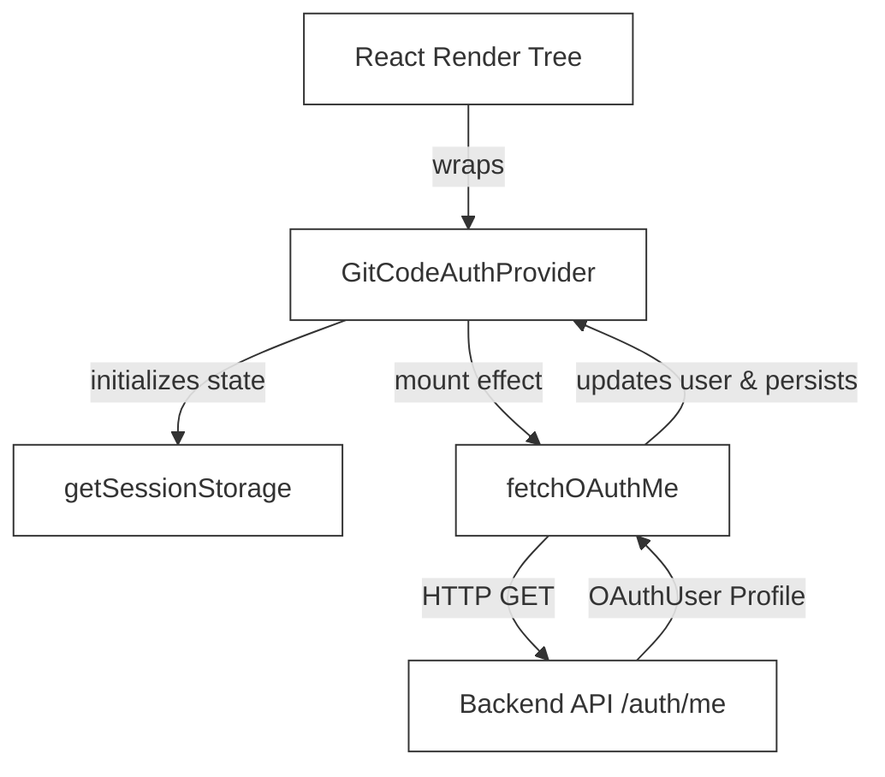
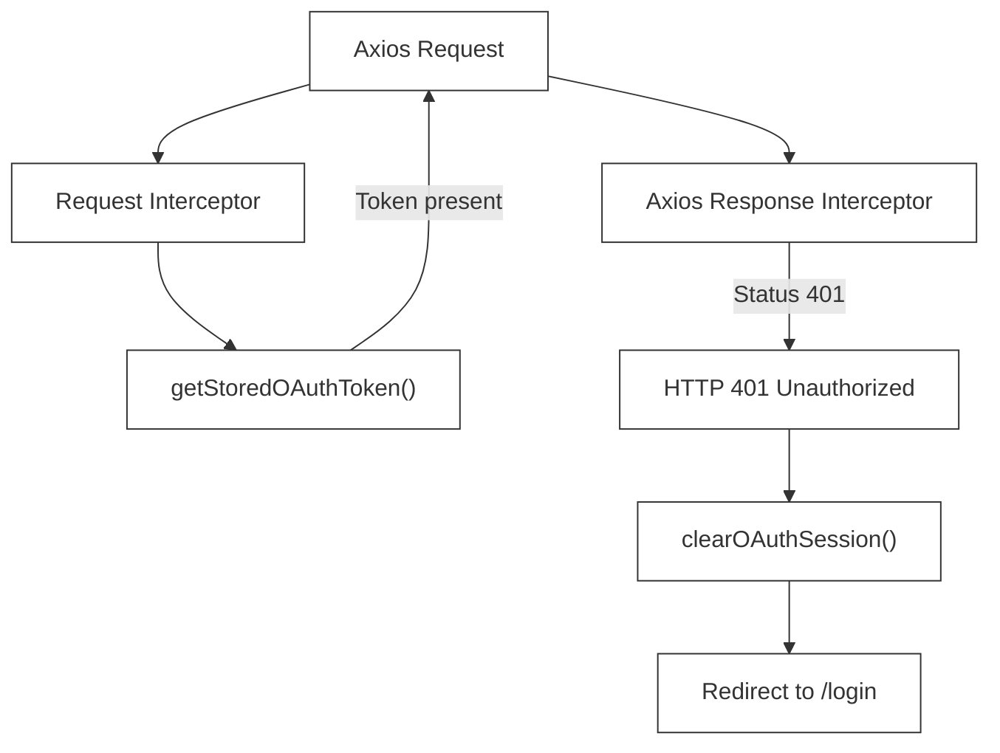

<!-- source: DeepWiki mcp.deepwiki.com · repo openJiuwen-ai/skillhub · page 3.4 Frontend Auth, API Client and Shared Components · fetched 2026-11-02 -->

# Frontend Auth, API Client and Shared Components

Relevant source files

The following files were used as context for generating this wiki page:

- [frontend/src/api/auth.ts](frontend/src/api/auth.ts)
- [frontend/src/api/client.ts](frontend/src/api/client.ts)
- [frontend/src/api/config.ts](frontend/src/api/config.ts)
- [frontend/src/auth/GitCodeAuthContext.tsx](frontend/src/auth/GitCodeAuthContext.tsx)
- [frontend/src/auth/gitcodeStorage.ts](frontend/src/auth/gitcodeStorage.ts)
- [frontend/src/components/Common/SiteFooter.tsx](frontend/src/components/Common/SiteFooter.tsx)
- [frontend/src/components/Common/UserAccountMenu.tsx](frontend/src/components/Common/UserAccountMenu.tsx)
- [frontend/src/components/Common/common-page/CommonPageLayout.tsx](frontend/src/components/Common/common-page/CommonPageLayout.tsx)
- [frontend/src/components/Common/common-page/SegmentedTabs.tsx](frontend/src/components/Common/common-page/SegmentedTabs.tsx)
- [frontend/src/hooks/useMediaQuery.ts](frontend/src/hooks/useMediaQuery.ts)
- [frontend/src/pages/PrivacyStatementPage.tsx](frontend/src/pages/PrivacyStatementPage.tsx)
- [marketplace/plugins_market/core/auth.py](marketplace/plugins_market/core/auth.py)
- [marketplace/plugins_market/core/oauth_user_profile.py](marketplace/plugins_market/core/oauth_user_profile.py)

## Purpose and Scope

This section covers the core frontend infrastructure of the openJiuwen Agentic Hub (SkillHub) React Single Page Application (SPA). It details the client-side authentication lifecycle, token and session persistence, the Axios-based API client layer and routing endpoints configuration, shared structural layout components (`CommonPageLayout`, `SegmentedTabs`, `UserAccountMenu`), and auxiliary static pages such as `PrivacyStatementPage` and `SiteFooter`.

---

## 1. Authentication Architecture & Token Storage

Client authentication manages sessions across multiple OAuth providers (`gitcode`, `github`, `agentos`). Token and user profile data are isolated within browser session storage via utility helpers defined in `frontend/src/auth/gitcodeStorage.ts`.

### Token and Session Storage Layer

The storage layer relies on `sessionStorage` keys to retain tokens and user metadata across page navigation within the same tab:
- Token storage key: `marketplace_oauth_access_token`
- User metadata key: `marketplace_oauth_user`
- Provider key: `marketplace_oauth_provider`

Key functions exported by `gitcodeStorage.ts`:
- `getStoredOAuthToken()`: Retrieves and trims the active token `[frontend/src/auth/gitcodeStorage.ts:20-27]()`.
- `getStoredOAuthUser()`: Parses and validates the stored JSON user profile `[frontend/src/auth/gitcodeStorage.ts:29-39]()`.
- `getStoredOAuthProvider()`: Resolves the active OAuth provider (`gitcode`, `github`, or `agentos`) `[frontend/src/auth/gitcodeStorage.ts:41-50]()`.
- `setOAuthSession(token, user, provider)`: Persists active credentials `[frontend/src/auth/gitcodeStorage.ts:52-56]()`.
- `clearOAuthSession()`: Purges session storage keys on logout or session expiration `[frontend/src/auth/gitcodeStorage.ts:58-62]()`.

Sources: `[frontend/src/auth/gitcodeStorage.ts:1-68]()`

### Auth Context & React Lifecycle

The React authentication state provider is implemented in `frontend/src/auth/GitCodeAuthContext.tsx` via `GitCodeAuthProvider` and consumed using the `useGitCodeAuth()` hook. 

*Diagram 1: Auth Context Initialization and Verification Flow.*
Sources: `[frontend/src/auth/GitCodeAuthContext.tsx:38-80]()`

When the provider mounts, it immediately reads from session storage to prevent flash-of-unauthenticated content. An asynchronous `useEffect` queries the backend verification endpoint `/auth/me` to refresh the user profile and check moderation privileges (`is_market_moderation_admin`) `[frontend/src/auth/GitCodeAuthContext.tsx:54-80]`. A `didRefreshRef` guard prevents duplicate verification requests under React StrictMode `[frontend/src/auth/GitCodeAuthContext.tsx:52-56]`.

Sources: `[frontend/src/auth/GitCodeAuthContext.tsx:1-118](), [frontend/src/api/auth.ts:1-79]()`

---

## 2. API Client and Configuration Layer

HTTP communication with the FastAPI marketplace backend is centralized through a configured Axios instance in `frontend/src/api/client.ts` and endpoint definitions in `frontend/src/api/config.ts`.

### Configuration and Endpoints

`API_CONFIG` defines the base URL (falling back to `/api/v1`), request timeout (300,000ms), and default JSON headers `[frontend/src/api/config.ts:3-14]()`. `API_ENDPOINTS` groups backend routes by domain modules, including `AUDIT`, `PLUGINS`, `ARTIFACTS`, `SITE`, `PLAYGROUND`, `GROUPS`, and `GITHUB` `[frontend/src/api/config.ts:20-96]()`.

Sources: `[frontend/src/api/config.ts:1-96]()`

### Axios Interceptors and 401 Handling

`getApiClient()` returns a singleton Axios instance configured with request and response interceptors `[frontend/src/api/client.ts:11-48]()`:

*Diagram 2: Axios Request Injection and Response Interceptor Pipeline.*
Sources: `[frontend/src/api/client.ts:19-45]()`

1. **Request Interceptor**: Automatically fetches stored OAuth tokens and appends `Authorization: Bearer <token>` and `X-OAuth-Provider` headers to outbound requests `[frontend/src/api/client.ts:20-30]()`.
2. **Response Interceptor**: Intercepts HTTP `401 Unauthorized` responses, invokes `clearOAuthSession()`, and safely redirects unauthenticated users to `/login` while avoiding redirect loops if already on the login path `[frontend/src/api/client.ts:33-45]()`.

Sources: `[frontend/src/api/client.ts:1-48]()`

---

## 3. Core Layout Components and Navigation Primitives

The frontend utilizes reusable UI layout primitives and navigation components built on top of Material-UI and Tailwind CSS.

### Common Page Layout & Segmented Tabs

- `CommonPageLayout`: Renders standard page frames with responsive headers, integrated breadcrumbs, toggleable view types (`grid` or `table`), toolbar slots, and pagination controls `[frontend/src/components/Common/common-page/CommonPageLayout.tsx:94-208]()`.
- `SegmentedTabs`: Implements a segmented control component (`Segmented Control`) with smooth transitions, custom focus rings, and selected state shadows `[frontend/src/components/Common/common-page/SegmentedTabs.tsx:24-99]()`.

Sources: `[frontend/src/components/Common/common-page/CommonPageLayout.tsx:1-245](), [frontend/src/components/Common/common-page/SegmentedTabs.tsx:1-99]()`

### User Account Menu

`UserAccountMenu` manages drop-down user profile menus using React Portals (`createPortal`) to escape container overflow clipping. It calculates absolute viewport coordinates (`getBoundingClientRect`) and listens to window scroll and resize events to anchor correctly `[frontend/src/components/Common/UserAccountMenu.tsx:19-131]()`.

Sources: `[frontend/src/components/Common/UserAccountMenu.tsx:1-131]()`

---

## 4. Site Footer and Privacy Statement Page

Static auxiliary pages and layout footers provide legal compliance and navigation links.

- `SiteFooter`: Renders the multi-column footer block (`SiteFooter`) with documentation links, community placeholders, copyright notices, and localized privacy policy buttons `[frontend/src/components/Common/SiteFooter.tsx:7-43]()`.
- `PrivacyStatementPage`: Fetches and renders markdown-formatted privacy policies using `PluginMarkdown` and dynamic document title updates `[frontend/src/pages/PrivacyStatementPage.tsx:10-60]()`.

Sources: `[frontend/src/components/Common/SiteFooter.tsx:1-43](), [frontend/src/pages/PrivacyStatementPage.tsx:1-60]()`

---

