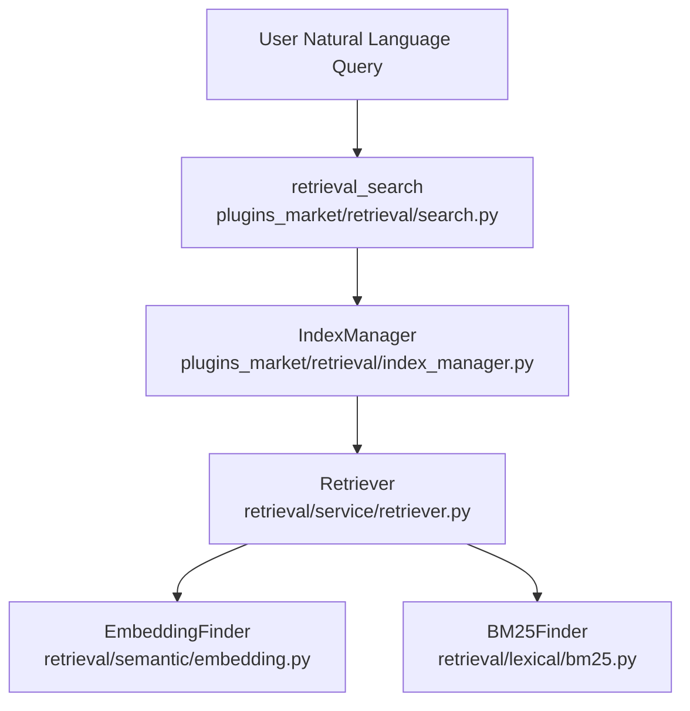
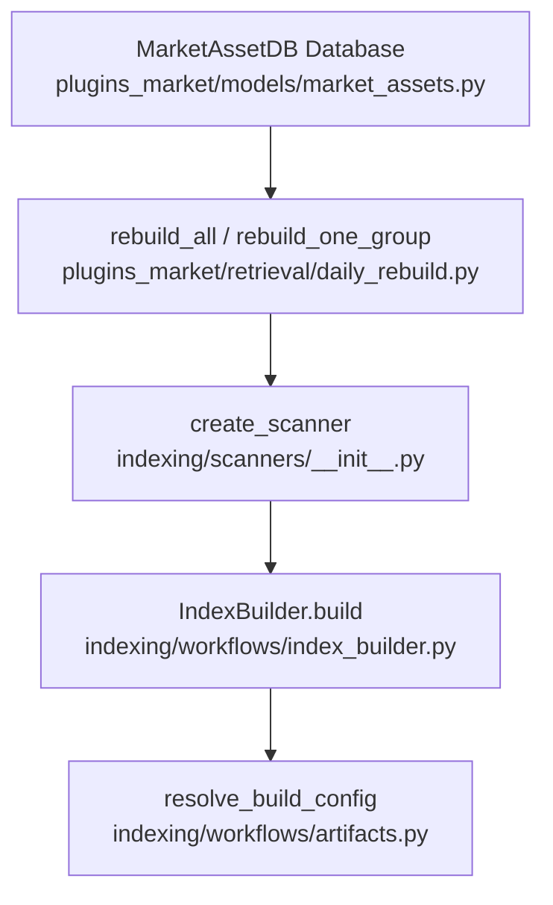

<!-- source: DeepWiki mcp.deepwiki.com · repo openJiuwen-ai/skillhub · page 4 Search, Retrieval and Recommendation · fetched 2026-11-02 -->

# Search, Retrieval and Recommendation

Relevant source files

The following files were used as context for generating this wiki page:

- [marketplace/main.py](marketplace/main.py)
- [marketplace/plugins_market/retrieval/daily_rebuild.py](marketplace/plugins_market/retrieval/daily_rebuild.py)
- [marketplace/plugins_market/retrieval/index_manager.py](marketplace/plugins_market/retrieval/index_manager.py)
- [marketplace/plugins_market/retrieval/search.py](marketplace/plugins_market/retrieval/search.py)
- [marketplace/plugins_market/tests/test_agent_asset_retrieval.py](marketplace/plugins_market/tests/test_agent_asset_retrieval.py)
- [marketplace/plugins_market/tests/test_retrieval_diagnostics.py](marketplace/plugins_market/tests/test_retrieval_diagnostics.py)
- [marketplace/retrieval/indexing/scanners/__init__.py](marketplace/retrieval/indexing/scanners/__init__.py)
- [marketplace/retrieval/indexing/scanners/base.py](marketplace/retrieval/indexing/scanners/base.py)
- [marketplace/retrieval/indexing/workflows/artifacts.py](marketplace/retrieval/indexing/workflows/artifacts.py)
- [marketplace/retrieval/indexing/workflows/index_builder.py](marketplace/retrieval/indexing/workflows/index_builder.py)
- [marketplace/retrieval/retrieval/lexical/bm25.py](marketplace/retrieval/retrieval/lexical/bm25.py)
- [marketplace/retrieval/retrieval/semantic/embedding.py](marketplace/retrieval/retrieval/semantic/embedding.py)

## Purpose and Scope

This section provides a high-level overview of the search, retrieval, indexing, recommendation, and dispatch subsystems within the openJiuwen Agentic Hub (SkillHub) marketplace. These subsystems enable natural language asset discovery, hybrid semantic and lexical ranking, personalized asset recommendations, and progressive agent dispatch workflows.

Because this is a parent page, it summarizes core concepts and high-level architecture. For deep technical details, implementations, and configuration parameters, please refer to the child pages:
- [Retrieval Indexing Pipeline](#4.1) — Scanners, BM25/embedding/tree index building, artifacts and manifests, OBS layout, CID models.
- [Runtime Search and Index Lifecycle](#4.2) — IndexManager RCU loading, daily rebuild jobs, tag refresh, distributed locks, reload consumer, search fallback, merge strategies.
- [Recommender System](#4.3) — Recommend endpoints and schemas, Milvus offline index with alias cutover, embeddings, online service/redis seeds, tests.
- [Dispatch Subsystem](#4.4) — marketplace/dispatch: progressive tree retrieval, disclosure rendering, experience bank, LLM clients, indexing workflows, prompts and tests.

Sources: `[marketplace/main.py:19-32]()`, `[marketplace/plugins_market/retrieval/search.py:40-62]()`

---

## Retrieval Indexing Pipeline

The retrieval indexing subsystem ingests packaged skill and plugin assets from object storage (OBS or MinIO), scans their internal structures [marketplace/retrieval/indexing/scanners/__init__.py:23-28](), and builds multi-modal search indices. It supports lexical matching via BM25, semantic vector search via embeddings, and hierarchical tree categorization driven by Large Language Models [marketplace/retrieval/indexing/workflows/index_builder.py:98-129]().

Build configurations (`BuildConfig` and `ResolvedBuildConfig`) govern index generation methods (`BuildMethod`), managing batch sizes, model clients, and fallback options [marketplace/retrieval/indexing/workflows/artifacts.py:52-84](). Generated artifacts and manifests are stored following structured OBS layouts tied to Catalog ID (CID) mappings.

For complete technical specifications, see [Retrieval Indexing Pipeline](#4.1).

Sources: `[marketplace/retrieval/indexing/scanners/__init__.py:23-28]`, `[marketplace/retrieval/indexing/workflows/index_builder.py:98-129]`, `[marketplace/retrieval/indexing/workflows/artifacts.py:52-84]()`

---

## Runtime Search and Index Lifecycle

At runtime, the marketplace exposes discovery queries through `retrieval_search`, which delegates execution to `IndexManager` [marketplace/plugins_market/retrieval/search.py:40-62](). `IndexManager` utilizes a Read-Copy-Update (RCU) concurrency model to maintain lock-free concurrent reads while enabling atomic retriever hot-swaps during daily index rebuilds and reloads [marketplace/plugins_market/retrieval/index_manager.py:3-7](), `[marketplace/plugins_market/retrieval/index_manager.py:85-118]()`.

If retrieval indices are uninitialized or unavailable, the system gracefully falls back to database-level queries (`LIKE` matching), ensuring high availability [marketplace/plugins_market/retrieval/search.py:40-62]().

Title: "Retrieval and Search Architecture"

For complete technical specifications, see [Runtime Search and Index Lifecycle](#4.2).

Sources: `[marketplace/plugins_market/retrieval/index_manager.py:3-118]`, `[marketplace/plugins_market/retrieval/search.py:40-63]`, `[marketplace/retrieval/retrieval/semantic/embedding.py:86-121]`, `[marketplace/retrieval/retrieval/lexical/bm25.py:124-155]()`

---

## Recommender System

The recommender subsystem supplies personalized asset suggestions and related item carousels throughout the marketplace web application. It integrates offline Milvus vector indices with alias cutover strategies to ensure zero-downtime index promotions, alongside online Redis seed caches for low-latency retrieval.

Initialization routines set up model endpoints and embedding parameters during application startup lifecycle hooks [marketplace/main.py:118-163]().

For complete technical specifications, see [Recommender System](#4.3).

Sources: `[marketplace/main.py:118-163]()`

---

## Dispatch Subsystem

The dispatch subsystem (`marketplace/dispatch`) manages advanced agent execution pathways. It incorporates progressive tree retrieval, disclosure rendering, experience bank lookups, and integrations with LLM clients. It also supports indexing workflows and structured prompt management.

Build methods and environment variables are parsed at application startup to configure LLM clients and execution parameters [marketplace/main.py:64-87]().

Title: "Indexing and Build Pipeline Flow"

For complete technical specifications, see [Dispatch Subsystem](#4.4).

Sources: `[marketplace/main.py:64-87]`, `[marketplace/plugins_market/retrieval/daily_rebuild.py:99-177]`, `[marketplace/retrieval/indexing/scanners/__init__.py:30-38]`, `[marketplace/retrieval/indexing/workflows/index_builder.py:98-129]`, `[marketplace/retrieval/indexing/workflows/artifacts.py:159-188]()`

---

