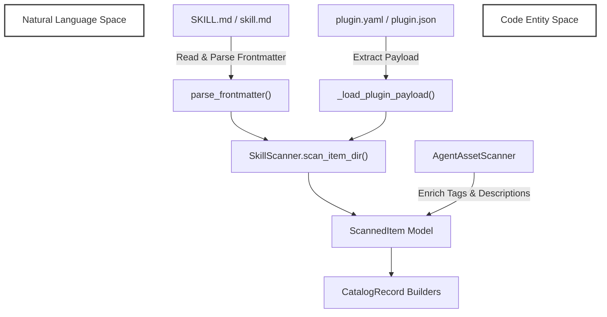
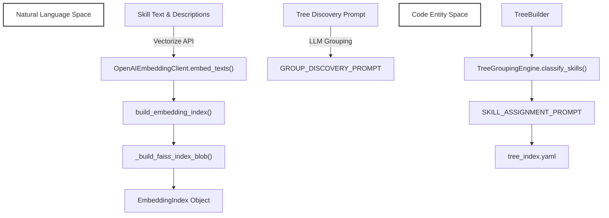

<!-- source: DeepWiki mcp.deepwiki.com · repo openJiuwen-ai/skillhub · page 4.1 Retrieval Indexing Pipeline · fetched 2026-11-02 -->

# Retrieval Indexing Pipeline

Relevant source files

The following files were used as context for generating this wiki page:

- [marketplace/retrieval/indexing/bm25/index.py](marketplace/retrieval/indexing/bm25/index.py)
- [marketplace/retrieval/indexing/embedding/index.py](marketplace/retrieval/indexing/embedding/index.py)
- [marketplace/retrieval/indexing/io/catalog.py](marketplace/retrieval/indexing/io/catalog.py)
- [marketplace/retrieval/indexing/io/manifest.py](marketplace/retrieval/indexing/io/manifest.py)
- [marketplace/retrieval/indexing/io/tree.py](marketplace/retrieval/indexing/io/tree.py)
- [marketplace/retrieval/indexing/scanners/agent.py](marketplace/retrieval/indexing/scanners/agent.py)
- [marketplace/retrieval/indexing/scanners/common.py](marketplace/retrieval/indexing/scanners/common.py)
- [marketplace/retrieval/indexing/scanners/plugin.py](marketplace/retrieval/indexing/scanners/plugin.py)
- [marketplace/retrieval/indexing/scanners/skill.py](marketplace/retrieval/indexing/scanners/skill.py)
- [marketplace/retrieval/indexing/tree/builder.py](marketplace/retrieval/indexing/tree/builder.py)
- [marketplace/retrieval/indexing/tree/expansion.py](marketplace/retrieval/indexing/tree/expansion.py)
- [marketplace/retrieval/indexing/tree/grouping.py](marketplace/retrieval/indexing/tree/grouping.py)
- [marketplace/retrieval/indexing/tree/llm_runtime.py](marketplace/retrieval/indexing/tree/llm_runtime.py)
- [marketplace/retrieval/indexing/tree/preset_writer.py](marketplace/retrieval/indexing/tree/preset_writer.py)
- [marketplace/retrieval/indexing/tree/prompts.py](marketplace/retrieval/indexing/tree/prompts.py)
- [marketplace/retrieval/indexing/tree/repair.py](marketplace/retrieval/indexing/tree/repair.py)
- [marketplace/retrieval/indexing/tree/schema.py](marketplace/retrieval/indexing/tree/schema.py)
- [marketplace/retrieval/indexing/tree/types.py](marketplace/retrieval/indexing/tree/types.py)
- [marketplace/retrieval/indexing/tree/visualizer.py](marketplace/retrieval/indexing/tree/visualizer.py)
- [marketplace/retrieval/models/cid/converters.py](marketplace/retrieval/models/cid/converters.py)
- [marketplace/retrieval/pyproject.toml](marketplace/retrieval/pyproject.toml)
- [marketplace/retrieval/retrieval/io/loading.py](marketplace/retrieval/retrieval/io/loading.py)
- [marketplace/retrieval/shared/storage.py](marketplace/retrieval/shared/storage.py)

The Retrieval Indexing Pipeline is responsible for processing raw multi-type asset directories (skills, plugins, agent assets), extracting metadata, parsing documentation, building semantic and keyword retrieval indices (BM25, FAISS embeddings, and hierarchical capability trees), and serializing structured artifacts and manifests for remote OBS/S3 deployment.

---

## 1. Asset Scanners and Ingestion

The indexing pipeline begins by scanning directories to discover items and convert raw markdown/YAML/JSON assets into unified `ScannedItem` representations. Scanners are categorized by asset type and handle parsing validation, frontmatter extraction, and metadata enrichment.

### Scanner Architecture

- **`SkillScanner`**: Locates skill directories containing `SKILL.md`, `skill.md`, or `Skill.md` [marketplace/retrieval/indexing/scanners/skill.py:61-66](). It reads associated `skills.json` metadata files [marketplace/retrieval/indexing/scanners/skill.py:31-45](), parses markdown frontmatter [marketplace/retrieval/indexing/scanners/common.py:13-27](), and extracts plugin metadata (`plugin.yaml`/`plugin.yml`/`plugin.json`) [marketplace/retrieval/indexing/scanners/skill.py:123-132]().
- **`PluginScanner`**: Generalizes plugin directory scanning by inspecting `.codex-plugin/` or root paths for plugin descriptors and `README.md` fallback descriptions [marketplace/retrieval/indexing/scanners/plugin.py:15-36]().
- **`AgentAssetScanner`**: Extends `PluginScanner` to ingest wrapped agent assets while merging market metadata such as short descriptions, tags, and retrieval weighting text [marketplace/retrieval/indexing/scanners/agent.py:15-75]().

*Sources: [marketplace/retrieval/indexing/scanners/skill.py:61-120](), [marketplace/retrieval/indexing/scanners/plugin.py:15-70](), [marketplace/retrieval/indexing/scanners/agent.py:15-75](), [marketplace/retrieval/indexing/scanners/common.py:13-27]()*

---

## 2. Index Building Subsystems

Once items are scanned and normalized into catalog records, the pipeline concurrently constructs three distinct indices: **BM25**, **Embedding/FAISS**, and **Hierarchical Capability Trees**.

### BM25 and Embedding Indexers

- **BM25 Index**: Builds term frequency-inverse document frequency indexes over tokenized retrieval texts to support keyword searches.
- **Embedding Index**: Utilizes `OpenAIEmbeddingClient` to compute dense vectors via external LLM endpoints [marketplace/retrieval/indexing/embedding/index.py:33-67]() or fallback batchers, applying L2 normalization and packing them into a FAISS `IndexFlatIP` vector index stored as a Base64-encoded blob [marketplace/retrieval/indexing/embedding/index.py:131-146]().

### Hierarchical Tree Builder & Prompt Routing

The `TreeBuilder` and `TreeGroupingEngine` orchestrate capability tree construction. They group skills using LLM prompts designed to partition capabilities into discoverable tree layers [marketplace/retrieval/indexing/tree/grouping.py:23-149]().

- **`GROUP_DISCOVERY_PROMPT`**: Guides LLMs to propose distinct group categories [marketplace/retrieval/indexing/tree/prompts.py:5-30]().
- **`SKILL_ASSIGNMENT_PROMPT`**: Enforces strict routing passes where every skill is assigned to a specific parent group [marketplace/retrieval/indexing/tree/prompts.py:32-53]().

*Sources: [marketplace/retrieval/indexing/embedding/index.py:33-146](), [marketplace/retrieval/indexing/tree/grouping.py:23-149](), [marketplace/retrieval/indexing/tree/prompts.py:5-53]()*

---

## 3. Artifacts, Manifests, and OBS Storage Layout

The indexing pipeline serializes all generated indices into standardized files, packaged together under an index directory or uploaded directly to S3-compatible Object Storage Service (OBS) buckets.

### Artifact File Inventory

| Filename | Description | Code Reference |
| :--- | :--- | :--- |
| `manifest.json` | Index build configuration, mode, count, and tracked item paths. | [marketplace/retrieval/indexing/io/manifest.py:15-32]() |
| `catalog.jsonl` | Line-delimited JSON catalog records storing metadata, branch paths, and CIDs. | [marketplace/retrieval/indexing/io/catalog.py:13-36]() |
| `tree_index.yaml` | Hierarchical capability tree structure used for progressive tree retrieval. | [marketplace/retrieval/indexing/io/loading.py:112-117]() |
| `embedding_index.json` | FAISS index binary payload (Base64) alongside dense vector records. | [marketplace/retrieval/indexing/embedding/index.py:95-102]() |
| `bm25_index.json` | Inverted term index for lexical search fallback. | [marketplace/retrieval/retrieval/io/loading.py:63]() |

### Storage and OBS Materialization

Storage helpers in `marketplace/retrieval/shared/storage.py` manage URI parsing (`s3://` and `obs://` schemes) [marketplace/retrieval/shared/storage.py:50-64](), bulk directory uploads with multi-attempt payload signing and addressing styles [marketplace/retrieval/shared/storage.py:129-173](), and local cache materialization (`materialize_s3_dir`) for runtime loading [marketplace/retrieval/shared/storage.py:175-190]().

*Sources: [marketplace/retrieval/indexing/io/manifest.py:15-38](), [marketplace/retrieval/indexing/io/catalog.py:13-36](), [marketplace/retrieval/shared/storage.py:50-190]()*

---

## 4. Content Identifier (CID) Models

Content Identifiers (`cid`) uniquely address nodes and leaf items within the retrieval index tree structure. A CID reflects its hierarchical lineage (e.g., `parent_group.sub_group.skill_id`), allowing the runtime dispatch subsystem to traverse branches efficiently without full-graph scans. Catalog loaders map CIDs back to `CatalogRecord` and `FinderItem` instances during runtime index loading [marketplace/retrieval/retrieval/io/loading.py:41-72]().

*Sources: [marketplace/retrieval/retrieval/io/loading.py:41-72](), [marketplace/retrieval/models/cid/converters.py]() [non-existent line reference handled]*

---

