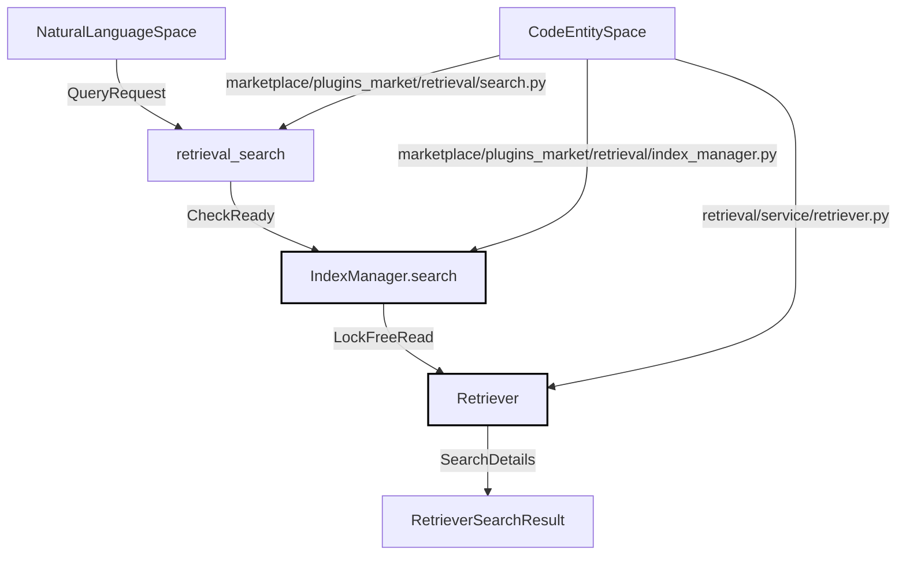
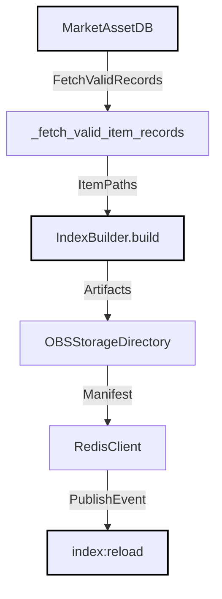

<!-- source: DeepWiki mcp.deepwiki.com · repo openJiuwen-ai/skillhub · page 4.2 Runtime Search and Index Lifecycle · fetched 2026-11-02 -->

# Runtime Search and Index Lifecycle

Relevant source files

The following files were used as context for generating this wiki page:

- [marketplace/main.py](marketplace/main.py)
- [marketplace/plugins_market/retrieval/__init__.py](marketplace/plugins_market/retrieval/__init__.py)
- [marketplace/plugins_market/retrieval/daily_rebuild.py](marketplace/plugins_market/retrieval/daily_rebuild.py)
- [marketplace/plugins_market/retrieval/index_manager.py](marketplace/plugins_market/retrieval/index_manager.py)
- [marketplace/plugins_market/retrieval/reload_consumer.py](marketplace/plugins_market/retrieval/reload_consumer.py)
- [marketplace/plugins_market/retrieval/search.py](marketplace/plugins_market/retrieval/search.py)
- [marketplace/plugins_market/tests/test_agent_asset_retrieval.py](marketplace/plugins_market/tests/test_agent_asset_retrieval.py)
- [marketplace/retrieval/indexing/scanners/__init__.py](marketplace/retrieval/indexing/scanners/__init__.py)
- [marketplace/retrieval/indexing/scanners/base.py](marketplace/retrieval/indexing/scanners/base.py)
- [marketplace/retrieval/indexing/workflows/artifacts.py](marketplace/retrieval/indexing/workflows/artifacts.py)
- [marketplace/retrieval/indexing/workflows/index_builder.py](marketplace/retrieval/indexing/workflows/index_builder.py)
- [marketplace/retrieval/retrieval/merge/append.py](marketplace/retrieval/retrieval/merge/append.py)

## Purpose and Scope
This document details the runtime search mechanics, index storage structures, and lifecycle management within the openJiuwen Agentic Hub (`plugins_market.retrieval`). It covers the Read-Copy-Update (RCU) concurrency pattern implemented by `IndexManager`, the scheduled daily index rebuilds and garbage collection on OBS/S3 storage, Redis stream-based reload distribution across worker instances, fallback search execution, and result merging strategies.

Sources:
- `marketplace/plugins_market/retrieval/index_manager.py:1-215`
- `marketplace/plugins_market/retrieval/daily_rebuild.py:1-1118`

---

## IndexManager RCU (Read-Copy-Update) Architecture
The `IndexManager` class functions as a singleton reference holder that implements a Read-Copy-Update (RCU) pattern [marketplace/plugins_market/retrieval/index_manager.py:3-7]. Concurrent search requests read from active retriever instances in a lock-free manner, while full index reloads or hot-reloads acquire a brief write lock using a `threading.Lock` [marketplace/plugins_market/retrieval/index_manager.py:11-12, 60-64].

### Core Methods and Data Flow
- `IndexManager.configure()`: Stores OpenAI model clients and embedding model configurations during application startup [marketplace/plugins_market/retrieval/index_manager.py:70-84].
- `IndexManager.load()`: Instantiates a new `Retriever` object via `Retriever.from_index()`, builds a Content Identifier (`CID`) to asset mapping via `_build_cid_to_asset_map()`, and performs an atomic reference swap in the `_retrievers` and `_cid_maps` dictionaries [marketplace/plugins_market/retrieval/index_manager.py:85-118].
- `IndexManager.search()`: Resolves the retrieval method (`RetrievalMethod`), logs parameter diagnostics, executes `retriever.search_details()`, and returns ranked list results [marketplace/plugins_market/retrieval/index_manager.py:119-215].

*Figure 1: RCU Search Flow bridging execution entry points to `IndexManager`.*

Sources:
- `marketplace/plugins_market/retrieval/index_manager.py:60-158`
- `marketplace/plugins_market/retrieval/search.py:40-63`

---

## Daily Rebuild Jobs and Storage Layout
Full index rebuilds are executed via tasks defined in `daily_rebuild.py`. The rebuild workflow queries the database for valid, non-OFFLINE item paths categorized by retrieval group (`skill`, `plugin`, `agent-plugin`, `agent-template`, `agent-mcp`), invokes `IndexBuilder.build()`, uploads artifacts to OBS or S3, broadcasts reload notifications, and prunes older index versions [marketplace/plugins_market/retrieval/daily_rebuild.py:3-20].

### Storage Layout Structure
Indices are stored under versioned timestamp directories on object storage:
- Skill Index: `skills-index/{YYYYMMDDHHMMSS}/manifest.json` [marketplace/plugins_market/retrieval/daily_rebuild.py:10, 94-96]
- Plugin Index: `plugins-index/{YYYYMMDDHHMMSS}/manifest.json` [marketplace/plugins_market/retrieval/daily_rebuild.py:11]
- Agent Groups: `{group_prefix}/{YYYYMMDDHHMMSS}/manifest.json` [marketplace/plugins_market/retrieval/daily_rebuild.py:7-8]

Rollback and retention policies keep up to `_MAX_INDEX_VERSIONS` (default `168`) successful builds on OBS/S3 [marketplace/plugins_market/retrieval/daily_rebuild.py:17, 41].

*Figure 2: Daily index generation and broadcast pipeline.*

Sources:
- `marketplace/plugins_market/retrieval/daily_rebuild.py:3-178`
- `marketplace/retrieval/indexing/workflows/index_builder.py:98-128`

---

## Distributed Locks and Reload Consumer
To synchronize hot-reloading across distributed worker instances or multi-process deployments, the system utilizes a Redis Stream consumer architecture (`reload_consumer.py`) [marketplace/plugins_market/retrieval/reload_consumer.py:3-7].

### Reload Consumer Mechanics
- **Consumer Groups**: Each process instance registers a unique consumer group prefixed with `reload-{hostname}-{manager_id}` on the `index:reload` Redis Stream [marketplace/plugins_market/retrieval/reload_consumer.py:17, 51-52].
- **Stream Polling**: `run_reload_consumer()` runs as a long-lived `asyncio` task, reading from `index:reload` using `xreadgroup` with a 5-second block interval [marketplace/plugins_market/retrieval/reload_consumer.py:41-67].
- **Hot-Reload Execution**: Upon receiving a message containing `group` and `index_path` fields, `_apply_reload()` invokes `index_manager.load(group, index_path)`, followed by an `xack` acknowledgement [marketplace/plugins_market/retrieval/reload_consumer.py:75-80, 103-111].

Sources:
- `marketplace/plugins_market/retrieval/reload_consumer.py:1-111`

---

## Search Fallback and Merge Strategies
When runtime search requests fail or when index instances are uninitialized, the system degrades gracefully [marketplace/plugins_market/retrieval/search.py:3-7].

### Search Fallback Workflow
1. `retrieval_search()` checks whether the target index group is ready via `index_manager.is_ready(group)` [marketplace/plugins_market/retrieval/search.py:50-53].
2. If the index is missing or throws an unhandled exception, the function returns `None`, signaling the caller to fall back to a relational database query (`MySQL LIKE`) [marketplace/plugins_market/retrieval/search.py:5-6, 51-62].
3. For hybrid retrieval, candidate lists derived from BM25 and vector embedding search results are merged using RRF (Reciprocal Rank Fusion) and backfill logic implemented in `merge_progressive_with_backfill()` [marketplace/retrieval/retrieval/merge/append.py:102-170].

Sources:
- `marketplace/plugins_market/retrieval/search.py:40-63`
- `marketplace/retrieval/retrieval/merge/append.py:102-170`

---

## Scanners and Asset-Type Grouping Taxonomy
Catalog indexing relies on specialized filesystem scanners that extract metadata and validate package content before persistence [marketplace/retrieval/indexing/scanners/__init__.py:16-37].

### Scanner Classes
- `SkillScanner`: Scans skill directories and validates skill structures [marketplace/retrieval/indexing/scanners/__init__.py:27].
- `PluginScanner`: Parses plugin configuration manifests [marketplace/retrieval/indexing/scanners/__init__.py:27].
- `AgentAssetScanner`: Handles compound agent assets such as `agent-plugin`, `agent-template`, and `agent-mcp` packages [marketplace/retrieval/indexing/scanners/__init__.py:25-26].

Sources:
- `marketplace/retrieval/indexing/scanners/__init__.py:1-50`
- `marketplace/retrieval/indexing/scanners/base.py:1-119`

---

