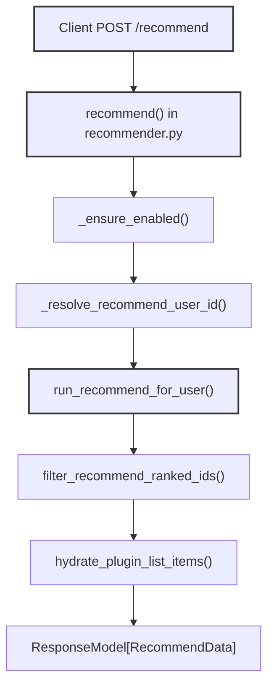
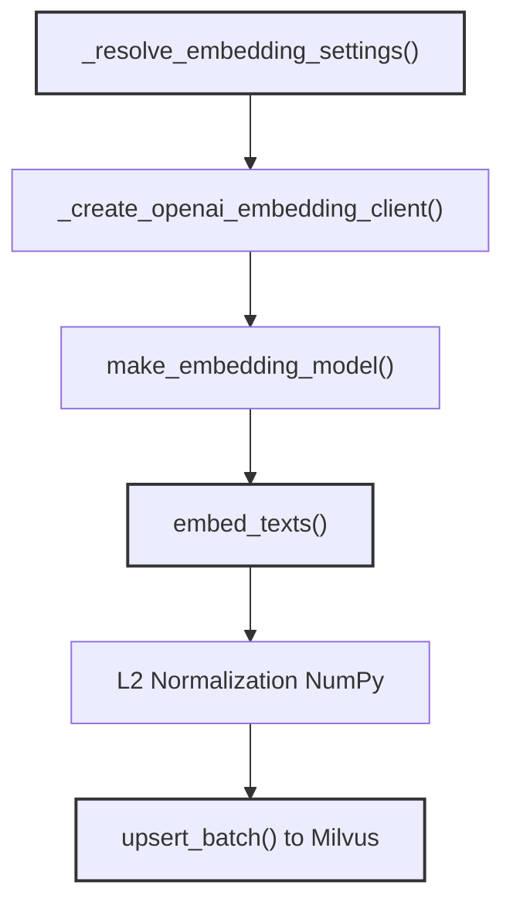
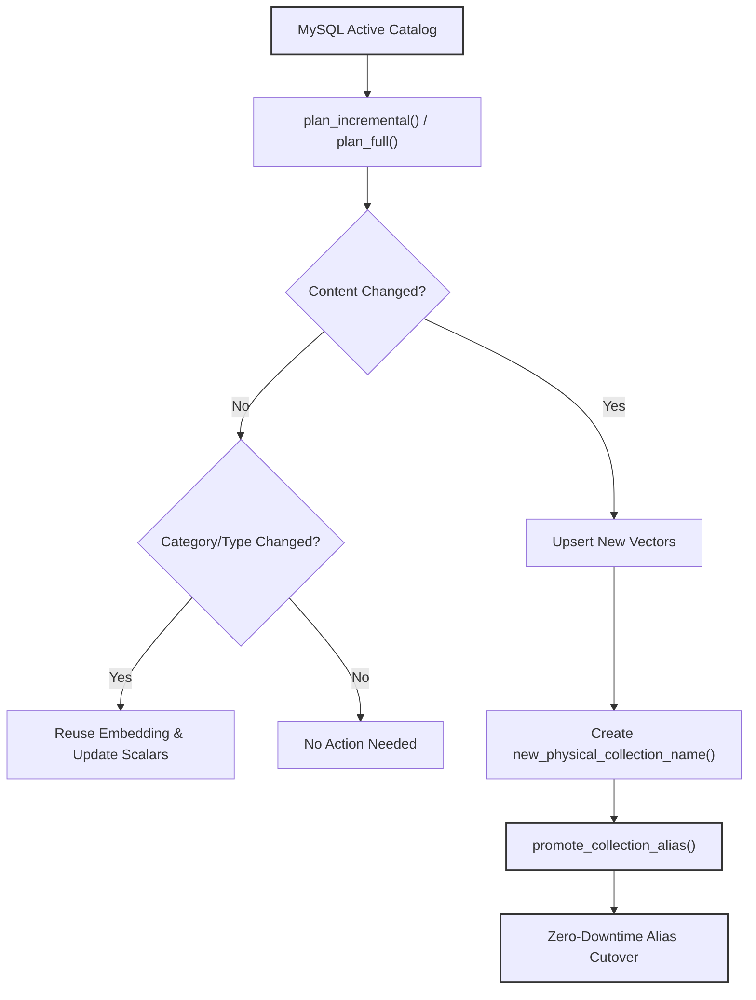
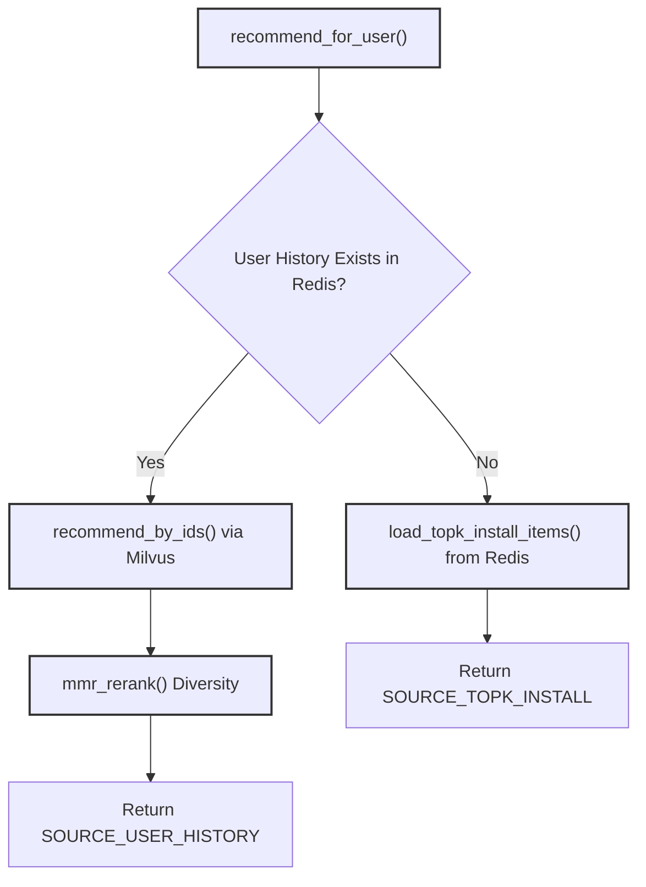
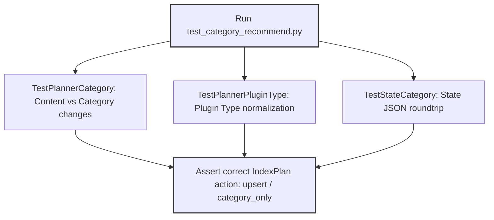

<!-- source: DeepWiki mcp.deepwiki.com · repo openJiuwen-ai/skillhub · page 4.3 Recommender System · fetched 2026-11-02 -->

# Recommender System

Relevant source files

The following files were used as context for generating this wiki page:

- [marketplace/plugins_market/core/errors.py](marketplace/plugins_market/core/errors.py)
- [marketplace/plugins_market/recommender/bootstrap.py](marketplace/plugins_market/recommender/bootstrap.py)
- [marketplace/plugins_market/recommender/schemas.py](marketplace/plugins_market/recommender/schemas.py)
- [marketplace/plugins_market/recommender/service.py](marketplace/plugins_market/recommender/service.py)
- [marketplace/plugins_market/routers/recommender.py](marketplace/plugins_market/routers/recommender.py)
- [marketplace/plugins_market/tests/test_recommend_hydrate.py](marketplace/plugins_market/tests/test_recommend_hydrate.py)
- [marketplace/recommender/offline/milvus_index/embedding.py](marketplace/recommender/offline/milvus_index/embedding.py)
- [marketplace/recommender/offline/milvus_index/milvus_client.py](marketplace/recommender/offline/milvus_index/milvus_client.py)
- [marketplace/recommender/offline/milvus_index/pipeline.py](marketplace/recommender/offline/milvus_index/pipeline.py)
- [marketplace/recommender/offline/milvus_index/planner.py](marketplace/recommender/offline/milvus_index/planner.py)
- [marketplace/recommender/offline/milvus_index/state.py](marketplace/recommender/offline/milvus_index/state.py)
- [marketplace/recommender/offline/package_sync/db.py](marketplace/recommender/offline/package_sync/db.py)
- [marketplace/recommender/online/redis_seeds.py](marketplace/recommender/online/redis_seeds.py)
- [marketplace/recommender/online/search.py](marketplace/recommender/online/search.py)
- [marketplace/recommender/online/service.py](marketplace/recommender/online/service.py)
- [marketplace/recommender/shared/config.py](marketplace/recommender/shared/config.py)
- [marketplace/recommender/tests/test_category_recommend.py](marketplace/recommender/tests/test_category_recommend.py)

## Purpose and Scope
This page details the **Recommender System** subsystem within the openJiuwen Agentic Hub (`skillhub`), located under `marketplace/plugins_market/recommender/` and `marketplace/recommender/`. The recommender system provides personalized semantic recommendations for marketplace assets (such as skills, swarm skills, and agent plugins). It integrates an OpenAI-compatible embedding generator, a Milvus vector database with zero-downtime alias cutover, Redis-backed user sequence tracking and installation popularity rankings, Maximum Marginal Relevance (MMR) diversification, and FastAPI HTTP endpoints.

---

## 1. Recommender HTTP Endpoints & Schemas

The marketplace backend exposes recommender APIs under the `/recommend` router prefix (`marketplace/plugins_market/routers/recommender.py`). 

### Endpoints
* **`POST /recommend`**: Executes personalized recommendations for authenticated or anonymous users. It resolves the user identity, recalls top candidates from the online cascade, filters for visible assets, and hydrates marketplace cards with scores.
* **`POST /recommend/by_ids`**: Finds similar assets given a list of seed asset IDs by fetching their vector embeddings and running Milvus search.
* **`POST /recommend/by_queries`**: Embeds arbitrary query texts (capped between 1 and 32 items, 1–2000 chars) via the embedding engine and searches Milvus.

### Identity Resolution & Security
The function `_resolve_recommend_user_id` binds personalization to a verified identity (`marketplace/plugins_market/routers/recommender.py:64-93`()). 
* Valid `Bearer` tokens enforce that the body `user_id` matches the token's subject (or is omitted).
* Valid `X-System-Token` headers permit trusted internal services to assert any `user_id` (including empty strings for cold-start).
* Unauthenticated or conflicting calls fall back to anonymous/cold-start behavior (`user_id = ""`).

### Schemas
Pydantic models defined in `marketplace/plugins_market/recommender/schemas.py` govern input validation and output serialization:
* `RecommendRequest`: Controls `user_id`, `request_id`, `top_k` (1 to 500), `category_id`, and `plugin_type`.
* `RecommendItemOut`: Extends `PluginListItem` with a float `score` attribute.
* `ByIdsRequest` / `ByQueriesRequest`: Validation payloads for similarity and query-based recommendation routes.

*Sources: `marketplace/plugins_market/routers/recommender.py:37-174`(), `marketplace/plugins_market/recommender/schemas.py:16-84`()*

---

## 2. Embedding Subsystem & OpenAI-Compatible Vector Generation

Vector embeddings are generated using an OpenAI-compatible API configured via environment variables (`MARKET_REC_EMBEDDING_API_BASE_URL` and `MARKET_REC_EMBEDDING_MODEL`).

### Implementation Details
* **Security & Secrets**: Secrets like API keys are resolved securely using `SecurityUtils.get_decrypt_secret("MARKET_REC_EMBEDDING_API_KEY")` with a fallback to plaintext environment variables (`marketplace/recommender/offline/milvus_index/embedding.py:18-35`()).
* **Client Construction**: `make_embedding_model()` initializes and caches an OpenAI-compatible embedding client (`marketplace/recommender/offline/milvus_index/embedding.py:112-123`()).
* **L2 Normalization**: `embed_texts()` normalizes embedding output arrays to unit length, enabling inner-product (`IP`) metric similarity searches in Milvus (`marketplace/recommender/offline/milvus_index/embedding.py:125-139`()).
* **Batch Upserting**: `upsert_batch()` upserts asset vectors, category IDs, and plugin types into Milvus collections, falling back to `insert` if upsert fails (`marketplace/recommender/offline/milvus_index/embedding.py:141-164`()).

*Sources: `marketplace/recommender/offline/milvus_index/embedding.py:1-164`()*

---

## 3. Milvus Offline Indexing, Blue/Green Aliasing & Cutover

The offline indexing pipeline synchronizes MySQL active skill catalogs with the Milvus vector database (`marketplace/recommender/offline/milvus_index/pipeline.py`).

### Schema & Fields
Milvus collections enforce a strict schema containing four mandatory fields (`marketplace/recommender/offline/milvus_index/milvus_client.py:91-119`()):
1. `asset_id` (`VARCHAR`, Primary Key, max length 64)
2. `category_id` (`VARCHAR`, max length 64, indexed with `INVERTED`)
3. `plugin_type` (`VARCHAR`, max length 32, indexed with `INVERTED`)
4. `embedding` (`FLOAT_VECTOR`, dynamic dimensionality, e.g., 1024)

### Blue/Green Aliasing & Zero-Downtime Cutover
To prevent downtime and avoid serving empty collections during full index rebuilds, SkillHub uses a physical collection naming convention and alias redirection (`marketplace/recommender/offline/milvus_index/milvus_client.py:163-207()`):
* **Physical Collection Naming**: `new_physical_collection_name(public_name)` generates a unique timestamp- and PID-suffixed name (e.g., `skill_index__1774880000_1234`) (`marketplace/recommender/offline/milvus_index/milvus_client.py:163-167`()).
* **Alias Promotion**: `promote_collection_alias(public_name, new_physical)` safely swaps the Milvus alias to point to the newly populated physical collection and returns the old physical collection name for subsequent garbage collection (`marketplace/recommender/offline/milvus_index/milvus_client.py:190-207()`()).

### Index Planning (`planner.py`)
The planner module diffs active database skills against local state (`marketplace/recommender/offline/milvus_index/planner.py`):
* `content_needs_reindex`: Checks if version or artifact SHA256 hashes differ.
* `scalars_need_update`: Detects category or plugin type changes without modifying content, allowing embedding reuse (`category_only` plan).

*Sources: `marketplace/recommender/offline/milvus_index/milvus_client.py:1-207`(), `marketplace/recommender/offline/milvus_index/pipeline.py:1-192`(), `marketplace/recommender/offline/milvus_index/planner.py:1-88`()*

---

## 4. Online Cascade Service & Redis Seeds

The online service resolves recommendations via a cascade strategy (`marketplace/recommender/online/service.py:134-205()`):

1. **User History Cascade (`SOURCE_USER_HISTORY`)**:
   * Loads user seed IDs from Redis sequences (`load_user_seed_ids()`) (`marketplace/recommender/online/redis_seeds.py:33-71`()).
   * Queries Milvus for similar vectors using seed embeddings (`recommend_by_ids()`).
   * Reranks candidates using Maximum Marginal Relevance (`mmr_rerank()`) to balance relevance and diversity.
2. **Fallback Popularity Cascade (`SOURCE_TOPK_INSTALL`)**:
   * If user history is empty or recall fails, it loads install-count rankings from Redis (`load_topk_install_items()`) (`marketplace/recommender/online/redis_seeds.py:74-136`()).
   * Filters out items matching user history, category, or plugin type constraints.

*Sources: `marketplace/recommender/online/service.py:34-205`(), `marketplace/recommender/online/redis_seeds.py:33-136`(), `marketplace/recommender/online/search.py:25-160`()*

---

## 5. Testing & Diagnostics

Unit tests under `marketplace/recommender/tests/test_category_recommend.py` validate category-aware recommendations, index planning, and state transitions.

### Key Test Suites
* `TestPlannerCategory`: Verifies that content changes trigger upserts (`content_needs_reindex`), whereas category-only modifications trigger scalar updates (`category_needs_update`) (`marketplace/recommender/tests/test_category_recommend.py:72-143`()).
* `TestPlannerPluginType`: Ensures plugin type updates (such as normalizing `teamskills` aliases to `swarmskill`) correctly reuse embedding paths (`marketplace/recommender/tests/test_category_recommend.py:144-172`()).
* `TestStateCategory`: Validates state round-trip serialization for category metadata (`marketplace/recommender/tests/test_category_recommend.py:173-185`()).

*Sources: `marketplace/recommender/tests/test_category_recommend.py:1-185`()*

---

