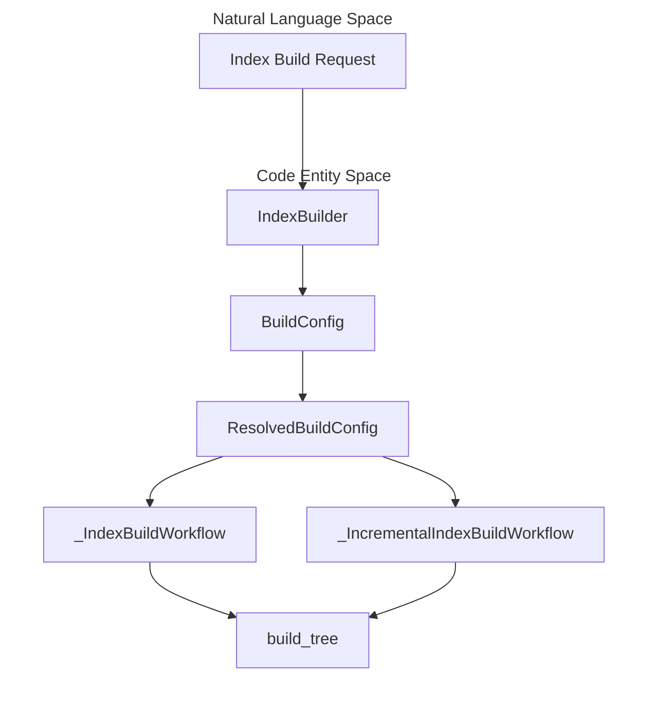
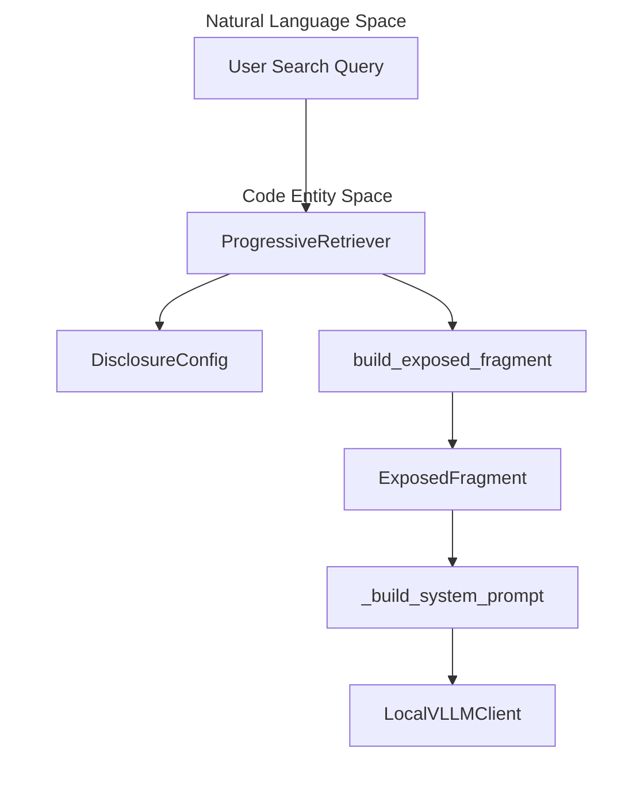

<!-- source: DeepWiki mcp.deepwiki.com · repo openJiuwen-ai/skillhub · page 4.4 Dispatch Subsystem · fetched 2026-11-02 -->

# Dispatch Subsystem

Relevant source files

The following files were used as context for generating this wiki page:

- [marketplace/dispatch/README.md](marketplace/dispatch/README.md)
- [marketplace/dispatch/__init__.py](marketplace/dispatch/__init__.py)
- [marketplace/dispatch/agent/__init__.py](marketplace/dispatch/agent/__init__.py)
- [marketplace/dispatch/agent/toolkit.py](marketplace/dispatch/agent/toolkit.py)
- [marketplace/dispatch/build.py](marketplace/dispatch/build.py)
- [marketplace/dispatch/config/config_template.json](marketplace/dispatch/config/config_template.json)
- [marketplace/dispatch/environment.yml](marketplace/dispatch/environment.yml)
- [marketplace/dispatch/indexing/__init__.py](marketplace/dispatch/indexing/__init__.py)
- [marketplace/dispatch/indexing/io/__init__.py](marketplace/dispatch/indexing/io/__init__.py)
- [marketplace/dispatch/indexing/io/catalog.py](marketplace/dispatch/indexing/io/catalog.py)
- [marketplace/dispatch/indexing/io/config_loader.py](marketplace/dispatch/indexing/io/config_loader.py)
- [marketplace/dispatch/indexing/io/items_jsonl.py](marketplace/dispatch/indexing/io/items_jsonl.py)
- [marketplace/dispatch/indexing/io/manifest.py](marketplace/dispatch/indexing/io/manifest.py)
- [marketplace/dispatch/indexing/io/tree.py](marketplace/dispatch/indexing/io/tree.py)
- [marketplace/dispatch/indexing/models.py](marketplace/dispatch/indexing/models.py)
- [marketplace/dispatch/indexing/tree/builder.py](marketplace/dispatch/indexing/tree/builder.py)
- [marketplace/dispatch/indexing/tree/expansion.py](marketplace/dispatch/indexing/tree/expansion.py)
- [marketplace/dispatch/indexing/tree/grouping.py](marketplace/dispatch/indexing/tree/grouping.py)
- [marketplace/dispatch/indexing/tree/prompts.py](marketplace/dispatch/indexing/tree/prompts.py)
- [marketplace/dispatch/indexing/tree/root_categories.py](marketplace/dispatch/indexing/tree/root_categories.py)
- [marketplace/dispatch/indexing/tree/schema.py](marketplace/dispatch/indexing/tree/schema.py)
- [marketplace/dispatch/indexing/tree/visualizer.py](marketplace/dispatch/indexing/tree/visualizer.py)
- [marketplace/dispatch/indexing/workflows/__init__.py](marketplace/dispatch/indexing/workflows/__init__.py)
- [marketplace/dispatch/indexing/workflows/artifacts.py](marketplace/dispatch/indexing/workflows/artifacts.py)
- [marketplace/dispatch/indexing/workflows/full_build.py](marketplace/dispatch/indexing/workflows/full_build.py)
- [marketplace/dispatch/indexing/workflows/index_builder.py](marketplace/dispatch/indexing/workflows/index_builder.py)
- [marketplace/dispatch/indexing/workflows/tree_ops.py](marketplace/dispatch/indexing/workflows/tree_ops.py)
- [marketplace/dispatch/prompts/__init__.py](marketplace/dispatch/prompts/__init__.py)
- [marketplace/dispatch/prompts/experience.yaml](marketplace/dispatch/prompts/experience.yaml)
- [marketplace/dispatch/prompts/indexing.yaml](marketplace/dispatch/prompts/indexing.yaml)
- [marketplace/dispatch/prompts/retrieval_disclosure.yaml](marketplace/dispatch/prompts/retrieval_disclosure.yaml)
- [marketplace/dispatch/prompts/retrieval_protocols.yaml](marketplace/dispatch/prompts/retrieval_protocols.yaml)
- [marketplace/dispatch/pyproject.toml](marketplace/dispatch/pyproject.toml)
- [marketplace/dispatch/retrieval/algorithm.md](marketplace/dispatch/retrieval/algorithm.md)
- [marketplace/dispatch/retrieval/doc.md](marketplace/dispatch/retrieval/doc.md)
- [marketplace/dispatch/retrieval/experience/README.md](marketplace/dispatch/retrieval/experience/README.md)
- [marketplace/dispatch/retrieval/experience/__init__.py](marketplace/dispatch/retrieval/experience/__init__.py)
- [marketplace/dispatch/retrieval/experience/bank.py](marketplace/dispatch/retrieval/experience/bank.py)
- [marketplace/dispatch/retrieval/experience/cluster.py](marketplace/dispatch/retrieval/experience/cluster.py)
- [marketplace/dispatch/retrieval/experience/collector.py](marketplace/dispatch/retrieval/experience/collector.py)
- [marketplace/dispatch/retrieval/experience/distiller.py](marketplace/dispatch/retrieval/experience/distiller.py)
- [marketplace/dispatch/retrieval/experience/embed.py](marketplace/dispatch/retrieval/experience/embed.py)
- [marketplace/dispatch/retrieval/experience/models.py](marketplace/dispatch/retrieval/experience/models.py)
- [marketplace/dispatch/retrieval/experience/retriever.py](marketplace/dispatch/retrieval/experience/retriever.py)
- [marketplace/dispatch/retrieval/experience/wrapper.py](marketplace/dispatch/retrieval/experience/wrapper.py)
- [marketplace/dispatch/retrieval/io/loading.py](marketplace/dispatch/retrieval/io/loading.py)
- [marketplace/dispatch/retrieval/llm/__init__.py](marketplace/dispatch/retrieval/llm/__init__.py)
- [marketplace/dispatch/retrieval/llm/factory.py](marketplace/dispatch/retrieval/llm/factory.py)
- [marketplace/dispatch/retrieval/llm/openai_api/client.py](marketplace/dispatch/retrieval/llm/openai_api/client.py)
- [marketplace/dispatch/retrieval/llm/transformers_prefix_cached_generation/cache.py](marketplace/dispatch/retrieval/llm/transformers_prefix_cached_generation/cache.py)
- [marketplace/dispatch/retrieval/llm/transformers_prefix_cached_generation/client.py](marketplace/dispatch/retrieval/llm/transformers_prefix_cached_generation/client.py)
- [marketplace/dispatch/retrieval/llm/transformers_prefix_cached_generation/generation.py](marketplace/dispatch/retrieval/llm/transformers_prefix_cached_generation/generation.py)
- [marketplace/dispatch/retrieval/llm/transformers_prefix_cached_generation/warmup.py](marketplace/dispatch/retrieval/llm/transformers_prefix_cached_generation/warmup.py)
- [marketplace/dispatch/retrieval/llm/vllm/client.py](marketplace/dispatch/retrieval/llm/vllm/client.py)
- [marketplace/dispatch/retrieval/merge/append.py](marketplace/dispatch/retrieval/merge/append.py)
- [marketplace/dispatch/retrieval/protocols/prompts.py](marketplace/dispatch/retrieval/protocols/prompts.py)
- [marketplace/dispatch/retrieval/service/models.py](marketplace/dispatch/retrieval/service/models.py)
- [marketplace/dispatch/retrieval/service/retriever.py](marketplace/dispatch/retrieval/service/retriever.py)
- [marketplace/dispatch/retrieval/tree/__init__.py](marketplace/dispatch/retrieval/tree/__init__.py)
- [marketplace/dispatch/retrieval/tree/codebooks.py](marketplace/dispatch/retrieval/tree/codebooks.py)
- [marketplace/dispatch/retrieval/tree/progressive.py](marketplace/dispatch/retrieval/tree/progressive.py)
- [marketplace/dispatch/retrieval/tree/render/__init__.py](marketplace/dispatch/retrieval/tree/render/__init__.py)
- [marketplace/dispatch/retrieval/tree/render/disclosure.py](marketplace/dispatch/retrieval/tree/render/disclosure.py)
- [marketplace/dispatch/retrieval/tree/render/prompts.yaml](marketplace/dispatch/retrieval/tree/render/prompts.yaml)
- [marketplace/dispatch/retrieval/tree/types.py](marketplace/dispatch/retrieval/tree/types.py)
- [marketplace/dispatch/service.py](marketplace/dispatch/service.py)
- [marketplace/dispatch/shared/storage.py](marketplace/dispatch/shared/storage.py)
- [marketplace/dispatch/tests/__init__.py](marketplace/dispatch/tests/__init__.py)
- [marketplace/dispatch/tests/test_artifacts_and_io.py](marketplace/dispatch/tests/test_artifacts_and_io.py)
- [marketplace/dispatch/tests/test_cid_tree_converters.py](marketplace/dispatch/tests/test_cid_tree_converters.py)
- [marketplace/dispatch/tests/test_index_builder.py](marketplace/dispatch/tests/test_index_builder.py)
- [marketplace/dispatch/tests/test_progressive_coverage.py](marketplace/dispatch/tests/test_progressive_coverage.py)
- [marketplace/dispatch/tests/test_progressive_refactor.py](marketplace/dispatch/tests/test_progressive_refactor.py)
- [marketplace/dispatch/tests/test_progressive_retriever.py](marketplace/dispatch/tests/test_progressive_retriever.py)
- [marketplace/dispatch/tests/test_refactor_message_compatibility.py](marketplace/dispatch/tests/test_refactor_message_compatibility.py)
- [marketplace/dispatch/tests/test_retrieval_merge.py](marketplace/dispatch/tests/test_retrieval_merge.py)
- [marketplace/dispatch/tests/test_retrieval_service.py](marketplace/dispatch/tests/test_retrieval_service.py)
- [marketplace/dispatch/tests/test_scanners.py](marketplace/dispatch/tests/test_scanners.py)
- [marketplace/dispatch/tests/test_tree_builder_config.py](marketplace/dispatch/tests/test_tree_builder_config.py)
- [marketplace/dispatch/tests/test_tree_builder_postprocess.py](marketplace/dispatch/tests/test_tree_builder_postprocess.py)
- [marketplace/dispatch/tests/test_tree_builder_skill_profiles.py](marketplace/dispatch/tests/test_tree_builder_skill_profiles.py)
- [marketplace/dispatch/tests/test_tree_grouping_runtime.py](marketplace/dispatch/tests/test_tree_grouping_runtime.py)
- [marketplace/dispatch/tests/test_tree_schema_visualizer_config.py](marketplace/dispatch/tests/test_tree_schema_visualizer_config.py)

The dispatch subsystem (`marketplace/dispatch`) provides core asset indexing, progressive tree-based retrieval, disclosure rendering, an experience bank with FAISS vector search, and LLM client integrations for the openJiuwen Agentic Hub. It operates as an offline and runtime engine that organizes skills and plugins into hierarchical or flat capability trees, optimizes context windows using prompt disclosures, and caches execution pathways to minimize token overhead.

---

## 1. Indexing Workflows and Artifacts

The indexing workflow manages the creation, incremental expansion, and pruning of capability trees and search indexes. The entry point for building and modifying indexes is `IndexBuilder`, which orchestrates full builds, additions, and deletions using task configurations defined in `BuildConfig` [marketplace/dispatch/indexing/workflows/index_builder.py:37-166] [marketplace/dispatch/indexing/workflows/artifacts.py:24-64].

`BuildConfig` configures indexing parameters such as branching factors (`tree_branching_factor`), maximum depth (`tree_max_depth`), LLM client parameters, caching options, and post-processing rules. The configuration resolves into a immutable `ResolvedBuildConfig` prior to executing build workflows [marketplace/dispatch/indexing/workflows/artifacts.py:70-110].

Sources: `[marketplace/dispatch/indexing/workflows/index_builder.py:37-166]()`, `[marketplace/dispatch/indexing/workflows/artifacts.py:24-157]()`

---

## 2. Progressive Tree Retrieval and Disclosure Rendering

Progressive tree retrieval traverses capability hierarchies dynamically based on user prompts. Instead of dumping all available assets into the LLM context, `ProgressiveRetriever` [marketplace/dispatch/retrieval/tree/progressive.py:] exposes hierarchical nodes incrementally using structured disclosure templates.

`DisclosureConfig` controls exposure depth (`max_exposure_depth_per_call`), thresholds, and boundary codebooks [marketplace/dispatch/retrieval/tree/render/disclosure.py:98-105]. `ExposedFragment` and `SelectableResolution` represent rendered subtrees and candidate mappings presented to the generation model [marketplace/dispatch/retrieval/tree/render/disclosure.py:108-155].

Sources: `[marketplace/dispatch/retrieval/tree/render/disclosure.py:98-174]`, `[marketplace/dispatch/retrieval/tree/progressive.py:]`

---

## 3. Experience Bank and Feedback Loop

The experience bank module provides a fast-path retrieval mechanism that bypasses full tree traversal for previously validated query patterns [marketplace/dispatch/retrieval/experience/wrapper.py:17-56].

`ExperienceBank` maintains a local persistent directory containing metadata (`metadata.jsonl`) and a FAISS vector index (`faiss_index.bin`) [marketplace/dispatch/retrieval/experience/bank.py:87-120]. `ExperienceAwareRetriever` wraps standard tree retrieval with a fast-path similarity search [marketplace/dispatch/retrieval/experience/wrapper.py:17-38]. If a query matches an existing experience pattern above the configured similarity threshold, skill IDs are returned immediately without invoking tree traversal logic [marketplace/dispatch/retrieval/experience/wrapper.py:44-55].

Sources: `[marketplace/dispatch/retrieval/experience/bank.py:87-212]`, `[marketplace/dispatch/retrieval/experience/wrapper.py:17-156]`

---

## 4. LLM Clients and vLLM Integration

The subsystem interacts with local and remote language models through the `ProgressiveLLMClient` protocol [marketplace/dispatch/retrieval/llm/vllm/client.py:71-88]. 

`LocalVLLMClient` implements asynchronous vLLM execution for prefix-cached prompt generation and candidate scoring [marketplace/dispatch/retrieval/llm/vllm/client.py:71-163]. It spawns an internal async event loop runner (`_AsyncLoopRunner`) to handle asynchronous calls synchronously within thread boundaries [marketplace/dispatch/retrieval/llm/vllm/client.py:44-68]. `RetriverTest` provides an initialization test harness and service wrapper that configures vLLM engine arguments and path resolution [marketplace/dispatch/service.py:126-191].

Sources: `[marketplace/dispatch/retrieval/llm/vllm/client.py:44-163]`, `[marketplace/dispatch/service.py:126-191]`

---

## 5. Testing and Compatibility

Regression testing ensures prompt message structures and tree renderings remain stable across refactors. `test_refactor_message_compatibility.py` validates different scenarios—such as compact boundary codes, flattened tree prompts, and logit selection modes—by comparing captured prompt structures against baseline references [marketplace/dispatch/tests/test_refactor_message_compatibility.py:38-107].

Sources: `[marketplace/dispatch/tests/test_refactor_message_compatibility.py:1-227]`

---

