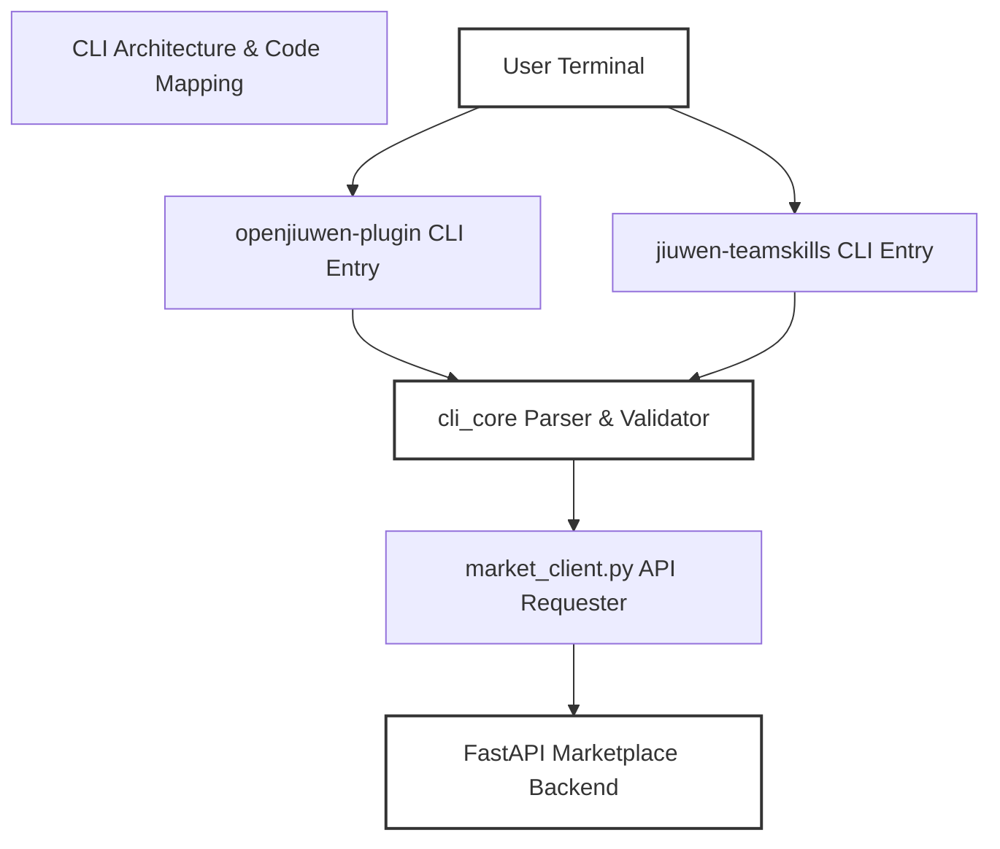
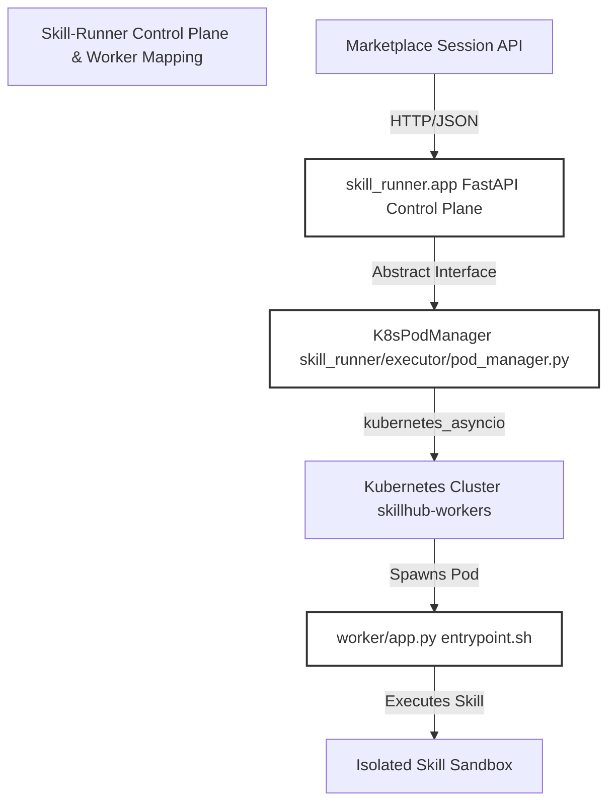
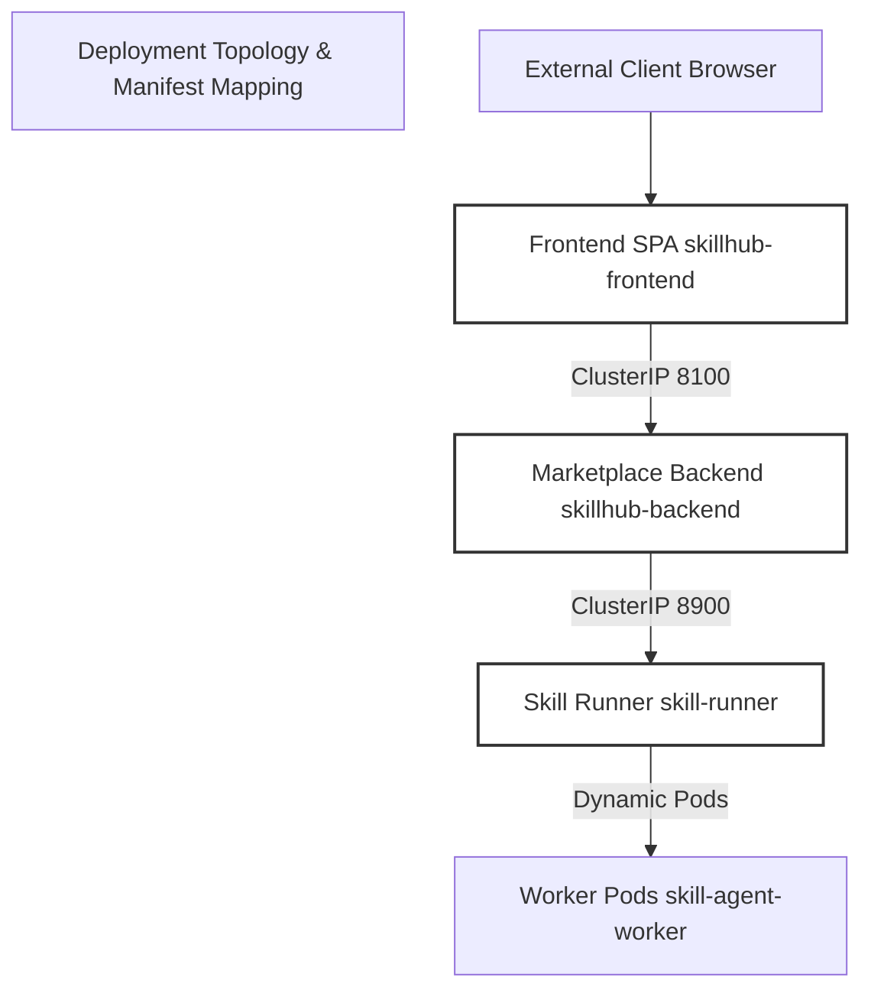

<!-- source: DeepWiki mcp.deepwiki.com · repo openJiuwen-ai/skillhub · page 5 Tooling, Playground and Deployment · fetched 2026-11-02 -->

# Tooling, Playground and Deployment

Relevant source files

The following files were used as context for generating this wiki page:

- [cli/README.md](cli/README.md)
- [cli/openjiuwen_plugin/parsers.py](cli/openjiuwen_plugin/parsers.py)
- [docker/Dockerfile.skill-runner](docker/Dockerfile.skill-runner)
- [docker/k8s/frontend-deploy.yaml](docker/k8s/frontend-deploy.yaml)
- [docker/k8s/marketplace-deploy.yaml](docker/k8s/marketplace-deploy.yaml)
- [docker/k8s/skill-runner-config.yaml](docker/k8s/skill-runner-config.yaml)
- [docker/k8s/skill-runner-deploy.yaml](docker/k8s/skill-runner-deploy.yaml)
- [docker/skill-agent-worker/entrypoint.sh](docker/skill-agent-worker/entrypoint.sh)
- [docs/zh/README.md](docs/zh/README.md)
- [skill-runner/executor/pod_manager.py](skill-runner/executor/pod_manager.py)
- [skill-runner/pyproject.toml](skill-runner/pyproject.toml)

This section covers the operational infrastructure, development tooling, playground execution sandboxes, and packaging systems for openJiuwen Agentic Hub (SkillHub). It provides a high-level overview of the command-line interfaces (`cli/`), the `skill-runner` microservice sandbox architecture (`skill-runner/`), and container/Kubernetes deployment assets (`docker/`).

For detailed technical references, refer to the child pages:
- [CLI Packages](#5.1)
- [Skill Runner and Playground](#5.2)
- [Deployment and Operations](#5.3)

Sources: `cli/README.md:1-10` [cli/README.md:1-10](), `docker/Dockerfile.skill-runner:1-8` [docker/Dockerfile.skill-runner:1-8]()

---

## 5.1 CLI Packages

The SkillHub CLI ecosystem provides commands for developers to scaffold, validate, pack, publish, search, install, and delete assets and plugins from the marketplace [cli/openjiuwen_plugin/parsers.py:10-223](). The codebase features two independently installable CLI tools sharing a common core package (`cli_core/`):
1. `openjiuwen-plugin`: Manages plugin types such as `tools`, `mcp-stdio`, `restful-api`, and `skill` [cli/README.md:7]().
2. `jiuwen-teamskills`: Tailored for swarm skills and agentic bundles (`swarmskill`, `skill`) [cli/README.md:8]().

Sources: `cli/README.md:1-10` [cli/README.md:1-10](), `cli/openjiuwen_plugin/parsers.py:10-25` [cli/openjiuwen_plugin/parsers.py:10-25]()

For comprehensive details on command structures, parsers, and test suites, see [CLI Packages](#5.1).

---

## 5.2 Skill Runner and Playground

The `skill-runner` service provides a secure, isolated sandbox playground for evaluating skills and agent plugins [skill-runner/pyproject.toml:1-4](). It consists of a FastAPI control plane [docker/Dockerfile.skill-runner:1-5](), dynamic pod executors (`PodManager`, `K8sPodManager`) [skill-runner/executor/pod_manager.py:16-35](), worker applications, and session stores.

Sources: `docker/Dockerfile.skill-runner:1-7` [docker/Dockerfile.skill-runner:1-7](), `skill-runner/executor/pod_manager.py:16-60` [skill-runner/executor/pod_manager.py:16-60](), `docker/k8s/skill-runner-config.yaml:18-20` [docker/k8s/skill-runner-config.yaml:18-20]()

For complete documentation on session state management, `llm_proxy`, resource limits, and worker communication, see [Skill Runner and Playground](#5.2).

---

## 5.3 Deployment and Operations

SkillHub supports containerized deployments via Dockerfiles [docker/Dockerfile.skill-runner:1-7](), `docker-compose`, and Kubernetes manifests (`docker/k8s/`) [docker/k8s/marketplace-deploy.yaml:1-5]() [docker/k8s/skill-runner-deploy.yaml:1-5]() [docker/k8s/frontend-deploy.yaml:1-5]() for high-availability environments. 

Sources: `docker/k8s/frontend-deploy.yaml:21-33` [docker/k8s/frontend-deploy.yaml:21-33](), `docker/k8s/marketplace-deploy.yaml:21-28` [docker/k8s/marketplace-deploy.yaml:21-28](), `docker/k8s/skill-runner-deploy.yaml:22-29` [docker/k8s/skill-runner-deploy.yaml:22-29]()

For details on initialization scripts, container build arguments, troubleshooting runbooks, and configuration templates, see [Deployment and Operations](#5.3).

---

