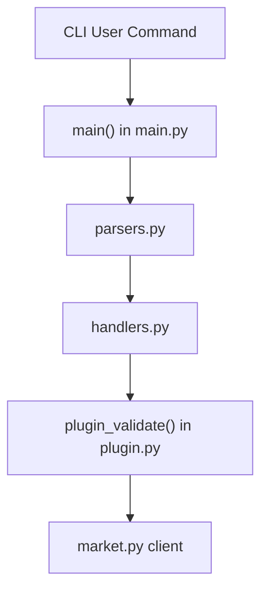
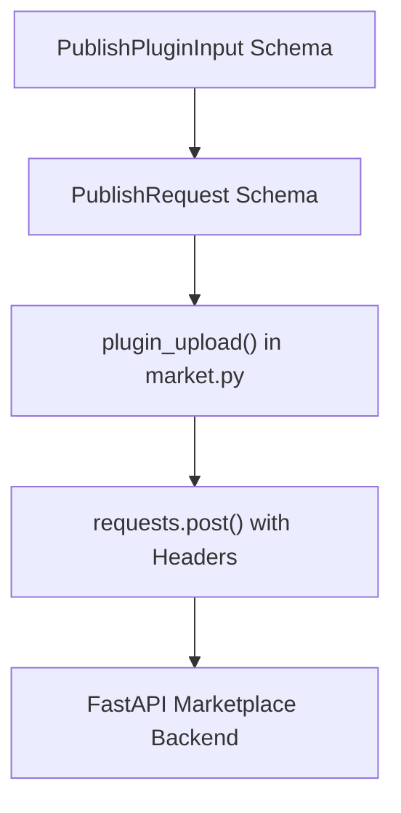

<!-- source: DeepWiki mcp.deepwiki.com · repo openJiuwen-ai/skillhub · page 5.1 CLI Packages · fetched 2026-11-02 -->

# CLI Packages

Relevant source files

The following files were used as context for generating this wiki page:

- [CONTRIBUTING.md](CONTRIBUTING.md)
- [SECURITY.md](SECURITY.md)
- [cli/README.md](cli/README.md)
- [cli/cli_core/handlers.py](cli/cli_core/handlers.py)
- [cli/cli_core/market.py](cli/cli_core/market.py)
- [cli/cli_core/plugin.py](cli/cli_core/plugin.py)
- [cli/cli_core/schemas/__init__.py](cli/cli_core/schemas/__init__.py)
- [cli/cli_core/schemas/plugin.py](cli/cli_core/schemas/plugin.py)
- [cli/jiuwen_teamskills/README.md](cli/jiuwen_teamskills/README.md)
- [cli/jiuwen_teamskills/main.py](cli/jiuwen_teamskills/main.py)
- [cli/jiuwen_teamskills/parsers.py](cli/jiuwen_teamskills/parsers.py)
- [cli/jiuwen_teamskills/pyproject.toml](cli/jiuwen_teamskills/pyproject.toml)
- [cli/jiuwen_teamskills/tests/test_jiuwen_teamskills.py](cli/jiuwen_teamskills/tests/test_jiuwen_teamskills.py)
- [cli/openjiuwen_plugin/README.md](cli/openjiuwen_plugin/README.md)
- [cli/openjiuwen_plugin/__init__.py](cli/openjiuwen_plugin/__init__.py)
- [cli/openjiuwen_plugin/main.py](cli/openjiuwen_plugin/main.py)
- [cli/openjiuwen_plugin/parsers.py](cli/openjiuwen_plugin/parsers.py)
- [cli/openjiuwen_plugin/pyproject.toml](cli/openjiuwen_plugin/pyproject.toml)
- [cli/openjiuwen_plugin/tests/test_openjiuwen_plugin.py](cli/openjiuwen_plugin/tests/test_openjiuwen_plugin.py)
- [marketplace/plugins_market/imports/bundle_safe_extract.py](marketplace/plugins_market/imports/bundle_safe_extract.py)
- [marketplace/plugins_market/imports/skill_import_service.py](marketplace/plugins_market/imports/skill_import_service.py)

This page documents the CLI packages within the openJiuwen Agentic Hub repository (`cli_core`, `openjiuwen_plugin`, and `jiuwen_teamskills`). These command-line tools provide developer scaffolding, local validation, asset packaging, and direct interaction with the marketplace backend for tools, MCP servers, RESTful APIs, agent skills, and swarm skills.

Sources: `cli/README.md:1-10`()

---

## 1. Architecture and Shared Core (`cli_core`)

The `cli_core` package contains shared business logic, parameter validation, local packaging routines, and HTTP request clients [cli/README.md:3-9](). It is bundled into both the `openjiuwen-plugin` and `jiuwen-teamskills` wheel distributions.

Key modules within `cli_core`:
- `cli_core/plugin.py`: Handles local directory initialization (`plugin_init`), structural validation (`plugin_validate`), and zip archiving (`plugin_pack`, `plugin_pack_skill_bundle`) [cli/cli_core/plugin.py:34-60]() [cli/cli_core/handlers.py:20-29]().
- `cli_core/market.py`: Implements marketplace REST API calls (`plugin_search`, `plugin_upload`, `plugin_delete`, `plugin_info`) along with authentication header construction and server-side error translation [cli/cli_core/market.py:1-43]() [cli/cli_core/handlers.py:11-19]().
- `cli_core/handlers.py`: Translates parsed command-line arguments into actions executed by `plugin.py` and `market.py`.

*Figure 1: Shared Core Execution Flow mapping natural language commands to `cli_core` code entities.*

Sources: `cli/README.md:3-9`(), `cli/cli_core/plugin.py:34-60`(), `cli/cli_core/market.py:1-43`()

---

## 2. OpenJiuwen Plugin CLI (`openjiuwen_plugin`)

The `openjiuwen_plugin` package provides the `openjiuwen-plugin` executable [cli/README.md:5-7](). It targets traditional agent plugins, tools, MCP stdio integrations, and restful APIs.

### Commands and Parsers
Supported subcommands configured in `openjiuwen_plugin.parsers` include:
- `init`: Scaffolds a new plugin directory structure [cli/openjiuwen_plugin/parsers.py:10-22]() (`tools`, `mcp-stdio`, `restful-api`, `skill`).
- `validate`: Verifies local configuration files (`plugin.yaml`, `README.md`, Python module structures) [cli/openjiuwen_plugin/parsers.py:24-27]().
- `pack`: Compresses a plugin directory into a deterministic `.zip` archive [cli/openjiuwen_plugin/parsers.py:29-38]().
- `publish`: Uploads a plugin zip file or directory with token authentication [cli/openjiuwen_plugin/parsers.py:40-84]().
- `info`, `search`, `delete`, `install`: Interacts with the marketplace API for asset lifecycle management [cli/openjiuwen_plugin/parsers.py:85-223]().

Sources: `cli/openjiuwen_plugin/parsers.py:10-223`(), `cli/README.md:5-7`()

---

## 3. Jiuwen TeamSkills CLI (`jiuwen_teamskills`)

The `jiuwen_teamskills` package provides the `jiuwen-teamskills` executable [cli/README.md:5-8](). It specializes in `swarmskill` and `skill` assets, enforcing multi-role contracts via `SKILL.md` frontmatter validation [cli/cli_core/plugin.py:62-117]().

### Swarm Skill Contracts
Team skills require frontmatter defining a non-empty `roles` list containing at least two unique role definitions [cli/cli_core/plugin.py:62-90]():
- Validated via `teamskill_validate_directory()` and `_collect_teamskill_role_errors()` in `cli_core.plugin` [cli/cli_core/plugin.py:62-117]().
- Parsers in `jiuwen_teamskills.parsers` support legacy command aliases (`init-teamskills`, `search-teamskills`) while mapping requests to the shared handlers [cli/jiuwen_teamskills/parsers.py:146-211]().

Sources: `cli/cli_core/plugin.py:62-117`(), `cli/jiuwen_teamskills/parsers.py:146-211`(), `cli/README.md:5-8`()

---

## 4. Market Client and Schemas

Interactions with the marketplace backend rely on strict Pydantic validation models [cli/cli_core/schemas/plugin.py:101-178]() and HTTP client headers [cli/cli_core/market.py:53-70]().

### Request Validation & Headers
- `PublishPluginInput`: Validates local paths, semantic versioning rules (`MARKETPLACE_VERSION_PATTERN`), or Git commit SHAs (`MARKETPLACE_GIT_COMMIT_VERSION_PATTERN`) [cli/cli_core/schemas/plugin.py:13-15]() [cli/cli_core/schemas/plugin.py:101-131]().
- `PublishRequest`: Ensures zip file existence and validates `checksum_sha256` inputs [cli/cli_core/schemas/plugin.py:141-171]().
- `_cli_request_headers`: Builds user-agent strings (`open-jiuwen-plugin` or `jiuwen-teamskills`) along with bearer tokens or system tokens [cli/cli_core/market.py:44-70]().
- `_market_translate_message_for_cli`: Translates raw backend responses or Chinese error messages into standardized CLI error strings [cli/cli_core/market.py:81-130]().

*Figure 2: Publishing request flow linking Pydantic validation schemas to network execution.*

Sources: `cli/cli_core/schemas/plugin.py:101-171]`, `cli/cli_core/market.py:44-130`()

---

## 5. Testing Suites

Both plugin and teamskills CLIs include comprehensive `pytest` test suites verifying CLI argument parsing, scaffold generation, local validation rules, and error handling [cli/openjiuwen_plugin/tests/test_openjiuwen_plugin.py:51-165]() [cli/jiuwen_teamskills/tests/test_jiuwen_teamskills.py:18-162]().

- `test_openjiuwen_plugin.py`: Validates schema checks, tool mismatch detection, version string patterns, and initialization commands [cli/openjiuwen_plugin/tests/test_openjiuwen_plugin.py:51-165]().
- `test_jiuwen_teamskills.py`: Verifies swarm skill directory scaffolding, `SKILL.md` role validation errors, and legacy runtime type mapping [cli/jiuwen_teamskills/tests/test_jiuwen_teamskills.py:18-162]().

Sources: `cli/openjiuwen_plugin/tests/test_openjiuwen_plugin.py:51-165`(), `cli/jiuwen_teamskills/tests/test_jiuwen_teamskills.py:18-162`()

---

