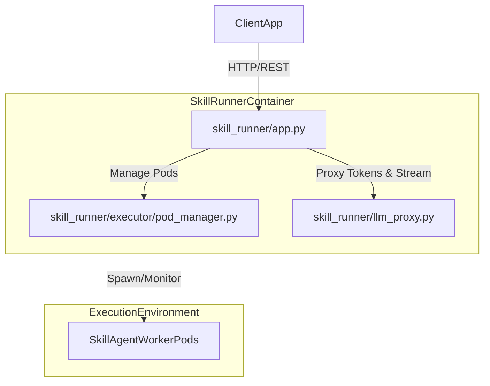
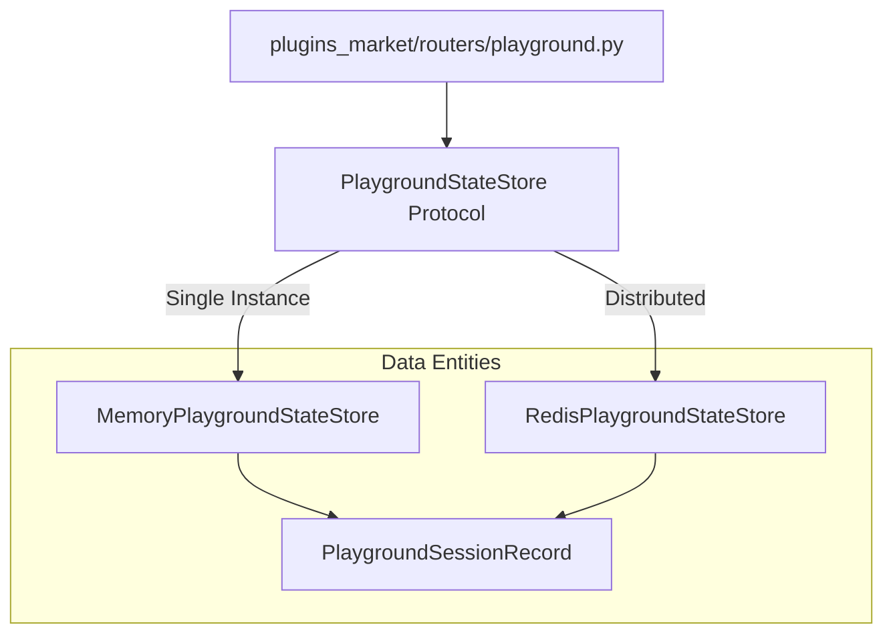
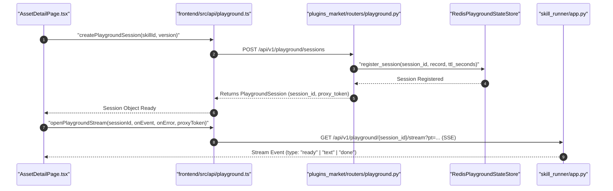

<!-- source: DeepWiki mcp.deepwiki.com · repo openJiuwen-ai/skillhub · page 5.2 Skill Runner and Playground · fetched 2026-11-02 -->

# Skill Runner and Playground

Relevant source files

The following files were used as context for generating this wiki page:

- [.dockerignore](.dockerignore)
- [docker/Dockerfile.skill-runner](docker/Dockerfile.skill-runner)
- [docker/skill-agent-worker/entrypoint.sh](docker/skill-agent-worker/entrypoint.sh)
- [docs/zh/README.md](docs/zh/README.md)
- [frontend/src/App.tsx](frontend/src/App.tsx)
- [frontend/src/api/playground.ts](frontend/src/api/playground.ts)
- [frontend/src/pages/LoginPage.tsx](frontend/src/pages/LoginPage.tsx)
- [frontend/src/pages/MyPluginDetailPage.tsx](frontend/src/pages/MyPluginDetailPage.tsx)
- [frontend/src/pages/MyProfilePage.tsx](frontend/src/pages/MyProfilePage.tsx)
- [marketplace/plugins_market/core/cache.py](marketplace/plugins_market/core/cache.py)
- [marketplace/plugins_market/core/oauth_session_store.py](marketplace/plugins_market/core/oauth_session_store.py)
- [marketplace/plugins_market/core/playground_state.py](marketplace/plugins_market/core/playground_state.py)
- [marketplace/plugins_market/core/redis_client.py](marketplace/plugins_market/core/redis_client.py)
- [marketplace/plugins_market/routers/site_public.py](marketplace/plugins_market/routers/site_public.py)
- [skill-runner/executor/pod_manager.py](skill-runner/executor/pod_manager.py)
- [skill-runner/llm_proxy.py](skill-runner/llm_proxy.py)
- [skill-runner/pyproject.toml](skill-runner/pyproject.toml)

## Purpose and Scope
This document details the architecture and implementation of the **Skill Runner** microservice and the marketplace **Playground** subsystem. The `skill-runner` service acts as an isolated control-plane handling execution delegation, container pod lifecycle management via `pod_manager`, and token-aware LLM proxying. Concurrently, the marketplace backend (`plugins_market`) provides state persistence and API endpoints for managing interactive user sessions, streaming SSE events, and resource quotas.

Sources: `docker/Dockerfile.skill-runner:1-46]`, `marketplace/plugins_market/core/playground_state.py:1-53]`, `frontend/src/api/playground.ts:1-44]()`

---

## 1. Skill Runner Control Plane Architecture
The `skill-runner` service is packaged as a dedicated microservice container (`docker/Dockerfile.skill-runner:1-46]`). Unlike execution worker pods, the control plane container does not execute user-provided code directly; instead, it exposes a FastAPI application (`skill_runner/app.py`) that manages session lifecycles, authenticates requests, and routes execution tasks to sandboxed worker instances or Kubernetes pods.

*Figure 1: Skill Runner Control Plane Routing and Pod Management.*

Sources: `docker/Dockerfile.skill-runner:1-46]()`

---

## 2. Execution Subsystem and Pod Manager
The execution subsystem relies on `skill_runner/executor/pod_manager.py` to bridge control-plane requests with dynamic container or process isolation. 
- **Lifecycle Management**: It provisions, health-checks, and tears down execution environments per skill session.
- **Security Boundary**: Ensures user code execution is constrained within dedicated worker boundaries (`docker/skill-agent-worker/entrypoint.sh`), preventing untrusted code execution from breaching the marketplace core or control-plane database.

Sources: `docker/Dockerfile.skill-runner:1-8]()`

---

## 3. LLM Proxy and Streaming Token Management
`skill_runner/llm_proxy.py` intercepts interactions between executing skills and Large Language Model (LLM) endpoints.
- **Token Accounting**: Tracks input and output token usage per session, feeding aggregate statistics back to control-plane logs and state monitors.
- **SSE Streaming**: Manages Server-Sent Events (SSE) connections, forwarding incremental text deltas, reasoning steps, and tool execution callbacks to the frontend playground client.

Sources: `frontend/src/api/playground.ts:15-43]()`

---

## 4. Marketplace Playground State Store and APIs
The marketplace backend handles session coordination and distributed state synchronization through `marketplace/plugins_market/core/playground_state.py`. It implements a dual storage pattern (in-memory vs. Redis) governed by the `PlaygroundStateStore` protocol.

### State Persistence Implementation
- **`MemoryPlaygroundStateStore`**: Used for single-instance deployments, maintaining local Python dictionaries for active sessions (`self._sessions`), per-user session mappings (`self._user_sessions`), and concurrency locks (`self._create_locks`) `[marketplace/plugins_market/core/playground_state.py:57-105]()`.
- **`RedisPlaygroundStateStore`**: Used for multi-instance deployments, storing session hashes (`pg:sess:{sid}`), user session sets (`pg:usess:{uid}`), and distributed creation locks (`pg:clk:{uid}`) to prevent race conditions during heavy concurrent session provisioning `[marketplace/plugins_market/core/playground_state.py:106-191]()`.
- **`PlaygroundSessionRecord`**: Dataclass capturing runtime metadata such as `user_id`, capability tokens (`token`), and assigned runner addresses (`runner_addr`) `[marketplace/plugins_market/core/playground_state.py:21-26]()`.

*Figure 2: Playground State Store Code Entity Architecture.*

Sources: `marketplace/plugins_market/core/playground_state.py:32-191]()`

### Frontend API Client
The React frontend interacts with playground endpoints through `frontend/src/api/playground.ts`:
- `createPlaygroundSession(skillId, version, skillType)`: Initializes a session on the backend `[frontend/src/api/playground.ts:45-56]()`.
- `sendPlaygroundMessage(sessionId, content)`: Dispatches natural language user inputs to active session workers `[frontend/src/api/playground.ts:58-60]()`.
- `openPlaygroundStream(sessionId, onEvent, onError, proxyToken)`: Establishes an `EventSource` connection for real-time SSE event consumption, appending query parameter authentication tokens (`?pt=`) when necessary `[frontend/src/api/playground.ts:78-97]()`.
- `uploadPlaygroundFile(sessionId, file)`: Form-data upload helper for session working directories `[frontend/src/api/playground.ts:67-76]()`.

Sources: `frontend/src/api/playground.ts:1-129]()`

---

## 5. End-to-End Playground Data Flow
The sequence below illustrates the data exchange when a user initiates and interacts with a playground session across the React frontend, marketplace backend, and skill-runner control plane.

*Figure 3: Sequence Flow for Playground Session Initialization and Event Streaming.*

Sources: `marketplace/plugins_market/core/playground_state.py:148-163]`, `frontend/src/api/playground.ts:45-97]()`

---

