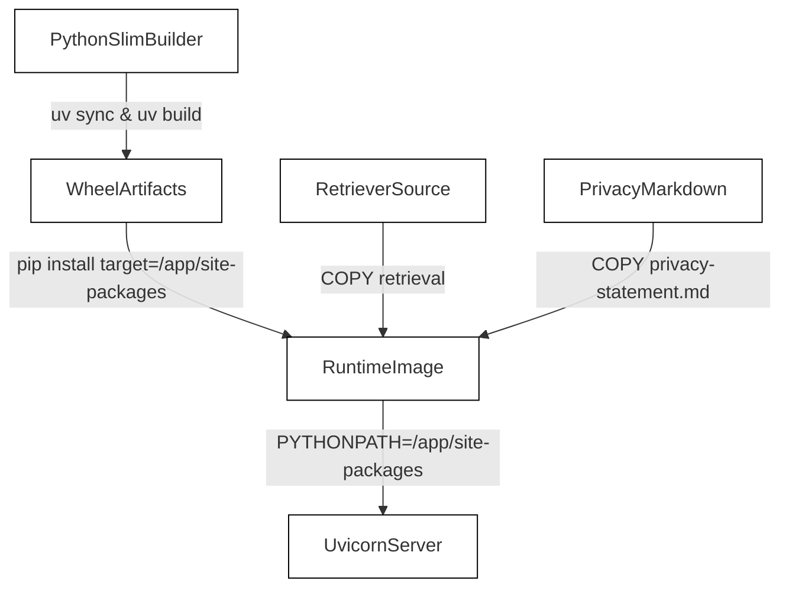
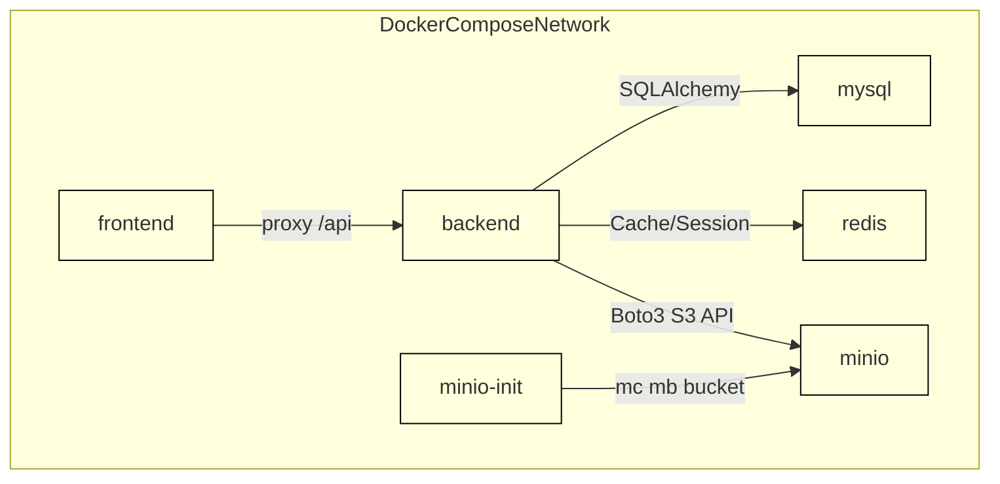

<!-- source: DeepWiki mcp.deepwiki.com · repo openJiuwen-ai/skillhub · page 5.3 Deployment and Operations · fetched 2026-11-02 -->

# Deployment and Operations

Relevant source files

The following files were used as context for generating this wiki page:

- [.env.example](.env.example)
- [.gitattributes](.gitattributes)
- [docker/Dockerfile.skillhub-backend](docker/Dockerfile.skillhub-backend)
- [docker/docker-compose.override.yml.example](docker/docker-compose.override.yml.example)
- [docker/docker-compose.yml](docker/docker-compose.yml)
- [docker/k8s/frontend-deploy.yaml](docker/k8s/frontend-deploy.yaml)
- [docker/k8s/marketplace-deploy.yaml](docker/k8s/marketplace-deploy.yaml)
- [docker/k8s/skill-runner-config.yaml](docker/k8s/skill-runner-config.yaml)
- [docker/k8s/skill-runner-deploy.yaml](docker/k8s/skill-runner-deploy.yaml)
- [docker/mysql-init/01-init.sh](docker/mysql-init/01-init.sh)
- [docker/update_version.sh](docker/update_version.sh)
- [frontend/.gitignore](frontend/.gitignore)
- [frontend/nginx/default.hub.conf.template](frontend/nginx/default.hub.conf.template)
- [frontend/nginx/default.root.conf.template](frontend/nginx/default.root.conf.template)
- [marketplace/plugins_market/core/config.py](marketplace/plugins_market/core/config.py)
- [marketplace/pyproject.toml](marketplace/pyproject.toml)

## Purpose and Scope
This document covers the containerization, orchestration, environment configuration, database initialization, Kubernetes deployment manifests, version management, and operational runbooks for the openJiuwen Agentic Hub (SkillHub). It provides complete technical details on how the FastAPI backend, React frontend, MySQL database, Redis cache, and S3-compatible storage (MinIO/OBS) are packaged and deployed across local development and production environments.

Sources: `docker/Dockerfile.skillhub-backend` [docker/Dockerfile.skillhub-backend:1-81](), `docker/docker-compose.yml` [docker/docker-compose.yml:1-165](), `marketplace/plugins_market/core/config.py` [marketplace/plugins_market/core/config.py:1-162]()

---

## 1. Container Build Pipeline and Dockerfile Architecture
The backend container image is built using a multi-stage approach defined in `docker/Dockerfile.skillhub-backend` [docker/Dockerfile.skillhub-backend:1-81](). 

### Build Stages
1. **Builder Stage (`builder`)**: Uses `python:3.11-slim-bookworm` [docker/Dockerfile.skillhub-backend:2-2](). It installs `uv` [docker/Dockerfile.skillhub-backend:14-16]() as the package manager, synchronizes dependencies specified in `marketplace/pyproject.toml` [docker/Dockerfile.skillhub-backend:13-19](), and builds a distribution wheel into `/app/dist` [docker/Dockerfile.skillhub-backend:20-20]().
2. **Runtime Stage (`runtime`)**: Uses a clean python slim image [docker/Dockerfile.skillhub-backend:23-23]() and installs `git` and `ca-certificates` for Git-source repository operations [docker/Dockerfile.skillhub-backend:36-43](). It creates a non-root system user `app` [docker/Dockerfile.skillhub-backend:45-47](), installs the built wheel into a custom target path `/app/site-packages` [docker/Dockerfile.skillhub-backend:53-60](), and copies retrieval sources and privacy markdown files [docker/Dockerfile.skillhub-backend:66-69]().

*Figure 5.3.1: Multi-stage Docker build data flow for `docker/Dockerfile.skillhub-backend`.*

Sources: `docker/Dockerfile.skillhub-backend` [docker/Dockerfile.skillhub-backend:1-81](), `marketplace/pyproject.toml` [marketplace/pyproject.toml:1-44]()

---

## 2. Local Orchestration with Docker Compose
Local development orchestration is managed via `docker/docker-compose.yml` [docker/docker-compose.yml:1-165](), which brings up six interconnected services: `mysql`, `redis`, `minio`, `minio-init`, `backend`, and `frontend`.

### Service Topology
* **`mysql`**: MySQL 8.0 instance configured with `utf8mb4` [docker/docker-compose.yml:29-50](), mounting initialization scripts from `docker/mysql-init` and baseline DDLs.
* **`redis`**: Redis 7-alpine cache instance [docker/docker-compose.yml:54-66]() utilized for OAuth sessions and index synchronization.
* **`minio`**: S3-compatible object storage [docker/docker-compose.yml:74-85]() exposing API ports on host interfaces.
* **`minio-init`**: An ephemeral container executing `mc` client commands to provision the required storage bucket [docker/docker-compose.yml:87-104]().
* **`backend`**: The FastAPI marketplace service built via `Dockerfile.skillhub-backend` [docker/docker-compose.yml:105-146]().
* **`frontend`**: React/Vite SPA served behind Nginx, proxying `/api` requests to the backend [docker/docker-compose.yml:147-161]().

*Figure 5.3.2: Local development service topology in `docker/docker-compose.yml`.*

Developers can bypass local services using `docker/docker-compose.override.yml.example` to point to external databases or object storage [docker/docker-compose.override.yml.example:1-80]().

Sources: `docker/docker-compose.yml` [docker/docker-compose.yml:1-165](), `docker/docker-compose.override.yml.example` [docker/docker-compose.override.yml.example:1-80]()

---

## 3. Database Initialization and Schema Deployment
Database schema bootstrapping is handled automatically during initial container start by `docker/mysql-init/01-init.sh` [docker/mysql-init/01-init.sh:1-56]().

### Execution Sequence
1. **Baseline DDL**: Executes table creation scripts in foreign-key dependency order from `/sql/baseline/openjiuwen_market/DDL/` including `market_assets.sql`, `market_asset_versions.sql`, `market_asset_interactions.sql`, `audit_logs.sql`, `plugin_fetch_records.sql`, and `site_notifications.sql` [docker/mysql-init/01-init.sh:20-28]().
2. **Incremental Migrations**: Applies successive schema versions (`v0.0.2.B001`, `B002`, `B003`) containing table extensions, audit log rebuilds, group management tables, and playground usage trackers [docker/mysql-init/01-init.sh:29-50]().

Sources: `docker/mysql-init/01-init.sh` [docker/mysql-init/01-init.sh:1-56]()

---

## 4. Kubernetes Production Manifests
For production deployments, Kubernetes manifests under `docker/k8s/` provide declarative control over deployments, services, and configuration maps.

* **Backend Deployment**: Defined in `docker/k8s/marketplace-deploy.yaml` [docker/k8s/marketplace-deploy.yaml:1-72](), running `skillhub-backend` with liveness, readiness, and startup probes pointing to `/api/health`.
* **Frontend Deployment**: Defined in `docker/k8s/frontend-deploy.yaml` [docker/k8s/frontend-deploy.yaml:1-67](), exposing `skillhub-frontend` via a `ClusterIP` service pointing to Nginx.
* **Skill Runner Services**: Configured via `docker/k8s/skill-runner-config.yaml` [docker/k8s/skill-runner-config.yaml:1-47]() and `docker/k8s/skill-runner-deploy.yaml` [docker/k8s/skill-runner-deploy.yaml:1-73]() for isolated task execution.

Sources: `docker/k8s/marketplace-deploy.yaml` [docker/k8s/marketplace-deploy.yaml:1-72](), `docker/k8s/frontend-deploy.yaml` [docker/k8s/frontend-deploy.yaml:1-67](), `docker/k8s/skill-runner-deploy.yaml` [docker/k8s/skill-runner-deploy.yaml:1-73](), `docker/k8s/skill-runner-config.yaml` [docker/k8s/skill-runner-config.yaml:1-47]()

---

## 5. Configuration Management
Configuration values are loaded using Pydantic `BaseSettings` inside `marketplace/plugins_market/core/config.py` [marketplace/plugins_market/core/config.py:31-162]() and mapped from environment files like `.env.example` [.env.example:1-162]().

Key configuration categories include:
* **Service Binding**: `STORE_HOST`, `STORE_PORT`, and `MARKET_DEBUG` [marketplace/plugins_market/core/config.py:34-42]()
* **Database & Cache**: `DB_TYPE`, `DB_HOST`, `REDIS_HOST`, and `MARKET_REDIS_PASSWORD` [.env.example:29-47]()
* **Object Storage**: `STORAGE_TYPE`, `MARKET_BUCKET_NAME`, `MARKET_S3_ENDPOINT`, and credential modes [.env.example:106-135]()
* **OAuth Providers**: GitCode, GitHub, and AgentOS callback configuration [.env.example:63-104]()
* **Rate Limiting**: Sliding window rate limits across public reads, publishes, and batch interactions [.env.example:146-162]()

Sources: `marketplace/plugins_market/core/config.py` [marketplace/plugins_market/core/config.py:31-162](), `.env.example` [.env.example:1-162]()

---

## 6. Version Script and Operational Runbooks
Version synchronization across Python packages and Node packages is automated via `docker/update_version.sh` [docker/update_version.sh:1-9](), which updates `pyproject.toml` and `package.json` in tandem [docker/update_version.sh:3-9]().

### Troubleshooting Runbook
* **Health Check Failures**: Verify container connectivity by querying `curl http://localhost:8100/api/health` [docker/docker-compose.yml:20-21]() or inspecting health check probes in Kubernetes deployments [docker/k8s/marketplace-deploy.yaml:39-51]().
* **Database Connection Issues**: Ensure MySQL initialization completed successfully [docker/mysql-init/01-init.sh:1-56]() and check that `DB_HOST` resolves correctly within the container network.
* **Object Storage Presigned URL Errors**: Verify that `MARKET_S3_ENDPOINT` matches accessible hostnames or that host entries (e.g., `127.0.0.1 minio`) are configured correctly in local environments [docker/docker-compose.yml:10-13]().

Sources: `docker/update_version.sh` [docker/update_version.sh:1-9](), `docker/docker-compose.yml` [docker/docker-compose.yml:1-165](), `docker/mysql-init/01-init.sh` [docker/mysql-init/01-init.sh:1-56]()

---

